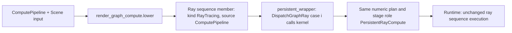

# Compute ray tracing design

Status: implementation contract, 2026-10-24. Baseline `origin/develop`
`dbbf7461`. Phase C0 decided D1 and D4 and cleared the D5 triangle-identity
risk; see [section 3](#3-phase-c0-evidence). This describes work to build. Read [requirements](requirements.md)
and [tasks](tasks.md). AGENTS.md, steering, ADR 0003 and the canonical
[render graph authoring guide](../../../docs/development/render-graph-authoring.md)
remain authoritative. Line references are to the baseline and will drift; the
symbol names are the stable anchors.

## 1. What already exists

A `RayTracingPipeline` node is already a compute kernel. There are no dedicated
ray stages or shader tables.

- **Builder.** `render_graph_ray.py` `lower` validates the node and
  `expand_programs` synthesizes one compute program, `GraphRayCompute`. It
  wraps the authored raygen/miss/closest-hit callbacks around the renderer's
  `ComputeMain` (`renderer_gpu_preview.slang`), which uses inline `RayQuery`.
- **Persistent wrapper.** When a configuration has more than one ray pass, or
  any `Buffer`, `persistent_wrapper` puts each authored source in its own
  namespace. It emits `switch (GetGraphPassIndex())` dispatchers for raygen,
  closest-hit and miss, and declares `GraphBuffer0/1` at slots 6/7.
- **Pass index.** The runtime passes the index in
  `Sampling.z << LUDUS_GRAPH_PASS_INDEX_SHIFT` (`gpu_preview_services.h`).
- **Ordering.** Every pass in the sequence is encoded through one
  `rhi::OrderedGraph` (`PrepareGpuPreviewGraphSequence`,
  `gpu_preview_graph.cpp`). It is limited to four consecutive passes
  (`MAX_RAY_PASSES`).
- **Fused post-processing.** Accumulate, ToneMap and Denoise accept only a
  `RayTracing` producer (`render_graph.py` checks `producer['kind']`), and are
  fused into the producing dispatch.
- **Color output.** The kernel writes a float4 storage buffer. A
  renderer-owned image pass copies it into the RGBA8 attachment. The RHI has no
  storage textures (`profile.h`: "currently unimplemented").
- **Generic compute.** `ComputePipeline` nodes validate structurally
  (`render_graph_pipeline.py`), then `_lower_pipeline` (`render_graph.py`)
  rejects all of them with `Capability`.

The observation that shapes the design: an authored scene-aware ray-generation
function, `float3 GenerateRay(SceneContext, RayLaunch, inout RayQueryContext)`,
is already a complete per-pixel compute kernel. It can call `TraceClosest`,
`TestVisibility`, sampling and material helpers directly. Hit and miss callbacks
only matter when the kernel calls `TraceAndShade`.

## 2. Selected design

**A scene compute pass is a member of the existing ray sequence whose callback
set is a single authored kernel.** It reuses the following unchanged:

- the persistent wrapper;
- binding ABI 0-9;
- the 64×1×1 workgroup;
- per-pass index dispatch;
- ordered-graph hazard tracking;
- fused Accumulate/ToneMap/Denoise;
- the color image pass;
- capability selection.



Why not a separate compute executor: it would duplicate several things —
binding/scene packing, the ordered sequence, fused post-processing, the image
copy and selection. It would also need a storage-texture RHI feature that does
not exist. A separate executor becomes worthwhile only for generic (non-scene)
compute, which stays out of scope (C01).

### D1 Numeric representation (decided in C0: no format change)

In the offline plan, a scene compute pass is a `RayTracing` sequence member
with `source_kind: "ComputePipeline"` and a callback variant `[compute_id]`.
`lower_plan` emits the existing `Technique::RayTracing` pass record. The runtime
never reads `ray_programs` (verified: there are no references under
`modules/graphics/renderer/src` or `modules/content`). It selects code only
through the pass index. So `plan.h` `VERSION` 13 and `PACKAGE_VERSION` 17 stay
unchanged, and an older runtime executes such a package correctly.

Alternative: add `Technique::SceneCompute`. That would bump both versions and
add a runtime validation branch with identical execution. Choose it only if
review wants runtime diagnostics to name compute passes. That is what C08
allows.

**Decision (C0).** No format change. The C0 prototype ran a raygen-only kernel
(one `TraceClosest`, no `TraceAndShade`) followed by a pass that reads its hit
buffer. It used the unchanged `Technique::RayTracing` pass records, the
persistent wrapper and the runtime ray sequence, and no runtime source changed
(section 3.3). `SceneCompute` would add two version bumps and a decoder branch
with identical execution. Name compute passes in the offline plan summary and
builder diagnostics instead (D3).

### D2 Authored signature (recommended: raygen-shaped)

```slang
float3 TraceAndShadePixel(SceneContext scene, RayLaunch launch, inout RayQueryContext queries);
```

The manifest program uses `"stage": "compute"`, `"input": "RayLaunch"` and
`"output": "Radiance"`. The return value is the pass's linear radiance, which is
handled exactly like a raygen return: accumulation, tone mapping, the magenta
rule for nonfinite or negative values. A pass whose color is only an
intermediate returns `float3(0)`. The next pass in the chain overwrites the
color, as reservoir passes already do.

Legacy (non-scene) signatures are not admitted for compute; a scene compute
node requires `scene_interface`. `TraceAndShade` stays declared so shared helper
headers compile. For a compute pass index, the dispatcher has no hit/miss case,
so it reaches `default:` and latches `HasFailed` (C03).

### D3 Builder changes

- New module `scripts/python/ludus_tools/render_graph_compute.py` owns
  scene-compute lowering. It keeps `render_graph_ray.py` focused on the
  callback profile and shares its port checks through extracted helpers rather
  than a copy.
- `_lower_pipeline`:
  - a ComputePipeline with a Scene input goes to `render_graph_compute.lower`;
  - a ComputePipeline without one keeps the `Capability` failure, with the
    repair text extended to "add a Scene input for a scene compute pass".
- `render_graph_pipeline.py`:
  - a scene compute node accepts `"dimensions": "ColorTarget"` and
    `"state": {}`;
  - an explicit `group_size` must equal `[64, 1, 1]`;
  - `new_node` for generic compute is unchanged.
- `render_graph_build.py`:
  - manifest programs may declare `stage: compute` only with the C03 signature;
  - node/technique matching collects variants as `(compute_id,)` for compute
    members and `(rg, miss, ch)` for ray members;
  - any sequence that contains a compute member forces the persistent profile.
    `group_profiles` currently selects that profile by pass count or `Buffer`
    use; a single compute pass also needs it, because the plain `scene_wrapper`
    hard-wires one callback triple.
- `persistent_wrapper`: compute variants contribute only a raygen-position case.
  The closest-hit and miss switches omit their index.
- The `producer['kind'] == 'RayTracing'` checks need no change, because compute
  members keep that kind. Plan summary text and diagnostics name the source
  node kind.

**Implemented (C1).** Two choices refine this section:

- The `[64, 1, 1]` group-size rule is enforced at lowering, not during document
  validation. A saved scene compute draft with another size still loads, and the
  build reports a `Capability` diagnostic whose repair clears the field.
- In the manifest, the ray technique's `ray_generation`, `miss` and `closest_hit`
  defaults are optional as a group. A package whose ray passes are all
  node-owned, such as a graph with only scene compute passes, omits all three.
  `scene_interface` stays required for compute members.

### D4 Random decorrelation between passes (decided in C0: explicit dimension offsets)

Every pass is seeded from `SourceGeneration`, and `RayQueryContext` starts at
`NextRandomDimension = 0` (`scene_wrapper`). Two passes that both draw
automatic dimensions therefore see the same values for each pixel. C0 measured
this on Metal (section 3.2).

**Decision.** Each template pass draws from explicit dimensions with the
existing address overloads `SampleSceneRandom(RayLaunch, uint dimension)` and
`SelectLight(SceneContext, RayLaunch, uint dimension)`. They do not advance
or reset `RayQueryContext`, which keeps its "do not reset or copy this state"
contract. The dimension ranges are documented constants beside the hit record
encoding:

| Pass | Dimensions | Draws |
| --- | --- | --- |
| primary | `[0, PRIMARY_RANDOM_DIMENSION_COUNT)` = `[0, 2)` | subpixel jitter x, y |
| shade | `[2, 6)` | light selection, then the `SampleIncidentLight` `float3` |

Neither pass uses the automatic stream, so neither depends on how many automatic
draws the other made. (The baseline text named `SampleSceneRandom(queries,
dimension)`; that overload is the bounded-integer draw. The explicit-address
overload takes a `RayLaunch`.)

ReSTIR already solves the same problem differently. Its reuse passes address
`(pixel, GetGraphPassIndex())` instead of the scene API's `(pixel, 0)` scope
(`SampleReuseRandom` in `restir_di/main_shaders/reservoir.slang`). That is the
better choice for a pass whose dimension count is unbounded or data-dependent.
The C2 documentation names both patterns.

A wrapper-level salt (`NextRandomDimension = passIndex * stride`, or a pass
scope in `PixelRandomAddress`) is rejected. It would change the existing
ReSTIR and ordered-ray images, and it is unnecessary. If it is ever wanted, it
is a separate, versioned change.

### D5 Template (two passes)

```text
Scene, Camera, RenderSize
  -> primary  [ComputePipeline: scene, view, color rw, hits rw]
  -> shade    [ComputePipeline: scene, view, color rw, hits rw]
  -> Accumulate -> ToneMap -> Export
hits = Buffer { bytes_per_pixel: 32, extent: RenderSize }
```

The hit record is two `uint4` words per pixel, in `GraphBuffer0`:

| Word | x | y | z | w |
| --- | --- | --- | --- | --- |
| 0 | packed triangle + 1 (0 = miss/empty) | `asuint(DistanceWorld)` | `asuint(bary.x)` | `asuint(bary.y)` |
| 1 | `asuint(jitter.x)` | `asuint(jitter.y)` | `launch.SampleIndex` | flags (front face) |

Storing triangle + 1 makes the buffer's zero initialization (and zeroed resize
replacements) decode as "no hit" rather than as triangle 0 (C12). The sample
index in word 1 lets the shading pass reject a record that did not come from
this frame's primary dispatch.

- **Primary pass.** Draws the subpixel jitter, builds the ray with
  `MakeCameraRay` and issues one `TraceClosest`. It writes the record and
  returns `float3(0)`. Budget: one surface query.
- **Shade pass.** Validates and decodes the record and calls
  `GetSurfaceHit(scene, triangle, bary)`. It rebuilds the same camera ray from
  the stored jitter and restores `IncomingRay`, `DistanceWorld` and
  `IsFrontFace`, as `LoadVisibilitySurface` does. A miss returns
  `EvaluateEnvironment`. A hit returns emission plus one-sample direct lighting:
  - `SelectLight` and `SampleIncidentLight` choose the light sample;
  - `TestVisibility` from `SpawnSurfaceRay` traces the shadow ray;
  - `EvaluateStandardBsdf` evaluates the surface response.

  Budget: up to two visibility queries.

This is deliberately the shading model of a first-hit direct-lighting renderer.
The point is to demonstrate the compute split, not a new integrator.

**Correctness risk (cleared in C0).** The runtime builds a separate packed scene
and BLAS/TLAS per pass (`GpuPreviewRecord`, `gpu_preview_ray.cpp`). A packed
triangle index from pass 0 is only valid in pass 1 if both packings come out in
the same order from the same extraction. C0 showed that they do, by
construction and by test (section 3.1). The record keeps the packed triangle
index. The instance + primitive fallback (`FindVisibilityTriangle`) is needed
only if a later change builds passes of one sequence from different
extractions.

Snippet interface: inputs `scene: Scene`, `view: View`, `color: ColorTexture`;
output `color: ColorTexture`. The hits buffer is internal to the library
configuration.

Attribution in the shader sources:

- Laine, Karras and Aila, "Megakernels Considered Harmful: Wavefront Path
  Tracing on GPUs", HPG 2013. Its stage split motivated separating hit
  generation from shading. This template stops at two passes because ray
  queues and compaction are not available.
- Burns and Hunt, JCGT 2(2) 2013, for storing hit identity instead of shaded
  attributes. Keep the existing attribution in `visibility_buffer.slang`.

### D6 Editor

- `render_graph_pipeline_node.cpp`, `render_graph_pipeline.cpp`:
  - show the Launch size control (Match color target / Explicit) for a compute
    node that has a Scene input;
  - show group size as Automatic, with an Advanced override like ray state.
- `render_graph_scene_authoring.cpp`, `render_graph_shader_creation.cpp`,
  `render_graph_shader_interface.cpp`:
  - generate the C03 stub;
  - offer "Connect Scene bundle" for compute nodes;
  - list the compute signature in the interface panel.
- Templates:
  - catalog entries in `resources/render_graph_templates.json`;
  - embedding through the visibility-style `foreach` in
    `apps/editor/CMakeLists.txt`;
  - a new `PrepareComputeRayTracingConfiguration` in its own source file,
    dispatched from `PrepareConfigurationTemplate`. Generalizing the hard-coded
    visibility and ReSTIR prepare functions is a separate refactor.

### D7 Out of scope

Generic compute without Scene, storage textures, indirect dispatch, ray queues
and compaction (a full wavefront path tracer), more than four passes, sharing
one scene or TLAS across passes, browser execution, and software traversal.
Each needs its own RHI/runtime design.

## 3. Phase C0 evidence

Measured on `origin/develop` `64529832` (PR #589) on 2026-10-24, on this
Mac's Metal device (Apple GPU, `macos-clang-debug`). There is no Linux host
here. Vulkan evidence for the same GPU test comes only from the batch CI native
suite, which runs `ludus_render_graph_ray_tests` on Linux. Until that runs, the
claims below are Metal-only.

### 3.1 Triangle identity across passes

The index that a hit record stores is the *packed* triangle index, not the
native BVH primitive index. `Trace` (`renderer_gpu_preview.slang`) reads
`Order[CommittedPrimitiveIndex()]` from the packed scene. `CreateGpuPreviewRayGeometry`
emits BLAS primitive `i` from `Triangles[Order[i]]`. `PackGpuScene` writes the
triangle table in `Triangles` order. So `SurfaceHit.TriangleIndex` and
`GetSurfaceHit` both address `ReferenceSceneData::Triangles`.

That array has the same order in every pass of one sequence:

- `PrepareScene` (`render_graph.cpp`) initializes every ray pass in one loop
  from one `RenderGraphSceneDescription rayScene`. Only `rayScene.SceneData`
  changes per pass.
- `BuildMaterialGraphRayScene` (`scene_shader.cpp`) appends triangles in
  item → material slot → primitive order. It skips only zero-area triangles,
  and area depends only on positions. `SceneData` changes material indices,
  emitters and lights, but not which triangles exist or their order. Material
  errors fail the whole build; they never skip a triangle.
- `BuildReferenceBvh` (`reference_scene.cpp`) derives `Order` with a
  `StableSort` whose comparator breaks centroid ties by triangle index, so the
  result is a pure function of `Triangles`. The packed index does not depend on
  it anyway.

Camera-only updates reuse each pass's scene and do not rebuild it. The legacy
non-scene path builds a per-pass `Snapshot` instead, but scene compute requires
`scene_interface`, so that path does not apply.

Regression tests that keep this true:

- `scene_shader_tests.cpp`, "Ray passes built from one extraction pack
  triangles in identical order". It builds three items (six triangles, with a
  BVH that permutes them) under three `SceneData`, seed and width variants, and
  requires identical `Triangles` identities, positions and `Order`.
- `render_graph_ray_tests.cpp`, "A raygen-only pass hands packed triangle hits
  to a later pass" (section 3.3). On Metal, over four frames including a camera
  update, every recorded hit and miss in pass 0 resolved to the same triangle,
  instance and primitive in pass 1, with barycentrics, distance and
  reconstructed position within 1e-5. All 24 triangles in two instances were
  hit, on about 2,200 of the 6,144 pixels per frame.

### 3.2 Random seeding across passes

| Input | Source | Same in every pass? |
| --- | --- | --- |
| `Sampling.xy` / `RandomSeed` | `TryMakeRandomKey(Seed = SourceGeneration)` at creation (`render_graph_ray.cpp`); `TryMakeRandomKey(revision)` on a camera update (`gpu_preview_camera.cpp`) | yes |
| `RandomPixel` | linear pixel index | yes |
| `RandomSampleIndex` | `accumulation[pixel * 2].w` of the pass's own job | yes, while passes advance in lockstep; camera epochs reset all of them together |
| `NextRandomDimension` | `0` in `scene_wrapper` | yes |

So the automatic stream is identical in every pass. The GPU test proves it:
for every pixel and frame, the shade pass's first `SampleSceneRandom(queries)`
bit-matches the primary pass's, and an explicit draw at dimension
`PRIMARY_RANDOM_DIMENSION_COUNT` differs from it. That led to the D4
decision.

Sample-index lockstep has one caveat. A pass with a fused Accumulate counts
only valid samples, and it stops at its limit or on a latched failure. A pass
without one counts every frame. In normal operation the counts agree. D5's
stored `SampleIndex`, which the shade pass checks, rejects a record from any
other sample.

### 3.3 Prototype: TraceClosest from ray generation

The prototype is kept as a test fixture,
[`tests/sdk_consumer/rg2/compute_split/`](../../../tests/sdk_consumer/rg2/compute_split/main.lurender.json),
cooked into `ludus_render_graph_ray_tests` as `rg2_compute_split`. It contains
two `RayTracingPipeline` passes whose callbacks never call `TraceAndShade`, so
each pass is exactly the kernel that a scene compute member would lower to:

- `primary.slang` draws jitter from explicit dimensions 0 and 1, calls
  `TraceClosest` once, and writes the D5 32-byte record to `GraphBuffer0`.
  Instead of flags, word 1 `.w` stores its first automatic draw, which feeds the
  section 3.2 check.
- `shade.slang` checks the stored `SampleIndex` and re-traces the stored ray. It
  compares the re-trace with `GetSurfaceHit` on the recorded triangle and
  encodes identity, triangle and correlation results as colors.

It ran with no runtime, RHI, format or builder change. A negative control
(comparing against the wrong triangle and the wrong draw) failed all eight
identity and correlation checks, so the test detects both failures.

Findings for C1:

- `GraphBuffer0/1` and `GetGraphPassIndex()` exist only in
  `persistent_wrapper`. The D3 rule that any sequence with a compute member
  forces the persistent profile is required, not optional.
- The renderer GPU-test fixtures are staged with `file(COPY)` at configure
  time. Editing a fixture shader does not re-cook it until CMake reconfigures.
