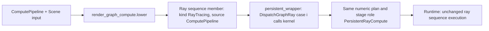

# Compute ray tracing design

Status: implementation contract, 2026-10-24. Baseline `origin/develop`
`dbbf7461`. This describes work to build. Read [requirements](requirements.md)
and [tasks](tasks.md). AGENTS.md, steering, ADR 0003 and the canonical
[render graph authoring guide](../../../docs/development/render-graph-authoring.md)
remain authoritative. Line references are to the baseline and will drift; the
symbol names are the stable anchors.

## 1. What already exists

A `RayTracingPipeline` node is already a compute kernel. There are no dedicated
ray stages or shader tables.

- **Builder.** `render_graph_ray.py` `lower` validates the node and
  `expand_programs` synthesizes one compute program, `GraphRayCompute`. It
  wraps the authored raygen/miss/closest-hit callbacks around the renderer's
  `ComputeMain` (`renderer_gpu_preview.slang`), which uses inline `RayQuery`.
- **Persistent wrapper.** When a configuration has more than one ray pass, or
  any `Buffer`, `persistent_wrapper` puts each authored source in its own
  namespace. It emits `switch (GetGraphPassIndex())` dispatchers for raygen,
  closest-hit and miss, and declares `GraphBuffer0/1` at slots 6/7.
- **Pass index.** The runtime passes the index in
  `Sampling.z << LUDUS_GRAPH_PASS_INDEX_SHIFT` (`gpu_preview_services.h`).
- **Ordering.** Every pass in the sequence is encoded through one
  `rhi::OrderedGraph` (`PrepareGpuPreviewGraphSequence`,
  `gpu_preview_graph.cpp`). It is limited to four consecutive passes
  (`MAX_RAY_PASSES`).
- **Fused post-processing.** Accumulate, ToneMap and Denoise accept only a
  `RayTracing` producer (`render_graph.py` checks `producer['kind']`), and are
  fused into the producing dispatch.
- **Color output.** The kernel writes a float4 storage buffer. A
  renderer-owned image pass copies it into the RGBA8 attachment. The RHI has no
  storage textures (`profile.h`: "currently unimplemented").
- **Generic compute.** `ComputePipeline` nodes validate structurally
  (`render_graph_pipeline.py`), then `_lower_pipeline` (`render_graph.py`)
  rejects all of them with `Capability`.

The observation that shapes the design: an authored scene-aware ray-generation
function, `float3 GenerateRay(SceneContext, RayLaunch, inout RayQueryContext)`,
is already a complete per-pixel compute kernel. It can call `TraceClosest`,
`TestVisibility`, sampling and material helpers directly. Hit and miss callbacks
only matter when the kernel calls `TraceAndShade`.

## 2. Selected design

**A scene compute pass is a member of the existing ray sequence whose callback
set is a single authored kernel.** It reuses the following unchanged:

- the persistent wrapper;
- binding ABI 0-9;
- the 64×1×1 workgroup;
- per-pass index dispatch;
- ordered-graph hazard tracking;
- fused Accumulate/ToneMap/Denoise;
- the color image pass;
- capability selection.



Why not a separate compute executor: it would duplicate several things —
binding/scene packing, the ordered sequence, fused post-processing, the image
copy and selection. It would also need a storage-texture RHI feature that does
not exist. A separate executor becomes worthwhile only for generic (non-scene)
compute, which stays out of scope (C01).

### D1 Numeric representation (recommended: no format change)

In the offline plan, a scene compute pass is a `RayTracing` sequence member
with `source_kind: "ComputePipeline"` and a callback variant `[compute_id]`.
`lower_plan` emits the existing `Technique::RayTracing` pass record. The runtime
never reads `ray_programs` (verified: there are no references under
`modules/graphics/renderer/src` or `modules/content`). It selects code only
through the pass index. So `plan.h` `VERSION` 13 and `PACKAGE_VERSION` 17 stay
unchanged, and an older runtime executes such a package correctly.

Alternative: add `Technique::SceneCompute`. That would bump both versions and
add a runtime validation branch with identical execution. Choose it only if
review wants runtime diagnostics to name compute passes. That is what C08
allows.

### D2 Authored signature (recommended: raygen-shaped)

```slang
float3 TraceAndShadePixel(SceneContext scene, RayLaunch launch, inout RayQueryContext queries);
```

The manifest program uses `"stage": "compute"`, `"input": "RayLaunch"` and
`"output": "Radiance"`. The return value is the pass's linear radiance, which is
handled exactly like a raygen return: accumulation, tone mapping, the magenta
rule for nonfinite or negative values. A pass whose color is only an
intermediate returns `float3(0)`. The next pass in the chain overwrites the
color, as reservoir passes already do.

Legacy (non-scene) signatures are not admitted for compute; a scene compute
node requires `scene_interface`. `TraceAndShade` stays declared so shared helper
headers compile. For a compute pass index, the dispatcher has no hit/miss case,
so it reaches `default:` and latches `HasFailed` (C03).

### D3 Builder changes

- New module `scripts/python/ludus_tools/render_graph_compute.py` owns
  scene-compute lowering. It keeps `render_graph_ray.py` focused on the
  callback profile and shares its port checks through extracted helpers rather
  than a copy.
- `_lower_pipeline`:
  - a ComputePipeline with a Scene input goes to `render_graph_compute.lower`;
  - a ComputePipeline without one keeps the `Capability` failure, with the
    repair text extended to "add a Scene input for a scene compute pass".
- `render_graph_pipeline.py`:
  - a scene compute node accepts `"dimensions": "ColorTarget"` and
    `"state": {}`;
  - an explicit `group_size` must equal `[64, 1, 1]`;
  - `new_node` for generic compute is unchanged.
- `render_graph_build.py`:
  - manifest programs may declare `stage: compute` only with the C03 signature;
  - node/technique matching collects variants as `(compute_id,)` for compute
    members and `(rg, miss, ch)` for ray members;
  - any sequence that contains a compute member forces the persistent profile.
    `group_profiles` currently selects that profile by pass count or `Buffer`
    use; a single compute pass also needs it, because the plain `scene_wrapper`
    hard-wires one callback triple.
- `persistent_wrapper`: compute variants contribute only a raygen-position case.
  The closest-hit and miss switches omit their index.
- The `producer['kind'] == 'RayTracing'` checks need no change, because compute
  members keep that kind. Plan summary text and diagnostics name the source
  node kind.

### D4 Random decorrelation between passes

Every pass is seeded from `SourceGeneration`, and `RayQueryContext` starts at
`NextRandomDimension = 0` (`scene_wrapper`). Two passes that both draw
automatic dimensions therefore see the same values for each pixel. Recommended
fix: the template's second pass draws with explicit dimensions offset by a
documented per-pass constant (`SampleSceneRandom(queries, dimension)` already
exists).

A wrapper-level salt (`NextRandomDimension = passIndex * stride`) would change
the existing ReSTIR and ordered-ray images, so it must not be applied silently.
If chosen, it is a separate, versioned change. Phase C0 confirms the actual
seeding before either fix is written.

### D5 Template (two passes)

```text
Scene, Camera, RenderSize
  -> primary  [ComputePipeline: scene, view, color rw, hits rw]
  -> shade    [ComputePipeline: scene, view, color rw, hits rw]
  -> Accumulate -> ToneMap -> Export
hits = Buffer { bytes_per_pixel: 32, extent: RenderSize }
```

The hit record is two `uint4` words per pixel, in `GraphBuffer0`:

| Word | x | y | z | w |
| --- | --- | --- | --- | --- |
| 0 | packed triangle + 1 (0 = miss/empty) | `asuint(DistanceWorld)` | `asuint(bary.x)` | `asuint(bary.y)` |
| 1 | `asuint(jitter.x)` | `asuint(jitter.y)` | `launch.SampleIndex` | flags (front face) |

Storing triangle + 1 makes the buffer's zero initialization (and zeroed resize
replacements) decode as "no hit" rather than as triangle 0 (C12). The sample
index in word 1 lets the shading pass reject a record that did not come from
this frame's primary dispatch.

- **Primary pass.** Draws the subpixel jitter, builds the ray with
  `MakeCameraRay` and issues one `TraceClosest`. It writes the record and
  returns `float3(0)`. Budget: one surface query.
- **Shade pass.** Validates and decodes the record and calls
  `GetSurfaceHit(scene, triangle, bary)`. It rebuilds the same camera ray from
  the stored jitter and restores `IncomingRay`, `DistanceWorld` and
  `IsFrontFace`, as `LoadVisibilitySurface` does. A miss returns
  `EvaluateEnvironment`. A hit returns emission plus one-sample direct lighting:
  - `SelectLight` and `SampleIncidentLight` choose the light sample;
  - `TestVisibility` from `SpawnSurfaceRay` traces the shadow ray;
  - `EvaluateStandardBsdf` evaluates the surface response.

  Budget: up to two visibility queries.

This is deliberately the shading model of a first-hit direct-lighting renderer.
The point is to demonstrate the compute split, not a new integrator.

**Correctness risk.** The runtime builds a separate packed scene and BLAS/TLAS
per pass (`GpuPreviewRecord`, `gpu_preview_ray.cpp`). A packed triangle index
from pass 0 is only valid in pass 1 if both packings come out in the same order
from the same extraction. C0 must prove that, and add an assertion or test, or
the record must carry stable identity (instance + primitive, resolved with
`FindVisibilityTriangle`) instead.

Snippet interface: inputs `scene: Scene`, `view: View`, `color: ColorTexture`;
output `color: ColorTexture`. The hits buffer is internal to the library
configuration.

Attribution in the shader sources:

- Laine, Karras and Aila, "Megakernels Considered Harmful: Wavefront Path
  Tracing on GPUs", HPG 2013. Its stage split motivated separating hit
  generation from shading. This template stops at two passes because ray
  queues and compaction are not available.
- Burns and Hunt, JCGT 2(2) 2013, for storing hit identity instead of shaded
  attributes. Keep the existing attribution in `visibility_buffer.slang`.

### D6 Editor

- `render_graph_pipeline_node.cpp`, `render_graph_pipeline.cpp`:
  - show the Launch size control (Match color target / Explicit) for a compute
    node that has a Scene input;
  - show group size as Automatic, with an Advanced override like ray state.
- `render_graph_scene_authoring.cpp`, `render_graph_shader_creation.cpp`,
  `render_graph_shader_interface.cpp`:
  - generate the C03 stub;
  - offer "Connect Scene bundle" for compute nodes;
  - list the compute signature in the interface panel.
- Templates:
  - catalog entries in `resources/render_graph_templates.json`;
  - embedding through the visibility-style `foreach` in
    `apps/editor/CMakeLists.txt`;
  - a new `PrepareComputeRayTracingConfiguration` in its own source file,
    dispatched from `PrepareConfigurationTemplate`. Generalizing the hard-coded
    visibility and ReSTIR prepare functions is a separate refactor.

### D7 Out of scope

Generic compute without Scene, storage textures, indirect dispatch, ray queues
and compaction (a full wavefront path tracer), more than four passes, sharing
one scene or TLAS across passes, browser execution, and software traversal.
Each needs its own RHI/runtime design.
