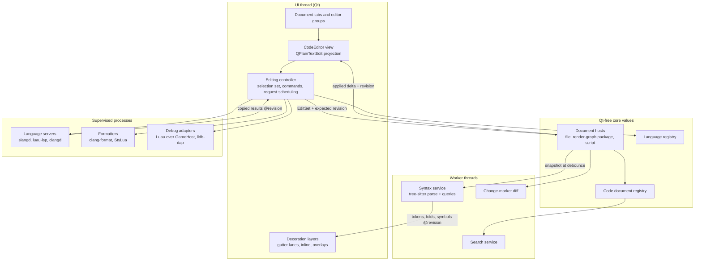

# Code editor architecture: shaders, scripts and project text

Status: proposed target design, 2026-11-03, against `develop` at `eebc2f20`.
The foundation it extends is implemented and documented in
[Source editing direction](editor-gui-systems.md#source-editing-direction):
the document seam, compiler diagnostics, the `slangd` adapter and the formatter
bounds. That section remains the owner of those implemented contracts; this page
owns the target product, the remaining architecture and the delivery order. The
implementation specification and prompts are in the
[Kiro handoff](code-editor-kiro-handoff.md). Nothing below is implemented unless
the [baseline](#baseline) says so.

## Goal

A Ludus author should be able to do all of their project text work in the
Ludus Editor, and prefer it to VS Code for that work. That covers shader and
render-graph programmers working in Slang, gameplay authors working in Luau, and
native gameplay programmers working in C and C++. It also covers project JSON,
CMake and Markdown. "Prefer" needs two things:

- **Parity.** The editing, navigation, refactoring and debugging that people
  expect from VS Code are present and feel just as fast. Anything missing
  sends them back to VS Code.
- **Engine context VS Code cannot have.** The editor knows the selected shader
  program and its generated bindings, can show the live result in the Render
  Preview, knows the project's assets and entities, and can debug the game in
  the GameHost it already supervises.

This is a project editor, not a general IDE. These are non-goals: an extension
marketplace or plugin API, remote development, notebooks, web-development
tooling, a full Git client, and (for now) an integrated terminal emulator. A
terminal needs a pseudo-terminal per platform plus a VT emulator, and Qt does
not provide one under a compatible license. Review that decision again once
the code editor is qualified. The command layer must also let a later modal
(Vim-style) input layer sit in front of the editor, but this design does not
add one.

### Principles

1. **Typing never waits.** The UI thread handles input and paints. Parsing,
   language servers, search, diffing, formatting and compilation run elsewhere.
   A late result is merged in or thrown away; it never stops a keystroke.
2. **One authority per state.** Text, history and save stay with the document
   owner ([document transactions](editor-gui-systems.md#editing-and-document-transactions)).
   Views, tokens, folds and diagnostics are projections of it, tagged with the
   revision they came from.
3. **Reuse language tooling.** Use LSP servers for semantics, DAP adapters for
   debugging and tree-sitter for syntax structure. Do not maintain a Ludus
   parser for Slang, Luau or C++. The existing single-line lexers stay as an
   instant fallback.
4. **Familiar by default.** Use VS Code's concepts (quick open, the command
   palette's prefix modes, multi-cursor, peek-free navigation, the problem
   list) and offer a VS Code keymap profile, so muscle memory carries over.
5. **Everything is bounded and degrades gracefully.** Every queue, result set,
   cache and file size has one named owner constant. A missing or crashed tool
   leaves editing usable, says what happened, and offers the fix
   (Repair, Choose Executable, Retry).
6. **Private to the editor, portable at the seam.** The implementation lives in
   `apps/editor`. Request, result and edit values contain no Qt types, so the
   browser editor and tests can reuse them. Nothing enters the installed SDK.

## Baseline

What `develop` at `eebc2f20` already has, so that no milestone rebuilds it:

| Area | Implemented | Missing |
| --- | --- | --- |
| Surface | `CodeEditor` over `QPlainTextEdit`: line gutter, current-line and bracket highlight, indent guides, word wrap, font zoom, bracket pairing, auto-indent | Multi-cursor, column selection, folding, sticky scroll, overview ruler, inlay text, minimap |
| Commands | Indent/outdent, toggle comment, duplicate/move/delete lines, go to line, bottom find/replace bar (case only) | Regex/whole-word/in-selection find, find in files, snippets, surround, expand selection |
| Documents | `CodeDocumentHost` seam with UTF-8 edits, revisions and one owner history; render-graph package host | A host for ordinary project files; a tab per file; the Scripts work area still uses a bare `QPlainTextEdit`; standalone shaders and scripts open in an external editor |
| Syntax | Single-line Slang lexer with multi-line state in `CodeSyntaxHighlighter` | Luau, C/C++, JSON, CMake and Markdown; structure for folding, outline or breadcrumbs |
| Semantics | Lazy `slangd`: completion, signature help, symbols, definition, references, a Back/Forward history, and Quick Open over package files | Hover, live diagnostics, semantic tokens, inlay hints, rename, code actions, completion resolve, snippets; any non-Slang server |
| Formatting | Explicit Format Document with pinned clang-format for shaders | Format selection, format on save, Luau and C++ profiles |
| Diagnostics | Compiler/build markers anchored through edits, out-of-date marking, Error List navigation | Live analysis kept apart from build results; quick fixes |
| Debugging | External debuggers only ([developer tools](developer-tools.md)); S5 source stops in the Scripts work area | Breakpoint gutter, call stack, variables, inline values in the code editor |

The [developer tools](developer-tools.md) baseline from 2026-10-01 rejected an
embedded code editor. The 2026-10-21 decision recorded in
[editor GUI systems](editor-gui-systems.md#source-editing-direction) replaced
that, and this design follows the later decision.

## Feature scope

Tier 1 is parity: users leave if it is missing. Tier 2 is the engine-specific
advantage. Tier 3 waits for real demand. The milestone column refers to the
[delivery plan](#delivery-plan).

| Tier | Feature | Data source | Milestone |
| --- | --- | --- | --- |
| 1 | A document tab for every project text file, preview tabs, split editors, dirty state, save, external-change conflicts, recovery | File document host and code document registry | M1 |
| 1 | Encoding, line-ending and indentation detection; EditorConfig | File host, `.editorconfig` | M1 |
| 1 | Multiple cursors, column selection, add next/all occurrences | Selection set in the controller | M2 |
| 1 | Find widget with regex, whole word and in selection; find and replace in files | Search service | M2 |
| 1 | Auto-closing pairs, surround with, smart indentation, snippets with placeholders | Language registry, snippet store | M2, M4 |
| 1 | Keymap profiles (Ludus and VS Code) and user overrides | Command catalogue | M2 |
| 1 | Accurate highlighting, folding, outline, breadcrumbs, sticky scroll, expand/shrink selection | Tree-sitter syntax service | M3 |
| 1 | Hover, live diagnostics, semantic tokens, inlay hints, symbols, workspace symbols, references, rename, code actions, completion resolve | Generic LSP client | M4 |
| 1 | Luau: types, completion and diagnostics against the game's contract; formatting | `luau-lsp` with the S4 `contract.d.luau`, StyLua | M5 |
| 1 | C/C++: clangd against the active preset; clang-format; read-only engine SDK navigation | clangd from the pinned LLVM | M6 |
| 2 | Shader context picker, live preview on idle or save, target code view mapped to source lines | Shader context provider, render-graph tool | M7 |
| 2 | Inline color swatches and picker, numeric scrubbing with live preview | Syntax service plus preview | M7 |
| 2 | Asset and entity references: completion, validation, hover preview, open in its editor | Project content catalog | M7 |
| 2 | Which render graphs, worlds or behaviors use this file | Project index | M7 |
| 1 | Breakpoints, stepping, call stack, variables, watches, inline values | DAP client: Luau adapter over GameHost, `lldb-dap` for native code | M8 |
| 1 | Change markers in the gutter against Git `HEAD`, overview ruler, themes, accessibility audit | Version-control service, design tokens | M9 |
| 3 | Minimap, peek definition, inline blame, Markdown preview, terminal, Vim layer, VS Code theme import | — | Later |

## Architecture



### Components and ownership

| Component | Owns | Must not |
| --- | --- | --- |
| Code document registry | One host per canonical project path and project epoch; open references from views; the dirty-buffer list for Save All, close and recovery | Keep a host alive once its last view closes, unless the buffer is dirty or part of a pending workspace edit |
| Document host | Authoritative UTF-8 text, revision, history, save, external-change conflict, the encoding and line-ending profile | Know about widgets, tokens or language servers |
| Editing controller | Selection set (primary plus secondary cursors), command execution, converting typing into edit sets, request scheduling and cancellation, applying results after checking the revision | Write files or own process lifetimes |
| `CodeEditor` view | One `QTextDocument` projection, layout, painting, native input, IME and accessibility | Mutate text except through the controller |
| Decoration layers | Gutter lanes, squiggles, inline text, overlays, overview ruler marks, each a revision-tagged set | Hold their own copy of positions that the edit deltas cannot move |
| Language registry | One record per language: file patterns, grammar and queries, comment tokens, pairs, indentation rules, server, formatter and debugger profiles, snippets | Hard-code a language anywhere else |
| Syntax service | Tree-sitter parsers, trees and query results per document, on a worker | Touch Qt objects |
| Language client | One generic LSP connection per server profile and workspace: capabilities, synchronization, requests, crash and restart | Interpret a language's semantics |
| Context providers | Shader context (existing), script context, native compile context | Duplicate the compiler owner's source generation |
| Search service | Project file enumeration, matching, streamed results, replace previews | Read a dirty file from disk instead of its buffer |
| Debug client | DAP sessions, breakpoint table, stack/variable models | Pause the editor's UI thread |

The existing classes map onto this as follows. `CodeEditor` stays the view.
`CodeDocumentController` grows into the editing controller. `CodeAssistance`
splits into the controller's request scheduler and a language-neutral result
presenter. `SlangLanguageService` becomes the first profile of the generic
language client. `CodeEditorPanel` is replaced by the find overlay.
`CodeNavigation` keeps the history and chooser. Each move is a structural change
with its own regression coverage, separate from behavior changes
([incremental refactoring](../../AGENTS.md)).

### Documents, buffers and views

**Hosts.** Three hosts implement `CodeDocumentHost`:

- The existing render-graph package host, unchanged.
- A new **file document host** for any project text file. It reads and checks
  the file on a worker, keeps the bytes as UTF-8 and preserves an existing BOM.
  Line endings and indentation are detected, then overridden by
  `.editorconfig`. Saving goes through `QSaveFile` atomic replace. External
  changes are detected through the existing source watcher: a clean buffer
  reloads silently, and a dirty buffer keeps the draft and shows a conflict bar
  with Compare, Keep Mine and Reload.
- A **script host** that moves the Scripts work area's draft and history onto
  the same seam, so script text gets the full editor.

Invalid UTF-8 opens read-only, shows the replaced bytes, explains why, and
offers Open Externally. Other encodings are a non-goal.

**Edit sets.** The seam grows from one contiguous replacement to an
`EditSet`: ordered, non-overlapping replacements applied together as one
revision and one undo step, plus the selection set before and after. Multiple
cursors, Replace All, formatting and workspace edits use the same path.
Formatting already publishes ordered non-overlapping ranges; generalize that
rather than adding a second path.

**Storage.** The file host keeps a contiguous UTF-8 buffer, applies an
`EditSet` in one pass, and maintains a line-start index incrementally. A worker
receives a copied snapshot at the syntax debounce (about 30 ms of idle), never
on every keystroke. Copying 8 MiB costs well under a millisecond on current
desktops. Use a chunked copy-on-write store only if measurement at the file
limit misses the budget; it would need a Foundation shared-ownership facility,
which does not exist yet ([memory policy](../../AGENTS.md)).

**Views.** Each view owns a `QTextDocument` projection of its host. An edit
from one view is applied to the host, and the host broadcasts the applied delta
to every other view of the same document. That is how split editors and a
script open in two groups stay identical, while each keeps its own wrap width,
scroll position, folds and cursors. Qt's own undo stack stays disabled for
bound views, as it is today.

**Tabs.** Opening a file from Project Explorer, Quick Open or navigation opens
a **preview tab** (italic title). The next preview replaces it; editing it,
double-clicking the tab or the item, or saving it makes it permanent. Tabs show
a dirty dot, a read-only lock and a tool-failure badge. Closing a dirty tab asks
Save, Don't Save or Cancel. Editor groups split right or down; Ctrl+1/2/3 focus a
group. Restoring a project reopens its tabs, cursors and scroll positions from
per-project local settings. Unsaved buffers are restored from the editor's
existing recovery owner, written off the UI thread on an idle debounce.

**Read-only documents** use the same view: generated shader code, target
disassembly, engine SDK headers reached by Go to Definition, and compiler
output. They show a banner saying where they came from and why they cannot be
edited.

### Language registry

The registry is a compiled-in table, with tree-sitter query files installed as
data beside the editor. A record holds:

- an identifier, display name, file patterns and an optional first-line pattern;
- the grammar name and its query files: `highlights`, `folds`, `indents`,
  `locals`, `injections` and `textobjects`;
- line and block comment tokens, bracket pairs, auto-closing and surrounding
  pairs, word pattern, indentation rules and region markers;
- a language server profile: the pinned executable resolver, arguments,
  initialization options, workspace configuration and the context provider;
- a formatter profile, a debug adapter profile and a snippet set.

First languages:

| Language | Grammar | Language server | Formatter | Debugger |
| --- | --- | --- | --- | --- |
| Slang (`.slang`, `.slangh`) | `tree-sitter-slang` | `slangd` from the project's Slang SDK | clang-format (existing profile) | — (GPU debugging stays in [graphics debugging](graphics-debugging.md)) |
| LUSL (`.lusl`, `.luslh`) | Lexical today, from the LUSL compiler's keyword table; the Ludus-owned `tree-sitter-lusl` follows M3 ([ADR 0026 amendment](../decisions/0026-tree-sitter-syntax-dependency.md#amendment-the-lusl-grammar)) | `luslc lsp` from the project SDK | In-process `FormatSource` | — |
| Luau (`.luau`) | `tree-sitter-luau` | `luau-lsp` with `contract.d.luau` | StyLua | Luau adapter over GameHost |
| C and C++ | `tree-sitter-c`, `tree-sitter-cpp` | clangd from the pinned LLVM | clang-format | `lldb-dap` from the pinned LLVM |
| JSON (`.json`, `.luscene.json`, manifests) | `tree-sitter-json` | In-process checks against Ludus schemas | Built-in, stable key order preserved | — |
| CMake | `tree-sitter-cmake` | — | — | — |
| Markdown | `tree-sitter-markdown` | — | — | — |
| Plain text | — | — | — | — |

Adding a language means adding a record and its data files. It does not mean
forking the editor.

### Syntax service

**Decision: tree-sitter for syntax structure.** Tree-sitter is an incremental
parsing library written in C. It recovers from errors, does not use exceptions,
builds for Wasm, and has maintained MIT grammars for every language above.
Its queries give highlighting, folding, indentation, locals, outline and text
objects from one tree. Neovim, Helix and Zed use it in production. The core
library and the C and C++ grammars have ConanCenter recipes; the Slang, Luau,
CMake and Markdown grammars need Ludus-owned recipes that pin their sources.
Adding the dependency needs an ADR under `docs/decisions/`, following the
[standard library policy](../decisions/0003-standard-library-usage-policy.md)'s
review model, before code lands. See the
[alternatives](#decisions-and-alternatives) for what was rejected.

**Threading.** The native editor runs syntax jobs on a single-thread pool.
Each projection owns its parser and last tree. After a debounce, the view posts
a copied UTF-16 snapshot and revision. The worker computes a coalesced edit
between consecutive snapshots, edits the old tree, and reparses. When the
changed ranges fit inside one whole-line declaration, the worker walks that
declaration and shifts the cached tokens and structure beyond it. Larger or
malformed changes rebuild the products from the new tree. The browser
uses the parser progress callback to yield between slices on the event loop.
A newer edit cancels obsolete jobs. Publication checks the revision again
before applying results.

**Tokens.** The worker combines grammar symbols with rooted queries to produce
ordered, disjoint UTF-16 spans, with two 32-bit words per token. Markdown also
uses its inline grammar for code spans, links and emphasis. The highlighter uses the lexical fallback when it has no result
for the current revision. Qt keeps formatting attached to unchanged blocks.
On publication the highlighter refreshes the visible blocks first and
reapplies the rest in timer slices. Large-file mode colors visible lines and
computes indentation folds without running tree-sitter.

**Structure.** The worker returns source ranges for folds, outline and
selection. The view uses enclosing outline entries for breadcrumbs and sticky
scroll. Fold state belongs to each view and live text anchors track the
opening and closing lines between results. A restored tab matches the hash of
the opening line before collapsing it.

**Semantic tokens** from a language server are layered over syntax tokens when
the server provides them. Syntax tokens stay the base layer, so the colors don't
flicker while a server is starting or has stopped.

### Language services

**Generic client.** Turn `SlangLanguageService` into a `LanguageClient` that
speaks LSP 3.17 to any profiled server. It keeps the existing bounds as profile
defaults (4 MiB messages, 8 KiB headers, a ten-second deadline, JSON decoded off
the UI thread) and the existing stale-result rules (project epoch, document
identity and revision, context identity, request identity, connection
generation). It adds:

- **Capability dispatch.** A command whose capability the server lacks is
  disabled, with a reason in its tooltip. It is never sent and left to fail.
- **Priority and cancellation.** Completion, signature help and hover go first.
  Semantic tokens, inlay hints, diagnostics pulls and document symbols follow.
  Workspace queries come last. A newer request of the same kind cancels the
  older one with `$/cancelRequest`.
- **Synchronization.** Incremental `didChange` when the server supports it,
  debounced to the syntax cadence for background features and sent at once
  before an interactive request.
- **Crash handling.** Restart with backoff. After three crashes in a minute,
  stop and show a status-bar error with Retry and Show Log. Editing is never
  affected.
- **Positions.** Negotiate `utf-8` position encoding when the server offers it,
  and fall back to UTF-16 mapped through the existing seam.

**Assistance features.**

- **Hover**: after a 300 ms dwell (VS Code's default), or by keyboard. It shows
  the signature, documentation and that position's diagnostics together, with
  a Quick Fix link when actions exist.
- **Completion**: triggered by identifier characters and the server's trigger
  characters, or explicitly. Results from several sources are merged: the
  server, snippets, words in open buffers, and Ludus project symbols (see
  [engine context](#engine-context)). They are ranked with the command
  palette's fuzzy matcher, show resolved documentation lazily, and insert
  snippets with tab stops.
- **Signature help**, kept as implemented, plus active-parameter highlighting.
- **Live diagnostics**: shown with a different source label from build results.
  The Error List groups them as "Analysis" and "Build"; the build report stays
  authoritative, as it is today.
- **Inlay hints**: parameter names and deduced types, drawn as inline text that
  is not part of the document (see [surface](#editor-surface)). Toggle with a
  setting, or hold Ctrl+Alt to show them temporarily.
- **Rename**: inline rename box, preview of every affected file, then one
  workspace edit.
- **Code actions**: a light bulb in the gutter on the caret line when actions
  exist; Ctrl+. opens them.
- **Workspace symbols**, references with a results tool window, Go to
  Definition / Declaration / Type Definition / Implementation.

**Workspace edits.** Rename and multi-file code actions open each affected file
as a buffer (bounded, 256 files by default), apply one `EditSet` per file, and
tag them with a shared transaction identifier. The files become dirty, and
nothing is written until Save All. Undo in any one of those files offers
"Undo in all N files". There is still no shared undo history across documents.

**Context providers.**

- *Shader*: the existing render-graph context, which captures sources and
  generated bindings through the compiler owner. The status bar adds a picker
  for the shader context, because one file may belong to several programs.
- *Script*: the active behavior package's `contract.d.luau` from the S4 cook,
  plus the target profile. `luau-lsp` receives it through `--definitions`. The
  cook's paired `luau-analyze` remains the authority. `luau-lsp` bundles its own
  Luau version, so its live diagnostics are labelled as analysis.
- *Native*: the `compile_commands.json` of the project's active preset build
  directory. When it is missing or stale, a banner offers Configure; the editor
  never configures silently. Never pass `--query-driver` or any other setting
  that makes clangd run a compiler named by the project.

**Tool pinning.** `slangd` comes from the selected Slang SDK, as today. clangd,
clang-format and `lldb-dap` come from the pinned LLVM 23. `luau-lsp` and StyLua
get pinned versions with per-platform hashes in `config/tool_versions.json`,
installed by `init.sh` only when scripting is enabled. Tools are resolved the way
shader tools are, with **Choose Executable** to override. A project file can
never silently replace an executable path.

### Formatting

Generalize the existing formatter adapter into profiles:

- LSP `textDocument/formatting` and `rangeFormatting` when the server offers it;
- the clang-format replacement-XML adapter for Slang and C++;
- StyLua for Luau, reading the source from stdin and returning the whole text;
- built-in JSON.

A whole-text result is turned into a minimal `EditSet` by the change-marker diff
(Myers), so cursors, folds and markers survive. Add Format Selection and an
opt-in **Format on Save** per language. Format on Save runs before the write,
under the formatter deadline; if formatting fails, the unformatted text is saved
and a warning is shown. The existing bounds, rules for the captured identity, and
single-undo-group guarantee stay as they are.

### Search

**In-document find** runs on the UI thread for documents below 1 MiB and in
slices above that. It covers plain text, case, whole word and regex
(`QRegularExpression`, with JIT and a match budget), and find in selection. It
shows the match count ("3 of 17") and marks matches in the overview ruler.
Replace preserves case when asked. Replace All is one `EditSet`.

**Find in Files** (Ctrl+Shift+F) runs on the search worker:

- It enumerates the project's authored roots and skips build outputs (`out/`,
  preset build directories), `.git`, binary files and files above the search
  size limit. It respects `.gitignore` when Git is available.
- It searches dirty buffers in place of the files on disk.
- It streams results in batches to a Search tool window grouped by file, with
  cancellation, a limit of 10,000 matches, and include/exclude glob fields.
- **Replace in Files** previews every change. It applies through the workspace
  edit path, so nothing is written until Save All.

### Debugging

The editor becomes a DAP client. The protocol is the existing contract between
editors and debuggers, and both target adapters can speak it.

- **Luau**: a small adapter inside the editor translates DAP requests into the
  versioned GameHost debug capability that the
  [scripting debugging contract](scripting.md#debugging-contract) defines. That
  contract owns the semantics (safepoints, pause scope, bounded watches with no
  side effects); this page owns only the presentation.
- **Native C/C++**: `lldb-dap` from the pinned LLVM, attached to or launching
  the GameHost process that the editor already supervises. It is optional, and
  RAD Debugger remains the external choice on Linux, as
  [developer tools](developer-tools.md) describes.

Presentation:

- The breakpoint lane in the gutter supports conditions, hit counts and
  logpoints. Breakpoints that did not bind are drawn hollow, with the reason.
- The current-statement line is highlighted.
- Call Stack, Variables and Watch tool windows; inline values on the paused
  lines; Run to Cursor; and a Debug toolbar.
- A pause never blocks the UI thread. The scope of a stop (script invocation or
  the whole process) is always shown.

### Change markers

When the project is in a Git repository and `git` is on the path, the editor
reads the `HEAD` version of an open file with `git show HEAD:<path>` through the
tool process supervisor. A Ludus-owned Myers diff runs on a worker and produces
added, modified and deleted markers in the gutter and the overview ruler. A
click shows the original lines and a Revert Change action. There is no staging,
committing or branch UI.

### Settings, keymaps and EditorConfig

- **Settings** are layered: built-in defaults, then user preferences, then
  per-project local settings (machine-local and ignored, like other local
  settings), then `.editorconfig` for indentation, line endings, the final
  newline and trailing whitespace. Preferences gets a **Text Editor** page.
- **Commands** all live in the existing command catalogue, so they appear in
  menus, the palette and the F1 shortcut list with one label. Editor commands
  apply when focus is in a code editor; global ones apply elsewhere.
- **Keymap profiles.** **Ludus** is the default and follows the workbench's
  current Visual Studio conventions, including Ctrl+D Duplicate Lines.
  **VS Code** is the second profile. User overrides go in a JSON file, with
  conflict detection in the shortcut list. Opening the first code document
  shows a one-time choice of profile.
- **Shortcut conflicts (decided 2026-11-03, implemented in M2).** F9 recorded
  profiling, but it is Toggle Breakpoint in both Visual Studio and VS Code.
  Ctrl+K opened the command palette, but it is VS Code's chord prefix. The
  maintainer accepted this resolution:
  - Record Profiling moves to Ctrl+Alt+F9 in every profile and focus.
  - F9 toggles a breakpoint when focus is in a code editor. Elsewhere it is
    unassigned.
  - The Ludus profile keeps Ctrl+K for the command palette.
  - The VS Code profile opens the palette with Ctrl+Shift+P and frees Ctrl+K
    for chords such as Ctrl+K Ctrl+C.
  - The shell's shortcut-collision tests enforce these bindings in both
    profiles.
- **Folding shortcuts.** Both profiles bind Fold and Unfold to Ctrl+Shift+[
  and Ctrl+Shift+] (Cmd+Option+[ and Cmd+Option+] on macOS).
  - **Ludus** uses Ctrl+Alt+M as the outlining prefix, leaving Ctrl+M for Tab
    Moves Focus. On macOS the outlining prefix is physical Control+M. The
    second key is M for Toggle Fold, L for Toggle All Folds, O for Fold
    Level 1 and H for Fold Selection, with the same modifiers as the prefix.
  - **VS Code** uses Ctrl+K Ctrl+L for Toggle Fold, Ctrl+K Ctrl+[ and Ctrl+K
    Ctrl+] for recursive folding, Ctrl+K Ctrl+0 and Ctrl+K Ctrl+J for Fold All
    and Unfold All, and Ctrl+K Ctrl+1 through Ctrl+K Ctrl+7 for levels. Ctrl+K
    Ctrl+/ folds comments, Ctrl+K Ctrl+8 folds regions, and Ctrl+K Ctrl+, and
    Ctrl+K Ctrl+. create and remove manual folds.
  - The source menu and command palette expose every command.

### Threading and performance

| Thread or process | Work |
| --- | --- |
| UI thread | Input, building edit sets, host application of small edits, projection updates, applying revision-checked results in slices of at most 2 ms, painting |
| Syntax worker | Tree-sitter parsing and queries for every document |
| Search worker | Find in Files, large-document find, replace previews |
| Shared background pool | File reading and UTF-8 checking, JSON decoding, diffs, recovery snapshots |
| Supervised processes | Language servers, formatters, debug adapters, `git` |

**Proposed budgets.** These are targets for named reference machines (one Apple
silicon Mac, one Linux x64 desktop and one Windows x64 desktop), not
measurements. They tighten the
[existing targets](editor-gui-systems.md#responsiveness-and-host-capabilities)
without replacing them.

| Measure | Target |
| --- | --- |
| UI-thread handling per keystroke, file ≤ 1 MiB | ≤ 4 ms p95, ≤ 8 ms p99 |
| The same with 100 cursors | ≤ 8 ms p95 |
| Keypress to painted glyph | ≤ 16 ms p95 at 60 Hz, ≤ 8 ms on 120 Hz displays |
| Scrolling a 100,000-line file | Every frame within the display interval; paint ≤ 8 ms p95 |
| Toggle one fold; Fold All or Unfold All on a 100,000-line file | Within one frame; ≤ 50 ms on the UI thread |
| Open a 1 MiB file to first paint | ≤ 100 ms, with the visible lines colored ≤ 50 ms later |
| Open an 8 MiB file to first paint | ≤ 500 ms |
| Reparse plus queries after an edit, 1 MiB | ≤ 30 ms on the worker |
| Warm completion | ≤ 150 ms p95 (existing) |
| Find in Files, first results | ≤ 200 ms; complete within 2 s for 10,000 files with a warm cache |
| Memory per open document, excluding servers | ≤ 4 × file size + 2 MiB |
| Idle with no background work | No timer wakeups and no CPU use; nothing polls |
| Editor startup with no code document open | No grammar loaded, no server started, at most 5 ms added |

**Large files and long lines.** One owner constant per threshold, defined with
the file host:

- *Normal*: up to 8 MiB and 200,000 lines. Every feature is on.
- *Large*: up to 64 MiB. Tree-sitter, language servers, wrap, inlay hints,
  sticky scroll and change markers are off. Lexical coloring is applied to
  visible blocks only. Folding is by indentation. A banner explains this.
- *Very large*: up to 256 MiB. The file opens read-only after confirmation.
- *Beyond that*: the editor refuses with Open Externally.
- A line longer than 20,000 UTF-16 units gets no formats, no bracket matching and
  no inlay hints. Qt still lays out the whole block, which is the measured
  bottleneck ([existing benchmarks](editor-gui-systems.md#responsiveness-and-host-capabilities)).
  If this limit misses its target, the escape hatch is in the
  [alternatives](#decisions-and-alternatives).

**Hidden tabs.** A tab that is not visible keeps its host and projection but
drops layout caches and decoration sets beyond its last viewport. The
registry keeps decoration caches for the 16 most recently used hidden documents.

**Measurement.** Add a latency probe that timestamps the key event when it
arrives and when the paint that shows it completes, using
`QElapsedTimer`. Report it through the existing editor CPU profiling scopes, so
an author can record a Perfetto trace while typing. Extend the existing
`[.benchmark]` editor tests with a corpus: real Ludus shaders, a 100,000-line
generated C++ file, an 8 MiB JSON file, a single 1 MiB line, typing during
diagnostics and a 100-cursor edit. Keep raw host results in ignored output.
Method: Pavel Fatin's latency measurements
([references](#references)) explain why the keypress-to-paint figure matters
more than throughput.

## User experience

### Layout

```text
┌ Document well ───────────────────────────────────────────────────────────────┐
│ ● lighting.slang  ×  │ door.luau  ×  │ CMakeLists.txt  ×  │         ⫼ split │
├──────────────────────────────────────────────────────────────────────────────┤
│ shaders › lighting.slang › EvaluateSun(...)                    breadcrumbs   │
├──────────────────────────────────────────────────────────────────────────────┤
│ float3 EvaluateSun(float3 normalWorld, ...)          sticky scroll header    │
├────┬───┬─┬───────────────────────────────────────────────────────┬───┬───────┤
│ ●  │ 41│▎│     float3 radiance = sunColor * max(dot(n, l), 0);   │ ▬ │ find  │
│    │ 42│ │ ▸   if (shouldShadow == true)        ⚑ shadow: float  │ ▬ │overlay│
│ ◆  │ 43│▎│         radiance *= SampleShadow(positionWorld);     │ ▬ │       │
│    │   │ │                     ~~~~~~~~~~~~ (squiggle)           │   │       │
│ bp │ ln│Δ│ fold + text + inlay hints + inline swatches           │ruler      │
└────┴───┴─┴───────────────────────────────────────────────────────┴───┴───────┘
 Ln 43, Col 18 │ 2 selections │ Spaces: 4 │ UTF-8 │ LF │ Slang │ Context: Forward/Opaque ▾ │ slangd ✓
```

### Editor surface

- **Gutter lanes**, from left to right: breakpoints, line numbers, a
  combined change and diagnostic bar, and fold controls. Fold controls appear on
  hover or when a range is collapsed. Diagnostic icons differ by shape as well as
  color.
- **Inline layers**: diagnostic squiggles drawn as an extra selection with an
  underline, inlay hints, color swatches and ghost text (snippet placeholders).
  Inline text such as inlay hints is drawn by the view in the space reserved
  for it. It is never inserted into the projection, so it cannot reach the
  document, the clipboard or the history.
- **Overlays**: the find widget (top right of the editor, as in VS Code),
  completion, signature help, hover, rename and the code-action menu. Overlays
  never take focus from the text except for rename and find. Escape closes the
  topmost one.
- **Overview ruler** in the scrollbar: diagnostics, find matches, change
  markers, the caret line and breakpoints.
- **Multiple cursors**: Alt+click adds a cursor. Alt+Shift+drag makes a column
  selection. Ctrl+Alt+Up/Down adds a cursor above or below. Add Next Occurrence
  and Select All Occurrences exist in both keymaps. Typing, deleting, pasting
  (one line per cursor when the counts match), completion and IME commits
  apply to every cursor as one `EditSet`. IME preedit is shown only at the
  primary cursor.
- **Folding**: collapsing and expanding ranges from syntax, region markers,
  servers or indentation. See [Folding](#folding).
- **Font**: the system monospace by default (SF Mono or Menlo, Consolas,
  DejaVu Sans Mono), with font, size, line height and optional ligatures
  through `QFont::setFeature` (Qt 6.7 and later). No downloaded fonts.

### Folding

Folding collapses a range of lines to its first line, as in VS Code and Visual
Studio. The rules below exist so that hidden text never surprises the author:
it is never silently edited, lost from the clipboard or left without a control
that reveals it.

**Where fold ranges come from.** For each language, in this order:

1. The tree-sitter `folds` query: blocks, functions, structs, parameter and
   initializer lists, multi-line comments, JSON objects and arrays, CMake
   blocks, and Markdown sections and fenced blocks.
2. Region markers declared in the language record. `// #region` and
   `// #endregion` work in Slang, C and C++, and `#pragma region` and
   `#pragma endregion` also work in C and C++. Luau uses `--#region` and
   `--#endregion`. The text after the opening marker names the region in the
   placeholder and the outline.
3. A language server's `textDocument/foldingRange` result (M4). Only kinds that
   the grammar does not produce are added. Server ranges never replace syntax
   ranges, so folds do not move while a server starts, restarts or stops.
4. Indentation, for languages without a grammar and in large-file mode.

**Manual folds.** Fold Selection collapses the selected whole lines as a manual
fold, whatever the syntax says. A manual fold stays until it is unfolded, Remove
Manual Fold is run on it, or an edit removes its first line.

**Collapsed ranges.**

- The first line stays visible. It is followed by a placeholder: `{ … }` when the
  range is a bracket pair, the region name for a region, and `…` otherwise. A
  tooltip gives the number of hidden lines.
- Clicking the placeholder or the gutter control expands the range.
- Fold controls appear on hover over the gutter, and always on a collapsed
  range and on the line with the caret.

**Caret and navigation.**

- The caret never rests on a hidden line. Up and Down skip a collapsed range.
- Right at the end of a collapsed line moves to the line after the range, and
  Left at the start of that line moves back to the end of the collapsed line.
- Any operation that puts a caret, a selection or a highlight inside hidden text
  first expands the smallest collapsed ranges that contain it. That covers Go to
  Line, Go to Definition and Go to Symbol, choosing an outline, breadcrumb or
  sticky-scroll entry, Find Next and Find Previous, Error List and F8 navigation,
  debugger stops and Run to Cursor, Add Next Occurrence, and an undo or redo
  that restores a selection inside.
- Replace All, Replace in Files, formatting and workspace edits change hidden
  text without expanding it. Their previews show the change.

**Editing.**

- A selection that spans a collapsed range includes the hidden lines. Copy, Cut,
  Delete and drag-and-drop act on the whole text, and the clipboard never
  contains the placeholder.
- Line commands on a collapsed first line act on that line and all its hidden
  lines: Delete Lines, Move Lines Up and Down, Duplicate Lines and Toggle Line
  Comment. Duplicate Lines leaves the copy collapsed too.
- Typing on the first line keeps the range collapsed.
- Between structure results, collapsed ranges are moved by the edit deltas, as
  tokens are. When a new result arrives, a range stays collapsed only if a range
  of the same kind still starts on the same line. Otherwise it is expanded, so
  an edit that deletes the first line or breaks a bracket pair reveals the text
  rather than leaving it hidden.
- Formatting maps collapsed first lines through its diff, so folds survive a
  whole-document format.
- Invariant: every hidden line belongs to a collapsed range whose first line is
  visible and shows a placeholder and control. Unfold All always reveals
  everything.

**Markers inside a collapsed range.** The first line's gutter shows the most
severe diagnostic inside the range, by shape and color, and a marker when a
breakpoint, a change marker or the current statement is hidden. The overview
ruler keeps showing hidden markers at their true positions.

**State.** Collapsed ranges are view state. Split views fold independently. A
tab saves its collapsed ranges with the project as a first line, a kind and a
hash of that line's text. They are restored only where the line still matches,
and the rest are dropped. A reload after an external change keeps folds the same
way.

**Commands.** Toggle Fold, Fold, Unfold, Fold Recursively, Unfold Recursively,
Fold All, Unfold All, Fold Level 1 to 7, Fold All Comments, Fold All Regions,
Fold Selection, Remove Manual Fold, Go to Parent Fold, and Go to Next Fold and
Go to Previous Fold. All of them are in the command catalogue and the palette.
Default shortcuts are in
[Settings, keymaps and EditorConfig](#settings-keymaps-and-editorconfig).

**Limits.** At most `CODE_MAX_FOLDS` ranges per document. When a document has
more, the outermost ranges are kept and the status bar says that folding is
partial. In large-file mode, folds come from indentation, computed on the
background pool. Folding never changes the document, its revision or its undo
history.

**Accessibility.** Collapsing or expanding announces the range and its line
count. The placeholder has an accessible name. Toggle Fold at the caret makes
every fold reachable from the keyboard.

### Status bar

When a code editor has focus, the status bar shows the cursor position,
selection or cursor count, indentation, encoding, line endings and language
mode, each clickable to change. It also shows the language server state
(starting, ready, indexing with progress, or failed with Retry) and the
context picker: a shader program for Slang, and the behavior package and target
profile for Luau.

### Command palette and quick navigation

Extend the existing palette with VS Code's prefix modes in one box:

- no prefix: files (Quick Open over the whole project, not only the open package);
- `>`: commands;
- `@`: symbols in the current file;
- `#`: workspace symbols;
- `:`: go to line.

Ctrl+P opens it with no prefix, and the palette shortcut opens it with `>`.
Ctrl+Tab cycles through the most recently used documents.

### Theme

Add syntax roles to `config/design-tokens.json`: keyword, control keyword,
type, function, method, variable, parameter, property, constant, number,
string, escape, comment, documentation comment, preprocessor, macro, namespace,
operator, punctuation, and invalid. Give each a dark, light and high-contrast
value, and add contrast pairs against the editor background so the existing
token tests enforce 4.5:1. Tree-sitter captures and LSP semantic token types map
onto these roles in one table in the language registry. The viewport-dark rule
does not apply; code follows the workbench appearance.

### Accessibility

- Keep Qt's accessible text interface on the projection.
- Announce diagnostics at the caret, completion selection and debugger stops
  with `QAccessibleAnnouncementEvent` where the platform supports it.
- Every overlay works with the keyboard alone.
- Severity and change kinds never depend on color alone.
- Focus rings follow the workbench style.
- Reduced-motion settings disable smooth scrolling.
- The accessibility audit in M9 uses VoiceOver, Narrator and Orca on the
  reference machines.

### Engine context

These features are what VS Code cannot offer:

- **Shader context picker and live preview.** Pick the program and variant a
  shared file is compiled for. With **Live Preview** on, an idle draft
  (500 ms after the last keystroke) is compiled through the existing render-graph
  build, and the Render Preview updates when the result is Ready, following the
  rule that the
  [last drawable view stays](../../AGENTS.md#review-feedback-and-viewport-acceptance)
  until the replacement is Ready. Failures appear as build diagnostics; the old
  image stays.
- **Target code view.** Show the generated SPIR-V, MSL or WGSL for the selected
  context side by side, with source-line mapping in both directions: selecting
  a source line highlights its generated lines. Add instruction or register
  statistics where the platform compiler reports them.
- **Color swatches and numeric scrubbing.** A `float3` or `float4` literal in a
  color context (a parameter or field with a color annotation, or a name ending
  in `Color`) shows a swatch that opens the workbench color picker. Alt+drag on a
  numeric literal changes it, and with Live Preview the image follows while
  dragging. A scrub is one undo group.
- **Asset and entity references.** In Luau and JSON, string literals that the
  contract types as asset or entity references complete from the content
  catalog. Unknown references are underlined. Hover shows a preview (a texture
  thumbnail or a mesh name and bounds), and Ctrl+click opens the asset in its
  workspace.
- **Usages across editors.** "Used by" on a shader or script lists the render
  graphs, worlds and behaviors that reference it, and opens them.
- **Script loop.** Save, reload (S5's explicit reload) and the debugger are all
  available from the editor toolbar and the status bar, so an author never
  leaves the text.

### Failure behavior

Every tool or context failure shows in three places: the status-bar item, a
dismissible bar above the editor naming the operation, and the Output log with
details. Each offers the fix that applies: Repair Tools, Choose Executable,
Configure Project, Retry or Show Log. Editing, saving and undo keep working
while any of these fail. Following the [rule on error messages](editor-art-direction.md#common-interaction-rules),
messages name the operation and the outcome.

## Browser editor

The Qt/Wasm build reuses the views, controller, hosts, registry and tree-sitter
(compiled to Wasm and run in a worker when threads are available, otherwise in
slices on the main thread). Native processes are unavailable in the static
browser host, so language servers, formatters, debug adapters and `git` report
the capability as unavailable. A Wasm language server or an authorized host
transport is qualified separately, under the same stale-result rules
([responsiveness and host capabilities](editor-gui-systems.md#responsiveness-and-host-capabilities)).

## Trust and security

- Opening a project still executes nothing ([editor architecture](editor-architecture.md)).
- Language servers start lazily when the first document of their language
  opens, using pinned or user-chosen executables only.
- No project-provided setting may name an executable, add server arguments that
  run programs, or pass clangd `--query-driver`.
- Debugging launches only the GameHost the editor already supervises, or
  attaches to a process the user picks.
- Downloads happen only in `init.sh` or explicit Repair, never when a file opens.

## Delivery plan

Milestones are ordered by dependency. Each is reviewable and keeps editing
usable. The [tasks](../../.kiro/specs/code-editor/tasks.md) carry the gates.

| Milestone | Outcome | Depends on |
| --- | --- | --- |
| M0 | Revalidate the baseline; latency probe and benchmark corpus; language registry skeleton; tree-sitter ADR; decision log | — |
| M1 | Every project text file opens as a tab: file host, registry, preview tabs, split groups, conflicts, recovery, EditorConfig, status bar; the Scripts work area uses `CodeEditor` | M0 |
| M2 | Editing parity: edit sets, multiple cursors, column selection, find overlay, Find/Replace in Files, auto-closing and surround, keymap profiles and conflict resolution | M1 |
| M3 | Syntax service: tree-sitter for the first languages, asynchronous tokens, folding, outline, breadcrumbs, sticky scroll, expand selection | M0 (ADR), M1 |
| M4 | Generic LSP client: hover, live diagnostics, semantic tokens, inlay hints, symbols, rename, code actions, completion resolve and snippets, workspace edits | M2, M3 |
| M5 | Luau provider: pinned `luau-lsp` and StyLua, contract definitions, script cook diagnostics, project-symbol completion | M4 |
| M6 | C/C++ provider: clangd, compile database handling, clang-format, read-only SDK headers | M4 |
| M7 | Engine context: shader context picker, live preview, target code view, swatches, scrubbing, asset references, usages | M4 (M5 for Luau references) |
| M8 | Debugging: DAP client, Luau adapter over GameHost, `lldb-dap`, breakpoints, stack, variables, inline values | M5, M6 |
| M9 | Change markers, overview ruler polish, themes, accessibility audit, browser parity check, performance qualification, user documentation | M1–M8 |

M5 and M6 can run in parallel. M7 can start once M4's shader parts are done.

## Acceptance

The editor is qualified when, on the reference machines:

- every [budget](#threading-and-performance) has a recorded measurement within
  target, or an accepted, documented exception;
- each first-language workflow (edit, navigate, rename, format, diagnose and,
  where it applies, debug) passes an interactive run that is recorded in the
  task ledger, as well as offscreen tests;
- every tool failure path (missing, wrong version, crash, timeout, stale reply)
  leaves the draft intact and shows its fix;
- unsaved buffers survive a forced quit;
- a user guide at `docs/development/code-editor.md` explains setup,
  keymaps, languages and limitations.

Offscreen tests alone do not qualify native interaction, IME or Qt/Wasm, as the
[existing rule](editor-gui-systems.md#responsiveness-and-host-capabilities) already says.

## Decisions and alternatives

| Question | Choice | Alternatives and why not |
| --- | --- | --- |
| Text widget | Keep `QPlainTextEdit` projections | A Ludus-owned text view over per-line `QTextLayout` would remove the whole-block layout cost on long lines and allow true virtual inline text. It would also make Ludus own selection, IME, accessibility and platform navigation, which the [toolkit decision](editor-gui-systems.md#toolkit-evaluation) rejects. It is the escape hatch only if M2/M3 measurements miss the budgets after mitigation, and needs its own ADR. Qt Creator shows that a `QPlainTextEdit`-based editor can support multiple cursors, folding and LSP. |
| Syntax | Tree-sitter, with the existing lexers as fallback | TextMate grammars (VS Code) are regex-based, slower and need Oniguruma, and give no tree. KSyntaxHighlighting (MIT, Kate's definitions) is Qt-native, but lexical only, and has no Slang or Luau definitions. More hand-written lexers would be cheap, but give no structure. |
| Semantics | Out-of-process LSP servers | In-process analysis would mean owning parsers and type checkers for three languages. Embedding Luau's Analysis library directly would tie the editor to one Luau revision and duplicate `luau-lsp`. |
| Whole editor | Native Qt | Monaco in `QWebEngineView` adds a Chromium dependency and a second text stack. QScintilla is GPL or commercial. KTextEditor is LGPL, brings KDE Frameworks, and has weaker macOS and Windows support. |
| Debugging | DAP client | A custom protocol per language means one client per debugger. The scripting contract already keeps GameHost's protocol behind a capability-declared adapter. |
| Storage | Contiguous UTF-8 plus a line index, snapshots copied at the debounce | A persistent piece tree (VS Code) or rope gives O(1) snapshots, but needs a shared-ownership Foundation facility and much more code. Adopt one only on measured need. |

## References

These sources inform the design; cite them again beside the code they shape.

- Max Brunsfeld and contributors, *Tree-sitter* documentation, "Using parsers"
  and "Syntax highlighting" (incremental parsing, changed ranges, queries).
  <https://tree-sitter.github.io/tree-sitter/>
- Stephan Seitz (theHamsta) and contributors, *tree-sitter-slang*, an extension
  of tree-sitter-cpp and tree-sitter-hlsl (MIT).
  <https://github.com/tree-sitter-grammars/tree-sitter-slang>
- polychromatist and contributors, *tree-sitter-luau* (MIT), including its
  highlight, fold, indent and locals queries.
  <https://github.com/polychromatist/tree-sitter-luau>
- Microsoft, *Language Server Protocol Specification 3.17*.
  <https://microsoft.github.io/language-server-protocol/specifications/lsp/3.17/specification/>
- Microsoft, *Debug Adapter Protocol* specification.
  <https://microsoft.github.io/debug-adapter-protocol/>
- Alexandru Dima, "Optimizations in Syntax Highlighting", Visual Studio Code
  blog, 2017-02-08: binary token arrays, viewport-first tokenization and moving
  tokens across edits. <https://code.visualstudio.com/blogs/2017/02/08/syntax-highlighting-optimizations>
- Peng Lyu, "Text Buffer Reimplementation", Visual Studio Code blog,
  2018-03-23: the piece-tree alternative this design defers.
  <https://code.visualstudio.com/blogs/2018/03/23/text-buffer-reimplementation>
- Pavel Fatin, "Typing with pleasure", 2015: keypress-to-display latency as the
  measure of editor responsiveness. <https://pavelfatin.com/typing-with-pleasure/>
- Eugene W. Myers, "An O(ND) Difference Algorithm and Its Variations",
  *Algorithmica* 1(2), 1986, pp. 251–266, DOI 10.1007/BF01840446: the change-marker
  and formatter diff.
- Slang contributors, *Slang VS Code extension* README, "Features": hover,
  completion, signature help, semantic highlighting, inlay hints, document
  symbols and clang-format formatting from the official language server.
  <https://github.com/shader-slang/slang-vscode-extension>
- JohnnyMorganz and contributors, *luau-lsp*, editor setup documentation:
  standalone server and definition files through `--definitions`.
  <https://github.com/JohnnyMorganz/luau-lsp>
- JohnnyMorganz and contributors, *StyLua* (MPL-2.0, used as a separate process).
  <https://github.com/JohnnyMorganz/StyLua>
- LLVM project, *clangd* documentation and *lldb-dap* README.
  <https://clangd.llvm.org/>, <https://lldb.llvm.org/resources/lldbdap.html>
- EditorConfig contributors, *EditorConfig* specification. <https://editorconfig.org/>
- The Qt Company, *QPlainTextEdit*, *QSyntaxHighlighter* and *QFont::Tag*
  (Qt 6.7) documentation. <https://doc.qt.io/qt-6/qplaintextedit.html>,
  <https://doc.qt.io/qt-6/qsyntaxhighlighter.html>, <https://doc.qt.io/qt-6/qfont-tag.html>
