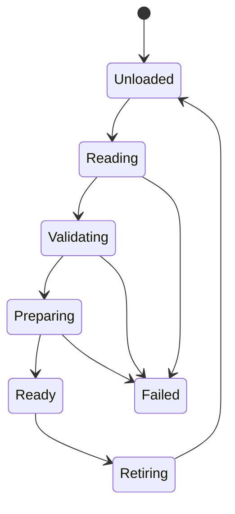

# Content resources and loading

Status: Architecture contract; initial native implementation is described in
[implementation evidence](../development/audio-content-evidence.md). Baseline inspected on October 2, 2026,
HEAD `9a71dd1`. This historical proposal specifies shared resource identity and
loading for levels and audio. The implemented native audio subset is documented
in the linked evidence; general level loading remains a separate proposal.
Read [audio authoring](audio-authoring.md), [milestones](audio-content-milestones.md),
and [implementation handoff](audio-content-codex-handoff.md).

The proposed [resource manager architecture](resource-management.md) extends these
contracts to shared asynchronous acquisition, typed resident versions, explicit
budgets and later cooking/streaming. Its [reference review](resource-management-reference-review.md)
records the relevant Gems readings and design refinements. That broader proposal
preserves the current version-1 formats and does not claim its future coordinator
or nonblocking integration is already implemented.

## Outcome and boundaries

A composer exports audio, registers it under a stable resource ID, authors sound
behavior, and saves a project that another machine can load. A level references
those same IDs. Development tools and packaged games validate the same definitions.

Start with an explicit catalog and typed audio loader. Do not require reflection,
a general importer plugin system, a database, a VFS, a binary bank compiler,
a job scheduler, or the proposed world implementation. A compiled sample can
exercise loading before levels exist. The following choices are Ludus proposals.

## Ownership and dependency direction

| Owner | Responsibility |
| --- | --- |
| Content catalog | Immutable ID, kind, relative path and revision records |
| Audio content loader | Decode definitions, resolve references, prepare audio, own leases |
| Game session | Active/pending level leases, sound delivery, music context |
| AudioSystem | Prepared clip/stream storage, playback and acknowledged retirement |
| Editor document | Mutable draft, saved digest, validation errors, document revision |
| Packaging tool | Validate dependencies and stage immutable release files |

Introduce `modules/content/`, exported as `Ludus::Content`, only for the catalog,
resource IDs, owned byte acquisition, bounded status/diagnostics and leases that
have demonstrated use. It depends on Base and Containers, never Audio, RHI,
GameplayWorld or Qt. Audio definitions and preparation belong in
`modules/audio/content/`, exported as `Ludus::AudioContent`, depending on Content
and Audio. Dynamic music later uses `modules/audio/music/`, `Ludus::Music`.
Keep source files in `src/`, public headers in `include/`, implementation headers
in `src/internal/`. Content and AudioContent now export these SDK targets; Music remains proposed.

Cooked interchange formats are contracts owned by neither the tools that write
them nor the runtime that reads them. The LUSCN cooked scene format lives in
`modules/content/scene_format/`, exported as the header-only `Ludus::SceneFormat`
INTERFACE target: versioned POD record layouts (header, texture, material V1/V2,
mesh, vertex, object), limits and constants with `static_assert`ed sizes. It
depends only on FoundationBase. `Ludus::SceneCook` and the Editor World composer
write it, and `Ludus::Resources` (`SceneDefinition::Decode`) reads it for the
renderer; the cooker never links the renderer and the runtime never links the
cooker. A format change bumps its version in that header and updates both sides
in the same change.

Qt adapters stay private to `apps/editor`. Do not move Qt JSON objects into runtime
headers. Select and pin a bounded, explicit-error JSON parser during the first
implementation audit; demonstrate compatibility with `-fno-exceptions`, duplicate
key detection and fallible storage. The parser stays behind `.cpp` boundaries.
Reuse a suitable existing codec if one has appeared since this baseline.

## Catalog schema

The conventional location is `content/catalog.json`, relative to the game source
root. Do not change the strict version-1 editor project descriptor just to add
content; derive this location from its resolved `source_dir`. Changing roots is
future versioned project configuration. The current root is its parent `content/`.

This is a complete illustrative catalog:

```json
{
  "version": 1,
  "resources": [
    { "id": "audio/impact-a", "kind": "audio-source", "path": "audio/impact-a.wav" },
    { "id": "sound/impact", "kind": "sound", "path": "audio/impact.sound.json" },
    { "id": "audio/forest-loop", "kind": "audio-source", "path": "audio/forest-loop.flac" },
    { "id": "music/forest", "kind": "music", "path": "audio/forest.music.json" }
  ]
}
```

All fields shown are required. IDs are case-sensitive lowercase ASCII letters,
digits, slash and hyphen, maximum 128 bytes. Segments are nonempty; no leading or
trailing slash. IDs are globally unique across kinds. Paths use forward slashes,
are relative, nonempty UTF-8, maximum 1024 bytes, and contain no empty, dot or
parent segments, backslash or absolute prefix. Resolve under the canonical content
root and reject symlink escapes too. Files must be regular files. Do not interpret
IDs as paths. Catalog entries can move without changing IDs.

Version 1 now also accepts `mesh` for Stage 3 immutable CPU geometry. Existing
three-kind catalogs retain their byte/schema behavior; older readers reject this
new kind explicitly. A mesh path is a normalized identity/source label in the
initial in-memory adapter, not a file-format or runtime-import promise. See the
[implemented mesh profile](resource-management.md#implemented-stage-3-profile).
The browser labels mesh entries explicitly and reports that mesh editing is unavailable.
Audio import preserves those entries without treating them as sound dependencies;
the audio workspace and audio packaging validator reject mesh roots explicitly.
Future level catalogs may share this identity policy through a versioned extension; this package does not silently
change the game-owned level schema. A game binding validates that a level's audio
key names the required sound/music kind. Numeric resource indices are resolved
on the cold path and never persisted as authored identity.

## Definition validation

Readers reject duplicate keys/IDs, unknown fields or versions, wrong kinds,
missing references, invalid scalar types, nonfinite values, and dependency cycles.
Own all surviving data before releasing input buffers. Diagnostics include resource
ID, source file, property path, error code and line/column where available.
Ordinary malformed content returns a status, never an assertion or exception.

Version-1 default ceilings are 1 MiB per JSON document, 4096 catalog entries,
32 nesting levels, 256 dependency edges per definition and 16384 total edges.
Lower application limits are allowed; increasing them requires capacity and
peak-memory evidence. Audio byte and PCM limits remain separate and use the
existing AudioSystem budget. Check every size product and peak allocation.

### Limit ownership

Admission ceilings are inclusive. `ludus/content/limits.h` owns Content's
`MAX_DOCUMENT_BYTES`, `MAX_RESOURCES` and the independent `MAX_SAVE_BYTES`
persistence budget. `ludus/content/scene_format/limits.h` owns cooked mesh,
texture and bundle ceilings shared by producers and runtime decoders.
`ludus/content/scene_cook/limits.h` owns importer source-file, metadata,
artifact/resident-closure and scene-catalog budgets. The original public headers
continue to expose these names for source compatibility.

The scene asset catalog (`assets/catalog.json`, an object of resource records)
is a different schema from Content's audio catalog (an array of records): its
encoded JSON ceiling is **64 MiB**, while scene level/metadata documents remain
**1 MiB**. Each scene record retains its import's source-input digest map for
artifact-key compatibility; the catalog grows with resources times source files.
The 4096-record ceiling is unchanged. Neither catalog's encoded byte ceiling is
a peak-memory guarantee: parsing, candidate construction and serialization can
coexist with the published representation.

Editor preview JSON/mesh files and encoded PNG files have independent input
ceilings in `apps/editor/src/internal/render_scene_limits.h`. Decoded texture
and assembled bundle checks use SceneFormat's constants. Equal numeric values
do not imply shared policy; source bytes, decoded bytes and peak allocations
must remain distinct. Changes to capacity require updating readers, parser
budgets, writers, diagnostics and boundary regressions together. Do not raise a
limit as part of a naming or ownership refactor.


Definitions form an acyclic dependency graph: sound/music -> audio-source.
Future dynamic music also references stinger sound definitions. No executable
scripts, plugin names or arbitrary runtime function references belong in content.

## Loading and resource leases

Conceptual state flow:



Every pending stage can be cancelled. Request identity contains loader session,
request generation and catalog revision. Late completions cannot publish into a
replacement request or closed editor project. Failure/cancellation releases only
candidate leases and preserves any active revision. Failed resources can be
retried explicitly; no unbounded automatic retry.

A lease pins one immutable definition revision and its dependency closure.
Multiple clients may share a prepared clip within the same audio session and
preparation profile. Cache keys include source content digest, import settings,
loop descriptor and session rate/identity; a hash alone is not a durable resource
ID. A stream source can be shared, but each stream playback needs its own prepared
instance, decoder and ring. Release cannot immediately free storage still used
by voices or jobs. Use AudioSystem retirement and terminal acknowledgments.

Acquire all required candidate resources before level activation. Validate peak
budgets for active and candidate content together. On failure keep the active
world and audio leases intact. Optional resources require an explicit game-owned
fallback policy; do not turn missing required music into success silently.

Preparation and file operations run outside the audio callback. Native acquisition
uses owned readers on a worker; browser acquisition returns to the event loop
while fetch is pending. Initial browser streaming still retains bounded encoded
bytes, as specified by the existing audio design. Do not advertise HTTP range
streaming or bounded download memory.

All AudioSystem calls remain serialized on its control owner. UI/background
results carry owned values to that owner; they never call it concurrently.
Expose status polling and cancellation instead of blocking the browser or GUI.

## Saving and replacing content

Canonical writers emit version and fields in fixed order, explicit defaults,
sorted catalog IDs, stable numeric formatting and a final newline. JSON has no
comments. Reject unsupported versions instead of dropping unknown data on save.

Documents track the last-read digest. Before replacement, reject an external
change with a conflict diagnostic and retain the dirty draft. Write a temporary
file in the same directory, flush as supported, and atomically replace the
original. On failure retain the original and report failure. Replacement protects
one file; do not claim a transaction across catalog, definition and audio files.

Import external audio by copying into the content root. Prepare/validate a staged
copy first, then publish it and register it. If catalog publication fails, the old
catalog remains valid; report the unreferenced file and allow cleanup. Never
publish a catalog pointing to a file that has not been successfully written.
Deleting registered sources is refused while referenced; report the referring IDs.

The [S3 editor content browser](../development/editor-workspace.md#s3-content-browser)
implements native copy imports with immutable, content-keyed source candidates
and a compare-and-swap catalog switch. Both Content and Audio entry points use
the same implementation. Candidates and superseded versions are retained;
automatic garbage collection is not implemented.

Reimport keeps the resource ID and authored settings, validates changed sample
rate/length/loops, and prepares a new revision before publishing. Old voices retain
the old revision until completion; new triggers use the new revision. Existing
music continues until an explicit restart or safe musical boundary in later work.
Peak-budget failure preserves the old revision. Whole-world restart is not
required for an audio replacement.

### Native saves

Include `<ludus/content/content.h>` and link `Ludus::Content`. Read saved bytes
into an owned buffer, then use their digest when publishing a validated draft:

```cpp
ludus::content::Bytes saved;
auto status = ludus::content::ReadFile(root, "catalog.json",
                                     ludus::content::MAX_DOCUMENT_BYTES, saved);
if (status == ludus::content::Status::Ok)
{
    const auto expected = ludus::content::Hash(saved.Data());
    // draftBytes is the validated candidate document owned by the caller.
    status = ludus::content::SaveFile(root, "catalog.json", draftBytes, &expected);
}
```

`ReadFile` replaces its output only on success. After a successful save, retain
the digest of the new bytes for the next edit. Pass `nullptr` instead of an
expected digest to require that a new destination does not exist. Run these
synchronous operations outside audio callbacks and render critical paths.

The current `Content::SaveFile` adapter supports Linux, macOS and Emscripten MEMFS.
The browser path requires one filesystem owner and never yields between digest
checks and rename. It skips the unsupported native writer lock and publishes only
volatile session memory; download is still required to keep edits across reload.
It keeps the same public signature and SHA-256 expected-digest policy. Other platforms return
`Unsupported`; portable catalogs and JSON processing do not depend on this save
backend. This adapter is separate from the proposed FoundationFilesystem F5
persistence API and does not implement watchers or asynchronous acquisition.

The caller supplies a trusted existing root and a validated relative UTF-8 path.
Root symlinks are allowed; every child-directory component and destination is
opened relative to a descriptor with symlink following disabled. Destinations
must be regular files or absent; FIFO checks are nonblocking. Already-open
directory mutation, hard links and privileged actors are not a sandbox guarantee.
The caller creates parent directories; the adapter does not create them.

A nonblocking exclusive `flock` on the parent directory serializes cooperating
Ludus writers. A busy lock, missing expected file, or digest/absence mismatch
returns `Conflict`. Other open/read errors retain their actual Content status
(`IoError`, `Limit`, or `OutOfMemory`) rather than being called a conflict.
The expected digest is checked before staging and immediately before rename;
uncooperative writers can still race the final check and publication.

Writes are capped at 32 MiB. The adapter exclusively creates `leaf.ludus-save`
in the same directory with mode 0600. The suffix counts toward native filename
limits. Existing temporary files or symlinks are never overwritten or removed;
report `IoError` and inspect them before retrying. Checked complete writes retry
interruptions and short progress; file sync and close must succeed before atomic
publication. Darwin uses its `renameat` API, declared by `<sys/stdio.h>` without
importing C stdio diagnostics; Linux retains its descriptor-relative rename
syscall. Existing readers retain their opened revision after replacement.

Failure before rename preserves the destination and attempts to remove the owned
temporary. Cleanup may itself fail, so a crash or filesystem error can leave a
temporary for manual inspection. `Ok` reports completed atomic publication.
Directory sync after publication is best-effort; failure cannot roll back the
completed rename and is not returned as a failed save. File `fsync` is not a
drive-cache flush or a power-loss durability guarantee. This API intentionally
does not claim those stronger guarantees.

Native tests cover create/replace, empty files, stale/absent digests, busy locks,
UTF-8 nested names, root aliases, child/leaf/temporary symlinks, FIFO/directory
rejection, size admission and retained reader revisions. A separate exception-free
test archive compiles the same implementation with private syscall seams on both
Linux and macOS. It exercises interrupted/short/zero/partial writes, file sync and
close failure, rename failure, an edit between digest checks, temporary cleanup,
lock release on retry, and best-effort directory sync. Hooks are not installed or
present in the production archive. macOS CI runs native and fault tests in
Development and under ASan/UBSan, and analyzes the save implementation and tests.

Thanks to **Apple**, *Mac OS X Manual Pages*,
[flock(2)](https://developer.apple.com/library/archive/documentation/System/Conceptual/ManPages_iPhoneOS/man2/flock.2.html),
[rename(2)](https://developer.apple.com/library/archive/documentation/System/Conceptual/ManPages_iPhoneOS/man2/rename.2.html)
and [fsync(2)](https://developer.apple.com/library/archive/documentation/System/Conceptual/ManPages_iPhoneOS/man2/fsync.2.html),
for advisory-lock ownership, atomic rename and the distinction between filesystem
sync and drive durability used here. The implementation is independent; no
upstream code was copied.

## Packaging and reproducibility

Begin with a tool that accepts explicit root resource IDs, walks dependencies,
validates content, and copies WAV/FLAC plus definitions into a clean staging
folder with a generated catalog. Game level code supplies its resource roots;
do not infer every possible dependency from arbitrary game source code.

Generate sorted output and a manifest of SHA-256 source/output digests, schema
version and tool version. Write the completion manifest last. Failed staging is
not a usable release and does not replace the previous complete package.
Runtime opens only the release catalog and does not depend on DAW files, host
absolute paths, the editor or a developer cache. Include resource licenses in
release inputs where required. Binary packs and lossy encoding are later work.

Derived waveform/preparation data is rebuildable. Store it under ignored project
output, keyed by source digest plus algorithm/tool/settings version. Commit source
audio, definitions and catalog according to the game repository's binary storage
policy. DAW projects and instrument licenses stay under composer control; never
package them implicitly.

## Relation to the world design

Follow [level loading](level-data.md) for candidate activation and
[frame updates](frame-update.md) for presentation delivery. This package adds
resource mechanics without making Content depend on the world or inventing
built-in entity kinds. A standalone audio sample must remain possible.

### Authored scene lighting (LUSCN v3)

LUSCN version 3 retains the 68-byte header and texture payloads. Its material,
vertex and object records are respectively 48, 40 and 64 bytes. An object gains a
stable nonzero scene-local identity; a vertex gains independent normalized bake
coordinates. Material emission retains its sidedness, emitter equivalence-group
identity and optional per-placement luminous flux. Producers resolve requested
power independently for each bound Shape using its world-space area and emitting
side count. Merging emitters is valid only when their resolved RGB luminance,
sidedness and power semantics agree. The existing six-mesh/eight-material limits
remain explicit admission limits; exceeding them must fail with a diagnostic.

The final 28-byte lighting trailer selects the fixed linear Rec.709 photometric
proxy, followed by at most 128 analytic light records of 64 bytes each and an
optional tightly packed float32 RGB environment. Directional RGB intensity is
illuminance in lux; point/spot intensity is candela. Emission and environment
radiance use RGB nits. This proxy deliberately approximates spectral authoring;
it does not promise PBRT spectral parity. Environment images are equirectangular,
rows north to south, with an explicit RGB multiplier. Zero dimensions select
constant RGB radiance; a black value means no environment. Mapping conversion
belongs to the producer, before serialization; equal-area maps cannot be labelled
equirectangular without resampling. HDR pixels are retained without tone mapping.

The canonical field schema, offsets, flags and bounds live in
`ludus/content/scene_format/luscn.h`. Serialization is field-by-field little-endian,
never a host-struct copy. The runtime decoder rejects unknown versions/profiles,
flags, duplicate instance or analytic-light IDs, invalid ranges, malformed HDR
payloads and nonfinite values. Decode works on a worker and publishes owned
immutable arrays only on success; every failure preserves the caller's previous
scene. Version 1/2 input retains its original material and sampler semantics,
two-sided emission, black environment and empty analytic light list. Stable IDs
are derived from legacy object and emissive-material order.

The allocation-free `BakeChartLayout` helpers assign a four-texel tile to each
triangle: a two-by-two interior plus one-texel replicated gutter. A corner's chart
UV depends only on its triangle and corner number. Version 3 producers duplicate
indexed vertices and store those UVs; version 4 consumers duplicate vertices when
they need charts and assign the same UVs (see [indexed scene meshes](#indexed-scene-meshes-luscn-v4)).
Source texture UVs remain separate. Sample without mipmaps. Distinct placements require independent baked
irradiance because transforms and visibility differ. Chart allocation, mesh
vertex expansion and irradiance storage must all fit their explicit budgets;
packing does not establish a valid bake or perform transport. The first layout
supports coarse per-triangle irradiance and is not a general lightmap unwrapper.

The scene asset pipeline stores the validated v3 lighting trailer in a content-addressed
`lighting` artifact. Its owning scene manifest references that logical ID and binds
its exact artifact revision through the normal dependency closure. Save, reopen,
relocation and release publication therefore need no source files to reconstruct
lights or HDR environments. V3 artifacts use build target `portable-rgba8-f32-le-v3`;
legacy artifacts retain their existing keys and byte-identical v2 assembly.

V3 material JSON adds `emission_flags`, `emission_power` and `area_source_id`.
The source ID is two exact unsigned 32-bit JSON integers `[low, high]`, never a
floating-point 64-bit value. Assembly scopes analytic IDs by the lighting artifact
identity and emitter equivalence groups by their owning scene identity. Placed
instance IDs derive from persistent level object UUIDs, so renaming/reordering or
moving a project does not change identity. Duplicate/colliding instance and analytic
IDs reject; reusing an imported scene's provenance does not duplicate its lighting.

Distinct imported environments add in linear radiance. Constant environments sum;
equal-sized HDR maps and constant/map combinations sum with a shared per-channel
scale. Source scales sum within the v3 `[0,10000]` bound and normalized HDR texels
remain in that range; overflow rejects the candidate. A single imported map retains
its original texels and multiplier, including zero-energy channels. Different HDR
map dimensions reject explicitly: this storage codec does not choose a resampling
policy. The combined light list remains bounded at 128 and the assembled packet
remains bounded by its version's byte limit (64 MiB, or 384 MiB for version 5); the
artifact closure shares the 384 MiB `MAX_ASSET_BYTES` ceiling. No environment or
light is silently dropped.

When legacy and v3 resources coexist, assembly expands legacy vertices with zero
bake UVs and synthesizes stable legacy emitter identities while retaining their
two-sided emission semantics. Zero UVs preserve the missing-chart state; they do not
qualify a valid indirect bake. Producers must supply actual nonoverlapping bake
charts before requesting baked lighting. The source asset regression suite exercises
runtime decoding after multi-import, save/reopen, relocated reconstruction and
release publication, alongside the unchanged legacy byte goldens.

### Indexed scene meshes (LUSCN v4)

Version 3 stores one 40-byte vertex per triangle corner, because each vertex
carries its own bake chart UV. Its 500,000-vertex ceiling therefore admits at
most about 166,000 triangles, which cuts real scenes such as Sponza (262,000
triangles over 192,000 vertices) roughly in half. Version 4 keeps every
version 3 header, texture, material, object and lighting record, but mesh
vertices are the 32-byte version 1/2 `VertexRecord` again and meshes stay
indexed. Bake chart UVs are not stored. A consumer that needs charts expands
each triangle corner and assigns `TryGetBakeChartUv(layout, triangle, corner)`,
which yields the same per-triangle layout that version 3 stored. The decoder
leaves `SceneMesh::BakeTexcoords` empty for version 4, and the static lighting
bake derives its tiles from the indices.

`MAX_VERTICES` still bounds unique vertices across the bundle and `MAX_INDICES`
each mesh. Because consumers expand corners, version 4 adds
`MAX_TOTAL_INDICES` (1,500,000) across all meshes: three times the corner count
that version 3's vertex ceiling allowed. The best-effort importers and the
Editor's World composition now write version 5 (below). The reference profile
keeps its version 1/2/3 output and byte goldens.

The scene asset pipeline splits a version 4 bundle into parts with build target
`portable-rgba8-f32-le-v4`. Version 4 mesh parts have the legacy vertex layout.
Assembly selects version 4 whenever any mesh part is version 4. Version 3 mesh
parts then drop their stored bake UVs, since consumers derive identical
coordinates, and legacy mesh parts are copied unchanged. Without a version 4
part, assembly produces exactly the version 2 or 3 bytes it produced before.

### Import profile and alpha masks (LUSCN v5)

Versions 1 to 4 share the *resident reference profile*: 6 meshes, 8 materials,
8 textures, 128 objects, 32 MiB of textures and a 64 MiB bundle, sized for the
first reference scene. Real scenes need one material per source material; the
best-effort planner used to merge Khronos Sponza's 25 materials into six. Version 5
keeps every version 4 record except the material, and admits the larger *import
profile*. `content::scene_format::GetBundleLimits(version)` returns the limits of a
version (`RESIDENT_REFERENCE_LIMITS` or `IMPORT_LIMITS` in `limits.h`); producers,
the Resources decoder, the scene asset pipeline and the Editor read them there.

| Limit | Versions 1-4 | Version 5 |
| --- | --- | --- |
| Meshes / materials / textures | 6 / 8 / 8 | 256 / 256 / 256 |
| Placed objects | 128 | 1,024 |
| Unique vertices (combined) | 500,000 | 2,000,000 |
| Indices (combined; versions 4 and 5) | 1,500,000 | 6,000,000 |
| Combined RGBA8 texture bytes | 32 MiB | 256 MiB |
| Bundle bytes | 64 MiB | 384 MiB |

Per-texture limits (4096 texels per side, 16 MiB) are unchanged.

`MaterialRecordV5` (56 bytes) stores `AlphaMode` in the version 3 reserved word,
then `AlphaCutoff` and a new reserved word. `ALPHA_OPAQUE` ignores texture alpha
and requires a zero cutoff. `ALPHA_MASKED` discards surface points whose straight
base-texture alpha is below `AlphaCutoff` in [0, 1] (equal alpha survives), in
rasterized views and in transport alike; an untextured masked surface is fully
covered. The decoder exposes them as `SceneMaterial::IsAlphaMasked` and
`AlphaCutoff`, and rejects unknown modes, an opaque nonzero cutoff and thresholds
outside [0, 1]. There is no blended transparency.

The best-effort importers cook alpha masks into the base texture's alpha (see
[best-effort scene import](../development/best-effort-scene-import.md#budget-planner)).
The Editor draws masked materials with the renderer's `MaterialAlpha::Masked`, in
the lit, debug and unlit paths; Solid shading samples no texture and draws them
covered. The Editor's World composition writes version 5 or later, so composed Worlds use
the import profile.

The scene asset pipeline splits a version 5 bundle into parts with build target
`portable-rgba8-f32-le-v5`; mesh parts keep the version 4 layout. Material
descriptions of version 5 parts add `alpha_mode` (`"opaque"` or `"masked"`) and
`alpha_cutoff`. Assembly selects version 5 when any part is version 5, any
material description carries an alpha mode, or the level exceeds the resident
reference profile's mesh, material, texture or object counts; otherwise it
produces the version 2 to 4 bytes it produced before. A level places at most
1,024 objects, and a closure at most every part of one version 5 bundle plus a
scene and lighting part per import. The catalog's records carry the full source
digest map of their import, so the catalog grows with parts times source files;
a scene with hundreds of materials and hundreds of source files approaches the
64 MiB catalog limit.

### Surface maps, emission maps and tangents (LUSCN v6)

Version 6 keeps the version 5 records and import profile, and adds the material
detail the renderer's authored lit programs already sample:

- `MaterialRecordV6` (64 bytes) replaces the version 5 reserved word by
  `SurfaceTexture`, then `EmissionTexture` and `NormalScale`. The surface map is
  **linear data**: RG encode the tangent-space normal XY as `2 * channel - 1`
  (positive Z reconstructed), B multiplies `Roughness` (floored at 0.045) and A
  multiplies `Metallic`. The emission map is sRGB colour whose RGB multiplies
  `Emission`. Both share the base texture's coordinates and address mode.
  `NormalScale` in [0, 8] is zero without a surface map. Textures carry no encoding
  of their own: a texture referenced as a surface map must not also be a base or
  emission texture, and the decoder marks it `SceneTexture::IsLinear`.
- `VertexRecordV6` (48 bytes) appends `Tangent` (XYZ, handedness W). W is +1 or -1
  with the bitangent `cross(Normal, Tangent.xyz) * W` (the MikkTSpace/glTF
  convention), and the XYZ part perpendicular to the normalized normal must exceed
  `MIN_TANGENT_PERPENDICULAR`; or the tangent is all zero, and consumers derive the
  vertex's frame from its texture coordinates. The decoder exposes them as
  `SceneMesh::Tangents`, laid out like `MeshDescription::Tangents`.

The best-effort importers write version 6 (see
[best-effort scene import](../development/best-effort-scene-import.md#budget-planner)).
The Editor uploads surface maps as `Rgba8Unorm`, passes mesh tangents to
`CreateMesh` and the maps to `LitMaterialDescription::SurfaceMap`, `NormalScale`
and `EmissionMap` in Lit and the debug views; area-light proxies of
texture-modulated emitters use the emission map's mean. Composed Worlds are
version 6; authored schema meshes carry absent tangents.

The scene asset pipeline splits version 6 bundles with build target
`portable-rgba8-f32-le-v6`. Material descriptions add `surface_texture`,
`emission_texture` (texture IDs or empty) and `normal_scale`, and depend on their
base, surface and emission textures in that order. Assembly selects version 6 when
any mesh part is version 6 or any material description has maps; older mesh parts
then gain absent tangents, version 3 parts dropping their stored bake UVs.
