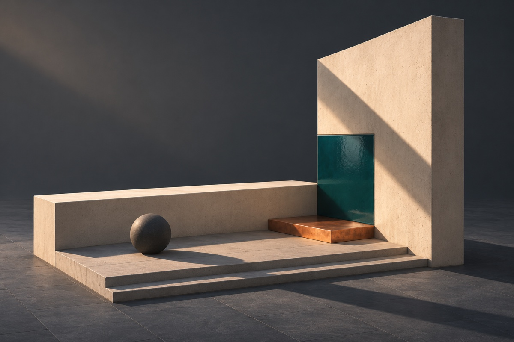

# Ludus product and art direction

This guide owns Ludus's visual identity, sample art direction, editor
presentation and wiki home. The shipped direction is **Quiet Studio with the
Ludus Block**, selected October 7, 2026. **Light & Form** is the proposed next
direction. It extends Quiet Studio's interaction principles and the approved
mint Block into a shared first experience for the engine, editor and wiki.
Games built with Ludus choose their own visual identity.

The artwork is wired into the editor's Qt resources, Welcome and recent-project
views, macOS app bundle, wiki branding and browser editor package. The production
theme now applies the light/dark roles below to the Qt workspace and project
creation dialog. The [multiplatform GUI systems](editor-gui-systems.md) and
[interaction design](editor-interaction-design.md) continue to own the compact
contextual row, useful central documents and optional secondary panels. Native
OS decoration/menu conventions stay native; the browser gets no simulated OS
title bar. A shared semantic component/token layer must style Qt controls
coherently; surrounding HTML cannot theme a Qt canvas. See the
[October 6 review](editor-gui-reference-review.md) for the actually read Excise,
Progressive Disclosure and Evaluation excerpts.

## Product promise

Make creative work predictable. Ludus owns routine setup, shows what is happening,
and protects the user's work. Complexity is available when it serves a task.
People should understand a command's outcome before invoking it and recover from
a failed operation without reconstructing their workspace.

This promise constrains implementation: one command and capability policy across
menus/buttons/shortcuts, one shared project backend across editor/CLI, explicit
save/discard/cancel, truthful progress, and verified publication. Automation must
reduce decisions without hiding failures or silently changing engine identity.

## Light and Form

The first creative task is to open a World, move its light and see the result.
The wiki shows the authored scene and offers a route into it. The editor gives
the scene the largest useful area and puts the controls for the selected object
within reach. The engine sample ships the inputs needed to reproduce the image.

| Surface | What works today | What to change |
| --- | --- | --- |
| Engine samples | The [Cornell box](../examples/cornell-box.md) makes material, geometry and lighting changes easy to compare. The [staircase2 image](../examples/reference-scene.md) records a reproducible offline reference capture. | Add an original, editable sample whose composition and lighting explain what a creator can do in the editor. |
| Editor | Docking, document ownership, predictable save and undo, and a stable viewport give users control. The documented [World workspace capture](../development/images/editor-workspace-vs-1920.png) also shows how empty panes and several control rows compete with the viewport. The browser first run can present a keymap dialog before the sample. | Give World a useful initial camera, clear primary actions and compact tool groups. Open the browser sample before asking about optional preferences. |
| Wiki | [The home page](../wiki/index.md) gives readers direct task links and search. Its eight equal cards and two side navigation columns give newcomers several choices of similar visual weight. | Give the home page one statement of purpose, one real Ludus image and two clear starting routes. Keep search prominent for returning readers. |

### Light Court showcase sample

*Light Court visual target, generated with OpenAI ImageGen. This illustration
communicates composition, materials and lighting for an authored Ludus World.*

Build a small courtyard with a stepped plinth, a tall concrete wall and a low
run of concrete that reads as an open L. The eye should travel from the lit
edge of the wall to the blue-green panel at its inside corner. Use a copper
plate below the panel and a single graphite sphere across the platform to make
the scale and material differences easy to read. The asymmetrical massing and
one strong diagonal shadow should remain recognizable at thumbnail size.

| Art decision | Target |
| --- | --- |
| Camera | A fixed, slightly elevated three-quarter opening view with the full L, the steps and the shadow in frame. Compose for a landscape viewport and check the crop at narrower widths. |
| Materials | Warm matte concrete is the largest area. The enamel is a smaller, deeper blue-green surface, the copper a warm metallic highlight, and the sphere a dark matte reference. Keep surface texture subordinate to the silhouette. |
| Lighting | Use an authored, low-angle directional light with a clear cast shadow and readable dark planes. If the chosen profile needs fill, use an explicit supported light in the saved World. |
| Color pipeline | Author material factors in linear space, encode base-color textures as sRGB, and use the selected renderer profile's documented display transform. Record that profile and the camera with the published capture. |

Use project-owned assets, ordinary meshes and the standard raster path. Give
the key light the name **Sun** and open the World at the authored camera. The
starter task is **Select Sun. Rotate it. Watch the shadow move.** Saving,
undoing and reopening follow the existing World workflow. The sample should
also read with selection cleared so the team can capture a clean image from the
same project. See [World renderer and camera preview](../development/editor-workspace.md#world-renderer-and-camera-preview)
and [lighting a World](../development/editor-workspace.md#lighting-a-world-that-renders-black).

Use the approved Block as the identity reference for any further Ludus-owned
showcase art. Start with readable masses, a clear focal point and a small number
of materials whose interaction with light can be seen. Captions for public
showcase images name the scene and capture path and link to the authored sample.
Concept art and offline reference captures keep their own labels and contexts.

### Editor presentation and first run

- **Start Page.** Lead with **New Project** and **Open Project** on desktop.
  Put recent projects nearby and give sample projects a clear entry point.
  In the browser demo, open the shipped sample with the default keymap and
  make the keymap change discoverable in Options. Use short labels that state
  what happens. Distinguish editing a World from playing a shipped browser
  build, and surface how to keep edits at the point of export or departure.
- **World workspace.** Group scene hierarchy and asset navigation so each has
  a clear job and the canvas dominates the default layout. Keep current view
  mode, framing and frequently used authoring commands close to the viewport.
  Keep camera diagnostics and capture tools in predictable menus or panels.
  Preserve panel recovery, keyboard access and the native layout conventions.
- **Properties and render graph.** Show the selected object or node at the top,
  keep labels aligned, and group fields by component or concern. Selection
  should be apparent even when keyboard focus is in a field. Keep graph port
  colors paired with type labels or shapes and retain the canvas routes for
  inspecting fields, editing connections and resolving rejected edits.
- **Feedback.** When a document is empty, offer the action that puts content
  there. For a failed edit, show the cause and repair where the action occurred.
  Keep diagnostics available as text. Show pending and failed viewport
  preparation separately from the last drawable frame.

The [workspace guide](../development/editor-workspace.md#workspace-layout),
[render graph authoring guide](../development/render-graph-authoring.md) and
[browser editor guide](../wiki/guides/browser-editor.md) own the commands,
supported actions and platform boundaries. Ship a browser Light Court route
when the supported browser renderer path reproduces that workflow. Until then,
the browser route opens a qualified sample such as Cornell Box.

### Wiki home

Use **Build your first world in Ludus** as the opening headline. Identify
Ludus as a C++ game engine and editor and name the first thing the visitor can
do. Pair that text with one useful landscape capture that shows the authored
scene at a recognizable size. Keep the headline, actions and caption in HTML
text so they remain readable on narrow screens and with images disabled.

Use **Install the editor** as the primary action and **Try the browser preview**
as a second path. Below the introduction, group the routes for creating a
project, editing a sample and exploring the SDK. Keep search and the documentation
index within reach. Preserve guide, architecture and API routes and use the
home-page layout only for the home page. The same Markdown and local image
must read offline. [Wiki development and publication](../development/wiki.md)
owns build, navigation and publication.

### Proposed appearance

Use near-neutral editor chrome so authored color reads cleanly. Use the
existing Block artwork and restrained mint or teal accents to identify Ludus.
Keep high-contrast appearance available and the viewport surround dark in
both appearances. Switching chrome appearance leaves authored colors, lights,
exposure and the view transform independent of the theme.

| Role | Dark appearance | Light appearance |
| --- | --- | --- |
| Workspace / panel / raised | `#171b1f` / `#20252a` / `#282e34` | `#f7f5f0` / `#ffffff` / `#eae7df` |
| Main text / secondary text | `#f0f2f1` / `#b4bdc0` | `#1d2428` / `#4f5d60` |
| Control edge / quiet divider | `#737f85` / `#3b444a` | `#778481` / `#d7d4cb` |
| Action fill / text on action | `#57d2c1` / `#142024` | `#09665a` / `#ffffff` |
| Selected row | `#284741` | `#ddefe9` |
| Viewport surround / selection stroke | `#0b0f12` / `#ffd25a` | `#0b0f12` / `#ffd25a` |

Reserve quiet dividers for decorative grouping and use the control edge where
the outline identifies an interactive control. Use an explicit focus outline
that remains visible over selected and hovered surfaces. Keep the viewport's
dark casing around the amber selection stroke, particularly over bright geometry.
Pair warning, error, success and progress colors with words or symbols. A mint
action uses the brand color. Successful completion has its own signal.

Use system sans-serif throughout. Let the landing headline use display scale
and the editor use its compact typographic roles. Use monospace or tabular
figures where paths, code or measurements benefit. Keep controls flat and use
the existing shape and spacing scale. Reserve dimensional shading for the mark
and authored imagery.

The colors above are proposed sRGB targets. Dark text on mint measures 9.0:1
and white on the light-theme teal measures 6.9:1. Confirm at least 4.5:1 for normal
text and 3:1 for large text and essential non-text contrast, including rendered
hover, selected and focus combinations. The approved [design tokens](../../config/design-tokens.json)
own the shipped values, contrast pairs and high-contrast variants. Extend that
source for shared color roles across Qt, setup, browser and wiki. The W3C
explains the thresholds for [text contrast](https://www.w3.org/WAI/WCAG22/Understanding/contrast-minimum.html)
and [non-text contrast](https://www.w3.org/WAI/WCAG22/Understanding/non-text-contrast.html).

### Implementation and review

1. **Author Light Court.** Use the ordinary desktop World preview to verify
   camera, materials and authored light. Rotate Sun, undo, save and reopen.
   Record the engine revision, renderer profile, capture settings and asset
   provenance. Publish a clean, reproducible engine capture for the next step.
2. **Improve the first session.** Start at a useful sample on the browser
   preview, defer the optional keymap choice and test the advertised edit,
   playback and export paths on their supported profiles. Verify viewport
   priority and useful empty states at 900 × 740 and 1280 × 800 on desktop.
   Exercise keyboard-only navigation and visible focus, light and dark chrome,
   high contrast and layout recovery. Confirm that pending and failed preparation
   retain the last drawable view and a ready replacement displays correctly.
3. **Update the wiki home.** Use the real engine image and verify both starting
   links, search and the sample walkthrough. Test narrow reflow without text
   clipping or overflow, both appearances, and the offline bundle. Record where
   first-time readers hesitate and whether they can reach their intended task.

## Ludus Block identity

The [standalone transparent mark](../wiki/assets/ludus-mark.png) and
[rounded tile icon](../wiki/assets/ludus-icon.png) are the approved visual
references. Both are 1254 × 1254 PNGs with alpha, created with built-in image
generation and approved by the project owner on October 7, 2026.
These PNGs are the shared artwork source for Qt resources, wiki branding and
browser packaging. The macOS bundle uses a derived ICNS file containing 16,
32, 128, 256 and 512 logical pixel icons at 1× and 2×. Regenerate it with macOS
`sips` exports named `icon_NxN.png` / `icon_NxN@2x.png` in a `.iconset` directory,
then `iconutil -c icns`; preserve the approved source artwork. The 16, 24 and 32 pixel
icons are drawn rather than scaled: `scripts/python/render_small_icons.py` redraws the tile
and the L's five planes from the reference's construction with flat brand colours, corners
snapped to the pixel grid, into `docs/wiki/assets/small` (the Editor's window icon picks the
nearest of these) and the setup window's `init_assets`. The ICNS still derives from the
reference, and a production vector master remains future refinement.

The letter should read as a building block: substantial, approachable and
precise. Preserve the upright stem, projecting foot, open inner corner and
consistent isometric perspective. Pale mint top planes and deeper teal side
planes explain the volume. The approved raster has gentle shading and rounded
edges; retain that character in large brand artwork, while small exports may
simplify shading to solid planes so the silhouette stays clear.

| Brand role | Target color | Use |
| --- | --- | --- |
| Mint front face | `#57d2c1` | Dominant logo color; dark-theme primary actions and focus |
| Pale mint top plane | `#b6f3e8` | Logo highlights and restrained supporting brand artwork |
| Deep teal side plane | `#229e95` | Logo depth; supporting brand artwork |
| Charcoal tile | `#18232c` | Application icon backdrop and dark workspace anchor |

These are reproducible design tokens, not exact samples of every shaded pixel
in the generated reference. Brand plane colors are not automatically suitable
for text or interaction states; use the semantic tokens below.

### Mark and icon use

- Use the charcoal tile for the editor application icon and the default icon
  of a project without its own artwork. User-supplied project artwork takes
  precedence; the fallback must not imply that every game shares Ludus branding.
- Use the standalone mark for documentation headers and Welcome branding when
  the surrounding surface already supplies a clear backdrop. Keep branding
  small in an active workspace so scene content remains the visual focus.
- Preserve aspect ratio, orientation and palette. Keep clear space of at least
  one sixth of the mark's width around the standalone mark; do not crop the foot
  or fill its inner corner. The supplied tile already includes its own inset.
- Keep the mark free of text, status badges, selection tint and animation.
  Place project names and operation/status indicators beside the icon. Use
  ordinary semantic glyphs for commands, files and diagnostics.
- Validate dedicated 16, 24, 32, 48, 64 and 128 pixel exports on dark and light
  surfaces. At small sizes simplify shading and tune edges to the pixel grid;
  do not assume scaling the reference PNG alone yields a readable icon. Platform
  packaging must account for OS masks and avoid applying a second rounded tile.

## Earlier direction studies

Open the [interactive proof of concept](../development/previews/editor-art-direction.html)
locally in a browser. Switch the direction cards, then try New Project, Browse,
Create, Close Project, and Build and Play. It simulates those interactions and
creates no files. The desktop implementation uses a real folder picker and
verified backend. This prototype and the captures below predate the selected
Ludus Block identity. They remain interaction studies, not the current palette
or a production theme.

| Direction | Philosophy | UI/UX emphasis | Visual language | Cost and tradeoff |
| --- | --- | --- | --- | --- |
| **Quiet Studio** (selected interaction model) | Protect attention; reveal complexity when useful | Task-focused Welcome; contextual authoring tools; advanced choices on demand; discoverable shortcuts | Earlier graphite/teal study; now refined by the Ludus Block identity | Lowest default visual load; expert speed requires deliberate shortcuts and compact layouts |
| **Instrument Panel** | Be a dependable, inspectable instrument | Compact rows; fixed command positions; continuous operation/ownership/recovery status | Charcoal, amber accent, square edges, precise strong dividers | Expert efficiency; more visual load and a higher learning burden if status becomes controls |
| **Open Workshop** | Build confidence through the task | Comfortable spacing; short explanations of outcomes; guidance that can be dismissed as skill grows | Light surfaces, cobalt actions, generous spacing, clear section structure | Accessible onboarding and documentation fit; repeated work needs a compact option |

Selected combination: Quiet Studio's attention model, Instrument Panel's truthful
status/recovery, and Open Workshop's plain language. Keep one coherent default;
do not combine all three layouts or add permanent guidance/status columns.
Dark/light appearance is an accessibility and environment preference. Both
appearances use the same mint/teal identity; cobalt from the earlier studies is
not an alternate brand palette to ship. Amber is a functional role (the selected
object), like success and danger, not a second brand colour.

The captured concept views are [Quiet Studio](../development/images/editor-direction-studio.jpg),
[Instrument Panel](../development/images/editor-direction-instrument.jpg), and
[Open Workshop](../development/images/editor-direction-workshop.jpg). Actual Qt
creation captures: [dark](../development/images/editor-project-creation-dark.png)
and [light](../development/images/editor-project-creation-light.png); these show
the implemented Ludus Block theme. Workspace captures are available in
[dark](../development/images/editor-block-workspace-dark.png) and
[light](../development/images/editor-block-workspace-light.png) appearance.

## Common interaction rules

- **Creation:** Name → Location with Browse → Create Project. Show the resulting
  new folder. Engine discovery and preparation happen behind this explicit action;
  specialist override lives in Advanced. Explain first-time downloads before Create.
- **Workspace:** Welcome carries recents while no project is open. Loaded projects
  receive the authoring area; File → Recent Projects remains available. Tool
  windows can be hidden through the Window menu; Window → Reset Window Layout
  always restores access.
- **Ownership:** a dialog has an unmistakable outer edge, title, primary action,
  and Cancel. Panels have visible title and splitter boundaries. Keyboard focus
  is visible, and disabled actions use the same capability rules everywhere.
- **Closing:** preserve settings/audio drafts with Save/Discard/Cancel. Failed
  Save and Cancel retain the project. Stop active work before Close Project;
  Close Project returns to Welcome without quitting the editor.
- **Language:** use verbs and outcomes. “Create Project” beats “OK”. Label Save
  Project Settings accurately until S2 adds focused document save routing.
- **Feedback:** identify operation and result; diagnostics remain selectable.
  Never claim readiness until configure/build/tests have completed. Do not steal
  selection or reset focused fields on runtime heartbeats (S2 acceptance).

## Visual system target

The HTML study has isolated surface/text/border/accent/radius tokens. The Qt
component layer now applies these roles to panel surfaces, tabs, fields,
buttons, lists, table headers and focus borders. Welcome groups its primary
creation/open actions above the recent-project list. Application palette changes
refresh the light/dark appearance; platform fonts, menus and window decoration
remain native. It uses logical pixels and layout managers, with no custom title-bar hit testing.

Use cool charcoal surfaces, mint actions, readable neutral text and modest
rounding. Translate the logo's construction into clear panel grouping and
strong silhouettes. Controls remain flat and easy to scan; isometric faces,
bevels and shaded blocks belong to brand artwork, not every button or panel.

The Qt layer has no stylesheet. `ApplyWorkspaceStyle` completes a palette from the
tokens (`MakeEditorPalette`: surfaces, text, mid and light roles, selection,
placeholder as secondary text, disabled text) and installs one `EditorStyle`, a
`QProxyStyle` over the platform style, that draws the pieces the palette cannot:
button and field edges and focus rings, tab underlines, dock titles, toolbar and
status bar rules, header sections and the dock separator. Controls therefore
inherit palette changes normally, keep platform metrics where they are not
overridden, and show the focus ring in the same widths (2 px, 3 px in high
contrast) in both appearances. `visualRole` (`primary`, `secondary`, `toggle`) and
`density=compact` properties are read by the style, and `itemPadding` pads a list's
rows. A `toggle` is a switch (Force raster, Work Light, Stats, the Content filter
chips): on, it fills with the accent; off, it keeps the `BorderControl` edge
(`BorderSubtle` when disabled), even as an auto-raise toolbar button at rest, so it
reads as something to press rather than as a label. The few per-widget `setStyleSheet` calls that remain (graph node details,
quick add, the world graph view and the state view) are local and are the
candidates for the next pass. The `[style][.gallery]` test writes a gallery of the
controls in dark, light and high contrast to `LUDUS_STYLE_GALLERY_DIR` for visual
comparison.

The tokens live in one file, [`config/design-tokens.json`](../../config/design-tokens.json).
The Editor reads a header generated from it at configure time
(`apps/editor/DesignTokens.cmake`), the setup window reads it through
`scripts/python/design_tokens.py`, and the browser editor's `editor.css` carries a
generated block of `--ludus-*` custom properties (`python3
scripts/python/design_tokens.py --write` refreshes it). The file also lists the
contrast pairs that must hold in both appearances; the Editor tests
(`[design-tokens]`) and `scripts/python/test_design_tokens.py` fail when a value
breaks one, when a colour is in no pair without a `contrastExempt` reason, or
when `MakeEditorPalette` maps a Qt role pair below WCAG AA. The table shows the
core roles; the file is authoritative.

| Semantic token | Dark appearance | Light appearance |
| --- | --- | --- |
| Workspace / panel | `#18232c` / `#222f39` | `#f1efea` / `#ffffff` |
| Raised surface | `#2c3c47` | `#e6e3dc` |
| Text / secondary text / hints | `#e9f2f1` / `#b5c5c9` / `#a5b7bc` | `#18232c` / `#4c6267` / `#4f6468` |
| Border (controls) / divider | `#80969e` / `#3a4d59` | `#6d8387` / `#d3d0c8` |
| Primary fill / text on fill | `#57d2c1` / `#18232c` | `#127066` / `#ffffff` |
| Focus ring / interactive text | `#57d2c1` | `#127066` |
| Selected surface / text | `#294b4b` / `#e9f2f1` | `#d5eee8` / `#18232c` |
| Viewport (both appearances) | `#090c0f` | `#090c0f` |
| Selection amber (viewport and graph canvas) | `#ffd25a` | `#ffd25a` |

The light appearance uses warm paper neutrals rather than mint-grey, while the
mint/teal brand colours are unchanged. The viewport stays dark in both
appearances so lighting judgements do not change with the interface theme.

Mint is the recognizable brand color in both appearances. On a light surface,
use the darker semantic teal for interactive text, focus rings and primary
button fills; reserve bright mint for artwork or fills with charcoal text.
Keep text and focus legible against every hover, pressed, selected and disabled
surface. Before shipping, verify at least 4.5:1 for normal text and 3:1 for
large text and essential control/focus boundaries in the actual rendered
components. Selection and keyboard focus need distinct treatments, such as a
tinted selection surface and an explicit focus outline, even when combined.

Use 4 logical px corner radii for compact controls, 6 for grouped surfaces and
8 for Welcome/project cards. The icon tile's broad rounding is a branding
proportion, not a radius to apply to dense editor controls. Distinguish workspace,
panels and raised dialogs through surface values, restrained borders and
explicit splitter boundaries. Avoid floating card decoration around every
inspector field; long property lists need consistent alignment and compact rows.

Use a system sans-serif font; monospace only for paths, code and numeric debug
values. Use a small spacing scale (4/8/12/16/24/32 logical px, the `design::SPACING_*`
tokens; layout code never types a pixel value, and the `[style][spacing]` test enforces
it), clear section titles in the Title type role, and text with icons for primary
actions. Peers in a run of symmetric commands (Undo/Redo, Pause/Step/Resume) are
icon-only with a tooltip. Match command glyphs by optical size,
stroke weight and modest rounding; reserve the dimensional L for branding.
Combo boxes reserve the full text advance, including letter spacing and glyph
bearings, alongside their arrow column. Qt's ink bounds can be narrower than
that advance; the shared style accounts for the difference while preserving
icon space and the control's size-adjustment policy. When sizing to contents,
check every offered item, including an item wider than the current selection,
with ordinary and spaced fonts.
Accent identifies selection/focus and primary actions; warning/error/success
also need words or symbols and separate semantic treatments. In particular,
mint action styling alone must not imply successful completion.

Use balanced density by default and a compact option for repeated expert work.
Welcome and project creation can have more breathing room and a visible mark;
the authoring workspace keeps chrome quiet around the central document. No
decorative animation during editing, rotating logo, glossy control gradients,
glow, glass blur or external font downloads. Respect reduced-motion preferences
for any functional transition introduced later.

The shared component layer must apply these roles to native and browser
presentations while preserving each platform's navigation and decoration
conventions. High-contrast/system accessibility appearances may override colors
or effects to preserve readability and state visibility.

## Validation before implementation acceptance

The logo selection fixes the identity; usability and component validation still
determine how the editor applies it. Run the same tasks against the updated
Quiet Studio design, then the native editor: create a project
without knowing SDK locations, choose its parent folder, cancel creation, reopen
a recent project, find a shortcut, attempt close with unsaved changes, cancel,
save and close, and recover a hidden panel. Observe novice and experienced
contributors; record completion, wrong turns, help requests, expected outcome,
and preference with a reason. Do not treat preference or screenshots alone as
proof of usability. Check dark/light, keyboard-only navigation, 900×740 and
high-DPI layouts, long paths, and the actual desktop folder picker. Check logo
exports at actual size, projects with custom artwork, focus combined with
selection, and readable diagnostics independent of brand color. Record whether
captures show the historical prototype, a themed component study or the shipped
editor; approval of the logo is not evidence of completed theme integration.

## Consulted design references

The [TOC reading guide](editor-reference-reading-guide.md) remains the catalogue;
selected chapters were read, rather than treating a chapter title as evidence.
Thanks to **David Lightbown**, *Designing the User Experience of Game Development
Tools* (CRC Press, 2015), ch. 4 pp. 53–62 (mental models/task flows), ch. 5
pp. 80–86 (hierarchy/constraints/mapping), pp. 112–115 (progressive disclosure),
and ch. 6 pp. 117–129 (evaluation). [Author's companion site](https://www.uxofgametools.com/).
Adaptation: compare task-based concepts and disclose engine selection; retain
native controls rather than reproducing the book's illustrative interfaces.

Thanks to **Graham Wihlidal**, *Game Engine Toolset Development* (Thomson Course
Technology, 2006), ch. 37 pp. 423–430, “Responsive UI During Intensive Processing.”
[Author's book](https://www.wihlidal.com/files/getd_full_book.pdf). Adopt responsive,
cancellable operations; preserve Ludus's existing supervised adapters and
exception-free C++ instead of the historical .NET examples. See the
[design review](editor-design-review.md) for implementation decisions and evidence.
