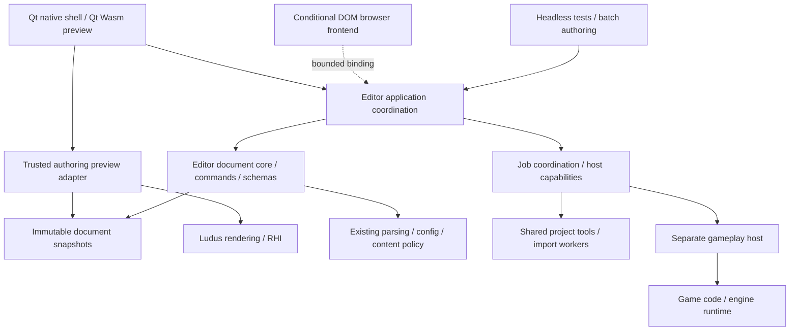

# Multiplatform editor GUI systems

Status: proposed target architecture, 2026-10-06. This is a design decision,
not a GUI rewrite or a claim of measured superiority. The current Linux Qt
workspace and bounded Qt/Wasm document preview remain the implemented baseline.
The native macOS/Windows editor, Qt-free document core, scene viewport and
contracts below require implementation and acceptance. The
[initial S2 slice](../development/editor-workspace.md#initial-s2-document-interactions)
implements a Qt-free bounded history primitive and adapts the current Qt project
settings form; descriptor validation and persistence have not yet moved into
the portable core. This does not complete milestone M1.

## Decision and priorities

Build a **portable document/command core, a Qt 6 Widgets native shell, and Ludus
rendered authoring viewports**. Keep the current Qt/Wasm preview. Qualify its
presentation for full browser authoring against explicit gates; select a DOM
frontend if it cannot pass them. Share document semantics across frontends and
platforms, while giving each host honest file, process and rendering capabilities.
[ADR 0023](../decisions/0023-editor-presentation-and-document-core.md) records the
selection and when to revisit it.

The priority order is preservation of work and predictable operations; usable
text, keyboard and accessibility; readable ownership and debugging; responsive
large documents; then visual polish, footprint and advanced customization.
There is no release deadline. This permits real integration experiments and
user evaluation; it does not make the lifetime cost of an extra toolkit vanish.
The recommendation is engineering judgment for Ludus, not a universal toolkit
ranking. There are no comparative performance results yet.

The modern part of this design is the combination of headless authoring,
transactional edits, revision-safe jobs, isolated gameplay and measured,
semantic presentation. A renderer that can draw buttons does not supply all
of those systems. Keep toolkit choice replaceable by putting authoring policy
below presentation, rather than designing a universal widget API. A future DOM frontend consumes
the same core compiled to Wasm through bounded typed commands, queries and
incremental deltas; it must not reimplement document validation/history in
JavaScript or serialize an entire project on each keystroke. Choose the smallest
binding needed by the accepted workflow, not a general RPC/object proxy system.

## Source editing direction

The current Renderer Source pane is a Qt `QPlainTextEdit` over the graph draft.
Its platform clipboard, selection, undo/redo and cursor-navigation behavior is
part of the editing baseline, including modifier keys and keyboard-only use.
The current pane does not provide language completion or formatting. Qt's
[QPlainTextEdit documentation](https://doc.qt.io/qt-6/qplaintextedit.html)
describes the supplied text operations; those must remain intact when adding
code-specific behavior.

Use lightweight in-editor editing plus **Open in Code Editor** for full code
work. The Renderer Source pane now lets native users choose an installed
application and open the selected saved project file. It asks before saving
pending changes or creating a project copy of the built-in graph. External saves
refresh a clean draft before validation/build, as one undoable revision; local
conflicts retain the draft and block the operation. Project-owned sources stay
in the project, and builds continue to consume a captured revision. The first
launcher opens files; diagnostic line navigation and editor-specific command
arguments are not yet integrated.

Full embedded code editing would require a maintained editor component,
project-aware completion and diagnostics, language-specific formatting, file
tabs, indentation, search, native Home/End and modifier-key behavior, clipboard,
IME and accessibility acceptance. Completion must see the same manifest-generated
shader interfaces and bindings as compilation, including unsaved source buffers.
Evaluate that as a separate integration rather
than growing a bespoke text widget. Slang's official
[editor extensions](https://shader-slang.org/tools/) already offer completion,
semantic highlighting and navigation; its
[VS Code extension](https://github.com/shader-slang/slang-vscode-extension)
uses `clang-format` for shader formatting. Prettier supports
[JSON and other listed languages](https://prettier.io/docs); formatter selection
must follow the source language and project configuration.

## Toolkit evaluation

| Option | Where it helps | Cost or constraint | Decision |
| --- | --- | --- | --- |
| Qt Widgets | Native forms, trees, tables, text, menus, accessibility, docking; existing C++ tools | Custom visual design needs discipline; browser integration has separate limits | Selected native presentation |
| Qt Quick/QML | Highly custom, fluid interfaces and declarative visual composition | A second presentation language and item/model layer; specialized desktop authoring still needs work | Evaluate for a specific surface only when Widgets fails its task |
| DOM application, optionally desktop hosted | Browser semantics, inspectable layout, broad web UI ecosystem; strongest alternative for browser authoring | Additional bindings/toolchain and desktop packaging; native GPU composition/process services still need explicit integration | Browser fallback; whole-editor replacement requires evidence |
| Dear ImGui | Developer diagnostics and rapidly built renderer-connected tools | Upstream documents incomplete accessibility and international text shaping/bidirectional support | Optional developer overlay |
| Ludus-owned widget toolkit | Complete control over drawing and dependencies | Ludus must own editing, IME, shaping, focus, accessibility, docking, clipboard and platform behavior indefinitely | Do not build for the editor |
| Different native UI stacks per OS | Deep platform customization | Duplicate layouts, bug fixes and authoring integration | Shared Qt views with narrow host adapters |

Qt's model/view APIs allow a projection over a separate data repository; the
widget model need not own the document. Use that seam instead of item widgets
as the database. [Qt model/view documentation](https://doc.qt.io/qt-6.10/model-view-programming.html).
Mixing in `QQuickWidget` has a documented extra render pass and disables the
threaded Quick render loop; this specific embedding cost does not imply that
all Qt Quick applications are slow. [Qt QQuickWidget](https://doc.qt.io/qt-6.10/qquickwidget.html).
Dear ImGui's own stated limitations inform its role here.
[Dear ImGui](https://github.com/ocornut/imgui).

Start with Qt's built-in docking and a small number of named panels. Prototype
advanced docking middleware only if cross-window tab groups or other required
workflows cannot be served well; evaluate recovery, accessibility, supported
platforms and dependency terms before adoption. A single new feature is not a
reason to replace the entire shell. The native shell now uses Qt's docking for
a Visual Studio-style layout (below); the evaluation records what middleware
would add.

### Visual Studio-style shell on Qt docking

The native editor follows Visual Studio's arrangement, which users of game and
engine tools already know: a central **document well** and **tool windows**
docked around it ([user guide](../development/editor-workspace.md#workspace-layout)).
Thanks to Microsoft for *Customize window layouts and personalize document tabs
in Visual Studio* (Visual Studio documentation, "Tab groups" and "Arrange
windows"); its tab-group, tool-window and reset-layout model informs this shell.
[Microsoft documentation](https://learn.microsoft.com/visualstudio/ide/customizing-window-layouts-in-visual-studio).

| Part | Qt Widgets mechanism | Owner and contract |
| --- | --- | --- |
| Document well | `QMainWindow` central widget: a `QSplitter` of `QTabWidget` tab groups (one direction, at most four groups) | `DocumentWell` owns presentation only: open views, order, active group and split. Closing a tab hides a view; its document owner keeps the draft |
| Tool windows | One `QDockWidget` per tool window with a stable `objectName` (Project Explorer, Properties, Error List, Output, Content, Render Preview, Live Inspector, Timing) | Each reads its owner's copied state or hosts a document owner's panel; none owns a draft |
| Commands | One `QAction` per command from a small catalogue (stable ID, label, short toolbar label, shortcut, help) shared by menus, toolbars and shortcuts | Document and controller operations validate at dispatch; documents have no duplicate command rows |
| Active document | The current tab of the active group | Save/Undo/Redo route to it; focus in a tool window keeps the document active |
| Layout | `saveState`/`restoreState` (version 5) per user, plus per-project open documents and groups | Older, other-Qt or corrupt layouts fall back to the default |
| Preferences | Tools > Options: a modal page list beside the selected page, editing a copy | The document owner validates and applies the accepted values |

Properties hosts one page per document kind and shows the active document's:
the World's entity inspector, or the render graph's node inspector, which follows
the canvas selection. Each panel is taken from its document owner
(`WorldWorkspace::TakePropertiesPanel`, `RendererWorkspace::TakeInspectorPanel`)
and keeps editing that document's draft, so Save and Undo still route to the
document. The Render Preview tool window hosts the render graph's preview panel
(`RendererWorkspace::TakePreviewPanel`); the preview itself, its borrowed World
viewport device and its activation stay with the document owner.

The Render Graph document is the source tree beside Canvas, Source and Plan views.
The shell's `renderGraph.*` commands (File > New/Open Render Graph, the Build menu
and the Render Graph toolbar) call its operations and read its gates (`CanBuild`,
`CanCreateGraph`, `IsJobActive`, `CommandsChanged`). Live Preview is document state
(`SetLivePreview`, `LivePreviewChanged`), so Cancel or a project change unchecks the
toggle. Tools > Options edits the document's `RenderGraphBuildSettings` and shows
what the last automatic build resolved. The Error List copies render-graph results
and parses build output; navigation calls the producer's existing location mapping
(`RendererWorkspace::ActivateDiagnostic`), whose rows are the Error List's rows in
the same order.

Today one render graph is open at a time. The next subsection designs one canvas
document per open `.lurender.json`.

### One document per render graph

This design is not implemented yet. Each open root `.lurender.json` becomes its
own Render Graph document, in the way Visual Studio opens one editor per file.
The document owner, `RendererWorkspace`, keeps its contract: one typed
`RenderGraphDocument` draft, one history, one `RenderGraphJob`, and one
`RenderGraphPreview`. A new private component, `RenderGraphDocuments`, owns the
set of these documents for the bound project. `MainWindow` still only routes
commands and tool windows to it. This follows the
[refactoring rules](#implementation-boundaries-and-refactoring): the set is a
narrow owner with its own state, not new branches spread through `MainWindow`.

**Identity and admission.** A document's identity is the canonical path of its
root graph. Opening a path that is already open activates that document.
`RenderGraphDocument::Load` reads every authored source below its package root.
Two documents whose package roots are equal, or where one root contains the
other, would therefore keep two drafts of the same files. The set refuses such an
open, names the open document that owns the package, and leaves that document
unchanged. The set holds at most `MAX_RENDER_GRAPH_DOCUMENTS` documents (8) plus
the main graph described below. A refused open reports its reason and loads
nothing. Project Explorer, File > Open Render Graph and shader items
(`FindPackageGraph`) all go through this one admission path.

**Main graph and engine default.** `graphs/Main/main.lurender.json` is a
permanent slot. While a project is bound there is always one main document. It
keeps today's `rendererWorkspace` objectName, so existing layouts restore, and
closing its tab only hides it, as now. When the file does not exist, the slot
shows the read-only engine default. Its identity is already the destination
path, so Save or Customize creates the package without re-keying the document.
New Graph refuses a name whose root graph would collide with an open document,
including an unsaved engine default. That stops creation from writing beneath a
draft. Every other graph document is dynamic: the set creates it when it opens
and destroys it when it closes.

**Jobs and creation.** Each document keeps its own job, and the existing checks
on request, epoch and loaded document reject stale results. Documents in
different packages may run jobs at the same time. Their build trees
(`out/render-graph/<package>/<graph>/`) and draft snapshots are disjoint. The set
adds no global queue until measurements show contention for the shared worker
socket. `RenderGraphCreation` moves from `RendererWorkspace` into the set, with
one creation per project at a time. New Graph and Open Graph add a document
instead of replacing a draft, so they no longer ask to discard one.
`CanCreateGraph` means "a project is bound and no creation is running". It no
longer depends on another document's job.

**Current graph document.** The commands that act on a graph target the *current
graph document*: Validate, Build, Build & Preview, Cook Runtime, Cancel, Live
Preview, Tools > Options' resolved tools, and Render Preview. This is the most
recently activated graph document. It stays current while a World or another
non-graph document is active, because Build & Preview is normally used with the
World tab in front. When the current document closes, the next most recently
active graph document takes over, and otherwise the main document. Save, Undo
and Redo still route to the active document only.

**Error List identity.** `ErrorListEntry` gains a nonzero `Owner`, the
document's serial. The set assigns serials from a per-session counter and never
reuses them. `ReplaceEntries(producer, owner, entries)` replaces only that
document's rows; build output uses owner 0. Render-graph rows show the File as a
project-relative path (package plus package-relative file), so rows from two
graphs can be told apart. To activate a row, the shell looks up the document by
`Owner`, opens it, and calls its own `ActivateDiagnostic(SourceIndex)`, so row
order still matches `MakeRenderGraphErrorEntries`. Closing a document removes its
rows. A project change removes every render-graph row. A row whose owner is gone
cannot navigate to another document.

**Properties.** Properties keeps one page per document instead of re-binding a
shared page. Each inspector panel is built over its own workspace's selection,
draft and edit callbacks. Re-binding one page would first require moving
inspector state out of `RendererWorkspace`, which is a separate extraction. The
set adds the document's `TakeInspectorPanel` page to the Properties stack when it
creates the document, and removes it when the document closes. Properties shows
the page of the active document, or the World page or the hint, as today.

**Render Preview and the shared device.** The Render Preview tool window holds a
stack of each document's `TakePreviewPanel` page and shows the current graph
document's page. Only the current document has a preview source:
`SetPreviewSource(&World->GetRenderPreview())`. Every other document has
`SetPreviewSource(nullptr)`, which detaches its `RenderGraphActivation` and
releases its generations on the World viewport device. Its last image stays
visible, marked stale, and its requested generation re-stages through
`ServicePreview` when it becomes current again. So at most one activation uses
the shared device, and `RenderPreview::DeviceStopping` still has a single
consumer to release. `WorldWorkspace::RenderPreviewChanged` re-targets only the
current document. A document without a source stops its preview timer.

Live Preview stays a per-document state, but at most one document may have it
on. Changing the current document turns it off on the previous one, and
`LivePreviewChanged` updates the toggle, because a background document's results
could not be shown. The set owns the project's `RenderGraphBuildSettings` and
applies them to every document, including new ones. Options shows the resolved
tools and SDK of the current document.

**Document well lifecycle.** `DocumentWell` gains documents that the owner
closes. They are registered with that flag, and a tab close, Window > Close
Document or Close All emits `CloseRequested(document)` instead of hiding the
document. The set asks to discard a dirty draft and cancels the document's job
and creation callback. It sets the preview source to null, removes the Error
List rows and the Properties and Render Preview pages, and calls
`RemoveDocument`, which unregisters the view without deleting it. It then
deletes the workspace before the panels it gave away; their connections use the
workspace as context, so they are already disconnected. A dynamic document's
objectName is `renderGraph.` followed by the first 16 hexadecimal digits of the
SHA-256 of its project-relative root graph path. So `DocumentWell::SaveState`
still contains no paths. Tab titles are the root graph's file name, with its
package folder added when two open documents share a file name, plus `*` while
dirty. Closing the project or the editor asks about every dirty graph document
in well order.

**Per-project layout.** The project workspace file adds `renderGraphs`: the
project-relative root graph paths of the dynamic documents, in opening order, at
most `MAX_RENDER_GRAPH_DOCUMENTS`. The layout version stays 5, because files
without the key restore only the main document and the Qt dock state does not
change. On restore, the set binds the project first. For each entry it rejects
absolute or escaping paths, requires an existing `.lurender.json` inside the
canonical project root, and applies the admission rules, skipping refused
entries and naming them in the status bar. Restore reads sources and writes
nothing. Only then does `DocumentWell::RestoreState` arrange the restored
objectNames. This reverses today's order, where the well restores before
`RendererWorkspace::SetProject`.

| Slice | Scope | Regression evidence |
| --- | --- | --- |
| 1 | `DocumentWell` owner-closed documents: `CloseRequested`, `RemoveDocument`; Close Document and Close All route through them | Well tests: hide versus request-close, removal while active or split, `SaveState` after removal |
| 2 | Error List `Owner` and project-relative render-graph File | Per-owner replacement keeps other owners' rows; activation reaches the owning document's `ActivateDiagnostic` |
| 3 | Extract `RenderGraphDocuments` holding only the main document, with no behaviour change: creation, build settings, preview-source assignment, current-graph tracking. `RendererWorkspace` gains a project binding that does not open the main graph | Existing `editor_shell_tests` and `renderer_workspace_tests` pass unchanged |
| 4 | Dynamic documents: admission, cap, per-document Properties and preview pages, current-graph routing, Live Preview handoff, close and destroy | `editor_shell_tests`: two graphs open in two tabs, Properties follows the active one, B's rows navigate to B, closing B cancels its job and removes its rows and pages, an overlapping package is refused, only the current document is attached (native preview builds) |
| 5 | Per-project restore of `renderGraphs`; user guides ([workspace layout](../development/editor-workspace.md#workspace-layout), [render-graph authoring](../development/render-graph-authoring.md#node-canvas-and-preview-rg3b)) | Restore reopens graphs by relative path, skips missing or escaping entries, and keeps the main document's objectName |

### Docking middleware evaluation

Qt Widgets docking lacks three Visual Studio behaviours: auto-hide (pinned) tool
windows, a drag-target guide diamond, and floating or cross-window document tab
groups. Two maintained Qt libraries provide some of them. Neither is added by
this change; adoption needs a prototype against the gates below and its own
reviewed change.

| | [Qt Advanced Docking System](https://github.com/githubuser0xFFFF/Qt-Advanced-Docking-System) | [KDDockWidgets](https://github.com/KDAB/KDDockWidgets) |
| --- | --- | --- |
| Licence | LGPL-2.1 | GPL-2.0 or GPL-3.0, or a commercial KDAB licence |
| Ludus licence fit | Usable from MIT-licensed Ludus when dynamically linked or relinkable, with notices; the static Qt/Wasm build already carries comparable LGPL obligations | GPL terms would apply to distributed editor binaries; avoiding them needs a commercial licence. A blocker for an MIT project without that purchase |
| Frontends | Qt Widgets (Qt 5 and 6) | Qt Widgets and Qt Quick (Qt 5 and 6) |
| Auto-hide | Yes, main window and floating containers | Not stated in its README; verify in a prototype |
| Drop guides | Drop overlays while dragging | Arrow drop indicators, customizable |
| Floating windows / tab groups | Docking into floating windows; named perspectives | Nested floating windows; partial layout save/restore |
| Stated platform support | Developed and tested on Windows; macOS reported working but untested by the author; Linux depends on the compositor, with Wayland limits (native decorations, compositor stacking, no restored floating positions, Qt 6.6.3+) | Lists macOS, Linux (X11, Wayland), Windows, WebAssembly and EGLFS |
| Integration cost | Replaces `QMainWindow` docking with its own dock manager; every tool window and the document well move to its API | Replaces `QMainWindow` docking with its own main window and layout serializer |

Read on 2026-10-19 from each project's README. Gates before adopting either:
macOS and Linux (X11 and Wayland) acceptance of drag, float, re-dock and restore;
keyboard access and accessible names for every dock and tab; recovery from
corrupt or old layouts at least as robust as the current versioned fallback;
the Qt/Wasm build; no exception-dependent API on normal paths; and a licence
review. On today's evidence the Qt Advanced Docking System is the candidate to
prototype if auto-hide becomes a required workflow; KDDockWidgets is not
viable without a commercial licence.

## Dependency and ownership map

Arrows describe dependencies or data consumption, not synchronous scheduling.
The DOM frontend is conditional, not a second required implementation. The
core does not depend on Qt, the renderer, a window, a GPU, or game code. Rendering
failure must leave documents editable and saveable.

| Owner | Authority and lifetime | What it exposes |
| --- | --- | --- |
| Document core | One authored draft, validated edits, history and saved-content identity per document | Typed queries, operations, immutable snapshots and revision deltas |
| Application coordination | Open documents, active task, selection, operation routing and capability results | Explicit command context and workflow state |
| Presentation | Widgets, focused text buffers, view projections, layout, local navigation | User intent; no direct draft or runtime mutation |
| Host adapters | File/persistence operations, process ownership, dialogs and host lifecycle | Bounded requests/results and supported/unavailable reasons |
| Job coordination | Operation identity, progress, cancellation and result publication | Copied results; never Qt model calls from workers |
| Authoring preview | Trusted scene rendering, cameras, picking and per-surface state | Revision-tagged input/results; no arbitrary game-module loading |
| Gameplay host | Game code, simulation and runtime resource lifetime | Existing bounded session protocol |

These are logical boundaries, not seven mandatory libraries. Start with one
private Qt-free document/application library and one private Qt shell target
under `apps/editor`, plus existing tooling adapters. The current target called
`ludus_editor_core` contains Qt types; its name is not proof of this separation.
Extract one real workflow before deciding further target splits. Do not build
an editor framework in Foundation or export Qt through the installed SDK.

Use existing Foundation parsing, configuration, task and content facilities at
their documented boundaries. Project setup continues to use its
[shared CLI policy](project-sdk-workflow.md). Promote a domain service to its
existing engine owner only when a real non-editor consumer needs it. No new
allocator, general reflection system, global service locator or event bus is
required. Follow Ludus C++23, explicit-error, no-exception, type, include and
public documentation standards throughout the migration.

## Documents and edit transactions

A document has a stable identity, schema version, authored content, monotonic
revision, saved-content identity, and bounded history. Paths are locations,
not object identities. Entity/asset/property IDs survive view sorting; runtime
handles additionally carry session/generation identity. Qt row indices and raw
pointers cannot identify persisted operations.

**Revision and dirty state are different.** Every committed change, including
Undo, advances the revision used to reject stale results. Dirty compares current
content with saved content or a valid history savepoint. Undo can restore saved
content without restoring its old revision. History eviction must not falsely
mark a modified document clean. A save captures content and identity; if edits
occur while it runs, completion acknowledges that snapshot and leaves newer
content dirty.

Each edit follows prepare, validate, commit and notify. Prepare captures enough
before/after data for a reversible operation and reserves required storage.
Validation checks the current target, schema, operation constraints and expected
revision. Failure preserves the draft and history. Commit publishes one coherent
change and a copied delta. Multi-selection edits prepare every target before
committing; partial application is not success. Prefer small typed operations
and direct functions over a generic reflective setter language.

An interactive gesture owns transient preview state. Begin records its targets;
updates change only that transient state; accept publishes one history item;
Escape, capture loss, invalidated targets or failure discard the preview. A
preview is visually marked and cannot silently enter a save snapshot. Scene
transforms, numeric scrubbing and curve edits use this same contract. Small edits
store changed values; use bounded snapshots when structural changes justify them.
There is one authoritative document history, rather than a second independent
Qt undo stack. Undo/Redo checks the current history head, not the original edit's
now-obsolete dispatch revision.

Focused text editing has a separate, temporary buffer: incomplete numbers and
IME composition must be representable without becoming document values.
Background deltas must preserve that buffer; conflicting changes get an explicit
resolution path. Text-widget Undo operates on this buffer while it owns focus;
document Undo operates on committed changes. Save first validates pending edits
in scope and reports invalid ones without discarding them. Close considers
pending buffers as unsaved work as well as committed dirty documents.

Source files and authored drafts are separate from simulation state. Live tuning
changes a session; copying a supported live value to a draft is an explicit
validated command. Saving that draft is another operation. Preserve the existing
[configuration](engine-configuration.md) and
[live-reload](project-live-reload.md) owners and protocols.

Thanks to **Robert Nystrom**, *Game Programming Patterns*, “Command,” especially
Undo and Redo: reversible operations inform this design. Ludus adds stable IDs,
validation and failure preservation rather than adopting raw-pointer examples.
[Author's chapter](https://gameprogrammingpatterns.com/command.html).
The exact reviewed excerpts are in the [reference review](editor-gui-reference-review.md).

## Commands and property presentation

A small command catalogue describes a stable ID, user label, context, shortcut
scope, capability/reason, typed parameters and execution category. Menus,
buttons, shortcuts, command search and automation dispatch through the same
application operation. Catalogue metadata is not a second source of domain
validation. Host and document validation run again at dispatch.

Distinguish reversible document edits, session controls, and external operations
such as save/build/import. An external effect cannot be reversed by pretending
it is a history entry. Undo after saving changes the draft; it does not rewrite
the disk until another explicit save. Automation invokes document commands and
job requests, rather than synthesizing widget clicks. Begin with headless tests
and batch calls; macro recording or scripting requires a demonstrated workflow.

Property descriptors declare a stable key, value type, display name, group/order,
units, defaults, bounds, help, authoring/session scope and editability. The source
schema owns validation; Qt adapters select reusable editors. Multi-selection can
show a mixed value without overwriting all objects on focus. Display conversions
must round-trip deliberately; formatting must not reduce stored precision.
Expensive previews and custom editors are registered per property type as needed.

Do not expose every C++ member or use arbitrary raw setters. Metadata describes
semantics; it does not bypass commands, ownership or serialization policy.
Thanks to **Graham Wihlidal**, *Game Engine Toolset Development* (2006), ch. 20,
“Using the Property Grid Control with Late Binding,” pp. 199–203, and ch. 43,
“MVC Object Model Automation with CodeDom,” pp. 531–537, for metadata and
presentation-independent automation. Ludus uses explicit C++ schemas and typed
operations, without .NET reflection, CodeDom or a global Application singleton.
[Author's book](https://www.wihlidal.com/files/getd_full_book.pdf).

## Threads, jobs and debugging

The UI thread owns Qt objects, model/view notifications and the serialized
application/document commit point. Workers receive immutable inputs and return
copied results. A worker never calls `QAbstractItemModel` APIs; the UI adapter
applies deltas using Qt's row/role notification contracts.
[Qt model threading and updates](https://doc.qt.io/qt-6.10/qabstractitemmodel.html).
Use direct calls within an owner; queues only where lifetime/thread/process
boundaries require them. An event system for every field change adds indirection
without fixing ownership. Browser adapters use cooperative chunks or explicit
worker messages as supported; the current single-threaded Pages preview is not
proof that native threads or blocking modal waits work there. Threaded Wasm needs
its own toolchain/deployment qualification. Asyncify is a compatibility mechanism,
not an excuse to block authoring work indefinitely.

Every job captures an operation ID, project epoch, relevant document/content
identity and target profile. Source changes may invalidate a result even when
the project remains open. Before publication, check those identities and the
operation's terminal state. Old jobs cannot publish into a reopened document or
launch an old artifact after a failed build. Reuse the project's existing
supervision and cleanup contracts.

Cancellation is a request followed by acknowledgement or another terminal
outcome. “Cancellation requested” is not “Cancelled”; a completed commit cannot
be undone by a late cancellation. Coalesce progress, bound queues/output/history,
and reserve terminal delivery so a progress flood cannot hide completion. For
imports, stage and validate an immutable artifact before switching the active
version; retain the last valid artifact on failure. Do not move blocking waits
or unbounded parsing onto the GUI thread.

Correlate command, operation, document revision and session IDs in existing
logging/profiling. Inspectable phase transitions and explicit error context
should reveal who owns a failure. A bounded diagnostic command record can replay
authoring failures against a captured source snapshot; external effects require
mocked adapters and are never automatically replayed. It is not a promise of
bit-identical gameplay replay or an unbounded capture of project data.

Thanks to **Graham Wihlidal**, ch. 6, “Measurement Metrics for Tool Quality,”
pp. 43–48, ch. 8, “Distributed Componential Architecture Design,” pp. 57–61,
and ch. 37, “Responsive UI During Intensive Processing,” pp. 423–428: the adopted
ideas are measurable maintainability, multiple entry points and responsive
cancellable work. We use private in-process functions and existing process
adapters rather than the book's .NET/COM/remoting stack.
[Author's book](https://www.wihlidal.com/files/getd_full_book.pdf).

## Rendering and platform hosts

Use Qt for the shell, forms, tables, hierarchy, search and text. Use custom Qt
2D painting for graph/timeline canvases when standard controls cannot serve them;
provide keyboard operations and semantic accessibility alongside drawing. Use
Ludus rendering for scene/material/game previews and 3D gizmos. Optional ImGui
panels serve developer diagnostics. Runtime UI remains its own engine concern;
`modules/ui` is not an editor widget toolkit.

Authoring preview runs trusted engine rendering from immutable draft snapshots;
it does not load arbitrary project game code. Gameplay stays in a supervised
child process. The proposed [Play in the editor viewport](#play-in-the-editor-viewport)
design presents that process's window in the World viewport, with a separate
window as the user's choice. It defines the format, ownership, sequence, resize
and backpressure contracts for macOS Metal and Linux Vulkan only. Do not promise
zero-copy sharing between Qt, Ludus and a child process elsewhere. CPU readback
is a diagnostic fallback, not the assumed interactive production path.

A render-surface adapter must specify who creates/destroys the window/view/canvas,
which thread may access it, pixel dimensions and scale, surface generation,
device/session identity, and teardown fencing. Resize, hiding, reparenting,
detaching, display change and device loss are normal transitions. Stale picking
results carry document, camera and surface identities and cannot select a new
scene or use an obsolete image after resize. Reuse the proposed
[camera ownership and render-view contract](camera-systems.md) for each logical
output; editor navigation is its own view state, not authored game camera data.

**This integration is not implemented by passing `winId()` to current RHI.**
Current Platform native-window handles are borrowed from Platform-owned windows;
current RHI window connection is not a general multiple-surface editor API.
Prototype a borrowed-surface contract and backend changes separately, preserving
Platform ownership. Native child-window embedding, focus, clipping and popups
need Linux Wayland/X11, macOS view and Windows tests. Cross-process reparenting
is not a portable default. A separate preview window remains the recovery path.

Multiple authoring views should share compatible preview resources/device where
the backend permits, while owning independent surfaces, cameras and render state.
Do not create a device per panel or assume the Qt compositor shares Ludus's device.
A device failure invalidates every dependent surface; each view establishes its
state explicitly. Thanks to **Graham Wihlidal**, ch. 25, “Using Direct3D Swap Chains
with MDI Applications,” pp. 243–247, for the shared-resource/per-view-lifetime
review. Its Direct3D 9 reset and swap-chain APIs are historical; modern RHI/Metal/
WebGPU behavior must be proven independently.
[Author's book](https://www.wihlidal.com/files/getd_full_book.pdf).

| Host | Shared presentation and policy | Host-specific acceptance |
| --- | --- | --- |
| Linux native | Qt views and portable authoring core | Existing process policy; Wayland/X11 focus, surfaces and dialogs |
| macOS native target | Same Qt views and core | Application menu, Command shortcuts, IME/VoiceOver, display scale, NSView/Metal lifetime, app bundle and process cleanup |
| Windows native target | Same Qt views and core | DPI changes, dialogs/paths, process-tree cleanup, surface and packaging integration |
| Browser | Current Qt/Wasm preview; qualified full-authoring frontend | Asynchronous files, download/recovery, browser focus/IME, semantic accessibility, canvas composition and unavailable native services |

Use Qt's public platform behavior for ordinary text, clipboard and dialogs;
add narrow host services for operations with different capability/ownership.
Do not abstract every Qt API into Ludus. Process availability, filesystem access,
audio and render support are independent capability results with useful reasons.
An OS rendering backend alone does not establish native editor support.

Browser composition requires a real prototype: Qt/Wasm presentation uses WebGL,
while the Ludus viewport uses WebGPU. Separate canvases must agree on logical and
physical bounds, clipping, stacking, popup overlap, focus, input and DPI. A DOM
frontend has similar viewport obligations. Host a canvas in a supported layout
seam; do not rely on Qt private globals as the enduring rendering API. A failed
viewport leaves the document UI usable. [Browser strategy](editor-browser-strategy.md)
defines the frontend selection gates and persistence limits.

## Play in the editor viewport

Status: approved 2026-10-19. P1 (the World-demo player on the engine Renderer),
P2 (World-demo Worlds in the shared World viewport, ScenePreview deleted) and P3
(the viewport frame source) are implemented; P4–P7 are pending. It replaces the
separate World-demo authoring window, the World-demo private shader and the
separate-window default for Play.

While a game plays, the World viewport is that game's window. The game owns
rendering and input there and behaves as it would in its own OS window. A
separate OS window is a mode the user chooses. Edit and Play both draw through
the one engine Renderer. No workspace, adapter or game keeps a private renderer,
window path or input path for the same job.

### Hosting stays out of process

The game runs in its own process: the Build and Run target, or GameHost for
Live Play. The editor never loads game code. This keeps
[ADR 0012](../decisions/0012-game-host-and-live-reload.md) and
[ADR 0023](../decisions/0023-editor-presentation-and-document-core.md) intact:

- A crashing or hung game cannot take documents with it.
- Module reload and checkpoint migration keep their supervisor.
- The editor and the game each own exactly one RHI device, as the current
  one-device-per-process `rhi::CreateDevice` contract requires.

In-process hosting is rejected. The game would have to run on the editor's
Qt-shared device and inside the editor's frame loop. Its window and input would
then differ from those of a shipped game, and a game crash would end the editing
session. The cost of keeping it out of process is a cross-process GPU image
transport, which RHI does not have yet.

### The hosted window

Platform gains one backend, `WindowSystem::Hosted`. A hosted window is a real
`platform::Window` whose events and surface come from a host channel instead of
an OS window server.

To start a session, the editor passes a channel address in the run request: a
per-session Unix socket path in a 0700 directory, plus a random token. The
tooling adapters (`editor_tool.py`, `play_tool.py`) add that address to the
child's environment. When the variable is present, `WindowManager::CreateWindow`
returns a hosted window. Game code does not change. The same mechanism covers
`apps/world_demo`, GameHost's `FramePresenter` and any other Ludus application.
Without the variable, the native backend runs as it does today.

The channel carries a bounded, versioned binary protocol owned by Platform. It
is separate from the GameHost control protocol and from the tooling stdio
events. A connection is accepted only with the token and a peer of the same uid.
The editor endpoint owns the socket. Losing the channel delivers a close to the
game, just as closing its window would.

The hosted backend implements the same `WindowBase` contract and event
vocabulary as Cocoa and Wayland:

- resize, in backing pixels plus a scale;
- visibility: Visible, Occluded or Minimized;
- focus, as FocusEntered/FocusLost resets with a held-key baseline;
- keyboard records through the attached sink;
- close.

Platform has no native pointer, cursor capture, fullscreen or text input yet.
Each of these lands in every backend in the same change, the hosted backend
included, so the viewport is never more or less capable than a native window.

Key translation has one owner. Platform publishes its existing native key-code
maps: Cocoa's `MapKeyCode` and the evdev keymap. The editor's Qt adapter converts
`QKeyEvent::nativeVirtualKey`/`nativeScanCode` through those maps, not through a
second table.

### The hosted surface and frame ownership

RHI connects a device to a hosted window exactly as it connects to any window.
`CreateDevice(app, {.System = Hosted, …})` yields a hosted surface. `BeginFrame`,
`EndFrame` and the Renderer's surface draws are unchanged. The hosted surface is
a swapchain whose presentation engine is the editor:

| Step | Producer: game RHI | Consumer: editor viewport |
| --- | --- | --- |
| Configure | Allocates three exportable RGBA8 images at the configured size, tagged with a surface generation | Imports each image onto its own Qt-shared device and records the generation |
| Acquire | `BeginFrame` takes an image the consumer has released. If none is free it returns `FrameStatus::Skipped` without blocking | — |
| Present | After `EndFrame`'s submission token is Ready, sends Present with image, generation and sequence | Wraps the image as the pending Qt texture through the existing lease path |
| Release | The image becomes acquirable again | Returns the image after the Qt frame that sampled it ends (`afterFrameEnd`) |
| Resize | Allocates a new generation on the next frame. Old images retire once all are released | Keeps the old generation's last image until the first new-generation frame arrives |

Completion is fenced on the CPU. The game announces a frame only after its GPU
work has completed. The editor returns an image only after its own sampling has
completed. Neither side needs the other's fence objects. Shared GPU events
(`MTLSharedEvent`, external semaphores) are a later optimization, made only if
measurements justify it. A skipped frame never undoes simulation, as specified
in [frame and tick updates](frame-update.md#presentation-and-rendering).

Backends:

- **macOS Metal.** Images are IOSurface-backed `MTLTexture`s. Each IOSurface is
  sent as a Mach send right (`IOSurfaceCreateMachPort`, then
  `IOSurfaceLookupFromMachPort`) through a per-session Mach rendezvous port that
  the editor registers. A Unix socket cannot carry Mach rights. Global IOSurface
  IDs are rejected because any process can look them up. The editor creates its
  texture on Qt's `MTLDevice` from the IOSurface. The P5 probe must confirm this
  exchange against Apple's [IOSurface](https://developer.apple.com/documentation/iosurface)
  documentation before the backend lands.
- **Linux Vulkan.** Images use `VK_KHR_external_memory_fd`: export with
  `vkGetMemoryFdKHR`, import with `VkImportMemoryFdInfoKHR`. The fds travel over
  the same Unix socket with `SCM_RIGHTS`. Opaque fd handles require the same
  `VkPhysicalDeviceIDProperties::deviceUUID` and `driverUUID` on both sides. On a
  mismatch, the editor refuses Play in the viewport and states the reason. Queue
  ownership transfers use `VK_QUEUE_FAMILY_EXTERNAL`. Thanks to the Khronos
  Vulkan Working Group for the
  [VK_KHR_external_memory_fd](https://docs.vulkan.org/refpages/latest/refpages/source/VK_KHR_external_memory_fd.html)
  and [external memory handle type compatibility](https://docs.vulkan.org/refpages/latest/refpages/source/VkExternalMemoryHandleTypeFlagBits.html)
  reference pages, which define the export, import and UUID-matching contract
  adopted here.
- **Browser and Windows.** Not covered. The browser editor keeps its separate
  web-sample player, and Platform has no Win32 backend. Each needs its own
  decision.

There is no CPU-readback Play transport. When hosted images are unavailable
(offscreen Qt, mismatched adapters, a missing extension), the editor states why
and offers the separate window. It never switches modes silently.

On the editor side, imported images reach the screen through the existing
presentation path: QQuickWindow, `ImageItem`, two frame slots, and release at
`afterFrameEnd`. `PreviewViewport` presents frames from a narrow
`ViewportFrameSource` with two implementations:

- `RenderPreview`, the in-process edit renderer;
- `PlayViewportSource`, which holds the imported hosted images.

Each source owns its leases and generations. The play source keeps a retired
generation alive until its last lease is released, as `PreviewGpuGeneration`
does. Play frames are shown 1:1 at the full viewport pixel size. The 1024-pixel
cap and the stretch mapping apply only to edit previews.

### Input, focus and capture

In Play, `PreviewViewport` stops navigating and forwards input instead. It does
not interpret game keys.

- **Focus.** Keyboard focus entering the viewport (by click or Tab) sends
  FocusEntered with the current held-key baseline. Focus loss, editor-window
  deactivation, hiding and modal dialogs send FocusLost. These are the
  transitions that Cocoa key-window changes and Wayland keyboard enter/leave
  already produce.
- **Shortcuts.** While the viewport has Play focus, it accepts
  `ShortcutOverride`, so menus and editor shortcuts cannot take game keys. Two
  chords stay reserved for the editor:
  - Shift+F6 stops Play (the existing Stop shortcut).
  - Shift+F1 releases capture and focus without stopping the game.
  - Esc belongs to the game.
- **Capture.** Once Platform supports cursor capture, a capture request from the
  game makes the viewport grab the mouse and hide the cursor, as navigation fly
  mode already does. The release chord, focus loss and Stop each end the capture.
- **Resize, scale and visibility.** A viewport resize becomes a hosted resize
  event in backing pixels and scale. Switching tabs or hiding the dock becomes
  Occluded, so GameHost's existing 10 Hz hidden pacing applies unchanged.
- **Close.** Stop sends a hosted close, the same as clicking a native window's
  close button, so the game shuts down along its normal path. The existing
  supervisor timeout and process-group cleanup remain the backstop.

### Separate window mode

Play offers **In viewport** (the default) and **In separate window**. The choice
is a local editor preference, not project data. In separate-window mode the
launcher omits the hosted-window variable, so the same binary with the same
arguments opens its native window. The World viewport keeps the edit view and
labels it as playing elsewhere. A mode change applies to the next Play; a
running session does not move between modes.

### Edit and Play transitions

One World viewport serves every World, World-demo included, in both modes.

1. **Edit.** `RenderPreview` renders the World extraction from the document
   snapshot and editor camera through the engine Renderer. Input drives
   navigation. The Render Graph document's preview follows
   `WorldWorkspace::GetRenderPreview`.
2. **Play requested.** The existing preconditions still apply: a saved project,
   clean drafts, and Build and Run or Live Play eligibility. The edit preview
   stops producing frames but keeps its device and its last image. The play
   source starts Pending, and the viewport keeps showing the edit image until a
   game frame is Ready.
3. **Playing.** The first presented game frame makes the play source Ready, and
   the viewport switches to it. Input switches to forwarding. The render-graph
   preview keeps its edit source; reloading a graph inside the game belongs to
   the live-reload asset path.
4. **Stop, exit or crash.** Leases drain, and imported images are destroyed
   after release. The edit source resumes from the document; simulation never
   writes authored state. A crash or failed start is reported in the status area
   and Output, and the edit view returns.

### World-demo on the engine Renderer

World-demo levels contain only 2D oriented boxes, and every one is opaque:
collision, scatter and role visuals all use alpha one (`apps/world_demo/world.cpp`).
They map onto existing Renderer features without a new shader:

- One unit-quad `MeshDescription`.
- One `SceneItem` per `RenderFrame` draw. Its `Affine3` comes from position,
  rotation and half extent, its `FlatMaterial` from the draw colour, and it uses
  the `Opaque` layer. The draw index becomes an explicit depth key, so collision
  boxes sit under scatter and scatter under actors, with no blending.
- The camera is the gameplay `CameraSample` that `GameWorld::Extract` already
  evaluates. The existing `camera_view` builder turns it into an orthographic
  `ViewDescription`.

A single Qt-free function owned by `apps/world_demo` turns a `RenderFrame` into
these items and the view. The runtime calls it every frame and draws with
`Renderer` on an explicit `CreateDevice` device instead of `rhi::Start`. The
editor builds a `GameWorld` from the projected level (`ProjectWorldDemo`)
without ticking it and extracts one frame. It then passes the same items to a
`RenderScene`, so World-demo Worlds render in the shared viewport like every
other World. `GetRenderPreview` returns that preview, so the render-graph
preview also works for World-demo Worlds. Edit and Play draw identical
geometry, scatter included, because both use the game's own extraction.

A World-demo frame holds up to 193 draws (`MAX_RENDER_DRAWS`, including the room floor). That is more
than RenderScene's current 128-object bound but within the Renderer's default
of 256. P2 raises the RenderScene bound to a named constant owned by the
Renderer limit, so the limit is not written as a second literal.

The following are then deleted:

- `ScenePreview` and its unavailable stub;
- `SceneDocument` and the `ludus_editor_scene` library;
- `world_scene.slang` and the editor's `editor_scene` shader;
- the World-demo **Open rendered preview** button;
- the `[.scene-native]` journey.

ScenePreview's keyboard gestures (WASD cursor, Enter pick, arrow transforms) are
not ported. Transforms are edited in the World inspector, as they are for every
other World. Viewport picking and gizmos are later work for all Worlds, not a
World-demo feature.

### Delivery stages

Each stage is one PR to `develop`, with regression tests, documentation and the
AGENTS.md gates.

| Stage | Boundary | Evidence |
| --- | --- | --- |
| P1 | World-demo runtime on the engine Renderer: shared item/view builder and an explicit device. The runtime stops using `world_scene.slang` | Builder unit tests for transform, order, colour and camera; headless and `--frames` runs; offscreen readback against the expected box layout |
| P2 | World-demo edit view in the shared viewport. Deletes ScenePreview, SceneDocument and `world_scene.slang` | World-demo Worlds publish a `RenderScene` and a RenderPreview; the render-graph preview attaches; inspector edits and undo update the frame; gesture tests replaced |
| P3 | `ViewportFrameSource` extracted in `PreviewViewport`, with no behaviour change | Existing viewport lease, resize, retire and offscreen tests pass unchanged |
| P4 | Platform hosted-window backend, editor endpoint and public native key-code maps | Socket-pair tests for each event, the focus baseline, close on channel loss, and token/uid refusal |
| P5 | RHI hosted surface: Metal IOSurface and Vulkan external-memory export and import | Two-process GPU tests: known colour, release-gated acquire, Skipped on exhaustion, retirement of resized generations, adapter-mismatch refusal |
| P6 | Play in the viewport: launcher variable, play source, input forwarding, reserved chords and transitions | Controller and viewport state tests; Cocoa journey playing World-demo in the viewport with native keys and resize; return to edit after crash and Stop |
| P7 | Separate-window preference and unavailable reasons | Preference persistence; launch without the variable; refusal-message tests |

P3's private `ViewportFrameSource` carries only frame
production and leases: `HasPendingFrame`, `TakeFrame`, `ReleaseFrame`, `Resize`,
`FrameReady` and `ResettingFrames`. Device admission, navigation and the
statistics overlay stay on `RenderPreview`, and the browser canvas still leases
from `RenderPreview` directly.
A source's images must live on the device that `RenderPreview` admitted. Its
leases use the Renderer's `ViewportFrame`, which only `RasterViewport` can issue,
so P6 must give the play source a way to issue leases.

P1, P3 and P4 are independent of each other. P2 needs P1, P5 needs P4, and P6
needs P2, P3 and P5. P5 opens with its macOS Mach rendezvous and Linux
device-UUID probes in the same PR.

## Implementation boundaries and refactoring

Large source files in scene cooking, rendering and the editor combine workflows
with different failure and lifetime contracts. Reduce coupling through private
components that own their state. Line counts prompt review; moving definitions
into headers or several files around an unchanged shared state does not establish
a boundary. Preserve public APIs and module dependency direction during the
initial extractions. The contributor policy is in
[AGENTS.md](../../AGENTS.md#responsibility-boundaries-and-incremental-refactoring).

The first extraction introduces `PreviewGpuGeneration` in the editor's private
implementation. Each generation freezes its validated scene and shading mode,
owns its renderer, assets, snapshot and lighting resources, and advances named
preparation stages through Pending, Ready or terminal Failed outcomes. The
preview coordinator owns camera/view updates, producer completion, frame
publication and routing image releases to the live or retired generation. It
retains the previous consumer-leased generation while a replacement prepares.
Preparation does not borrow the coordinator's mutable camera or asset handles.
Static-lighting publication and frame routing still need their own focused
extractions; this change does not complete the decomposition or qualify a new
platform. Preserve existing native/browser behavior and explicit unavailable
paths.

| Sequence | Boundary | Required preservation evidence |
| --- | --- | --- |
| 1 | Preview GPU preparation and resource generations; then frame publication/retirement and lighting/bake coordination | Pending and failed replacements retain the prior leased image; successful replacements publish their own image; release reaches the correct generation; camera/shading/resize and shutdown still work |
| 2 | World inspector presentation, import workflow, save/recovery and preview coordination | One document history; focused drafts survive failed replacement; stale document/project completions are rejected |
| 3 | Scene asset preparation, catalog/dependency assembly and transactional publication | Conflict detection, cancellation, paired catalog/level rollback and output preservation |
| 4 | Renderer resource/material/view/presentation and lighting/reference services | Stable handle ownership, bounded capacities and completion-based retirement; separately compiled private services |
| 5 | Reference cooker parsing, geometry/image conversion and serialization | Byte-identical reference outputs; reuse the existing general PBRT importer where contracts agree |

Use a separate reviewable change per boundary. Establish focused tests for the
existing contracts before extraction, identify intentional fixes separately from
moves, and run the applicable compiler, sanitizer, format/tidy and source-policy
checks. Offscreen GPU tests establish resource/publication behavior; interactive
native and browser viewport acceptance remains a separate requirement. Do not
mark later stages complete because a file became shorter.

## Workspace and visual system

Redesign around the active document, using the
[interaction contract](editor-interaction-design.md). Native hosts keep normal
OS window decoration and platform menu conventions. Browser hosts use an app
container without a simulated OS title bar. One compact application/context row
exposes project, document, save state and useful actions. The central task gets
space before optional inspector and diagnostics panels.

Keep common actions visible in a stable menu or contextual strip as well as
shortcuts/context menus. Place frequent context actions near their work; advanced
options and infrequent panels can be disclosed. Do not shuffle action positions
based on live usage metrics. Narrow containers switch secondary panels to tabs or
drawers, rather than clipping form fields behind empty docks. Tool windows scroll
their own overflow so a tabbed neighbour's minimum size never widens a dock
column at the documents' expense. Output stays a background tab behind the Error
List; a failed job raises the Error List without stealing focus. Large desktop
workspaces remain customizable with a recoverable default.

A small semantic design system owns surfaces, text, focus, selection, error,
spacing, typography, density and icon roles. Bind it to Qt palettes/style and
limited shared styling; avoid a separate stylesheet per panel. Preserve system
text behavior, scale and contrast choices. Light/dark and compact/comfortable
variants share components. HTML around a Qt canvas cannot theme the widgets
inside it. Accessibility includes names, roles, focus order, keyboard equivalents,
text entry and usable errors, rather than a color contrast pass alone.

Thanks to **David Lightbown**, *Designing the User Experience of Game Development
Tools* (CRC Press, 2015), ch. 5, “Excise” and “Progressive Disclosure,” pp. 104–114,
and ch. 6, pp. 117–129: remove repetitive navigation and clutter while preserving
discoverability; evaluate tasks with real users. These are workflow principles,
not a mandate to imitate another editor's skin.
[Author's companion site](https://www.uxofgametools.com/).

## Performance, evidence and delivery

Ordinary GUI work paints on demand. Active gestures/visible previews schedule
frames; inactive or hidden viewports stop or throttle. Preview frame rate does
not justify continuously repainting every panel. Virtualize large lists with
paged/lazy data, update changed roles, bound thumbnail caches and diagnostics,
and prioritize visible data. Preserve selected IDs and focused buffers across
updates. Optimize only after tracing input, domain work, notification and paint
costs separately.

Initial engineering targets below require a named machine, OS/browser, release
profile and reproducible dataset. They are targets, not current results or
industry benchmark claims. Baseline before setting enforced regression budgets.
Correctness, recovery and accessibility are hard gates even when a frontend is
faster. An unsupported browser/host must receive a useful capability explanation.

| Exercise | Measurement / gate |
| --- | --- |
| Ordinary command or property edit | Visible acknowledgement p95 under 100 ms; domain mutation and paint measured separately |
| Active viewport/drag | Target 16.7 ms total frame at 60 Hz; report p50/p95 and stalls, with Qt and engine costs separated |
| Idle open editor / hidden views | Record CPU, wakeups and GPU submissions against host baseline; no application-wide fixed refresh loop |
| 10,000 scene objects / 100,000 asset rows | Search, scroll, selection and edits remain usable; bounded models/caches; no widget per row |
| 100 Hz session updates / flooding diagnostics | Coalesced updates; edit buffers survive; completion and cancellation remain deliverable |
| Cold start / browser download | Record bytes, p50/p95 ready-to-edit, peak memory and failure recovery on declared devices |
| Add one property and one command | Domain registration plus adapter work, no duplicated validation in platform views; record files touched and debugging effort |

Deliver in reviewable vertical slices with acceptance evidence:

1. **M1: Portable authoring core.** Extract project-settings documents,
   validation and save into the Qt-free core. Prove the same fixtures and failure
   semantics headlessly, natively and in Wasm. Test save-during-edit, conflicts,
   history/savepoint behavior, invalid buffers and explicit allocation/error
   outcomes. Preserve existing serializers first.
2. **M2: Workspace shell.** Redesign the shell and semantic controls using those
   operations. Verify real keyboard, text, light/dark, narrow-container and
   panel-recovery tasks, including macOS integration; an offscreen screenshot
   alone does not qualify a platform.
3. **M3: Platform and viewport qualification.** Resolve browser frontend,
   large-model and native rendering risks with small runnable prototypes. Test
   Unicode/IME, screen readers, virtualized selection, compositor overlap and
   device/surface failure. Record decisions against the same tasks. If Qt/Wasm
   fails hard browser tasks, adopt DOM for browser and retire the preview frontend
   once it replaces its workflows.
4. **M4: End-to-end scene workflow.** Ship one asset/scene slice: import, find,
   place, select, transform, Undo, save, reopen and Play. Include cancelled/stale
   jobs, picking after resize, crash recovery and a real rendered frame. Establish
   multiple-surface RHI support before promising multiwindow scene previews.
5. **M5: Specialist authoring tools.** Add material/animation/audio tools through
   the same schemas, commands and preview ownership. Register trusted extensions
   statically first; do not auto-load native project plugins or hot-unload Qt
   object code. Add scripting or worker/plugin protocols only for a concrete task.

After M1–M4 pass their acceptance gates, record the implementation baseline and
perform the [deferred research review](editor-gui-reference-review.md#deferred-review-after-the-first-implementation).
Return to GDC/UIST and the other selected conferences, journals and talks with
observed workflow, performance and maintenance problems; compare bounded
experiments before changing the architecture. M3 qualification work remains part
of the first implementation. Specialist readings follow the relevant M5 work.

Per-document saves preserve conflict detection and atomic replacement semantics.
Multiple files do not acquire a fictitious global filesystem transaction. Design
recovery snapshots/journals with explicit bounds and crash guarantees before
shipping scene authoring; test truncated writes, stale recovery and failed flushes.
Browser persistence/export has a separate host contract: handing bytes to a
browser download acknowledges export, not durable saving to a chosen native
file. Label that outcome honestly; keep recovery/export reminders until the
product's declared persistence guarantee is met. Browser tab-close/unload cannot
be assumed to complete an asynchronous save. Reuse existing save
policies during extraction rather than silently expanding their guarantees.

The [reference review](editor-gui-reference-review.md) preserves the initial
proposal and the actual changes caused by reading. Existing E0/S1 specifications
remain historical implementation contracts; this target guides subsequent work.
