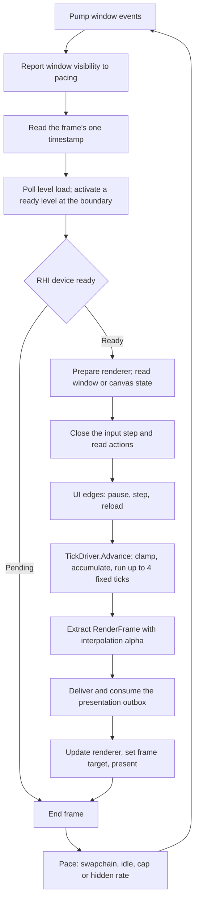

# Engine loop overview

Status: Overview and architecture assessment of the implemented runtime loops,
read from `develop` at `46f03beb7` on 2026-11-18. The ordering and timing
contracts stay with their owners; this page maps how executables compose them
and records where the implementation has drifted from those contracts.

Read this page to answer three questions: which loop runs a given executable,
what happens in one iteration and in which order, and which engine module owns
each step. The detailed contracts are in
[frame and tick updates](frame-update.md), [high-resolution time](high-resolution-time.md#native-frame-pacing),
[module startup and shutdown](module-lifecycle.md), the
[game host and live reload](project-live-reload.md) and the
[renderer systems](renderer-systems.md).

## No single engine-owned loop

Ludus does not ship a `Engine::Run()` that owns the frame. Each executable is a
composition root that calls engine modules in an order it writes as ordinary
code. This is deliberate: [frame-update.md](frame-update.md) makes call sites the
authoritative phase order, with no reflection, per-entity virtual callbacks or
registered update lists. The engine supplies the building blocks:

| Step | Engine owner | Building block |
| --- | --- | --- |
| Wait for the next frame start | `Ludus::Platform` | `platform::FramePacer`, `PacingClock` ([frame_pacing.h](../../modules/platform/include/ludus/platform/frame_pacing.h)) |
| Pump window and browser events | `Ludus::Platform` | `Window::HandleEvent`, `PollBrowserInput`, keyboard sinks |
| Close one input step | `Ludus::Input` | `InputSystem::ConsumeStep`, `GetAction` ([actions.h](../../modules/input/include/ludus/input/actions.h)) |
| Read one timestamp and clamp it | `Ludus::FoundationTime` | `time::Now`, `FrameClock::Sample` ([timers.hpp](../../modules/foundation/time/include/ludus/foundation/time/timers.hpp)) |
| Store entities and components | `Ludus::GameplayWorld` | `EntityRegistry`, `ComponentPool` |
| Open, record and present a frame | `Ludus::Rhi` | Global session (`rhi::Start`, `SetFrameTarget`, `BeginFrameStatus`, `EndFrameStatus`) or explicit device (`DeviceHandle`, `SurfaceHandle`) |
| Draw a world snapshot | `Ludus::Renderer` | Viewport raster and render-graph paths |

The fixed-step accumulator, the gameplay input bridge, the level session and
the module lifecycle runner are **not** in this list: today they exist only
inside sample applications. See [the assessment](#architecture-assessment).

## One frame in the reference order

The [world reference](../examples/world-demo.md) is the only loop that
implements the complete [frame-update](frame-update.md) contract. Its native
iteration is `Application::Frame` followed by `Application::Pace`
([application.cpp](../../apps/world_demo/application.cpp)):

1. **Pump.** `Window::HandleEvent` delivers platform events; keyboard records
   reach `InputSystem` through the attached sink. Closing the window ends the loop.
2. **Visibility and the timestamp.** The frame reports visibility to its pacing
   policy and reads `time::Now()` once. Every later step uses that value.
3. **Session transitions.** `Session::PollLoad` advances a level candidate;
   `Session::Activate` publishes it only at this boundary and resets the tick
   driver and pacing schedule, so loading time never becomes catch-up ticks.
4. **Device readiness.** Browser startup is asynchronous; a pending device ends
   the frame early without simulating.
5. **Input.** `ConsumeStep` closes the step. UI-owned edges (pause, single step,
   reload) are taken before gameplay samples its `TickInput`.
6. **Fixed ticks.** `TickDriver::Advance` samples the one `FrameClock`, adds
   `elapsed_ns × rate` to a checked rational phase and runs
   `GameWorld::RunTick` while a whole tick is due and the catch-up budget (4)
   allows. Excess whole ticks are discarded and counted. Hidden, paused and
   faulted frames drop debt instead of ticking. `RunTick` itself is the explicit
   phase chain BeginTick → Intent → Motion and collision → Gameplay → Commit →
   EndTick ([world.cpp](../../apps/world_demo/world.cpp)).
7. **Presentation.** `GameWorld::Extract` interpolates previous-to-current
   transforms by the carried phase into a reusable `RenderFrame`; the outbox of
   copied event records is delivered once and consumed.
8. **Render and present.** `FrameRenderer::Update` and `Present` draw,
   tone-map, encode and present in one submission through the explicit
   `DeviceHandle`. A skipped target is not a failure.
9. **Pace.** `LoopPacing::EndFrame` lets the FIFO swapchain pace presented
   frames, waits at an idle rate when nothing was presented, applies an
   optional cap and uses a low hidden rate while minimized or occluded.

In the browser the same `Frame` runs from `emscripten_set_main_loop`
([main.cpp](../../apps/world_demo/main.cpp)), and the presentation callback
paces it; `Pace` returns without waiting.

## The loops that exist

| Executable | Loop owner | Time model | Rendering path |
| --- | --- | --- | --- |
| Game host, editor play session | `HostSession::RunLoop` ([host_session.cpp](../../modules/runtime/game_host/src/host_session.cpp)) | One fixed 1/60 s `Update` per frame (four with debug fast-forward); `FrameClock` is diagnostic only | `FramePresenter::Present`: global RHI session, clear colour only |
| Shipping static game | `RunStatic` ([static_session.cpp](../../modules/runtime/game_host/src/static_session.cpp)) | One fixed 1/60 s `Update` per frame | Same presenter |
| Browser game player | `Frame` from `emscripten_set_main_loop` ([game_player.cpp](../../apps/web_samples/game_player.cpp)) | Variable step: wall-clock delta clamped to 0.1 s | Global RHI session, clear colour only |
| World reference (native, browser, editor-hosted window) | `Application::Frame` ([application.cpp](../../apps/world_demo/application.cpp)) | Bounded fixed-step accumulator with interpolation | Explicit `DeviceHandle` and engine `Renderer` |
| Smoke (native, browser) | `Application::Tick` ([application.cpp](../../apps/smoke/application.cpp)) | Variable step from the clamped `FrameClock` | Global RHI session through the smoke renderer |
| Editor | Qt event loop plus `QTimer`s and worker threads | Per-preview timers; the walk preview runs its own 120 Hz accumulator | Editor viewports; see the [editor architecture](editor-architecture.md) |

Small samples (`input_demo`, `cornell-box`, `audio-content`) have their own
`while` loops and are not listed. The editor never steps a game simulation
itself. **Play** on a game project starts the project's game host through
`scripts/python/play_tool.py` with a control socket, so the frame is
`HostSession::RunLoop`. **Play** in the World workspace requires the
`ludus_world_demo` target and starts it with `LUDUS_HOSTED_WINDOW` set. That
process runs the World reference loop and renders into a surface the editor
imports. Neither path renders on a thread other than the game process's main
thread.

### Game host

`game_host::Run` starts a `FramePresenter` (window, keyboard sink, bindings for
three actions, global RHI session), loads the gameplay module and calls
`HostSession::RunLoop`. Each iteration:

1. `HostPacing::Pace` waits for an absolute 60 Hz (hidden: 10 Hz) start.
2. `FrameClock::Sample` feeds timing telemetry only.
3. `FramePresenter::Poll` pumps the window and closes the input step;
   `PumpControl` reads the non-blocking control socket and dispatches validated
   editor commands (pause, step, reload, property edits, asset reload, stop) at
   the frame boundary.
4. `stepFrame` calls the module's `Update` with a `FrameInput` (fixed delta,
   simulation seconds, size, held-action bits, paused flag). A script-debug
   pause makes the tick partial; any other non-Ok status fails the session.
5. `FramePresenter::Present` validates the returned `RenderParams` and clears
   and presents the window.

The reload transaction (Validate, Quiesce, Snapshot, Stage, Commit, Retire) runs
inside a dispatched command, between frames, so it is serialized with stepping.
The contract is in [project live reload](project-live-reload.md) and
[ADR 0012](../decisions/0012-game-host-and-live-reload.md).

### Smoke application

The smoke loop proves startup, browser input and the RHI frame. Startup runs
through the private [lifecycle runner](../../apps/smoke/internal/lifecycle.h)
(window → RHI → renderer, reverse-order stop), polled from `Tick` while
`Loading`. Simulation is a variable step of the clamped frame interval.

## Rendering one frame

Every frame entry point reaches the GPU through one RHI choke point,
`internal::BeginSurfaceFrame` and `EndFrameStatus` in
[rhi.cpp](../../modules/graphics/rhi/src/rhi.cpp), which call the backend's
`Begin` and `End`. In the World reference on Vulkan the order is:

1. **Between frames.** `rhi::PollLifetime` collects completed work and
   transfers. `FrameRenderer::Update` builds the frame view and items, and
   `Renderer::CreateSnapshot` or `ReplaceSnapshot` and `PrepareView` accept them.
2. **Target.** `rhi::SetFrameTarget(device, surface, …)` records the extent, and
   a resize, for the next frame.
3. **Open.** `RasterViewport::Render` opens the frame through its
   [frame producer](#7-frame-bookkeeping-is-repeated-above-the-rhi), which
   calls `rhi::BeginFrame(device, surface)`. The backend waits on the
   frame-in-flight fence (two frames), harvests timing, acquires the swapchain
   image and begins the surface pass.
4. **Record.** `Renderer::DrawView` draws into scene colour, followed by optional
   overlays, tone-map and encode, and the composite to the surface.
5. **Close.** `rhi::EndFrame(device, token)` reserves the submission, runs the
   end-of-pass barriers, submits, presents and stamps the retirement ordinal
   that `SubmissionToken` exposes.

**Single owners.** Frames in flight, presentation and the retirement ledger
(`Collect` in [raster.cpp](../../modules/graphics/rhi/src/raster.cpp), keyed by
submission ordinal) each have one owner inside the RHI. A zero-size target, an
out-of-date swapchain or an acquire timeout returns `Skipped`. Loops treat that
as success without counting a presented image.

**Device loss.** Loss tears the session down, and no loop recreates the device:
the World reference enters `Failed`, and the game host fails the play session.

**What the game hands over.** A game-API module returns only `RenderParams`.
The World reference extracts a `RenderFrame` of bounded draw records and
converts it into renderer `SceneItem`s, which the renderer copies on
acceptance.

## What drives each subsystem

No engine code advances a subsystem on a game's behalf. The only exception is
input, which the game host's presenter steps once per frame. Everything else is
called, if at all, by an application loop:

| Subsystem | Per-frame or per-tick entry | Driven by |
| --- | --- | --- |
| Input | `InputSystem::ConsumeStep` | Game host presenter, World reference, input demo: once per presented frame |
| Gameplay world storage | None (`EntityRegistry`, `ComponentPool` are storage) | World reference `GameWorld::RunTick`, app code |
| Camera | `TryEvaluateCamera` (stateless) | World reference extraction, cornell-box, editor |
| Camera rigs and director | `TryAdvanceCameraRig`, `CameraDirector::TryUpdate`, `TryAdvanceControlView` | Nothing outside module tests |
| Collision queries | `CollisionWorld` raycasts and casts | Editor walk preview through `first_person_player`'s `WalkingController::Advance` |
| Fluid field | `Field::TryAdvance` | Nothing outside the SDK consumer test and web probe |
| Animation | `TryEvaluateComponentPose` | Nothing outside the SDK consumer test |
| Sequencer | `TryEvaluateSequenceObject`, `TryEvaluateSequenceCamera` | Nothing outside the SDK consumer test |
| Network | `LinkSimulator::Send`, `Receive` | Nothing outside the SDK consumer test |
| Audio | `AudioSystem::Service`, `AudioAppAdapter::Update`, content `Loader::Service` | `audio-content` example; editor audio preview and startup sound threads |
| Resources | `resources::Manager::Service` | `audio-content` example; editor render preview at start and teardown only |
| Behavior and Luau | `LuauProvider::Invoke`, `BeginDebug` (per event) | `scripted-game` module on a key press; `tools/script-session` |
| Live properties | `property_binding` codecs | `live-edit-game` callbacks, dispatched by `HostSession::PumpControl` |
| Shader development | `ShaderReload::Service` | Nothing outside renderer tests; the editor's preview reload mirrors its vocabulary separately |

## Startup and shutdown around the loop

[Module lifecycle](module-lifecycle.md) defines an authored start plan, polled
begin, reverse attempted-start journal and cleanup quarantine. Only the smoke
application uses it. The game host and the world reference start their window,
RHI and renderer in hand-written order and stop them in destructors or
`Shutdown` functions with the same order.

## Architecture assessment

This section records a review of the loops above against their contracts and
the repository's [responsibility-boundary rules](../../AGENTS.md#responsibility-boundaries-and-incremental-refactoring).
Each finding names its evidence so it can be re-checked; the recommendations are
proposals; each is tracked by the issue in the table below.

### Keep these properties

The loop design is sound where it is implemented. Preserve these properties
in any refactoring:

- **Call sites are the schedule.** No loop uses registration, reflection or
  per-entity virtual updates; the order is readable in one function per loop.
- **One timestamp per frame and one clamp.** The engine and reference loops read
  `time::Now()` once and clamp through a single `FrameClock`; the browser game
  player and the editor walk preview are the exceptions (findings 1 and 5). The
  world reference's rational
  phase makes tick counts independent of frame partitioning and reports
  clamped, discarded and excluded time separately.
- **No waiting in the frame.** Browser callbacks never block; native waits
  happen only in the injected-clock pacer, which is unit-testable.
- **Explicit failure, responsive faults.** Loop functions are `noexcept` and
  return statuses. A simulation fault stops ticks but keeps pumping and
  presenting; a presentation failure is never reported as a simulation fault.
- **Boundary-only transitions.** Level activation, module reload and property
  edits apply between frames, and a failed candidate preserves the active world
  or module.

### Findings

| # | Finding | Severity | Size | Issue |
| --- | --- | --- | --- | --- |
| 1 | [The fixed-tick contract has no engine implementation](#1-the-fixed-tick-contract-has-no-engine-implementation) | High | M | [#1783](https://github.com/The-Ludus-Project/Ludus/issues/1783) |
| 2 | [Game host ticks are coupled to frames](#2-game-host-ticks-are-coupled-to-frames) | High (decision) | M | [#1784](https://github.com/The-Ludus-Project/Ludus/issues/1784) |
| 3 | [The engine game path cannot draw a World](#3-the-engine-game-path-cannot-draw-a-world) | High (direction) | L | [#1785](https://github.com/The-Ludus-Project/Ludus/issues/1785) |
| 4 | [Subsystems are built ahead of any loop](#4-subsystems-are-built-ahead-of-any-loop) | High | Policy | [#1786](https://github.com/The-Ludus-Project/Ludus/issues/1786) |
| 5 | [Three game-API frame loops](#5-three-game-api-frame-loops) | Medium | S | [#1787](https://github.com/The-Ludus-Project/Ludus/issues/1787) |
| 6 | [`HostSession` concentrates five responsibilities](#6-hostsession-concentrates-five-responsibilities) | Medium | M | [#1788](https://github.com/The-Ludus-Project/Ludus/issues/1788) |
| 7 | [Frame bookkeeping is repeated above the RHI](#7-frame-bookkeeping-is-repeated-above-the-rhi) | Medium | M | [#1789](https://github.com/The-Ludus-Project/Ludus/issues/1789) |
| 8 | [Two pacing policies over one pacer](#8-two-pacing-policies-over-one-pacer) | Low | S | [#1790](https://github.com/The-Ludus-Project/Ludus/issues/1790) |
| 9 | [The lifecycle runner has one consumer](#9-the-lifecycle-runner-has-one-consumer) | Low | S | [#1791](https://github.com/The-Ludus-Project/Ludus/issues/1791) |
| 10 | [Two RHI frame entry points and an unused synchronous API](#10-two-rhi-frame-entry-points-and-an-unused-synchronous-api) | Low | S | [#1792](https://github.com/The-Ludus-Project/Ludus/issues/1792) |
| 11 | [The input step contract names the wrong unit](#11-the-input-step-contract-names-the-wrong-unit) | Low | S | [#1793](https://github.com/The-Ludus-Project/Ludus/issues/1793) |
| 12 | [Repeated helpers and constants in the loop path](#12-repeated-helpers-and-constants-in-the-loop-path) | Low | S | [#1794](https://github.com/The-Ludus-Project/Ludus/issues/1794) |

#### 1. The fixed-tick contract has no engine implementation

[frame-update.md](frame-update.md) is written as an engine contract, but its
only implementation, `TickDriver`, `TickPolicy`, `InputBridge`, `Mode` and the
level `Session`, is in [apps/world_demo/world.cpp](../../apps/world_demo/world.cpp)
(1,827 lines). The same file holds the sample's game rules: scatter, harvest
and regrow, combat and replay hashing. As a result, every other loop derives
its own time model:

| Loop | Time model |
| --- | --- |
| World reference | Bounded fixed step, rational phase, interpolation |
| Game host | One fixed step per frame, no accumulator |
| Smoke | Variable step |
| Browser game player | Variable step, 0.1 s clamp |
| Editor walk preview (`WalkingController`) | Fixed 120 Hz `float64` accumulator, 0.1 s clamp, no interpolation or discard accounting |

A user's game cannot reuse the reviewed driver without copying sample code.
The second accumulator in
[walking_controller.cpp](../../apps/first_person_player/walking_controller.cpp)
already differs in representation, rate, clamp and catch-up policy.

**Recommendation.** Move the game-independent pieces, `TickPolicy`,
`TickDriver`, `InputBridge` and the tick-mode state, into an engine module
under `modules/gameplay/` (or FoundationTime if it stays world-agnostic). Make
the driver call a non-template tick callback with a returned status instead of
`GameWorld::RunTick`. Keep the World reference's rules in the app. Make it a
structural move first, with the existing
[simulation tests](../../apps/world_demo/tests/simulation_tests.cpp) moving
alongside it, then adopt the driver in a separate change.

#### 2. Game host ticks are coupled to frames

`HostSession::updateGame` ([host_session.cpp](../../modules/runtime/game_host/src/host_session.cpp))
passes a constant `1/60 s` delta for each `Update`, and `RunLoop` calls it once
per paced frame. Its `FrameClock` feeds telemetry only. The code says this is
intended ("Ticks still follow frames"), but it departs from
[frame-update.md](frame-update.md#time-and-frame-ownership) in three ways:

- Simulation speed follows the frame rate: a 30 fps stretch runs the game at
  half speed, with no catch-up.
- A minimized or occluded window keeps ticking at the 10 Hz hidden rate. The
  contract says hidden frames drop time.
- `FrameInput` carries no interpolation alpha or accepted elapsed time, so a
  module cannot decouple presentation from ticks itself.

**Recommendation.** Decide which contract governs hosted games. Either adopt
the shared driver from finding 1 in `HostSession` and append the alpha and tick
count to `FrameInput` through the ABI's negotiated `StructSize` tail, or record
the frame-coupled model as an explicit exception in frame-update.md and the
[game API](../../modules/runtime/game_api/include/ludus/runtime/game_api/services.h)
documentation. As it stands, the code and the design disagree without saying so.

#### 3. The engine game path cannot draw a World

The hosted ABI's `RenderParams` is a clear colour plus four reserved scalars
that are validated but never rendered
([services.h](../../modules/runtime/game_api/include/ludus/runtime/game_api/services.h)).
`FramePresenter::Present` clears and presents the window, and that is all a
GameHost game can show. World rendering, extraction and the engine `Renderer`
run only in the World reference. The editor launches that reference as the
`ludus_world_demo` executable target in a hosted window
([main_window.cpp](../../apps/editor/src/main_window.cpp)), and the editor links
the sample's level codec through
[world_demo_adapter.h](../../apps/editor/src/internal/world_demo_adapter.h).
So there are two game runtimes. The supervised, reloadable one cannot draw, and
the one that draws is a sample the editor depends on.

**Recommendation.** Make the next hosted presentation contract a bounded
snapshot that the host hands to the engine `Renderer`, the `RenderFrame` that
frame-update.md already defines, rather than growing `RenderParams` scalars.
Do not add more reserved fields speculatively. Then decide whether the World
reference becomes a GameHost module, which would remove the editor's dependency
on sample internals. This is a design decision for an ADR, not a refactor.

#### 4. Subsystems are built ahead of any loop

This is the clearest sign of bloat. Several modules implement per-tick
behaviour, with tests and SDK consumer coverage, but no loop calls them (see
[what drives each subsystem](#what-drives-each-subsystem)):

- **No caller at all:** camera rigs and the camera director, animation pose
  evaluation, the sequencer, the fluid field, the network link simulator and
  `ShaderReload::Service`.
- **Callers outside the game path only:** audio and resource servicing run in
  one example and in editor worker threads.

None of these is reachable from the game host or from a game module's
`Update`. Their timing contracts (who calls them, at which phase, with which
delta) are therefore untested against a real frame. When the first game
integrates them, it may find that the API shape is wrong.

**Recommendation.** Before more feature work on these modules, connect each to
one loop through its frame-update phase: for example camera rigs in
presentation, animation evaluation after Motion, and audio delivery from the
presentation outbox. Do this in the shared driver from finding 1, or in the
World reference until that driver exists. Record in each module's status line
which loop drives it. Treat "has a consumer loop" as an acceptance condition for
new per-tick subsystem work, alongside tests.

#### 5. Three game-API frame loops

Three loops build a `FrameInput` and call a module's `Update`:

| Loop | Delta passed to `Update` |
| --- | --- |
| `HostSession::updateGame` | Fixed 1/60 s |
| `RunStatic` ([static_session.cpp](../../modules/runtime/game_host/src/static_session.cpp)) | Fixed 1/60 s |
| web_samples `Frame` ([game_player.cpp](../../apps/web_samples/game_player.cpp)) | Wall-clock delta clamped to 0.1 s |

The same game module therefore gets different time semantics natively and in
the browser.

[host.h](../../modules/runtime/game_host/include/ludus/runtime/game_host/host.h)
says "the same host run loop drives" the static path, but `RunStatic`
re-implements it, and the copies already differ:

- The static loop treats any non-Ok status, including `ScriptPaused`, as an
  `Internal` failure that ends the session.
- It has no telemetry.
- It derives `ElapsedSeconds` from the frame index.
- It duplicates the 60 Hz and 800×600 constants.

**Recommendation.** Let `HostSession` accept an in-process function table as
its module source, with no reload capability and no control channel. Then
`RunStatic` becomes `HostSession::RunLoop`, and shipping games run the same
frame as editor play. Make the browser player fill `FrameInput` with the same
helper and the same time model, which finding 2 decides.

#### 6. `HostSession` concentrates five responsibilities

[host_session.cpp](../../modules/runtime/game_host/src/host_session.cpp) has
1,376 lines. `Dispatch` alone is about 470 lines of string-compared command
branches, which mix literals such as `"Load"` with `CommandKindName(...)`.
`ReloadTo` is about 250 lines. The class also owns output framing and the
retained-result cache, the frame loop and telemetry. The header's reason for a
single owner (it serializes reload against stepping and edits) is valid, and
that serialization should stay. The code inside it is what needs splitting.
Member naming mixes `State_` with `mIsFastForwarding`, and the members use
owning `std::string`, which is [ADR 0003](../decisions/0003-standard-library-usage-policy.md)
migration debt.

**Recommendation.** Keep `HostSession` as the serializing owner, and extract
one boundary per change, each with regression coverage first:

1. Decode commands to `CommandKind` once in the protocol codec, and dispatch to
   one private handler per kind.
2. Move the reload transaction into a component with its own narrow state.
3. Move the output queue and result retention into the control-channel side.

#### 7. Frame bookkeeping is repeated above the RHI

Inside the RHI, fences, frames in flight, presentation and retirement each have
one owner (see [rendering one frame](#rendering-one-frame)). Above it, the
renderer and editor have at least seven entry points that open their own
frames or graphs. Among them are `RasterViewport::Render`,
`RenderGraph::Render`, `Renderer::Submit`, the GPU preview and reference-capture
advances, and several editor readers and shadow producers. They repeat the
same bookkeeping:

- **Double-buffered output images** with a generation lease and producer token,
  in `RasterViewport`, the GPU preview job, `RenderGraph` and the editor's
  graph display and shadow producers.
- **Retrying a frame left open** after `EndFrame` fails to reserve the
  submission, written four times
  ([viewport.cpp](../../modules/graphics/renderer/src/viewport.cpp),
  [render_graph.cpp](../../modules/graphics/renderer/src/render_graph.cpp),
  `render_preview.cpp`, `preview_gpu_generation.cpp`).
- **`DeviceStatus` to `RasterStatus` mapping**, written four times: the two
  renderer files above and the frame-opening paths of `SubmitCommands` and
  `ExecuteOrderedGraph` in
  [lifetime_services.h](../../modules/graphics/rhi/src/internal/lifetime_services.h)
  and [ordered_graph.h](../../modules/graphics/rhi/src/internal/ordered_graph.h).
  The RHI exposes three frame status enums (`FrameStatus`, `DeviceStatus`,
  `RasterStatus`), so every layer translates. The editor render preview's
  `DeviceStatus` switch turns browser admission failures into user text; it is
  not a `RasterStatus` mapping.

The RHI allows one open frame per device, and every submission opens a frame on
a surface slot. Vulkan and Metal reject an offscreen-only frame target, so
shadow, copy and compute submissions share the surface frame's lifecycle.

The largest translation units hide their size by including implementation
headers:

| File | Own lines | Including | Mixed responsibilities |
| --- | --- | --- | --- |
| [renderer.cpp](../../modules/graphics/renderer/src/renderer.cpp) | 6,194 | `gpu_preview_services.h`, `reference_services.h` (about 10,800 lines in all) | `Renderer`: about 70 public methods spanning mesh and snapshot storage, pipeline cache, L0 submit, L1 views, lighting presentation, shadow atlas, GPU preview and the reference path tracer |
| [render_graph.cpp](../../modules/graphics/renderer/src/render_graph.cpp) | 4,615 | | An inline `State` of about 1,180 lines; scene update, resize, ray accumulation, debug capture and reporting |
| [raster.cpp](../../modules/graphics/rhi/src/raster.cpp) | 3,527 | lifetime, transfer, compute, ordered-graph, ray and interop service headers (about 9,700 lines in all) | Resource registry, draw encoding, frame ledger and retirement, spatial upscale |

Including a header of implementation code does not establish a compilation
boundary under the [refactoring rules](../../AGENTS.md#responsibility-boundaries-and-incremental-refactoring).

**Recommendation.** Give the RHI one small "frame producer" helper that owns the
two output slots, the producer token, the retry of a frame left open and the
status translation, and adopt it in each entry point one at a time. Plan the
renderer's split by responsibility (reference tracer, GPU preview, raster views)
into real translation units with narrow state, following the existing
[renderer decomposition priority](editor-gui-systems.md#implementation-boundaries-and-refactoring).
Consider an offscreen-only frame on Vulkan and Metal before adding more
standalone submissions.

**Progress (2026-11-19, [#1789](https://github.com/The-Ludus-Project/Ludus/issues/1789)).**
[frame_producer.h](../../modules/graphics/rhi/include/ludus/graphics/rhi/frame_producer.h)
provides the helper in three parts:

- `rhi::ToRasterStatus` is the one `DeviceStatus` to `RasterStatus`
  translation. The two renderer copies and both RHI submission paths use it.
- `rhi::FrameRecording` owns one open frame: the surface it was acquired on,
  the first recording failure and the retry of a close that could not reserve
  its submission. A single-output producer, such as `RenderGraph` or a shadow
  producer, uses it directly.
- `rhi::FrameProducer` adds the two output slots: generation leases, the
  latest producer token per slot and publication of a slot only after a fully
  successful frame.

`RasterViewport` is the reference adoption of `FrameProducer`, and
`RenderGraph::Render` adopts `FrameRecording`. The remaining entry points adopt
the helper one per change: the GPU preview job, the editor render preview's
retry, the editor shadow producer and the editor graph display frames. The header documents ownership, lifetime, thread affinity and failure
behaviour.

**Decision: offscreen-only frames on Vulkan and Metal (2026-11-19).** Vulkan
and Metal gain an offscreen-only frame (`FrameTarget::ShouldPresentToSurface =
false`) before any further standalone submission is added. Until then, the
existing standalone submissions keep sharing the surface frame. The reasons:

- Both backends reject the target with `Unsupported` in `SetTarget`
  ([rhi_vulkan.cpp](../../modules/graphics/rhi/src/rhi_vulkan.cpp),
  [rhi_metal.mm](../../modules/graphics/rhi/src/rhi_metal.mm)). Direct3D 12,
  WebGPU and WebGL 2 accept it under the contract on `FrameTarget` in
  [rhi.h](../../modules/graphics/rhi/include/ludus/graphics/rhi/rhi.h).
- On a surface frame, a standalone shadow, copy or compute submission waits on
  a frame-in-flight fence, then acquires and presents a surface image. It takes
  one of the two frames in flight from the view. A zero-size target, such as a
  minimized Vulkan window's, returns `Skipped`, so that work cannot progress
  while the window is hidden.
- Today's standalone submissions run against headless surfaces, which keeps
  that cost small: the Editor's (8×8 when sharing Qt's device, 1×1 offscreen)
  and the reference-scene example's 8×8 device. An application presenting to a
  window has no such surface.
- The browser editor already records its shadow frame offscreen and then
  restores the presenting target, so `preview_gpu_generation.cpp` keeps a
  browser-only path.

The backend change is separate RHI work, outside #1789. It is complete when
`portable_transfer_conformance_tests` no longer falls back to a presenting
target on Vulkan and Metal. The frame producer helper then chooses the
offscreen frame for standalone submissions on every backend, and the
browser-only shadow path is removed.

#### 8. Two pacing policies over one pacer

`HostPacing` ([host_pacing.h](../../modules/runtime/game_host/src/internal/host_pacing.h))
and `LoopPacing` ([frame_pacing.h](../../apps/world_demo/internal/frame_pacing.h))
both wrap `platform::FramePacer` with the same visibility switch and schedule
reset. One paces at a fixed 60 Hz; the other relies on the swapchain, with
idle, cap and hidden rates. Their statistics, `TimingTelemetry` and
`PacingReport`, classify the same `PaceOutcome` values separately.

**Recommendation.** Move one loop-pacing policy into Platform, configurable for
fixed-interval or presentation pacing, an optional cap and a hidden rate, and
use it from both loops. Keep the two reports, since they produce different
outputs, but share the outcome classification.

#### 9. The lifecycle runner has one consumer

The [module lifecycle](module-lifecycle.md) runner is private to
[apps/smoke](../../apps/smoke/internal/lifecycle.h). The game host and the
World reference order window, RHI and renderer startup by hand and stop them in
destructors and `Shutdown` functions. `FramePresenter`'s destructor, for
example, shuts down the RHI.

**Recommendation.** Promote the runner when a second loop adopts it, most
naturally the game host once its presenter gains a renderer (finding 3).
Until then, state in module-lifecycle.md that only smoke uses it, rather than
promoting it speculatively.

#### 10. Two RHI frame entry points and an unused synchronous API

The game host and smoke present through the global session facade (`Start`,
`SetFrameTarget`, `BeginFrameStatus`, `EndFrameStatus`). The World reference
uses the explicit `DeviceHandle` and `SurfaceHandle`. Both entry points share
one owner, and [rhi-gdi.md](rhi-gdi.md#current-implementation-and-compatibility)
keeps the facade deliberately during migration. The older synchronous entry
points in [rhi.h](../../modules/graphics/rhi/include/ludus/graphics/rhi/rhi.h)
(`Initialize`, `ConnectWindow`, `InitializeRendering`, `BeginFrame`,
`EndFrame`) have no application caller. Only the RHI tests and
`tests/sdk_consumer` call them.

**Recommendation.** Deprecate and then remove the synchronous entry points,
migrating their tests to `Start` and `GetStartup`. Move the game host presenter
to the explicit device as part of finding 3.

#### 11. The input step contract names the wrong unit

[keyboard.h](../../modules/input/include/ludus/input/keyboard.h) says one owner
calls `ConsumeStep` "once per executed simulation step". Every caller calls it
once per presented frame. That is what [frame-update.md](frame-update.md#input-across-frames-and-ticks)
intends: the gameplay `InputBridge` holds edges across zero-tick and catch-up
frames. In the game host, up to four fast-forward updates share one step.

**Recommendation.** Correct the header comment to say "once per presentation
frame", and point to the bridge for distributing edges across ticks. This is a
documentation fix, not a behaviour change.

#### 12. Repeated helpers and constants in the loop path

- **FNV-1a digest.** The checkpoint ABI's `BodyDigest` and the frame-clear
  artifact both require FNV-1a, but `game_api` provides no helper. The digest
  is re-implemented in `host_session.cpp`, `frame_presenter.cpp` and
  `examples/live-edit-game/src/game.cpp`.
- **Finiteness test.** `frame_presenter.cpp` hand-codes a float bit test that
  FoundationMath's `IsFinite` already provides.
- **Constants.** The 60 Hz rate is declared three times
  (`host_session.cpp`, `static_session.cpp`, `world.h`), next to the
  `16'666'667 ns` pacing interval, and 800×600 is declared twice.

**Recommendation.** Add one documented `ComputeCheckpointDigest(ByteView)` to
[checkpoint.h](../../modules/runtime/game_api/include/ludus/runtime/game_api/checkpoint.h)
for host and modules. Use `IsFinite`, and give the host rate and default
extent one owner. Fold this into findings 1 and 5 where they touch the same
lines.

### Suggested order

1. Decide finding 2's governing time model. It determines whether finding 1's
   extraction serves one loop or several.
2. Finding 1 as a structural move, then finding 5 (one game-API loop), which
   removes most of finding 12. Fix finding 11's comment at the same time.
3. Finding 4's integration rule before the next per-tick subsystem feature;
   connect existing modules through the shared driver.
4. Finding 6's three extractions and finding 7's frame producer helper, one
   boundary per change.
5. Finding 3 as an ADR, followed by findings 9 and 10, which depend on it.
6. Finding 8 whenever pacing is next changed.
