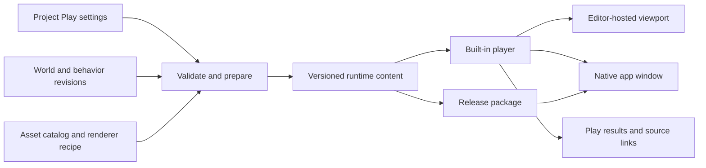

# From an authored World to a playable app

**Status** Proposed. This design covers editor setup, playtesting, authoring one
interaction, and handing the same app to a tester. It uses Sponza in an existing
Minimal project as the first walkthrough and a small redistributable World for
automated tests.

## Product decision

Make **Play** the next action after building an environment. An author can
choose where a player starts, press Play, change what happens, and export an app
without editing build files. Start with a built-in first-person player because
walking an authored scene tests the renderer, input, and collision together.
It also lets a level artist deliver a walkthrough before game rules exist. The
same project can then add interactions and, eventually, project-owned code.

The project has one **Starting World**. A World owns the objects, spawn markers,
lighting and attached behaviors. The project chooses the starting World, player
controller, default spawn and renderer. Platform, package and developer
launch options belong in their existing project or Release surfaces. An author
can learn the common path from one button and still find the individual choices
where they belong.

Today, Explore as Player is an editor navigation tool. The existing **Play saved
World** adapter runs a specific World Demo, and the native live-reload sample uses
a frame-clear presenter. Both establish useful hosting and isolation contracts.
The missing product capability is an editor-managed player for an ordinary
authored World, with the same World and behaviors available in an exported app.
[Existing edit and Play transitions](editor-gui-systems.md#edit-and-play-transitions) ·
[World authoring and runtime integration](../development/editor-workspace.md#gameplay-world-authoring) ·
[Native gameplay live editing](../development/project-live-reload.md)

## Personas and workflows

These are design hypotheses. Observe real creators doing their work before
treating the labels or task order as settled. One person may occupy several roles
in a small team.

| Persona | What they are trying to finish | Workflow |
| --- | --- | --- |
| Scene artist or renderer developer | Feel scale and shadow motion, then share a walkthrough for feedback | Open or import Sponza → Play → confirm the spawn → walk → test a 60-second day → use the same named lighting setup in a standalone build. |
| Solo game or interactive-app creator | Make an environment respond to the player and hand someone a playable version | From New Project choose **First Person** when a starter template ships, or open an existing World → Play → add an **Interact** rule at a switch → test it → export. A gallery or product demo can use this same path. |
| Level or gameplay designer | Iterate on a room and understand why an action did or did not fire | Pick a spawn near the room → **Play From Selected Spawn** → reproduce the event → inspect the affected object and its last result → edit the rule and replay. A test spawn never changes the shipping start. |
| Gameplay or engine programmer | Supply a reusable controller, mechanic, or renderer configuration and debug it with authored content | Register a typed gameplay action or configure an explicit custom launch target → expose a few meaningful parameters to Properties → reproduce with a saved World and input trace → use the SDK and existing build/debug workflow. |
| Tester or reviewer | Reproduce a problem on the same app revision without installing editor tooling | Open the exported build → follow its controls → report the build identifier, scene and observed behavior. In the editor, select a Play diagnostic or authored entity to follow the same evidence. |

The first usability task starts with an existing scene.
A **First Person** template can make new projects playable on creation. It
supplies a simple room, valid spawn and defaults through the same project setup.
Offer it on each target as its editor-to-export workflow qualifies.

## Editor interaction design

### First Play from an existing project

In an unconfigured project, the toolbar **Play** action opens **Set Up Play**
beside the viewport. An open World stays visible. An existing custom project
keeps its configured game launch action. Normal Play uses the project’s
Starting World regardless of the active World tab.

```text
Set Up Play

Starting World          Sponza                      [Choose World…]
How the player moves    First Person
Player Spawn            First Person Player        [Show in World]

                                    [Cancel]    [Set Up & Play]
```

Select the current World on first use, or offer **Open World…** and **New World…** if none exists. Prefill a sole valid spawn. For multiple spawns, show
names and their location in the viewport and ask the user to select one. If
there is no spawn, offer **Place Player Spawn**. Preview the eye and collision
volume before committing the placement as a normal undoable World edit. If the
spawn is in a wall, show the box and offer **Move Spawn**. If it has no floor,
show the problem and offer **Select Floor** or **Move Spawn**. **Make Solid**
targets the chosen mesh through the existing Static Collider edit. It never
changes every imported mesh as a side effect.

**Set Up & Play** saves portable launch choices and starts preparation. The
editor quietly reuses matching cooked assets and prepares stale ones. Show named
stages such as **Preparing Sponza** and **Starting first-person game** while
waiting. **Cancel** is available until startup finishes. If the selected
renderer cannot present a requested feature, describe the consequence and offer
a concrete choice. For Sponza, **Use Raster for Play** can select the supported
engine Raster configuration without replacing a project's authored graph. A
user can also keep a compatible project configuration. If the local player is
missing, offer **Repair Project Setup** with an explanation of what it installs.

After setup, **Play** starts the saved entry. Use the Play menu for **Play From
Selected Spawn** and **Play Settings…**. Expose the same start choices under
**Project Settings → Play**, so authors can review and change startup intent
without running the game. The menu, toolbar and shortcut share one capability
and command path.

### Iteration in the viewport

- **Edit** keeps the normal editor camera, selection, undo and lighting
  preview. **Explore as Player** remains a quick navigation and collision
  check. **Play** shows the actual game, including its input mappings and rules.
- The viewport retains the last editor frame until the game presents its first
  accepted frame. Display the World and spawn name near **Pause**, **Restart**
  and **Stop**. Click the game viewport to capture input. Use the existing
  **Shift+F1** convention to return focus and release the pointer, with the hint
  visible when capture begins. Focus loss and Stop both release capture and
  clear held inputs.
- Play the latest applied World snapshot, including applied edits that are
  still unsaved. Show **Playing unsaved edits** beside the session status when
  applicable. An incomplete inspector edit has to be applied or corrected
  before launch. If the World has never been saved, prompt for its path before
  persisting it as the project start. Export uses the saved project and Worlds
  and offers **Save and Continue** for valid unsaved documents.
- **Restart** starts from the same accepted launch snapshot. An explicit
  **Play With Latest Edits** prepares a replacement. If preparation fails, show
  the failure and keep the accepted session available. **Stop** returns to the
  editor camera and prior selection. Runtime moves, switches and experiments
  never create World undo entries.
- Once small live edits are supported, distinguish **Try in Play** from
  **Apply to World**. Only explicitly exposed fields enter the latter operation.
  It revalidates the original authoring revision and uses ordinary undo. If the
  World has since changed, show both values and let the user choose.

### First interactive features

For a World with Earth Sun and Moon linked to Atmosphere, show **Day–night cycle**,
**Starting time** and **Day length** with the World’s shared Earth settings.
The author can use the existing date/time as the starting time. Opening an older
World preserves its fixed sky until the cycle is enabled. In Play, **Time of day**
offers a scrub control and **Sky speed**, with a **Reset to World** action.
The controls act on the session clock for celestial sampling. **Pause** and
**Step** control the whole simulation. A 60-second day is a walkthrough test
setting and an optional quick choice.

For a first mechanic, select a switch in the viewport and choose
**Add Behavior → On Interact**. Pick the light from the viewport using
**Choose Target**, and select **Toggle Light**. The Properties row reads
**When interacted with → Toggle Hall Light**. The game shows its interact
prompt while the switch is reachable. Pressing the bound **Interact** action
once toggles the target once. In Play, selecting the switch exposes the last
activation or the reason an attempt was rejected, linked to the owning rule.
Scope viewport highlights to the selected object. Use the existing sequence
editor for rules that need conditions or multiple steps. The simple row and
sequence view use the same typed operations and stable targets.

### Hand the app to someone

In **Release**, select a target and choose **Package**. Show the starting World
and approximate scope before the build. The result offers **Open Package** and
**Show in Finder** or the platform equivalent. A tester launches the extracted
app from its own window. A fixed camera and additional control schemes can join
the same start, session, behavior and package contracts as they qualify.

## Architecture and ownership



| Owner | Implementation contract |
| --- | --- |
| Project and World documents | Add a versioned project launch selection that identifies the World, controller, spawn and renderer by durable reference. Reuse the project descriptor's versioning and World entity keys. Update references through supported rename/move commands. Keep references repairable if a World or spawn is later removed. Store scene-specific time and behavior in the World or its referenced data. Retain current project and World formats through compatible readers or explicit migrations. |
| Preparation and content | Editor and CLI both invoke shared project tooling. Freeze the selected authoring revision and validate typed component bindings, asset and behavior closure, spawn/collision admission and renderer capability. Reuse SceneCook and the asset catalog for mesh, texture and material content. Lower supported World components to a small versioned runtime representation with source identities for diagnostics. Bind stable source IDs to newly instantiated runtime handles. Cache by exact inputs, target profile and tool identity. Prepare outputs off the UI thread and publish a complete generation only after successful validation. |
| Player and simulation | Build a Qt-free player into qualified SDK/Editor distributions, with a standalone entry point that opens the same runtime content as editor-hosted Play. Compose the existing Camera, Input, PhysicsCollision, GameplayWorld, Resources and Renderer facilities. Extract reusable movement policy where the current Explore path couples it to Qt. Keep concrete game rules in the player and its providers. Prepare collision before activation, run movement and gameplay on fixed ticks, and publish completed state for rendering. |
| Renderer and time | The player selects a qualified realtime Renderer configuration and uses the normal renderer graph inputs. Each advancing tick computes one celestial instant from the authored epoch and elapsed simulation time, plus an optional session override. Sample both bodies and the night sky from that instant, then publish matching scene lights, shadows, disks and Atmosphere data. Preserve the current distinction between direct illumination and above-atmosphere illumination. Update frame data without recooking geometry, reallocating collision or rebuilding shaders. A scrub while paused requests a new render without stepping movement or gameplay. |
| Behavior | Use the existing behavior schemas and sequence/provider boundary. Implement **Interact** as a named input action with focus and edge semantics. Resolve the reachable target to a checked entity, dispatch only to that target at a defined tick phase, queue the typed light command and commit it before publishing the tick. Validate targets during preparation and resolve current generations at runtime. A bounded copied trace records source rule, target, tick and outcome. User-written behavior and native extensions use the same command and source-mapping boundaries. |
| Hosting and editor | Use the supervised child and hosted window contracts. The player owns its device and frame producer. The editor owns presentation, forwarding and source-linked diagnostics. Prefer a native window for the first platform/input spike. Qualify pointer motion and capture on the native and hosted paths before shipping an in-viewport first-person option. A session ID, content generation and accepted frame identify callbacks. Stop waits for process and GPU lease retirement before restoring edit input. Existing GameHost code reload remains available to explicitly configured custom projects. |
| Release | Package the same player and content schema from saved project intent with the existing Release operation. Record build identity, SDK/profile, root World and dependency closure. A clean extraction runs without editor data, authoring files or development caches. Keep published platform claims limited to tested targets. |

A preparation result links a reason to the World, entity, component or asset
that can fix it. Required invalid data blocks Start. Other capabilities can be
omitted with a visible explanation and a documented fallback. A missing spawn,
a stale async completion, a failed candidate, and a process crash all preserve
the editor document. A first-launch compatibility failure leaves the chosen
setup available for correction. Reopening a project performs no build or launch.

The operator-facing lifecycle is **Edit → Preparing → Starting → Playing**,
with **Paused** and **Stopping** as explicit session states. A failed first
frame returns to Edit with the failure and the last editor image. Prepare
replacement content while the accepted session continues. For live replacement,
stage the candidate frame source separately. Send input to one
session at a time and switch only when the candidate first frame is accepted.
Qualify that transition before offering live replacement. Early slices can
apply edits on the next start after Stop. Use existing controller supervision
and generation contracts where possible.
See [GUI systems](editor-gui-systems.md#play-in-the-editor-viewport),
[transactional level loading](level-data.md#candidate-world-loading),
[gameplay tick ownership](gameplay-foundations.md#simulation-and-publication),
[celestial sampling](game-world.md#earth-celestial-transforms), and
[package verification](game-packaging-publishing.md#package-identity-and-verification).

## Capture the mouse on macOS

A standalone player can explicitly [capture relative pointer input](macos-platform.md#relative-pointer-input)
through its Cocoa window. An [opted-in hosted player](editor-gui-systems.md#input-focus-and-capture)
captures on a left click in the Play viewport. Shift+F1 returns focus and the
pointer to the editor. Losing focus and stopping both release capture and clear
held keys. Relative capture is currently available on macOS.

## Prepare a first-person World snapshot

The native Editor can prepare a saved built-in World without opening a window or creating
a GPU device. From the directory containing the Editor executable, run the following command.
Use a trusted local project and an existing output directory.

```sh
./ludus_editor --prepare-world /path/to/project assets/sponza.world.json raster /path/to/output/walk.luplay
```

The World needs a First Person Player with a Transform. Each player entity contributes a
spawn. Static Collider opts a visible mesh instance into collision. Preparation resolves
the applied scene placement, authored lights and Atmosphere through the same extraction
as the viewport. An invalid Atmosphere link or unresolved material blocks publication.
The runtime profile selects engine Raster. The command prints component limitations and
import approximations and records them under `warnings` in the manifest. A project-owned game schema requires its own adapter.

The authoring entry point `PreparePlayableWorld` also accepts a frozen copy of an applied
`WorldDocument`, including unsaved edits. SceneCook resolves the selected catalog revision,
checks the cooked dependency closure and verifies the recorded local source inputs before
publication. Restore or reimport an input if it moved or changed. Preparation consumes
existing artifacts. A failed or cancelled candidate leaves the previous output usable.

A version-1 `.luplay` file starts with a compact UTF-8 JSON manifest terminated by LF.
The remaining bytes are the composed LUSCN payload, identified by `sceneSha256`.
The manifest carries the applied World's digest, stable entity keys, spawn eye positions
in metres, orientation quaternions (x, y, z, w), speeds in metres per second, light and
Atmosphere inputs, and the logical asset IDs with their exact artifact keys. World identity
uses the v2 document UUID, the v1 imported level UUID, or the project-relative path for a
v1 World without a level. Object bindings follow the decoded LUSCN object order.
`DecodePlayableSnapshot` reads the file in memory without Qt, an asset catalog, or raw sources.
It replaces a previous runtime snapshot only after validating the new candidate.

The redistributable acceptance fixture uses SceneCook's CC0 `gltf/maps` source. It checks a
moved instance, mapped material textures, lighting, spawn identity and collider membership
through the runtime decoder. The installed-SDK game and relocated Release qualification
use the separate [cooked glTF acceptance issue](https://github.com/The-Ludus-Project/Ludus/issues/1399).

## Play a saved World on macOS

Add a **First Person Player** and mark the floor and walls that should block
movement with **Static Collider**. Save the World, select the spawn in the
hierarchy, and choose **Play saved World**. Play uses the sole spawn automatically
when the World has one. Save changes before starting another session.

The Editor prepares a private runtime snapshot and starts its bundled first-person
player through the supervised launch path. The game opens in the chosen viewport
or in its own window. Both use the same Qt-free player with the engine Raster
graph, including supported material maps, analytic lights, shadows and static
Atmosphere. A project using this built-in path can launch with the Editor and
its tools alone.

Use **WASD** to walk and **Space** to jump. In a separate window, **Enter**
captures the mouse and **Escape** releases it. In an editor-hosted viewport,
click to capture the pointer and use **Shift+F1** to return it to the Editor.
**Stop** releases input and closes the game. If viewport hosting is unavailable,
the Editor offers **Play in a separate window**. If preparation or launch
fails, **Output** names the content or spawn to repair.

To run a previously prepared snapshot directly, use the spawn entity key from
its manifest.

```sh
./ludus_first_person_player /path/to/walk.luplay SPAWN_ENTITY_KEY
```

The macOS desktop fixture exercises the native player with an authored textured
wall, a floor collider, directional shadows and static Atmosphere. It verifies
presented frames, a blocked walk, an unobstructed strafe, jump and look.

```sh
python3 apps/first_person_player/tests/native_fixture.py /path/to/ludus_first_person_player
```

## Delivery and acceptance

| Slice | Independent result and evidence |
| --- | --- |
| 1. Start and walk | A clean macOS Development editor on Metal opens the existing Minimal/Sponza setup and launches an interactive first-person player using editor controls. It uses the selected spawn, renders saved scene materials and blocks movement at authored colliders. Move the spawn in the editor and rerun to prove the launch follows the World. Repeat against a small redistributable test fixture with known collision hit/miss and movement inputs. Capture cold and warm times from Play to the first controllable frame. Prove cancellation, missing-spawn repair and intentional child-process failure. |
| 2. Animate and inspect lighting | Enable an authored 60-second Earth day. Capture matched observations while stationary and while walking. Verify both light directions, sky disks and direct shadows change, and verify Pause, Step, scrub and reset with known timestamps. Compare editor-hosted and standalone observations at matched times and camera, within renderer tolerances. Confirm no World write, shader rebuild or collision rebuild during the cycle. Keep the chosen renderer/profile visible when the sky is unsupported. |
| 3. Author and test one mechanic | Place a switch and author **On Interact → Toggle Light** in editor controls. Test one edge, held input, reach and line-of-sight cases, stale/deleted targets, Restart and focus loss. Verify that a failed edit links back to the rule and keeps the last accepted play result available. Observe whether designers can diagnose a wrong target using the trace. |
| 4. Export and hand off | Export the walkthrough and switch fixture through Release, launch it from a moved clean extraction without editor tooling, and exercise start, movement, sky and the switch. Record platform, content and package identities. Use a small redistributable fixture for public evidence. Run the Sponza journey locally when the project assets are available. |
| 5. Extend with a second app | Use a named second app to qualify an additional controller or behavior provider and decide how to expose reusable recipes. Extend platform support only after the same editor-to-export path passes on that target. |

Start with macOS Metal because it is the observed workflow. Run the prototype
with first-time and repeat users. Give them the outcome “walk through this
Sponza World while a day passes” and later “make that switch control the hall
light.” Avoid steering them to the expected buttons. Record unassisted
completion, mistaken clicks, work-area switches, time to first controllable
frame and time from an edit to observable feedback. A proposed formative gate
is four of five first-time users completing setup and taking control within five
minutes on a prepared machine. Record first-use preparation separately from
warm iteration and choose a performance budget from the baseline.

Track the complete workflow as a milestone. The live board checked for this
design had no editor-managed World-to-app card. Reuse
[#1192](https://github.com/The-Ludus-Project/Ludus/issues/1192) for the collision
foundation and coordinate the cooked-scene qualification with
[#1399](https://github.com/The-Ludus-Project/Ludus/issues/1399). Link the Earth
observer work in [#1588](https://github.com/The-Ludus-Project/Ludus/issues/1588)
and the authored-rule qualification in
[#1218](https://github.com/The-Ludus-Project/Ludus/issues/1218). General World
streaming, advanced behavior qualification and baked GI shipping can be
qualified against later apps. Use real implementation dependencies when
sequencing the milestone.

## Reference decisions

The local books and talk decks were read at the passages below. The design
decisions are applications to Ludus. Use the same task scripts and sampled
runtime states to evaluate whether they work here.

| Source and passage | Application to this workflow |
| --- | --- |
| David Lightbown, *Designing the User Experience of Game Development Tools*, local edition, ch. 4, “Understanding the Mental Model” and “Personas,” and ch. 6, “User Testing.” [Author’s book site](https://www.uxofgametools.com/) | Organize the personas by goal and prior knowledge. The first task is worded as a result to reach in Sponza. Observe where authors expect Play, how they repair it and whether they understand what Stop preserves. |
| Jeff Stewart, *Build Great Tools*, GDC 2018, slides 23–26 on cohesive workflows. Philip Bloom, *Analyzing for Workflow Reduction*, GDC 2019, slides 19–24 on meaningful decisions and automatic tasks. [Stewart session](https://gdcvault.com/play/1025475/Build-Great-Tools-Workflow-Guidelines) · [Bloom session](https://www.gdcvault.com/play/1025809/Tools-Tutorial-Day-Analyzing-for) | Put setup and the invalid-spawn repair at Play, where intent is known. Ask for choices that change the game. Resolve tool, target and asset preparation internally and surface details when work fails. |
| Rémi Arnaud, “The Game Asset Pipeline,” *Game Engine Gems 1*, §§2.1–2.3, especially printed pp. 19–21 and 29–30. [Ludus resource review](resource-management-reference-review.md#asset-pipeline) | Derive the dependency closure from the starting World and referenced content. Reuse prepared artifacts for Play, preserve source mappings, and exhaustively verify the saved closure for export. |
| Wessam Bahnassi, “Game Tuning Infrastructure,” *Game Engine Gems 2*, §§16.4–16.7, printed pp. 265–274. | Use explicit typed exposure for sky speed and later tunable values. Keep runtime experimentation and persistent authored edits as separately named operations. Reuse existing GameHost/inspector capability contracts. |
| Sam Sternklar, *God of War Ragnarök’s Visual Scripting Solution*, GDC 2023, “Events and Eventization” and the command deferral section. [Talk and slides](https://sms.playstation.com/stories/gdc-2023-presentations/media/999) | Make the first interaction an addressed event with a typed, deferred command. Give designers a readable authored rule and a trace of the effect at the tick boundary. Start with the existing provider/sequence design and qualify with a named mechanic. |
| Eva Krebs et al., *All in One: Rapid Game Prototyping in a Single View*, CHI 2025, §§6.2–6.4. [Paper](https://www.hpi.uni-potsdam.de/hirschfeld/publications/media/KrebsBeckmannGeierGrendaRamsonHirschfeld_AllInOneRapidGamePrototypingInASingleView_AcmDL.pdf) | Link the selected switch and its last outcome directly to its rule. Participants valued immediate access in the small prototype, and dense scenes made visible connections harder to read. Use scoped highlights and a separate sequence view for deeper inspection. The study provides qualitative guidance. |
