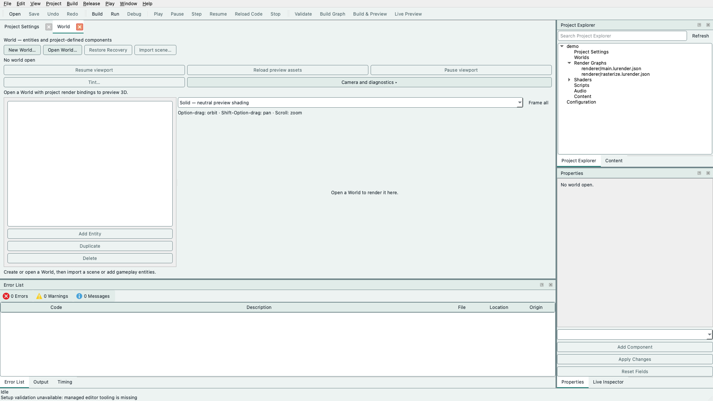
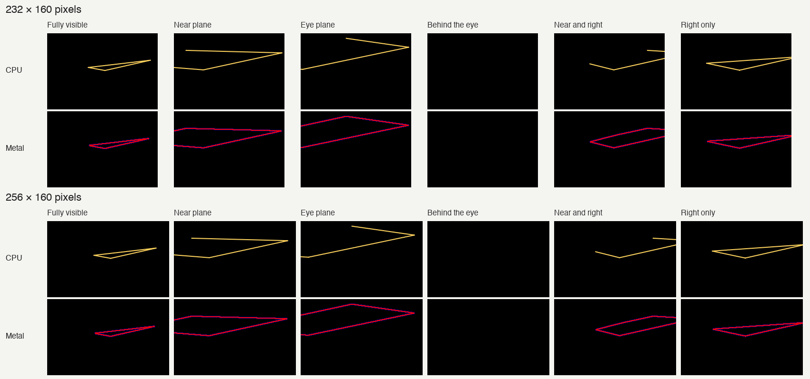
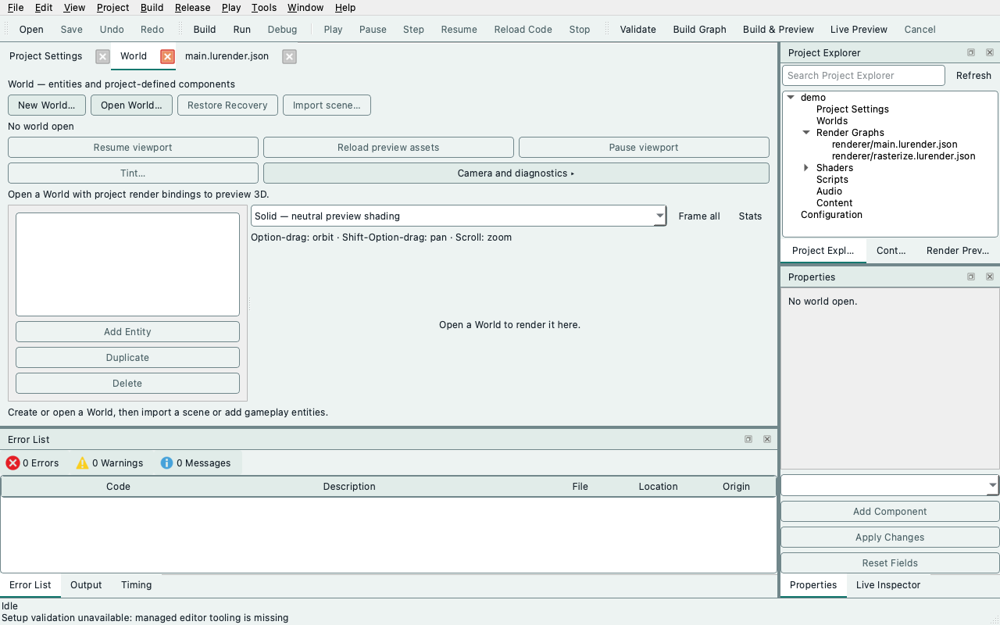

# Native editor workspace and troubleshooting

The editor is an **optional, OFF-by-default** native developer tool
(`apps/editor`, target `ludus_editor`). It opens a project descriptor, edits its
native build/launch settings, saves, reopens, configures/builds, runs the
selected executable in a separate process, stops it, and reports failures. It
also provides scene placement and project-defined component authoring in World,
including the world-demo game adapter. Trusted authoring
rendering and gameplay use separate windows; the status area describes the runtime.

See the specification package for the authoritative contract:
`.kiro/specs/editor-workspace/{requirements,design,tasks}.md` and
`docs/architecture/editor-workspace-research.md`. The
[editor architecture](../architecture/editor-architecture.md) and
[interaction design](../architecture/editor-interaction-design.md) define S1
and subsequent authoring stages.

The editor embeds the approved [Ludus Block artwork](../architecture/editor-art-direction.md)
for its application/window icon, Welcome view and recent-project fallback icons.
macOS bundles include the derived ICNS resource for Finder and Dock. The shared
PNG sources live in `docs/wiki/assets/` and also supply the wiki and browser
editor package; launching the native editor does not need those files on disk.

macOS builds also bundle an external crash handler. **Help > Crash Reporting**
controls consent and shows local report status; see
[crash reporting setup and symbols](diagnostics.md#macos-editor-crash-reporting)
before distributing a build to labmates.

## Work areas and document ownership

The editor follows Visual Studio's layout: **documents** open as tabs in the
central document well, and **tool windows** dock around it (see
[Workspace layout](#workspace-layout)).

| Document | Purpose |
| --- | --- |
| Start Page | New/Open and recent projects while no project is open |
| World | 2D/3D placement, game-owned entities/components, typed fields, references, shared history/save/recovery and trusted preview |
| Render Graph | The open render-graph package: its source tree beside the node **Canvas** and the validated **Plan**, with **Open Source** for the Code workspace ([render-graph authoring](render-graph-authoring.md)) |
| Code | Any project text file as a code tab: shared buffer, atomic save, external-change conflicts, crash recovery and the code status bar ([code editor](code-editor.md)) |
| Project Settings | One readable column (at most about 110 characters wide, left-aligned) of **Project** (name, folder, engine, components), **Build** (profile, setup status chip with its check details and Check/Repair actions, Build and run/Stop, collapsible build and launch details) and **Rendering resolution** sections sharing one left-aligned label column; values can be selected and copied, and **Save settings** is the page's primary action, enabled once something changed |
| Scripts | Project-owned script and sequence drafts |
| Audio | Content selection, definitions, save and preview |
| Configuration | Independent offline configuration preview and preference editing |

| Tool window | Purpose |
| --- | --- |
| Project Explorer | The project's worlds, render graphs, shaders, scripts, audio and content; opening an item opens its document |
| Properties | Fields of the active document's selection (the selected World entity or render-graph node) |
| Error List | Render-graph, shader and build diagnostics; double-click navigates to the source |
| Output | Selectable build/tool/runtime diagnostics |
| Content | Content catalog, search and imports |
| Render Preview | The World viewport rendered through the open render graph (Preview Runtime, status and image) |
| Live Inspector | Copied runtime state and supported live property operations |
| Timing | Runtime-reported frame pacing and interval statistics for the running session |
| Profiling | Record editor CPU scopes, viewport GPU durations, or both into a Perfetto JSON trace |

The Project Explorer's top row is one search field (it matches whole file names
and folders) with two icon buttons beside it: **Add** (plus) and **Refresh**.
Right-click a Project Explorer category, file, or empty area to open its context
menu. The **Add** button also offers **New World**, **New Render Graph**,
**New Shader**, **New Script**, **New Sound**, **New Music**, and the audio/content
import workflow. Worlds begin as unsaved drafts; Save creates the file. Render
graphs use the existing template/package creation dialog. Shader and Luau source
files start as unregistered source files: add their entry points/programs to the
owning manifest/package before building or cooking. Script files and shaders
without a graph owner open in the configured external code editor on native
platforms; that external launch is unavailable in the browser. The Scripts
category continues to open the project script workspace.

**Add Existing File** copies a selected authored file into an existing project
folder without replacing files. A file already inside the project is opened
without copying it. Single-file imports retain their references; add companion
files separately. Audio/content imports use the Content workspace's current
WAV/FLAC importer and publish through its catalog. New sound/music definitions
require an imported source selected in Audio. The audio/content categories keep
their workspace operations; they do not expose raw file deletion or duplication
of catalog-managed resources.

For one authored file, choose **Duplicate** (Ctrl+D / Command+D) or **Remove**
(Delete, or Backspace on macOS). A graph in a subdirectory duplicates its entire
containing package into a new sibling folder, preserving companion paths.
Root-level graphs, worlds, shaders and scripts duplicate only the saved file;
references outside the copied package stay shared. Copies never overwrite a
destination and reject child symlinks; package copies are bounded to 64 MiB,
4096 entries and 12 directory levels, and publish only after the full copy succeeds.
Remove asks for confirmation, then moves the file under the project's hidden
`.ludus-trash` folder, preserving its relative path inside a unique recovery
folder. Restore it manually to its original path and Refresh. References in
other files are not rewritten. Switch away from a loaded World or graph package
before removing its files; closing a tab retains its document. Select another
script program before removing its loaded source. File actions operate on one item at a
time; a multiple selection disables Duplicate and Remove.

The Configuration workspace retains its explicitly loaded preview/draft across
project changes. Quitting prompts for unsaved preferences. Project settings,
audio definitions, offline preferences and live values have separate save owners.
Applying to a session does not save a file; copying a live value to a tuning draft
requires a separate save. See [configuration](../wiki/guides/configuration.md)
and [native live editing](project-live-reload.md).

## Selection and keyboard shortcuts

Selectable lists, tables and trees support the host platform's usual gestures:
click to select, Ctrl-click on Windows/Linux or Command-click on macOS to toggle
individual items, and Shift-click for a range. Ctrl+A / Command+A selects all
selectable items in the focused view; Escape clears that view's selection. Arrow
keys navigate and Shift+arrow extends selection. Text fields keep their own
native selection, clipboard and undo shortcuts.

The World entity list nests children under their authored scene parents.
Expand or collapse a branch with its disclosure arrow. Selecting a child from
the viewport expands its branch.

Use **Search entities** to filter names, labels and stable IDs without changing
the document. Matching ignores case and surrounding spaces. The count shows
how many entities match. Ancestors of matches stay visible for context and
can be selected when they also match the query. Filtering and collapsing
deselect rows that are no longer available for group edits. Picking a
filtered-out entity in the viewport clears the search and reveals its
selection. Search pauses while inspector edits need Apply or Reset.

In the World entity list, Ctrl+D / Command+D duplicates the selected group;
Delete (also Backspace on macOS) asks to delete the group. Each group operation
is one World undo step and publishes only after the whole candidate validates.
Duplicated group references and scene parents point to their corresponding
copies; references outside the group remain unchanged. A surviving reference
blocks deletion of its target. Capacity or identity-generation failure leaves
the World unchanged. F2 focuses the name field for a single selected entity;
Return does the same on macOS. Multiple entities show a selection count in
Properties; select one entity to edit fields or attach components. The viewport
continues to use the primary selected entity for framing. World sessions retain
the selected entity IDs.

The render-graph canvas supports Ctrl+A / Command+A and Escape as well as
Ctrl-click / Command-click toggling and Shift-click additive selection (a canvas
has no list ordering for a range). Other document actions and inspectors retain
their current-item behavior; selecting multiple rows does not imply batch field
editing, reimport or opening every document. Existing Save, Undo/Redo and
clipboard shortcuts retain their document and focus routing.

Use **Window → Next Document** and **Previous Document**, or Alt+Tab and
Alt+Shift+Tab (Control+Tab and Control+Shift+Tab on macOS), to cycle through open
documents in tab order. Switching crosses split tab groups and wraps at either
end, focuses the selected document, and leaves closed documents closed. The
shortcuts also work while focus is in a text editor or a tool window. On
Windows/Linux, the desktop may reserve Alt+Tab for application switching; the
editor receives it only when the desktop shortcut is released or remapped.

## Project lifecycle: tasks and audiences

The **Project** tab shows the project folder, committed engine requirement and
components (v2 SDK projects), saved build profile, and the last read-only setup
check. A successful SDK check identifies the actual selected engine version,
revision, target, flavor, installation and selection source, including local
overrides. An unchecked or failed check is not a claim that the project is ready.
These results describe the saved project and computer inputs at check time;
recheck after changing installations outside the editor.

**Check setup**, **Repair setup**, **Save settings**, **Build and run**, and
**Stop** use the existing controller commands and their capability gates. Dirty
settings must be saved before checks/repair/build. Save settings saves the project
descriptor and pending edits in the active renderer graph, including the
[output resolution and render scale](render-graph-authoring.md#output-and-render-resolution)
shown in this tab. Audio, World documents, scripts and configuration keep their own
save owners. Opening a project still does not configure, download, repair or build it.
Repair's browser checkbox and engine selection retain their explicit behavior.

Name and build profile are visible. Profile labels explain **Development** for
everyday work, **Debug** for investigating code, and **Release** for distribution,
with Linux/macOS named explicitly. Version-1 descriptors disable profiles outside
their original Linux Debug/Development contract. Labels preserve the exact
underlying preset IDs; profile selection edits a draft and never switches engines or builds
implicitly. The saved preset ID remains visible in the overview. **Build and
launch details** reveals provider, source directory, executable target, working
directory and the exact argument list. Expanding/collapsing only changes the
presentation and preserves settings and history.

The following are designed use cases, not claims of interviews or usability
studies. Experience and discipline are independent: a professional artist may
need simple setup while a beginning programmer wants detailed build controls.
No role choice gates access to capabilities.

| Consumer and real task | Workflow and observable acceptance |
| --- | --- |
| First-time developer creates a game | Welcome → New Project → Name/Location → Create. Existing automatic engine selection stages and verifies the project. Errors retain the current project; no successful publication is claimed before build/tests. Project shows where files live and how to run. |
| Unity/Unreal/Godot user opens a team clone | Open the descriptor, read setup status, then explicitly Repair if tools/presets are missing. Learn the engine requirement and profile from the overview; no need to understand CMake fields to repair. |
| Experienced developer switches from iteration to a release build | Select the named profile, Save settings, Check/Repair its setup, then Build or Package through existing menus. Profile intent stays distinct from SDK acquisition and release packaging. |
| Designer, artist, sound designer or localization contributor joins a project | Open and diagnose setup without changing team metadata. Use the relevant work area; the Project tab explains that content documents save separately. Setup remains explicit rather than blocking access to readable content. Localization authoring itself remains a separate editor gap. |
| QA reproduces a launch issue | Expand build/launch details to inspect target, working directory and exact arguments; select the intended profile, save, run and stop. Copy Job Details in Output supplies exact process evidence. Failed builds never launch an older artifact. |
| Engine/tool engineer uses a local SDK | Repair with a selected installed engine; verify revision, prefix and local override in the successful check. Existing repair preserves custom presets and unrelated IDE settings; committed engine requirements are not rewritten. |
| Rendering researcher runs an experimental executable | Reveal target/preset/arguments, configure to discover executables, select the target and launch separately. Check reports the actual selected SDK; shader prerequisites remain explicit. This does not create a renderer authoring panel. |

### Delivery boundary and next lifecycle work

This first UX slice improves orientation and access to existing verified tooling.
It does not deliver an installed Editor distribution, SDK archive/store browser,
release-version upgrade/migration UI, arbitrary custom-preset discovery, or
browser/native workflow parity. Existing CLI owners remain the source of those
operations. Future UI must reuse their preview/validation/locking semantics and
show expected/actual engine identities before committing a change; upgrade must
preserve project-owned source and custom settings, support failure recovery, and
never conflate a machine-local override with a committed team engine update.

SDK setup identity travels through a bounded, job-tagged `setup_details` control
event (at most 16 KiB of UTF-8), separately from the reserved terminal summary
and output credit. The controller publishes it only after a successful setup
result; failure and cancellation show their own outcome. This private protocol
requires the matching editor/tooling version.

A setup check also sends one `engine_pin` event (at most 8 KiB) before running:
the selected engine install compared with the Editor's checkout revision
(`current`, `stale`, `invalid` or `unknown`). It is accepted only for
`project_check`, so a failed check can still offer **Use this editor's engine**.
Starting a check or repair clears the previous report. See
[engine drift](project-sdk-workflow.md#when-the-projects-engine-is-older-than-the-editor).

Acceptance covers keyboard/mouse disclosure, profile identity and explicit save,
read-only checks with selected engine evidence, disabled commands, pending
argument text, history and project switching. Offscreen Qt tests validate behavior;
native screenshots validate layout separately. No automated result establishes
that representative users completed these journeys comfortably. Moderated task
sessions with programming and content disciplines remain a usability gate.

## Prerequisites (optional editor setup)

The editor needs Qt 6 (6.4-compatible) with the Core/Gui/Widgets modules and a
native platform plugin (Wayland on Linux, Cocoa on macOS), in addition to the normal reference toolchain
(`./init.sh` prepares pinned Clang 23 / LLD / managed CMake/Ninja/Conan and the
managed Python venv). Qt is not added to Conan or the SDK. Default initialization
skips editor setup; select **Build Ludus editor** in the setup window or use
`./init.sh --cli --with-editor` to install missing Ubuntu/Debian Qt packages or
Homebrew `qtbase` on macOS and
build the selected native Debug, Development or ASan/UBSan editor with 3D preview.
Editor setup also acquires the checksum-verified pinned shader tools: Slang on
macOS, plus SPIR-V Tools on Linux. Native editor builds with 3D preview automatically
build the shader worker. Native World viewports use the project's render graph
and start a private compiler worker for automatic shader rebuilds; no separate
compiler flag or socket configuration is needed. This requires macOS 15
or newer on macOS. In **Advanced setup**, clear **Include 3D
preview and live shaders** for a lightweight document-only editor, or use
`--no-editor-preview` with `--with-editor` in the CLI. That path skips shader-tool
setup and explicitly disables rendering, including in an existing build cache.
The preview choice is saved for the selected editor preset and applies to later
script, direct CMake and IDE builds. `--no-system-install` skips system package
installation; it does not skip the managed shader tools when preview is enabled.
`--no-editor` explicitly
disables the editor for the prepared presets. Initialization also excludes test
targets by default; use `--with-tests` to include editor tests or `--run-tests` to
build and execute the enabled tests after setup.
Editor tests also require Qt Test, supplied by the same Qt base development
package on Ubuntu/Debian.

To manage Qt yourself, install it once (names vary by distribution) and use
`./init.sh --cli --with-editor --no-system-install`:

- Debian/Ubuntu: `sudo apt-get install -y qt6-base-dev qt6-wayland`
- Fedora/Amazon Linux: `sudo dnf install -y qt6-qtbase-devel qt6-qtwayland`
- macOS: `brew install qtbase` (Core/Gui/Widgets/Test and Cocoa). Setup discovers
  Homebrew Qt and records `Qt6_DIR` only in the local build cache. A manual Qt
  installation can be selected with CMake `-DQt6_DIR=/path/to/lib/cmake/Qt6`.

For **Use my location**, install the optional Qt Positioning module before
configuring the desktop editor. On Ubuntu use `qt6-positioning-dev`. On macOS
use `brew install qtpositioning`. With a split Homebrew installation you can
pass `-DQt6Positioning_DIR="$(brew --prefix qtpositioning)/lib/cmake/Qt6Positioning"`
to CMake if needed.

Only the editor configure/build uses Qt. A default configure
(`LUDUS_BUILD_EDITOR=OFF`) and default engine browser builds never search for Qt. The separate
[browser editor build](browser-editor.md) explicitly prepares WebAssembly Qt.

## Build the editor (Editor ON)

The editor is gated behind `LUDUS_BUILD_EDITOR` (OFF by default). Configure a
native preset with the option ON using the managed CMake, then build the target:

```bash
./init.sh --cli --with-editor                # Qt + pinned shader tools + rendered editor
# Or manage Qt and the editor build yourself:
./init.sh                                   # pinned tools + managed venv (once)
# Editor ON configure/build (managed cmake shown as `cmake` for brevity):
./scripts/shader-probe bootstrap
cmake --preset linux-clang-development -DLUDUS_USE_INIT_OPTIONS=OFF -DLUDUS_BUILD_EDITOR=ON \
  -DLUDUS_SLANG_COMPILER="$PWD/out/shader-tools/slang/bin/slangc" \
  -DLUDUS_SPIRV_VALIDATOR="$PWD/out/shader-tools/spirv-tools/usr/bin/spirv-val"
cmake --build --preset linux-clang-development --target ludus_editor
```

Native `LUDUS_BUILD_EDITOR=ON` has Linux x64, macOS arm64/x64 and Windows x64 build paths.
Apple silicon is the validated macOS host; native Intel acceptance remains pending.
Browser editor builds use
the separate pinned Qt WebAssembly toolchain; ordinary browser engine setup does
not enable the editor. Browser scene import, in-process cook and the CPU
navigation viewport are documented in [browser-editor.md](browser-editor.md). Unsupported native hosts fail configuration explicitly.

On macOS, the launcher defaults to `macos-clang-development`:

```bash
./init.sh --cli macos-clang-development --preset-only --with-editor --with-tests --no-system-install
./scripts/editor --preset macos-clang-development
```

The macOS port includes New/Open/Save, SDK setup/check/repair, Configure/Build,
Build and Launch, Stop, project profile selection, layout/history, audio authoring
and preview, and Configuration. Qt supplies native Cocoa windows, text input,
file pickers, and platform shortcuts. Games run separately using their own
platform/RHI backend, including Metal. Version-2 descriptors expose all three
macOS game profiles; the Editor itself uses Debug, Development or ASan/UBSan.
Version-1 descriptors retain their original Linux preset contract.

Qt 6.12.0's Cocoa accessibility bridge incorrectly deletes a table's accessibility
identity when releasing a synthetic row, column or cell that borrows it. This can
crash a screen reader or UI inspector while reading selected cells. Releasing a
native row also deleted the cell interfaces that an accessibility client had read,
although the Qt item-view table still cached them. The next row insertion or
removal, such as an editor selector rebuilding its items with `clear()`, then
crashed with a null dereference in `QAccessibleTable::modelChange`. The editor
installs a process-local ownership correction before creating its widgets: real
elements retain Qt's cleanup for interfaces they own, while synthetic elements
never delete borrowed identities and native cells never delete interfaces that
their item-view table owns; the table releases those on model changes and
destruction. Other Qt versions are unchanged, and the system Qt installation is
not modified. An unexpected native layout fails startup with a diagnostic rather
than applying the correction blindly. Thanks to The Qt Company for the
[Cocoa accessibility implementation](https://github.com/qt/qtbase/blob/v6.12.0/src/plugins/platforms/cocoa/qcocoaaccessibilityelement.mm)
used to identify the ownership error. The macOS `ludus_editor_accessibility_tests`
exercise native selection, deselection, model resets and widget destruction for
tables, lists and trees, and rebuild a combo box after a client reads its items;
they require the Cocoa platform plugin.

Live Play and native reload support macOS Debug/Development profiles with
validated Mach-O UUIDs and immutable detached DWARF symbols. Live Play,
Build and Reload, Pause/Step, live edits and opt-in source watching share the
existing isolated host supervisor; see [native live editing](project-live-reload.md#macos-setup-and-symbols).
RAD debugging remains disabled on macOS, with a backend error if invoked directly.
Game release setup and packaging now share the
[macOS ad-hoc app backend](game-packaging-publishing.md#macos-app-packages).
Developer ID signing and notarization remain separate distribution work. The Editor is built from the tooling checkout; this port does not add
an installed/signable Editor application bundle to the runtime SDK. The local
macOS build produces `ludus_editor.app`, with the required Qt frameworks supplied
by the opted-in development installation; the File API launcher resolves its
executable inside the bundle.

### Windows authoring viewport

Use the [Windows runtime toolchain and dependencies](../architecture/windows-direct3d12.md),
the x64 MSVC Qt build with Qt Quick 6.6 or later, and the pinned Slang and DXC
tools. From a Visual Studio developer shell, include the Qt prefix in
`LUDUS_WINDOWS_DEPENDENCIES` alongside the prepared runtime dependencies.

```powershell
python scripts/shader-probe bootstrap
cmake --preset windows-msvc-runtime -DLUDUS_BUILD_EDITOR=ON
cmake --build --preset windows-msvc-runtime --target ludus_editor ludus_editor_tests ludus_rhi_d3d12_tests
ctest --preset windows-msvc-runtime -R '^(ludus_editor_d3d12_viewport|ludus_editor_d3d12_high_dpi|ludus_editor_hosted_play|ludus_rhi_d3d12_tests)$' --output-on-failure
```

With Qt's `bin` on `PATH`, run the editor from the repository root so it can
find the tooling checkout and bundled graph sources.

```powershell
$python = (Get-Command python).Source
& .\out\build\windows-msvc-runtime\apps\editor\ludus_editor.exe --tooling-root "$PWD" --python "$python" --adapter "$PWD/scripts/python/editor_tool.py"
```

The viewport renders the open World's camera and authored
scene through the shared Direct3D 12 queue. Use a raster graph with a DXIL profile
for ordinary navigation and editing. The native viewport test requires an
interactive Windows desktop and uses Qt's software renderer preference for WARP
coverage. The high-DPI test repeats the authoring journey at a 1.5 scale factor.
The hosted Play test also opens a second process, exercises game input
and resize, and checks that Stop or a game crash restores the authoring viewport.
For mixed-DPI or physical GPU checks, launch the editor on a Windows desktop
with the normal Qt GPU selection.

Windows GPU-reference capture remains unavailable. Its DXIL kernels fail shader
validation and are excluded from the Windows editor build. The traversal chooser
disables that option, and an explicit GPU-reference request reports the missing
kernel. Windows CPU/GPU reference parity remains unqualified.

## Launch

`scripts/editor` locates the already-built `ludus_editor` through the shared
CMake File API helper and starts it with the trusted managed Python interpreter,
the `editor_tool.py` adapter, and this tooling root. It never builds or installs
anything; if the editor is not built it prints the preparation commands above.

```bash
./scripts/editor --preset linux-clang-development \
                 --project examples/editor-workspace/ludus.project.json
```

Opening a descriptor reads metadata and queues a read-only setup check for v2
SDK projects. The check uses the selected CMake to list presets and reports
missing/stale setup in the status area and Output. It never configures, builds,
downloads, runs project hooks, or changes files. Configure, Build Game, Build and Launch,
and Stop remain explicit actions.

### Startup sound

The desktop editor plays the Ludus startup theme, about 4.5 seconds long, once
when its window first appears. That happens on every launch, whether the editor
opens the Start Page or a project given with `--project`.

- **Turn it off:** uncheck **Tools → Options... → General → Play the startup
  sound when the editor opens**. The choice is remembered for this computer.
- **Override it for one launch or a script:** set `LUDUS_STARTUP_SOUND=0` (or
  `false`, `off`) to silence it, or `LUDUS_STARTUP_SOUND=1` (or `true`, `on`) to
  play it even when the option is off. The variable beats the option either way.
- Closing the editor while the theme plays fades it out instead of cutting it.

Playback uses the engine's own Audio device path (CoreAudio on macOS,
PulseAudio or ALSA on Linux) on a worker thread, so it never delays the window.
Without an output device the editor stays silent and logs one
`Editor.StartupSound` line. The browser editor has no startup sound: browsers
start audio only after a click or key press. Editor tests never play it.

The theme ships inside the editor as the lossless FLAC
`apps/editor/resources/startup-theme.flac` (44.1 kHz, 16-bit stereo, peaks at
−1.1 dBFS). It was composed by Minha Ju in GarageBand and is distributed under
the repository's MIT license, like the rest of Ludus.

## Recent projects

The **Welcome** work area shows recent projects only when no project is open.
The **File → Recent Projects** menu remains available while authoring. Double-click
an entry or choose **Open Selected**. The editor remembers ten successful opens
across restarts, including command-line and newly created projects. Missing paths
are labelled; a failed open preserves the current project. **Clear Recent Projects**
clears history without deleting projects. Recents no longer reserve a dock column.

History is local to the user, in `$XDG_CONFIG_HOME/Ludus/Editor/recent-projects.json`
(normally `~/.config/Ludus/Editor/recent-projects.json` on Linux). An absolute
`XDG_CONFIG_HOME` override works on both native hosts; otherwise macOS uses
Qt's native config location (`~/Library/Preferences/Ludus/Editor`). It is saved atomically,
separately from project files. If preferences cannot be written, project opening
still works and history remains available for the current session.

## Create, initialize, repair and update projects

The **Project** menu provides **New Project**, **Check Setup**, and
**Repair Project Setup**. Setup actions require a saved, clean v2
CMake project; save pending edits first.

For Ludus-Sandbox, open its `ludus.project.json`, choose **Repair Project Setup**,
leave **Use this project's selected engine (recommended)** selected, and click
**Repair Project**. This reuses the project's saved engine selection or installed
locked release; no installation paths need to be entered.

An SDK is the installed engine's headers and libraries. A desktop engine is built
for this computer; a browser engine is built for the web. The dialog asks for a
folder only after choosing **Choose a different installed engine** or enabling
**Also set up browser builds**. The latter needs an installed browser engine
matching the same engine release and enables the web Development and Release
profiles. Saved browser setup is shown and enabled initially. Turning it off
repairs only desktop builds and clears the saved browser selection and owned
web presets, so a missing old browser installation cannot block desktop repair.
Custom presets stay intact. The operation does not change the project engine
requirement or committed lock.

Repair verifies the managed CMake, Ninja, Clang 23, required SDK components,
dependency prefixes and shader tool paths. It generates marked
`ludus-local-<profile>` presets in ignored `CMakeUserPresets.json`, keeping custom
presets and their includes. Machine paths stay in ignored presets and
`.ludus/local.json`; the IDE uses preset mode and each preset selects its CMake
executable. Related stale IDE CMake-path overrides are removed; unrelated
settings are preserved. Real CMake configure/build/test preset discovery must
succeed, followed by a fresh configure, full build and native CTest. No-tests
is an error. Web profiles configure and build; browser runtime acceptance is
separate. The setup signature detects a moved or retargeted SDK (its path and ABI identity), changed presets and moved tools. It does not hash SDK library contents, so a refreshed engine install from `./init.sh` keeps existing projects' setup valid; each build folder's own SDK stamp reconfigures it on the next build.

The **Build and install the engine used by this editor** option explicitly
initializes and builds the trusted tooling checkout, then installs the desktop
SDK before repairing the game project. This can download dependencies; it
does not install system packages or execute the game project’s bootstrap hooks.
Web SDK acquisition remains an explicit engine-tooling step; select an installed
browser engine in this dialog. New Project asks only for Name and Location, with a Browse button and a
resulting-folder preview. Choose **Create Project** to select the engine and verify
the project. **Advanced engine selection** allows a custom Development SDK;
normal creation requires no SDK path or preparation checkbox. **Add a GitHub Actions
build and test workflow** also generates the
[project CI workflow](project-sdk-workflow.md#continuous-integration-github-actions),
pinned to the tooling checkout's commit. It is unavailable, with the reason shown,
when Location is inside a Git work tree. All child commands use the existing streaming output,
Stop, process-group cleanup and single-operation ownership.

New Project creates the bundled minimal v3 native template in a sibling staging
directory, verifies setup/configure/build/tests, then publishes to an absent
destination and opens it. Failure/cancellation before publication discards the
stage and leaves the current workspace intact. Staging build artifacts are
discarded because their CMake paths belong to the staging directory. The next
Configure builds at the final location. The browser editor creates the same
files without setup or verification; see
[New projects in the browser](browser-editor.md#new-projects).

The CLI calls the same backend:

```bash
ludus project check /path/to/Ludus-Sandbox --tools /path/to/Ludus
ludus project repair /path/to/Ludus-Sandbox --tools /path/to/Ludus --sdk /path/to/sdk
ludus project repair /path/to/Ludus-Sandbox --tools /path/to/Ludus --no-web
ludus project update /path/to/Ludus-Sandbox --tools /path/to/Ludus --sdk /path/to/new-sdk
ludus project create /path/to/new-game --name MyGame --sdk /path/to/sdk --tools /path/to/Ludus
```

`create --engine` without `--tools` can still generate metadata without an SDK.
Use `--tools` for verified creation. Without `--engine` or `--sdk`, CLI and
editor share automatic selection: explicit Advanced/CLI SDK, then an absolute
`LUDUS_SDK_PREFIX`, then the editor tooling checkout's current native Development
install, then automatic preparation of that engine. Invalid explicit/environment
selections fail visibly; they never fall back silently. A missing or stale
editor-owned install is prepared only after Create. ABI/compiler validation and
real preset discovery/configure/build/tests still gate publication. Paths remain
in ignored machine-local settings. Reuse requires matching checkout revision;
source-checkout builds are the supported editor distribution today.

```bash
ludus project create /path/to/new-game --name MyGame --tools /path/to/Ludus
```

## Workspace layout



The layout follows Visual Studio, built on Qt Widgets' own docking:

- **Documents** occupy the centre. Opening a project opens its **World**, with
  **Project Settings** as a background tab. Open other documents from **Project
  Explorer**, **Project → Project Settings** or the document list at the bottom of
  the **Window** menu. A tab shows the document's file; while it has unsaved
  changes a dot stands where its close cross would be (the cross returns when
  the pointer reaches it), its tooltip says so, and the **Window** menu entry
  ends in `*`. The close cross shows on the open tab and the tab under the
  pointer only. Closing a tab (**Window → Close Document**, Ctrl+W) hides
  that view only; its draft stays open and quitting still asks about unsaved work.
- **Tab groups.** **Window → New Vertical Tab Group** puts the active document
  beside the others (for example a render graph next to the World);
  **New Horizontal Tab Group** puts it below. **Move to Next/Previous Tab
  Group**, **Merge All Tab Groups** and the tab context menu move documents
  between groups. Groups share one direction at a time, up to four groups.
- **View → Code and Viewport** (Ctrl+Alt+V; Command+Option+V on macOS), also in
  Code workspace's **Source** menu, opens the graph's Code tabs beside the
  existing interactive World document. It reuses the World's viewport, camera
  and render device. **Return to Graph** restores the canvas and node selection.
  The World's header and hierarchy also collapse so its viewport fills the pane;
  returning to a single World restores them and their splitter preference.
  Drag the divider to size the two panes. Existing horizontal group sizes are
  preserved when invoking the command again, and other open tabs and drafts stay
  open. The project remembers the groups, divider, graph and active package source
  when the editor closes normally or switches projects. These are
  view preferences, not a recovery copy of unsaved source text. Missing or invalid
  saved graphs leave the current graph intact. Live Preview keeps its existing
  saved-source policy; compilation progress remains in the status-bar activity
  chip. The Render Graph toolbar stays visible while package code is shown in
  either group, so moving between code and viewport keeps the document area stable.
- **Tool windows** dock around the documents. The calm default keeps the documents
  as large as the window allows: Project Explorer (tabbed with Content and Render
  Preview) is on the left, Properties (tabbed with Live Inspector, and Ray Paths
  when a capture starts) is on the right, and the diagnostics group below the
  documents starts **closed**: Error List tabbed with Search, References,
  Output, Timing and Profiling. Each opens when there is something to show: new
  errors or warnings reveal the Error List, Find in Files reveals Search, Find
  References in a shader reveals References, a build reveals Output, the first
  Play session of an editor run reveals Timing, and recording reveals Profiling. Drag a title bar to
  move, tab or float a tool window. **View** shows and focuses one (Project
  Explorer Ctrl+Alt+L, Properties F4, Error List Ctrl+Alt+E, Output Ctrl+Alt+O,
  Render Preview). The **Window** menu lists every tool window with a check mark
  to show or hide it.
- **Window → Reset Window Layout** restores the default documents-first
  arrangement, all toolbars and the calm tool-window arrangement above, sized for
  the current window (the outliner takes about a seventh of the width and
  Properties a fifth). A bottom group that is closed opens at about a quarter of
  the height, enough for several Error List rows. If problems are already listed,
  Reset opens the Error List. Reset never changes drafts, saved files or a Play
  session. The saved layout carries a version; an older one (before the calm
  default) resets once to these defaults.
- **View → Focus Viewport** (Shift+Alt+Enter; Shift+Option+Return on macOS)
  hides every tool window, the toolbars and the setup notice. When a render graph
  is active, it focuses that graph and hides its navigation, source tree and
  status strip. Otherwise it focuses the World viewport and hides the World's
  controls (file commands, render controls, hierarchy and status line), switching
  to the World document when needed. Run it again to restore the previous tool-window arrangement,
  sizes, toolbars and active document exactly. The viewport is never moved or
  recreated, only resized. Closing the editor while focused saves the arrangement
  Focus Viewport returns to, and Reset Window Layout also leaves it. New errors
  or warnings do not interrupt it; the status bar announces them instead.
- **Save, Undo and Redo follow the active document tab.** Focus in a tool
  window does not change the active document: editing a World entity in
  Properties and pressing Ctrl+S saves the World. Focus entering another
  document's tab makes that document active. Undo still acts on focused text
  first.
- **Properties** follows the active document. While the World is active it
  shows the entity inspector (name, component fields, Add Component, Apply and
  Reset). While the Render Graph is active it shows the node selected on the
  canvas, in the source tree or by Error List navigation: its authored fields,
  canvas position, Remove Node, Add Node and the configuration's connections.
  Edits there are Render Graph edits: Ctrl+S and Ctrl+Z act on the graph.
- **Render Preview** shows the World viewport through the open render graph.
  **Build → Build Render Graph and Preview** brings it forward; Live Preview
  rebuilds update it without moving focus or raising it.
- **Error List** collects the last render-graph result (graph errors and mapped
  shader diagnostics) and compiler/CMake diagnostics found in build output.
  Toggle Errors, Warnings and Messages to filter. Double-click a render-graph
  row to select its graph node or open its source line in the Render Graph
  document; double-click a build row to select its line in Output. New errors or
  warnings from either source bring the Error List forward, opening it if it was
  closed, without taking focus; repeating an unchanged result does not, so a list
  you closed stays closed. Severity is an icon with the name in its tooltip, so
  the column never elides "Message". The Code column is hidden while no visible
  row has a code. A details pane under the table shows the selected description
  only when its row cannot: multi-line or elided descriptions.
- **Toolbars** share the menus' commands in one row that stays the same on every
  document tab, so switching tabs never moves a button. Groups, in workflow order:
  Standard holds File (Open, Save) and History (Undo, Redo). Game holds **Build Game**,
  then the three ways to start the game and **Stop**. Render Graph holds Validate, a
  **Compile Shaders** split button whose arrow offers Build & Preview, a **Live Preview**
  toggle that keeps an accent edge while it is on, and Cancel; these act on the current
  graph document from any tab, including the World that previews it. The Live Play
  Session group (Pause, Step, Resume, Fast-forward, Reload Code) is the only contextual
  group: it is shown last, after every other group, and only while a Live Play session is
  running or paused, so its appearing moves nothing. Each command's verb is distinct:

  | Button | What it does |
  |---|---|
  | **Build Game** | Compiles the game's code with the saved build profile. Nothing starts. |
  | **Live Play** | Builds the game as a reloadable module and plays it in an editor session: pause, step, inspect values and reload changed code while it runs. |
  | **Launch** | Builds the game, then starts it as its own program, the way players run it. |
  | **Debug** | Builds the game, then starts it in the RAD debugger. |
  | **Compile Shaders** | Compiles the render graph's shaders into `out/render-graph`. Game code is not built. |

  Toolbar buttons use short labels; tooltips say what each does. The primary
  commands (Open, Save, Build Game, Live Play, Launch, Debug, Stop) and the Render Graph
  group also show an icon beside the label; every other button stays text only. Project Explorer
  rows and the Error List severities carry icons too. The icons are Lucide
  drawings (ISC), drawn in the palette's button text colour; see
  [Editor icons](#editor-icons) for attribution and contribution instructions.
  **View → Toolbars** hides or shows the Standard and Game toolbars. Explorer rows show
  document names without file extensions, whatever their kind; the tooltip keeps the whole
  file name, and two rows that share a name and a folder name their type. Documents have no
  command rows of their own: **File → New Render Graph...** and **Open Render
  Graph...** open graphs, and the **Build** menu holds every render-graph
  command, including Cook Render Graph Runtime and Cancel Render Graph Job.
- **Empty and error states** share one `StateView`: an icon, one sentence, at most
  one primary action with its shortcut, and for an error the cause, what to do
  about it and a **Copy Details** button that puts all of it on the clipboard.
  The text wraps at the dock's width. A word too wide for it, such as a resource ID
  or a path, is shortened in the middle with the whole text in a tooltip, and
  **Show Details** opens the whole text with nothing shortened. In a narrow dock
  the buttons stack rather than clip.
  The Start Page (no recent projects), the World Inspector (no world open), the
  viewport when its GPU device or presentation fails, and a failed content
  refresh or import use it; cancelling an import is not an error.
- The right side of the status bar shows the **activity chip**: while a build,
  configure, render-graph job or content import runs it shows a dot and one
  label (an operation phase wins over a render-graph job, which wins over an
  import); a job that reports progress shows a determinate bar instead. The chip
  is hidden when nothing runs and never opens a toast. Beside it, **Problems**
  and **Warnings** counts from the Error List open that tool window when
  clicked. The chip applies at most ten changes a second, so a fast job cannot
  flicker the status bar.
- When a **code** view is active, the status bar also shows that view's cursor
  position, selection, indentation, encoding, line endings, language and
  language-server state; position, language and line endings are clickable to
  change where the current milestone supports it ([code editor](code-editor.md#status-bar)).
- While the **World** is shown, the status bar reports what an edit, import or
  save did and when its viewport pauses, plays a game or fails. Edit messages
  clear after eight seconds; a viewport failure, with its repair, stays until
  another message replaces it, and the viewport also shows it over its frame.
  Routine progress such as validation and frame statistics is not announced:
  the **Viewport** menu button's tooltip holds the latest viewport status. The
  World keeps no wrapped status line of its own, so a message never resizes the
  viewport or cancels a held drag or terrain stroke.
- **Tools → Options...** edits editor preferences. Its **Render Graph** page
  holds the advanced shader-tool overrides and the native shader worker socket
  ([build settings](render-graph-authoring.md#build-settings)). Its **General**
  page turns the [startup sound](#startup-sound) on or off.

Layout preferences are local to this computer. The window's tool-window layout
is saved in `workspace.json` (see [Workspace layout (S1)](#workspace-layout-s1));
each project also remembers its open documents, tab groups and World
navigation. Layout version 5 added the Render Preview tool window: layouts saved by
older editors, other Qt versions, or invalid/corrupt files fall back to the
default, and a malformed document arrangement leaves the World open.

Qt Widgets docking has no auto-hide (pinned) tool windows, no drag-target
guide diamond and no floating document windows. The
[docking evaluation](../architecture/editor-gui-systems.md#docking-middleware-evaluation)
records the libraries that would provide them.

The World hierarchy flanks the viewport inside the World document; the entity
inspector is the Properties tool window. **+ Add Component** sits under the
entity's name and ID and opens a menu of the components the entity can take (with
a search field once the list is long). Each component is a section with a thin
rule above it: click its header to fold it away (Properties remembers which
components you folded), and open its **⋯** menu for **Reset to Defaults**,
**Copy Values** and **Remove Component**; a lock beside the title marks a
component the project requires. Its help is one caption line with **More** for
the rest. **Apply Changes** and **Reset Fields** appear in a footer under the
fields only while there are unapplied edits, with how many fields changed.
Every section shares one label column, so labels and fields line up down the
whole dock; long labels shorten at their end (hover for the full label), check
boxes sit in the field column on their label's row, and clicking the label
toggles them. The inspector follows the tool window's width and never clips a
field: X/Y/Z and colour fields share one line while their values fit and stack
one per line when narrower, every section moves its labels above its fields
together when the dock is too narrow for the widest field beside the column (a
check box then carries its label), and texture, mesh and material references
shorten in the middle (hover for the full text). Properties is never narrower
than 224 pixels. Right-click the World viewport or
entity list for **Add Entity**, **Duplicate**, and **Delete**. Right-click an
entity to target it. Clicking a selected member of a group keeps the group
selected, and clicking the background keeps the current selection. Right-drag
still looks around, and holding the right button with the fly keys still moves
the camera. Above the viewport, one row holds
the World's path (hover for the full path) and its commands; **Restore
Recovery**, **Cancel scene operation** and **Play saved World** appear only
while they apply. The viewport's render controls share one row, and its
navigation help is the **?** button's tooltip (click it to show it at once);
the picture itself shows no tooltip. The keyboard context-menu key opens the World
menu at the frame's top-left corner, not over the framed subject.
The render surface receives the remaining height below its shading, framing and
navigation controls, including after resize.

In a default World (a project without `authoring/world.schema.json`), use
**Add World Preset** in the right-click menu or below the entity list to
create a **Cube**, **Plane**, **Sphere**, **Point Light**, **Spot Light**, **Directional Light**, **Sun**,
**Luminaire** or [**Aperture Slit**](#apertures). Each command
selects the new entity and creates one undo step. Geometry is one metre across,
centred at the origin; the plane lies in XZ with its front face toward +Y.
Use **Properties** to edit Transform, visibility and colour, or a light's kind,
colour, intensity, range and spot angles, then **Apply Changes**. Every entity's
Transform, like a scene instance's, shows Position, Rotation and Scale as one
X Y Z row each with four significant digits, such as 1.878; the field's tooltip
gives the stored value, and **Apply Changes** keeps it unless you edit that field.
Save the World to retain the objects; duplication and deletion use the regular entity commands.
Lights start two metres above and in front of the origin, aimed down 45 degrees.
**Sun** is a directional light of 10 lux, placed and aimed as described in
[Lighting a World that renders black](#lighting-a-world-that-renders-black).
They use -Z as their forward direction and require unit scale. Point and spot
intensity is candela; directional intensity is lux. Switch the viewport to
**Lit** and position lights to illuminate the geometry; creation adds no implicit
lighting. Renderer profiles retain their existing light support and limits.
A **Luminaire** is a 0.7 m analytic LED panel two metres above the origin, facing
down. Only render graphs that read luminaires, such as the
[slice-sampling-luminaire template](render-graph-authoring.md#sample-a-directional-luminaire-with-slice-sampling),
are lit by it; **Lit** and reference capture ignore it. Selecting it outlines the
panel and its emission direction in the viewport.

The same menu adds a [First Person Player](#explore-from-a-first-person-player)
for exploring the scene from a saved spawn.

Choose **Add World Preset → Add Terrain…** or right-click the World
viewport and choose **Add Terrain…**. The Terrain panel opens beside the
viewport with a Rolling Hills draft. Use **Flat** for a level surface or
**Generate** for Rolling Hills and Ridges. Set the footprint and relief in
metres. **Randomize** chooses another seed. **Advanced** exposes the seed,
base elevation, feature size, roughness and samples per side. Width and depth
follow local X and Z, and elevation follows local Y.

The preview updates as you edit. In an empty World the editor frames the first
ready draft. In an occupied World it keeps the camera, and **Frame Preview**
fits the draft on request. Use the native viewport's dashed footprint handles
to change width and depth and the move gizmo to place the draft. The browser
canvas uses the numeric fields for sizing. **Create Terrain** adds and selects
the ready terrain in one undo step. **Cancel** returns to the committed World.

Select terrain and choose **Edit Terrain…** in the viewport toolbar, its
right-click menu, or Properties. The **Source** panel opens the stored recipe.
**Compare with committed** shows the original surface at the same camera
pose. Switch back and choose **Apply Source Changes** to keep the ready
recipe as one undoable edit. This preserves the terrain's entity and transform.
**Save World** keeps the source, settings and recipe version.

In the native editor, choose **Import → Choose Heightmap…** to open an 8- or
16-bit grayscale PNG. Each axis must have 2 to 64 samples and the file must fit
within 64 KiB. Black maps to **Base elevation** and white maps to base plus
**Relief**, in local metres. The top-left pixel starts at local negative X and
negative Z. Use **Flip X** and **Flip Z** to align the raster against the World
in the preview. The saved World embeds the sample grid and orientation, so it
can reopen in the native or browser editor without the original PNG.

To sculpt committed terrain, open **Edit Terrain…** and choose a **Sculpt
brush**. Set the radius in terrain-local metres, then drag on the ground. The
viewport reshapes the terrain while you drag, and the update rate follows how
quickly the viewport can prepare the World. Release to keep the stroke as one
undoable edit. The World document changes only on release. The brush has full
strength in the inner half of the radius and fades to zero at the edge.

- **Flatten** moves the surface toward an absolute local height. Enter the
  height or use **Pick from surface** to sample it.
- **Raise / Lower** adds a signed local height change. A positive value raises
  the surface, and a negative value lowers it.
- **Smooth** blends heights toward neighboring samples from the surface before
  the stroke. **Strength** controls how much to blend on each pass. The
  smoothing distance depends on how far apart the terrain samples are.

While a brush is chosen, clicks in the viewport belong to the brush: they do not
select entities or show transform handles. Clicks made while the previous
stroke is still applying, or while unapplied source changes or **Compare with
committed** pause sculpting, start no stroke; the Terrain panel says what to
finish first. Choose **Off** to return to ordinary viewport editing. Press Escape or move
focus away during a drag to cancel it and restore the surface. Turn on **Show slope at cursor** while
using a brush to measure the surface angle in degrees from World horizontal.
A terrain can keep up to 16 strokes.
**Save World** keeps the strokes and replays them in order after a compatible
source change. If shrinking the footprint would clip a stroke, the
confirmation names how many strokes the edit removes. Replacing an embedded
heightmap also requires confirmation.

**Paint surface materials** colours the terrain from its own shape. Gentle,
dry ground is grass, steeper ground turns to dirt and then rock, ground where
water collects turns to mud, and gentle ground above **Snow line** is snow. The
snow line is a local height in metres. The colours come from slope, wetness
and elevation computed on the final surface, after sculpt strokes, so a stroke
that steepens a bank or fills a hollow repaints it. Clear the box to keep one
plain surface. The baked colour reaches the raster viewport and the path
tracers through the same World surface.

**Carve rivers** routes water downhill across the whole terrain and cuts a
channel wherever enough ground drains to one point. **River sources** is that
share of the terrain's area; smaller values carve more and shorter streams.
Channels deepen and widen downstream, and water fills each channel below its
banks. Rivers are carved into the generated or imported base before sculpt
strokes, so a stroke can still fill or deepen a channel. Water is presentation
of the terrain: clicks pass through it to the terrain, and it adds no walking
collision. Carving depends on the sample grid, so changing **Samples per side**
moves the channels. The fields, routing and carving are described in
[terrain fields, drainage, rivers and material rules](../modules/content/terrain.md).

**Show cooked pages** inspects the terrain as a game reads it. The Editor cooks
the ready view's final heights, after rivers and sculpt strokes, into a
versioned revision of height pages. It then reads every page back from its own
bytes and draws the page borders over the terrain at the decoded heights. The
panel names the revision, the page grid, the height step and the largest
difference from the source heights. A terrain with up to 64 samples per side
uses at most four pages per axis. The revision is for inspection only; the World
keeps its recipe. The cooked format needs square cells. When **Width** and
**Depth** divide into cells of different sizes, the panel names the **Depth**
that matches. See
[inspect and read a cooked revision](../modules/content/terrain.md#inspect-and-read-a-cooked-revision).

The editor extracts a single indexed mesh of at most 64 samples per side,
including after reopening the World. The terrain uses the current viewport
shading and authored lights. In an unlit World, the default raster graph
shows the terrain's surface colour without adding mesh lights.
[Explore as Player](#explore-from-a-first-person-player) uses the applied terrain
mesh for walking collision when the Terrain entity has **Static Collider**.
Hand-painted materials, tiling material textures, erosion and streaming are
future work. See the
[viewport authoring design](../architecture/terrain.md#terrain-authoring-in-the-world-viewport)
for delivery boundaries.

The geometry and default schema ship inside the editor, so this workflow needs
no model import or project asset files. Imported scenes and these objects can
share a default World. Project-owned schemas keep their existing component and
asset contracts: the bundled creation commands are disabled for those Worlds;
use **Add Entity** and the project's components instead. Existing default Worlds
with empty entities remain readable without conversion.


Native World viewports now use the [project render graph](render-graph-authoring.md#start-customizing-the-renderer),
falling back to the engine default only when the project has none. Shader edits update
that viewport automatically. Its selectors expose authored graph configurations and
attachments. The **Stats** toggle shows live update FPS, CPU/GPU time and readback
latency; see the [graph viewport measurement definitions](render-graph-authoring.md#start-customizing-the-renderer). The current static graph profile does not provide the former Lit material
preview; its input and presentation limits are documented with that workflow.

The viewport toolbar reads left to right in priority order: the configuration
and output choice, size and view, then editing (object tool, **Edit Terrain…**,
**Frame all**), display controls (**Exposure**, **Work Light**, **Force raster**, **Stats**,
**Reference…**) and finally navigation help. The configuration menu appears only
when the graph defines more than one configuration. When the viewport is too
narrow, commands from the right end move into the **»** overflow menu whole,
rather than being squeezed until their text is cut off.

Turn on **Work Light** to illuminate nearby surfaces while navigating or editing in a dark area. Its soft spotlight
follows the editor camera and starts off each editor session. It is available on **Final output** with the default
raster graph. Use **Force raster** to switch to that graph if a project graph is active. The spotlight has a 12 m range
and casts no shadows. The toggle lives in the viewport session, so it never edits the World or changes lighting
diagnostics, Play mode or reference renders.

### Apertures

An aperture is an opaque flat screen with a centred slit whose sizes are entity
fields. Choose **Add World Preset → Aperture Slit** to create a 1 m screen at the
origin with a 0.5 m slit and a 5 cm opening, or import a
[scene source aperture](../architecture/scene-source-format.md#aperture), such as the
screen of `tests/scenes/diffraction/single-slit.luscene.json`.

Select the entity and edit the **Aperture** component in Properties, then **Apply
Changes**:

- **Opening** is the slit width across local X, in metres; zero closes the slit. It
  must be less than **Screen width**.
- **Slit length** runs along local Y, at most **Screen height**.
- **Screen width** and **Screen height** size the screen around the slit.
- **Colour** (Reflectance R, G and B) is the screen's linear Lambertian reflectance;
  the default black absorbs all light, like the ideal knife-edge screen of diffraction
  work.

The screen lies in the entity's local XY plane and faces +Z, so use Transform to place
and turn it. The editor rebuilds the screen from these fields whenever it extracts the
World, so the viewport and the ray templates show each applied opening, and **Undo**
restores the previous one. An edit that cannot form a screen, such as an opening as
wide as the screen, is refused in Properties with the field to change. An aperture
draws its own screen, so it cannot share an entity with Renderable, Terrain or
imported geometry. Like the other presets, apertures need a default World.

### Absorbing media

An absorbing medium is an invisible box of homogeneous absorber, such as tinted
water or ink, that RT1 reference captures attenuate light through. Choose **Add
World Preset → Absorbing Medium** to create a 1 m box at the origin. Select the
entity and edit the **Absorbing Medium** component in Properties, then **Apply
Changes**:

- **Width**, **Height** and **Depth** (m) size the box along its local X, Y and Z
  axes. The box is centred on the entity, and its Transform moves, turns and
  scales it.
- **Absorption R**, **G** and **B** (1/m) are the linear Rec. 709 absorption
  coefficient σ<sub>a</sub> of each channel, from 0 to 10000 per metre. Light
  crossing a length *d* inside keeps exp(−σ<sub>a</sub> *d*) of the channel; 0 is
  vacuum. The defaults, 0.5, 1 and 2, match the
  [installed-SDK sample's medium](../examples/reference-scene.md#absorbing-medium-capture).

Below the fields, Properties shows each channel's **attenuation distance**,
1/σ<sub>a</sub>: the length over which the channel falls to 1/e (37%). A zero
coefficient reads **vacuum (no attenuation)**. It also shows how much of each
channel crosses the box's shortest side after the Transform scale. Compare the
distance with the size of the box: a box much shorter than the distance barely
tints, and one much longer is nearly opaque in that channel. The readout follows
the fields as you type, before **Apply Changes**. This follows the extinction
distance control described for Hyperion by Fong, Wrenninge, Kulla and Habel in
§7.5 of [Production Volume Rendering](https://doi.org/10.1145/3084873.3084907).

Properties refuses an edit that RT1 cannot transport and names the field to
change. That includes a coefficient outside 0 to 10000, a size that is not
positive, and a box that reaches more than 1,000,000 m from the origin. A World
holds one medium, because RT1 transports one medium per capture and does not
support overlapping or nested media. A second Absorbing Medium preset, a
duplicate of the medium, and Renderable, Terrain or Aperture components on its
entity are refused with the repair. Undo, Redo, Save and reopening restore the same
box and coefficients. **Delete** removes the medium.

The raster viewport and render graphs do not draw the medium, so ordinary
navigation is unchanged. Select the entity to see the box as an outline, and use
the Move, Rotate and Scale tools on it like any other entity. To see the medium,
open **Reference…** and capture with **CPU oracle** or **GPU compute**. A World
with a medium disables **Native ray queries**, whose tooltip explains why, and
moves a native selection to GPU compute, or to the CPU oracle without compute. The
status line notes that a render graph or raster comparison image ignores the
medium. See [Reference capture of the viewport](#reference-capture-of-the-viewport)
and the
[homogeneous absorbing medium reference](../architecture/renderer-systems.md#homogeneous-absorbing-medium-reference).
A capture freezes the medium with the rest of the scene, and the next capture
includes an applied edit. Importing a scene source with a
[`medium_interface` material](../architecture/scene-source-format.md#medium-interface)
is not supported yet: the import names the material, and the medium can be added
with this preset instead.

## Recording CPU and GPU profiling

For a scene-to-package performance check, see
[Check a GPU budget on target hardware](runtime-profiling.md#check-a-gpu-budget-on-target-hardware).
For hardware occupancy and barrier analysis on Radeon, see
[external Radeon GPU profiling](../architecture/graphics-debugging.md#external-radeon-gpu-profiling)
for standalone capture and target requirements.

In the native editor, choose **Tools > Profiling...** or **View > Profiling**.
Select **CPU**, **GPU**, or **Both**, then use **Record Profiling** in the tool
window's toolbar or Tools menu. **Ctrl+Alt+F9** (Cmd+Alt+F9 on macOS) uses the
same Record/Stop action in every keymap profile; some Mac keyboards require Fn.
Press it again to stop. (F9 now toggles a breakpoint when a code editor has
focus.) Mode and output cannot
change during recording/finalization. The action opens the Profiling window so
its status and Record/Stop control remain visible. The status shows elapsed time
and event counts during capture, then the saved trace's absolute path. Failed
starts identify the unavailable source or conflicting output file; **Reveal Last
Trace** becomes available only after a successful save. Even an idle CPU capture
includes `EditorRecordingStarted` and `EditorRecordingStopped` markers.

Each recording has a 30-second automatic limit, bounded CPU trace storage and
space for 4,096 completed GPU samples. GPU recording follows the visible World
viewport between recordings; an active recording retains its original source
while submitted timing results are collected.

CPU records instrumented scopes in the editor process, including viewport and
render-graph ticks. Renderer scopes separate `RenderGraphUpdate`,
`RenderGraphBuildScene`, `RenderGraphPrepareCameras`, `RendererPrepareView`,
`RendererSortOpaquePackets`, `RenderGraphPoll` and `RenderGraphRender`. A camera
change should use camera preparation rather than rebuild scene content; inspect
these scopes when navigation stalls. Texture inspection and readback conversion
appear as `EditorTextureValueRange` and `EditorTextureDisplayConversion`.
CPU recording is not a statistical sampler or a viewport-only CPU filter.
GPU requires an admitted scene viewport with timing support. Both
requires both sources and never silently falls back to CPU. Release builds with
profiling disabled report that recording is unavailable. Browser editor recording
remains separate work.

While a game plays in the World viewport, the window's **Target** row names it
and its process, and **GPU** records the game instead of the editor viewport.
The game measures its own passes, so it must render through a
`rhi::HostedGpuRecorder` with GPU timing enabled and name its passes with
`GpuScope`. The [World-demo game](../examples/world-demo.md#record-gpu-passes-from-the-editor)
does both, so Play it and record **GPU** to see its viewport passes. A game
without a recorder fails the recording with that reason. When the game's device
has no per-pass timestamp counters (for example a virtual machine's Apple
Paravirtual device), the recording still runs: the status says
**Per-pass counters unavailable on the game's device; frame timing only**, and
the trace holds one whole-frame duration per measured frame, with
`passTimingSupported` false.
**CPU** still records the editor; **Both** is refused while a game plays. The
saved trace belongs to the game: Perfetto names its GPU process after the game
and its process ID, and `ludusHostedProducer` in the JSON lists the recorded
frames, skipped and dropped counts and clock notes. Its timestamps use the
game's clock, so open it as a separate trace. If the game closes or crashes
first, the samples it already sent are saved and the status and trace say the
recording is incomplete. See
[Hosted recording](../architecture/editor-gui-systems.md#hosted-recording).

By default the trace is written to a unique file in the project's ignored
`out/profiling/` folder (the current directory's `out/profiling/` without a
project). An explicit output path must be new. Recording never replaces an
existing capture. Stop finalizes asynchronously, polling submitted GPU results
for up to two seconds without waiting on the GPU. Unresolved results are
reported in coverage; a suspended CPU event writer can delay the CPU join while
the editor remains responsive.

Use **Reveal Last Trace**, then **Open Perfetto** and load the JSON file. The
viewer is external; opening it does not upload the trace automatically. If
writing fails, use **Retry Save...** with a new destination or explicitly
**Discard Unsaved Recording**. A new recording cannot overwrite that retained
snapshot. The previous successful trace remains available after a later failure.
Closing during recording stops it and keeps the editor open until saving finishes.
After a save failure, retry Save or discard the retained recording before quitting.

CPU and Both also record the native project-graph viewport's wall-clock path.
In Perfetto, expand **Viewport N** tracks:

- **Frame to image ready** spans owner-thread preparation through output readback
  and display conversion. **Observed frame stages** splits submission, producer
  completion wait, readback requests/waits and CPU display conversion.
- **Between preview services** fills the gaps between service callbacks, labelled
  with the state waiting for the next callback. These intervals include timer
  pacing and other GUI work; they do not imply that the CPU or GPU was idle.
- **Qt presentation wait** covers image delivery to the World view until its
  paint handler starts. **Qt paint handler** measures that handler, and **Frame
  to Qt paint** includes the whole preparation-to-paint path. **Paint intervals**
  shows the interval between new images painted by the view.

Select a slice for `viewportId`, `frameId`, `deviceSession` and `outcome`.
Frame/device IDs match the GPU sample identities in Both mode. CPU scopes
`EditorGraphService`, `EditorGraphWorldExtraction`, `EditorReadbackRequestBand`,
`EditorReadbackPoll`, `EditorReadbackCopyBand`, `EditorReadbackCopyTextureBytes`,
`EditorGraphDisplayImageConversion` and `EditorWorldGraphPaint` distinguish actual
owner-thread work from the elapsed wait intervals. Instant markers identify
pending GPU readback bands and unavailable transfer capacity.

Waits end when a service callback observes readiness, so they include polling
latency. Qt paint completion is before compositor presentation or display scanout;
these tracks do not measure either. Frame, stage and scheduling tracks overlap:
use them to explain one frame's critical path, rather than summing their durations.
The overlay's Readback value includes polling and conversion as well as the copy.

Viewport capture reserves 32,768 spans before recording and allocates no span
storage on the recording path. `ludusViewportTiming` reports capacity, span count
and dropped spans. Capture boundaries clip in-flight intervals; unfinished waits,
failures, superseded images and cleared views have explicit outcomes. GPU-only
mode excludes these CPU-clock tracks. Recording observes the existing scheduling
and readback path without introducing waits or changing its service cadence.

GPU data appears as `GPU/FrameDurationNanoseconds` counters on a separate named
track. Each counter is placed at its **CPU submission marker**, with frame and
device-generation identity and collection time in a companion event. The value
is an elapsed device interval, rounded to the nearest integer nanosecond; its
encoded unit does not promise nanosecond accuracy. It is not a GPU execution
slice aligned with CPU scopes, utilization, or display latency.

GPU/Both also records named physical passes on supported Metal/Vulkan devices.
Look for `GPU/Pass/<name> [identity:ordinal:kind]/DurationNanoseconds` counters.
Authored graph labels and built-in `Viewport/Scene` and `Viewport/Composite`
labels share the renderer's native debug scopes. Merged physical passes produce
one duration with a logical member count. A scope containing multiple native
operations retains each operation's ordinal. Separate ray-query batch work is
not timed by these frame-command-buffer samples.

On Metal, and on Vulkan devices with calibrated timestamps, each named pass is
also drawn as a slice, like a CPU scope, under the **GPU** process on the
**GPU execution (calibrated)** track. Slice names are the
pass names with their kind, such as `Main/raytracing/raytracingpipeline (Compute)`.
Their times are the GPU's own start and end timestamps converted to the CPU trace
clock, so they line up with CPU scopes within the recorded
`clockUncertaintyNanoseconds` (typically under a microsecond on Metal and a few
microseconds on Vulkan drivers). Passes whose
execution overlaps, such as a render pass whose vertex stage starts while an
earlier compute pass is still running, appear on separate
**GPU execution (calibrated, overlap N)** tracks rather than as false parent and
child slices. If the clock conversion cannot be checked, for example after the
machine slept during a frame, that frame's passes remain counters only. On Linux
the editor enables `VK_KHR_calibrated_timestamps` (or the older
`VK_EXT_calibrated_timestamps`) when the adapter offers it; without the extension,
or when the driver reports more than 50 µs of calibration error, Vulkan passes
remain counters only.

The recorder holds at most 64 pass queries per acquired frame and shares its
4,096 sample slots between frame and pass results. `frameSampleCount` and
`passSampleCount` separate those totals; `queryDroppedPasses` and
`unresolvedPassBatches` report query pressure and unfinished batches. The status
reports when per-pass counters are unavailable; frame sampling can still work.
No Xcode, RenderDoc, or PIX installation is needed to record these timings.

Only completed samples count. The single frame probe and single pass batch may skip frames while a result
is pending; coverage reports eligible frames, invalid samples, dropped samples
and unresolved results. A legitimate quantized zero stays zero; missing data
never becomes a fabricated zero. GPU recording continues when **Stats** is
hidden, and both consumers share one sampler. An idle/hidden viewport may submit
no frames: navigate or edit to exercise the scene; a completely empty recording
reports no data instead of producing a misleading successful capture.

See the [GPU timing contract](../architecture/profiling-final.md#basic-gpu-timing-for-perfetto)
and [graphics-debugging plan](../architecture/graphics-debugging.md#perfetto-recording-in-the-editor)
for pass timing, clock calibration and later process targets.

### Find the authored operation for a GPU timing sample

Keep the original Editor Perfetto JSON export and the
`.lurgrt.resources.json` sidecar from the cooked World graph. Each recorded
World graph frame carries the SHA-256 of the cooked package submitted on that
frame. Keep the sidecar for each revision you want to inspect after recooking.

From the source checkout, export a report for an inclusive frame range:

```sh
python3 scripts/python/render_graph_timing_lookup.py --editor-trace trace.json \
    --plan world.lurgrt.resources.json --first-frame 12 --last-frame 19
```

Use a row's frame, device session, scope identity and scope pass index to find
the measurement in the trace. For the reverse lookup, add
`--operation Main/West/draw` using the qualified operation ID from the saved
plan. Cooked raster and upscale operations carry scope mappings. Both members
of a measured merged scope resolve to the same group-wide
duration when the plan carries the member list. A group-wide duration only
supports conclusions about the whole group. A frame whose operation was culled
has no matching scope. A skipped measurement or missing recorded plan shows
an unavailable state. If a saved sidecar predates scope mappings, recook the
original build generation and check that the cooked package SHA-256 is the same.
Supply additional saved revisions with repeated `--plan`.

The World viewport records each authored raster operation in its own scope,
so its samples never report a group. Merged groups need renderer pass merging,
which the [RG4 optimization gates](../architecture/render-graph-authoring.md#delivery-optimization-gates-and-acceptance)
keep separate from this lookup.

To produce a real recording with repeated pass names on macOS, run the hidden
`[.profiling-gpu]` case **World graph GPU scopes resolve same-named instances
through each frame's cooked plan** from `ludus_editor_tests`, with
`LUDUS_EDITOR_PROFILING_CAPTURE` set to an output prefix. It splits the default
graph's depth prepass into its own subgraph instance, so `Main/prepass/draw`
and `Main/raster/draw` share the pass name `draw`. A third instance,
`Main/unused/draw`, writes a target nothing reads and is culled. The case
recooks the graph with another tone-map exposure during the recording. It saves
the trace as `<prefix>-instances.json` and each revision's sidecar as
`<prefix>-<runtime SHA-256>.resources.json`. The case needs the pinned shader
tools that `./init.sh --with-tests --with-editor` prepares:

```bash
QT_QPA_PLATFORM=offscreen LUDUS_EDITOR_PROFILING_CAPTURE=out/instances out/build/macos-clang-development/apps/editor/ludus_editor_tests "World graph GPU scopes resolve same-named instances through each frame's cooked plan"
```

Pass both sidecars to the lookup: frames before the recook resolve through the
first plan, later frames through the second. A reverse lookup of
`Main/prepass/draw` and of `Main/raster/draw` returns separate samples, and the
raster instance can report several `scope_pass_index` values in one frame
because its scope encloses each physical pass it records. `Main/unused/draw`
reports `operation_not_in_plan`. Omit one sidecar to see that revision's frames
reported as `plan_unavailable`.

For the Metal [installed-SDK skylight fixture](render-graph-authoring.md#sky-visibility),
save the standard output of `skylight timing open` and pass it with
`--sdk-timing` in place of `--editor-trace`. Use the sidecar for the exact
cooked package staged in the app. GPU duration and the SDK fixture's CPU
preparation time appear in distinct fields, both in nanoseconds.

### Trace a shader edit to its first paint

Start a CPU or Both recording, change a graph shader, and build a preview. For
Live Preview, save the shader to start the build. In Perfetto, find **Graph edit
to first Qt paint** and follow its `candidateId` through the replacement tracks.
The terminal slice for a painted candidate also carries the rendered
`graphGeneration`, `viewportId`, `deviceSession` and `frameId`. A stale build or
superseded candidate has its own outcome. Paints of the retained graph keep
their own frame and generation identities.

**Await shader build lane** measures dispatch to the build executor and, when
used, admission to the shader worker's advertised lanes. **Compile and validate
shader stage** covers the stage helper, which includes invoking the compiler or
exchanging with the native worker, dependency checks and reflection validation.
Internal worker queue and compiler boundaries are unavailable separately. The
trace records up to 64 cache-miss stages from a successful build. A cache hit
adds no stage compile slice. Failed builds or incompatible process clocks can
leave only the observed tool process interval.

**Prepare graph pipelines (observed)** runs from staging the decoded candidate
until the editor observes setup readiness. **Await graph activation** covers
the remaining admission and publication wait. Frame and paint tracks then
record output production and delivery to Qt. These are CPU monotonic wall-clock
intervals and may include time between callbacks. Use the device pipeline
report for native creation and queue time by [recipe](render-graph-authoring.md#device-pipeline-preparation).

On macOS, the editor's `[shader-edit-trace]` test exercises a warm reload and
two overlapping replacements with native pipeline work paused. Set
`LUDUS_EDITOR_SHADER_EDIT_TRACE_OUTPUT` to a new file under `out/` to save its
Qt wall-clock trace. The fixture starts from a cooked generation, so its
tool-process intervals are absent. The regular CPU or Both recording captures
the build stages when editing sources in the editor.

## Closing and shortcuts

**File → Close Project** returns to Welcome without quitting. Save/Discard/Cancel
protect project settings and audio changes; Cancel or failed Save preserves the
project. Stop active jobs/Play before closing. Close clears the project identity,
setup result, discovery cache, document undo history and audio binding, preserving recent-project history and monotonically
increasing job IDs/epochs so callbacks cannot target a later project.
Quit also checks unsaved project settings before closing; Cancel or a failed Save
keeps the window and its draft open.

| Shortcut (Linux) | Action |
| --- | --- |
| Ctrl+N / Ctrl+O | New / Open Project |
| Ctrl+S | Save the active document (World, Render Graph, Scripts, Project Settings, Audio or Configuration) |
| Ctrl+Z / platform Redo | Undo / Redo in focused text, or the active document's history |
| Ctrl+W | Close the active document tab (its draft stays open) |
| Ctrl+Shift+T (Cmd+Shift+T on macOS) | Reopen the most recently closed workspace tab |
| Ctrl+Shift+W | Close Project |
| Ctrl+Shift+B | Build Game |
| Ctrl+F5 / F5 | Build and Launch / Build and Debug in RAD |
| F6 / Shift+F6 | Build and Start Live Play / Stop |
| Ctrl+F7 / F7 | Validate Render Graph / Compile Render Graph Shaders |
| Shift+F7 / Ctrl+Shift+F7 | Build Render Graph and Preview / toggle Live Render Graph Preview |
| Ctrl+Break | Cancel the running render-graph job (also turns Live Preview off) |
| Ctrl+Alt+L / F4 | Show Project Explorer / Properties |
| Ctrl+Alt+E / Ctrl+Alt+O | Show Error List / Output |
| Shift+Alt+Enter | Focus Viewport on or off |
| Ctrl+K / F3 | Command Palette (Ludus keymap; VS Code uses Ctrl+Shift+P) / Run Command in Context |
| Ctrl+Alt+F9 | Record Profiling (every keymap profile) |
| F9 | Toggle Breakpoint (when a code editor has focus) |
| Ctrl+M (Control+Shift+M on macOS) | Tab Moves Focus on or off: Tab leaves code editors instead of indenting |
| F1 | Keyboard Shortcuts help |

Two keymap profiles ship: **Ludus** (the house layout, Ctrl+K opens the command
palette) and **VS Code** (Ctrl+Shift+P opens the palette and Ctrl+K is free for
chords). The editor asks which to use on first run and remembers the choice; you
can change it and override individual bindings later.

**Window → Reopen Closed Document** opens the tab in the active group with its
draft intact. Repeat the command to step back through recent closes in the
current project session.

The **Command Palette** (Ctrl/Cmd+K) searches every menu command by name with fuzzy
matching: letters must appear in order, and consecutive letters, word starts and
short names rank higher. The matched letters are shown in bold, and each row
shows the command's menu and shortcut. A command that is not available now is
shown dimmed after the available ones and cannot run. **Run Command in Context**
(F3) lists only the commands that can run right now. Focus stays in the search
box: Enter runs the chosen command after the palette closes, Up and Down move
through the list (wrapping), Page Up and Page Down move a page and stop at the
ends, and Esc closes it. The search box's accessible description names the
chosen command and its shortcut for screen readers. Both read the window's own
QActions when they open and keep nothing while closed: the menu bar first, then
commands that live only on a toolbar or the window itself. A command added to a
menu or toolbar therefore appears in the palette and the F1 list with its label,
shortcut and availability.

### Keyboard focus and contrast

Every control shows keyboard focus with the same accent ring (2 logical px, 3 in
high contrast): buttons, fields, combo and spin boxes and tabs turn their edge
into the ring; check boxes, radio buttons, sliders and the current row of a
focused list, tree or table get the ring drawn around them. A selected row keeps
its tinted fill and still shows the ring when it is the current row, so
selection and focus never look the same. Tab walks the window's panels as one
loop and comes back round; no control keeps focus on Tab. Multi-line prose
fields pass Tab on. Code editors indent with Tab, so **Edit → Tab Moves Focus**
(Ctrl+M, Control+Shift+M on macOS, as in VS Code) makes Tab and Shift+Tab move
focus out of every code editor until it is turned off. The
`[editor][keyboard]` tests walk the main window with Tab and fail on a trap.

Colours come from [`config/design-tokens.json`](../../config/design-tokens.json).
Every colour there is in at least one contrast pair or names why it is exempt
(`contrastExempt`, decorative or inactive only), text pairs need WCAG AA 4.5:1
(7:1 in high contrast) and control edges and the focus ring 3:1 (4.5:1).
`scripts/python/test_design_tokens.py` and the `[design-tokens]` Editor tests
fail when a token or the palette's mapping of tokens to Qt roles breaks one.

The help dialog reads the same QAction bindings used by menus/toolbars, groups
them by menu and has a search box. Qt's
standard New/Open/Save bindings follow the platform; actions remain window-scoped
and use controller capability gates. Configurable mappings remain future work.
See [art direction](../architecture/editor-art-direction.md) and
[browser strategy](../architecture/editor-browser-strategy.md).

## Undo history

**Undo** and **Redo** name the edit they act on: the Edit menu reads
**Undo Rename Entity**, and the toolbar tooltip reads *Undo Rename Entity (Ctrl+Z)*.
With nothing to undo the item is disabled and its tooltip says so. Focused text
fields read **Undo Typing**, and the script graph reads **Undo Script Edit**.

When Undo or Redo changes the World, the Render Graph or Project Settings, a short
note such as *Undid: Move Entity* appears at the bottom of the document area for
about a second and a half. It never takes focus or blocks clicks. It fades in and
out unless reduced motion is on, in which case it appears and disappears at once.
Undo in a text field or code editor shows no note, because the change is already
visible at the caret.

**Edit → History** (also under View) opens the History tool window. It
lists the active document's edits, oldest first, under an **Initial state** row.
The current state is bold, undone edits are dimmed, and the caption counts the edits
and how many are undone. Click a row, or select it and press Enter, to undo or redo
straight to that state as one step; the note then reads, for example,
*Undid 3 edits, back to: Create Entity*. A new edit after a jump clears the
undone rows, as after Undo. Text fields and the script graph keep their own history,
so the History window explains that instead of listing rows. The list refreshes
only while the window is shown; recording an edit stores a name pointer and does
no other work.

Every edit records a name. Edits on the same field that merge into one undo step keep
the first edit's name. A new command that commits to a document history passes a short
verb-first name in title case (**Add Node**, **Change Build Preset**); edits without a
name read **Edit**.

## Initial S2 document interactions

Project Settings descriptor fields retain up to 64 before/after snapshots. Consecutive edits in
the same field coalesce until focus changes or Save establishes a boundary.
Undo and Redo change the draft; they never write the descriptor. Dirty state
compares the draft's content with the last successful save, so undoing to that
content becomes clean. Save keeps history and acknowledges the captured snapshot
rather than any later edit. A new edit after Undo clears the redo branch.
Validation failures, external-file conflicts and failed file replacement
preserve the draft and its history. Accepted Open, Reload and Close reset this
document history; rejected loads preserve it.

Unrelated controller updates leave unchanged fields and argument rows intact,
preserving cursor, selection and Qt text undo. A pending argument-row edit is
committed before Save or an unsaved-project decision. Field changes reach the
current project synchronously, preventing queued edits from targeting a newly
opened project. Focused editable text owns Undo/Redo first; move focus to another
Project Settings control to use document history. Other work areas and live
inspection do not consume project history. The Rendering resolution section uses
the active render graph's history, including when a resolution spin box has focus;
its canvas, Properties and Project Settings views all reflect Undo/Redo together.

The shared Save action follows the active work area. Audio retains its existing
save policy. Configuration saves committed preference edits to its selected
file, or asks for a path on the first save; **Apply** still commits the entry
buffer and **Save Sparse** selects an export path. Configuration and project
dirty states remain independent. Audio/configuration document history and live
tuning history are separate follow-up concerns. In the browser, Save downloads
an export and retains the existing volatile-workspace durability limits.

The bounded history primitive is independent of Qt. Project descriptor parsing,
validation and persistence still use the existing Qt adapter; the complete
[portable document core](../architecture/editor-gui-systems.md) remains pending.
This slice does not complete S2: typed portable transactions, richer validation
feedback, broader inspector/IME acceptance and configurable command mappings
still need implementation and qualification. Regression fixtures cover history
branching, save failures and conflicts, a later edit during Save, text focus,
pending argument buffers, command scope and cancelled Quit. The Linux and macOS optional
editor CI run the Qt fixtures offscreen and the sanitizer profile includes the
editor; offscreen checks do not establish native input or browser acceptance.

With the Qt prerequisites installed, include the editor in sanitizer validation:

```bash
./init.sh --cli linux-clang-asan-ubsan --preset-only --with-editor --with-tests --no-system-install
./scripts/build linux-clang-asan-ubsan
./scripts/test linux-clang-asan-ubsan
```

## Gameplay world authoring

The **World** tab owns scene placement and game-owned entity/component data in
one document, entity list, inspector and undo history. Imported geometry is an
entity: select it to edit its placement and attach gameplay components. The editor
never loads project code or guesses C++ component layouts. A project may supply
`authoring/world.schema.json` under its saved source directory; the inspector uses
that schema for gameplay fields. Without it, World supports scene import and
placement with an empty gameplay schema. The world-demo adapter uses this same
World workspace, document, hierarchy, inspector, Save, Undo and recovery path.
There are no separate Scene or 3D Levels authoring tabs.

### Start with an example

1. Use **File → Open Sample → live-edit-game** to obtain a writable sample copy.
   Opening world data does not require downloading tools or building the game.
2. Select **World → Open World…**, then `authoring/starter.world.json`.
3. Select **Starter Cube**. Edit its position or presentation fields. Units,
   project help, enum choices and logical asset names appear in the inspector.
   A number with a minimum and maximum has a slider beside its field, except
   angles (°) and distances (m), which you type or scrub. The slider fills the
   field column and the number keeps the width its value needs. Narrow ranges
   such as colour channels move evenly; wide ranges such as 0 to 1000000 cd use
   a logarithmic scale, so small values stay reachable. Type in the field for
   an exact value. The slider edits the same draft as typing, so
   **Apply Changes** and **Reset Fields** treat both alike. Position, rotation,
   scale and colour channels keep their compact rows: drag an axis letter to
   change one of those. Hold Shift for fine steps or Control (Command on macOS)
   for coarse steps. You can switch sensitivity during the drag and the current
   value stays put until you move the pointer. The default World's Transform
   reads as one Position, Rotation and Scale row each.
4. Use **Apply Changes** to validate all fields as one edit. Invalid text stays
   visible and the applied document stays intact. **Reset Fields** restores the
   last applied values. Selection and structural commands wait for Apply/Reset.
5. Use **Add Entity**, **Duplicate**, or **+ Add Component**. Required components
   arrive with defaults and show a lock; optional components have **Remove
   Component** in their **⋯** menu. Tags
   with no properties are supported. Entity names can repeat; stable IDs differ.
6. **File → Save World** (the normal Save shortcut while World is selected)
   applies valid pending fields and writes only the world document. Undo/Redo
   operates on whole applied edits; a focused text field retains its own text
   history. New World creates its file on the first successful Save.

The starter includes designer placement, artist presentation, sound asset,
localization-key, behavior-target and rendering-experiment fields. These are
**authoring examples**, not a runtime integration for `live-edit-game`: its
shipped gameplay remains driven by its existing tuning adapter. World previews applied authoring data but does not send edits to Live Inspector.
A game adapter must explicitly
read world data and map it to its typed component pools before it can affect
play. Do not assume Build and Run consumes a World document automatically.

### Use cases and review criteria

Experience and discipline are independent: an experienced artist should not
need C++ knowledge to edit a component, and an engine engineer should not have
to implement a widget for each new numeric field.

| Consumer/task | Interaction and acceptance criterion |
| --- | --- |
| Introductory developer creates a pickup | Start from a named entity and project defaults; add Presentation, choose a mesh and sound, save and reopen without editing JSON. An incomplete number remains visible with an actionable message. |
| Developer moving from Unity, Unreal or Godot changes composition | Use entity list plus component inspector, add/remove optional components, duplicate and Undo. Required components explain why removal is unavailable. |
| Professional designer or artist makes a precise batch of inspector edits | Apply the name and component values atomically. A failed property prevents partial publication; Undo restores the entire edit. File conflicts preserve the draft and history. |
| Audio or localization contributor assigns content | Use labeled logical asset choices filtered by declared kind and a localization-key string. No machine asset paths are stored. This is key assignment, not translation management or audio preview. |
| Engine engineer defines custom component data | Own stable component/property IDs, explicit bounds/defaults/help and the runtime adapter. Unknown fields/schema mismatch fail closed, preserving the current document. No reflection plug-in or project binary is executed. |
| Rendering researcher adds an experiment parameter | Declare units, finite bounds, numeric/enum fields and optional components. The existing inspector renders them. This slice has float32 numeric text input; float64 precision, material graphs and experiment execution remain future work. |
| QA validates a broken or interrupted authoring session | Invalid/duplicate-key JSON, missing references, locks and stale schemas produce explicit failure. Restore Recovery is opt-in, bound to the saved world and schema, validated before use, and undoable. |

These are designed task scenarios exercised by automated regressions and visual
review, **not evidence of a user study**. Validate with representatives of each
experience level and discipline before calling the interaction broadly usable.

### Project-owned file contract

Both schema and world are strict UTF-8 JSON with `version: 1`. See the editable
sample's `authoring/world.schema.json` and `authoring/starter.world.json` for
complete examples. Stable identifiers use 1–64 ASCII letters, digits, `_`, `-`,
`.` or `:`; they are not runtime generational `EntityId` values. Unknown members outside the scene extension described below,
duplicate object keys, duplicate definition/asset/entity IDs and missing
properties are rejected. Different entities may have the same display name.

The schema root has `id`, `label`, `components` and `assets`, and may declare the
`scene_transform` binding described below. Each component has
`id`, `label`, `help`, `required` and a `properties` array. Every property has
`id`, `label`, `help`, `unit`, `type` and `default`:

| Type | Additional schema / authoring behavior |
| --- | --- |
| `boolean` | Checkbox and boolean default |
| `number` | Finite ordered `min`/`max` within ±1e30; complete numeric input parsed by Ludus's float32 converter; untouched loaded numeric values retain their JSON value |
| `integer` | Finite ordered `min`/`max` within ±2147483647; integral values only |
| `string` | UTF-8 text of at most 512 bytes |
| `enum` | `choices`: 1–64 unique strings, each at most 128 UTF-8 bytes; default is one of them |
| `entity` | Empty-string default. Picker uses an entity's key in the current world (its version-2 UUID or version-1 ID) or empty for None |
| `asset` | Empty-string default and `asset_kind`. Picker uses a declared logical asset ID of that kind or empty for None |

A property may also declare two optional display hints. Both name one sibling
`enum` property of the same component:

- `when` lists the choices for which the row shows. For example,
  `"when": {"kind": ["point", "spot"]}`.
- `unit_for` maps choices to the unit shown in the label. For example,
  `"unit_for": {"kind": {"point": "cd", "directional": "lx"}}`.

A hidden row keeps its field. **Apply Changes** writes its authored value back
unchanged, so switching a light from spot to directional and back loses nothing.
The default World adds these hints in memory, leaving its schema bytes unchanged:

- Range shows for point and spot lights only.
- The cone angles show for spot lights only.
- Intensity reads in cd for point and spot lights, and in lx for directional ones.

The inspector shows numbers at the precision they were stored with. A value that
is exactly a float32, as Ludus's float32 converter stores it, shows its shortest
float32 text: 43.46527099609375 reads "43.46527". The field's tooltip keeps
every stored digit. An untouched field writes its JSON value back exactly.
Entity and asset choices show their names. The key stays in the item's tooltip,
and a short piece of it is added only when two entries share a name.

Each declared asset has `id`, `label` and `kind`. The list is supplied by the
project schema; it is not automatically populated from Content Browser and does
not prove that an asset exists or is loadable at runtime. A game's importer/binder
must verify that separately. Asset kinds prevent choosing a sound for a mesh field.

The world root has `schema` (the schema's stable ID) and `entities`. An entity has
`id`, `name` and `components`, an object keyed by component ID; each value is an
object keyed by property ID. Every attached component supplies every declared
property. Required components are present on every entity. Deleting an entity
referenced by another entity is rejected with the referring property; clear or
reassign that reference first. Duplicate creates a new stable ID, remaps its
self-references, and preserves references to other entities. New entity IDs are
FoundationIdentity UUIDv4 text from the operating system's entropy source; if it
is unavailable, Add and Duplicate change nothing and report that in the status
line (see [the UUID architecture](../architecture/object-handles-uuid.md#implementation-sequence)).

The Editor opens, edits and saves both World versions, and each document keeps
the version it was opened with. A version-1 World is never converted implicitly;
convert one with `ludus-cook identity` (see
[UUID authoring records](../architecture/object-handles-uuid.md#stage-3-uuid-authoring-records)).
A version-2 record adds a root `document` UUID. Each entity has `uuid`, `label`,
`name` and `components` instead of `id`:

- `uuid` is the entity's identity. Entity-typed properties store target UUIDs.
- `label` is a unique, readable scoped ID, shown in the inspector and pickers.
- Add and Duplicate mint a UUIDv4 that is unique in the World. They derive the
  label from the name: its lowercase ASCII letters and digits, separated by `-`,
  at most 31 characters, with `-2`, `-3`, ... added for uniqueness.
- Renaming changes only `name`. The label and UUID stay the same.
- A version-2 World cannot use the scene extension yet. Import Scene refuses it
  and changes nothing.
- **New World** still creates a version-1 World.

Runtime integration stays game-owned: parse/validate into temporary owned data;
create registry entities; map persisted IDs to new runtime handles; populate
`ComponentPool<T>` with the game's chosen types; resolve references only after
all identities exist. Publish the new world only after all phases succeed. Save
persistent IDs, never pool indices or runtime handles. The editor document is a
private Qt presentation model, not an installed engine API or serialization ABI.

### Save, recovery and scope

Schema loading and opening are read-only. World files must be regular files in
the source folder; symlinks and symlinked ancestors are refused. The schema is
frozen while a world is open. Save refuses a missing/changed schema, a changed
world source or a cooperative editor lock, keeping edits and history available.
Writes use an atomic replacement with direct-write fallback disabled. The lock
and baseline comparison coordinate cooperating editors, not arbitrary writers
racing the final filesystem rename. New World refuses existing destinations.

Applied edits to an existing saved world produce a sibling `.ludus-recovery`
snapshot with schema/base and payload digests. Opening never applies it. Restore
Recovery appears beside the World's file commands on a clean document with such a
snapshot, and validates the current disk source,
schema and entire recovery payload before creating one Undo item. Save removes
recovery. Undo back to the saved baseline removes matching recovery. Unapplied
text and never-saved new worlds do not have crash recovery; Save is required to
preserve them. Each world path has one recovery slot, so concurrent authoring of
the same document should use version control and separate working copies.

Limits: schema 64 KiB, 16 component definitions,
32 properties per component, 4096 declared assets and 32 applied history entries.
A World admits every object of one imported scene (the cooked import profile's
1024 objects; Bistro cooks 136) plus 128 authored entities, with 4 KiB of
compact JSON reserved per entity (4.5 MiB).
These bounds keep this first slice predictable; large production-world UX,
hierarchy/parenting, batch property editing, prefab/archetype workflows, schema migrations,
viewport gizmos, automatic runtime binding and browser import/export are still
unsupported. The browser World workspace explains its native-editor requirement and
disables its file actions. Both 2D and 3D authoring use the native World workspace.

## World renderer and camera preview

World now has a native 3D authoring adapter using the engine's mesh, unlit material,
reverse-Z view and C0 camera APIs. It extracts **applied** World data; it never loads
project code or changes simulation state. Camera/orbit/reference controls are
preview settings and do not enter Save, Undo or recovery. The engine's current
lighting implementation supplies Lit materials, authored lights and shadows;
Solid and Albedo remain inspection modes. See the owning
[renderer contract](../architecture/renderer-systems.md) and
[camera contract](../architecture/camera-systems.md).

### Explore from a First Person Player

Choose **Add World Preset → First Person Player** to add a reusable spawn to a
default World. The new entity starts at eye height above the origin, or at the
imported scene's saved start view when that position fits the Transform range.
In Properties, set Transform X/Y/Z to the eye position in metres, set Rotation X
and Y for pitch and yaw, and adjust **Move speed**. Apply the changes and use
**Save World** to keep the spawn. Duplicate the entity to keep multiple starting
points.

Select a player to see its upright collision box in the World viewport. Press
**F** with the viewport focused or double-click the player in the hierarchy to
frame the box. The box measures 0.48 × 1.75 × 0.48 m, and its base sits 1.60 m
below the spawn eye. Rotation aims the view and scale leaves the box at its fixed
size.

To make a surface solid, select its Terrain, mesh preset, or imported mesh
entity. In **Properties**, click **+ Add Component** and choose **Static Collider**.
Select several meshes to attach the component to the eligible entities in one
undoable edit. Existing Worlds, new renderable entities and scene imports use
the same opt-in. Remove the component to let the player pass through the mesh.

Apply or cancel any open Terrain draft. Select a player in the hierarchy and
click **Explore as Player**. Hold the right
mouse button to look around, use **W/A/S/D** to walk, **Shift** to run, and
**Space** to jump. The wheel does not change the walking speed, which the player's
**Move speed** authors. Use **Escape** or leave the viewport to return to the previous
editor camera. Movement is temporary and applies gravity even while you stand
still. If you fall below the World, you return to the spawn.

The player uses an upright box and sweeps it against the visible triangles
of entities with **Static Collider**, using the
[physics collision module](../architecture/physics-collision.md#explore-as-player).
It can step up 0.35 m and walk on slopes up to 45°. Place the spawn eye about 1.6 m
above the floor and clear of walls and ceilings. Collision preparation can take
longer for large imports and admits up to eight million instanced collider
triangles within 100 km of the World origin; triangles without area are
ignored. Publishing changes to geometry or collider membership ends the
walk. Choose **Explore as Player** again to use the updated surfaces.

This editor preview only moves the player. Rigid bodies, thrown objects,
and gameplay collision assets follow the
[physics systems architecture](../architecture/physics-systems.md).

### Try a 3D authoring workflow

Build the native editor using [Enable the rendered authoring surface](#enable-the-rendered-authoring-surface); the same option cooks the trusted renderer stages.

1. Open a writable **live-edit-game** sample. World is already visible.
2. Open `authoring/rendering.world.json`. Its persistent 3D viewport starts inside
   the World workspace. Asset validation runs in an owned worker; the editor
   remains responsive during bounded file reads/decoding. Hold right mouse to look
   and fly with WASD/QE; Alt/Option-left-drag orbits and middle-drag pans. Scroll
   to dolly, press **F** with the viewport focused to frame the hierarchy selection,
   or **Home** to frame all visible objects.
3. Select **Starter Cube** in World. Edit Position/rotation/scale or Renderable
   tint, visibility, mesh and color texture. Valid inspector buffers update the
   viewport after a short debounce, before **Apply Changes** commits the edit.
   Incomplete or invalid text retains the last valid image without changing the
   document or moving keyboard focus. **Reset Fields** restores the applied view.
   **Tint…** opens a display-sRGB picker and fills pending linear RGB values;
   Apply/Reset still own the transaction, while numeric fields remain available.
   **Save World** persists the applied data. Invalid fields stay in the inspector.
4. Expand **Camera and diagnostics**. Use editor camera controls or select
   **Preview Camera** to see its authored pose and lens. **Frame all visible
   objects** explicitly recenters/rescales editor navigation without moving saved
   objects or cameras. Applied object transforms preserve the existing editor
   viewpoint so their movement/scale changes stay visible.
   The settings area scrolls at small window sizes.
5. Select the camera entity in World to edit projection, vertical FOV in degrees,
   orthographic span, near/far distances or XY-follow target. Camera scale must
   be one. Apply validates the World schema; preview validation additionally
   checks cross-field lens and C0 recipe constraints.
6. Use **Reload preview assets** after editing mesh/PNG/binding files outside the
   editor. An accepted preview is a frozen snapshot, not a file-watching promise.
   Invalid replacement files retain the prior preview with persistent stale-data
   feedback. **Pause viewport** cancels pending publication and releases its device;
   the viewport stays embedded. **Resume viewport** restarts rendering.

World-demo Worlds and schema-bound 3D Worlds render in this same embedded viewport
through one device admission boundary. Launching a game
also pauses World rendering and resumes it when the operation returns to Idle. Project/document replacement prevents late worker
results from reopening or publishing into another document. Failed GPU setup
stops the surface with feedback and preserves World edits; resuming retries.

Reopening a project restores its last World, selection, editor camera pose/lens
and focus distance, authored camera selection, splitter sizes, active tab and dock
layout.
These preferences live beside the editor's local `workspace.json`, in `projects/`
files keyed by the canonical project root. They do not alter World camera entities
or project documents. Missing Worlds and incompatible or invalid preferences
fall back to the normal workspace; reopening never cooks or downloads assets
just to restore preferences. Viewport asset validation uses the existing local
project assets. Unsaved inspector buffers are not part of this preference file.
Browser builds and native builds without `LUDUS_EDITOR_RENDER_PREVIEW` explain
why rendering is unavailable. The game adapter chooses the trusted preview for
the open World; it does not introduce another authoring workspace.

### Why pixels turn magenta

When the World viewport draws a project render graph, magenta pixels are the
graph's failure colour: a sample failed one of its checks, and the pixel keeps the
colour until the camera or scene changes. The viewport's status line names the
check, how many pixels latched it and what to change, for example a shadow-ray
budget that the scene's emissive triangles exceed. Graphs cooked before failure
reasons name nothing; rebuild them. When the status says the reason is
unspecified, a shader set `queries.HasFailed` directly: build the graph, and the
Error List shows a warning at each such line. See
[Explain failed pixels](render-graph-authoring.md#explain-failed-pixels) for the
reasons and how a shader names its own.

### Select and transform objects in the World viewport

Click a visible object's triangles to select it. The hierarchy and Properties
follow the same stable entity ID. Click empty space or press **Escape** in the
idle viewport to clear the selection.
The selected object is marked by its silhouette: a two-pixel line in the selection
amber of the design tokens with a dark casing, drawn over the rendered image so it
stays legible against both bright and dark surfaces. The outline follows the object's
form, not its triangles; it traces the outer rim and the openings through the object,
and leaves out edges that lie inside its own projected area. Selection works with the
inspector hidden. Picking chooses the nearest geometric triangle, including back faces;
texture alpha masks and shader displacement do not alter this editor query.
A click tests triangles only for objects whose mesh bounds its ray enters before
the nearest hit found so far. Those bounds are computed once per published scene.

Choose **Select (Q)**, **Move (W)**, **Rotate (E)** or **Scale (R)** in the viewport
tool menu. With one entity selected, these keys also work while the entity list
has focus. Drag a red X, green Y or blue Z handle. Rotation uses rings. Move
changes the parent-local position, rotation changes the stored Euler degree
component, and scale changes one positive local scale component. Hold **Shift**
for 0.1 metre movement, 15 degree rotation or 0.1 scale-factor increments.
The handles stay 80 logical pixels long at any distance and take their colours
from the `axis.x`, `axis.y` and `axis.z` design tokens, with an X, Y or Z letter
at each tip so colour is never the only cue. Move ends each shaft in a solid
arrowhead and scale in a cube; a small square marks the pivot. Move also has
three small square handles beside the pivot, for the XY, YZ and XZ planes: dragging
one moves along both of its axes at once, following the pointer exactly on that plane,
and each takes the colour of the axis normal to its plane, a little quieter than the
arrows. A plane seen nearly edge-on has no square, so a plane handle is never shown
where a drag would run away. Scale replaces the pivot square with a larger centre
cube: dragging it up and to the right grows every axis by the same factor and down
and to the left shrinks them, never below 1% of the original. Both new handles have a
dark casing under them, thicken or brighten under the pointer like the axes, and win
the pointer over a shaft only where the shaft is not within 4 pixels of it; the centre
cube wins over everything near the pivot. While any handle is dragged a small label
beside the pointer reads the gesture: the distance moved in metres (`X +0.250 m`, or
`X +0.250  Z -0.120 m` on a plane), the angle turned in degrees (`Z +15.0°`) or the
scale factor (`X ×1.25`, or `×1.25` for the centre). **Shift** snaps the number as
well as the object. The label uses the viewport colours, the system fixed font at the
caption size of the design tokens, and is painted text in a label-sized texture, so
the handles remain one batch of triangles; it disappears with the gesture. With a tool
active, the handle under the pointer thickens and lightens and the cursor becomes
an open hand; while a handle is dragged the cursor is a closed hand, that handle
stays highlighted and the other axes fade towards the viewport colour. The half of
a rotation ring behind the pivot is dimmer, so the ring reads as a loop around the
object. A ring segment shorter than one logical pixel cannot start a rotation.
Start on another part of an edge-on ring or orbit the view. Hover is
tracked only while no mouse button is down, costs one handle
projection per mouse move, and is cleared when the pointer leaves the viewport. The
silhouette previews the candidate throughout a drag. Release applies one
validated World edit and refreshes the shaded scene; **Undo** restores the entire
gesture. **Delete** and **Ctrl+D** use the hierarchy’s delete and duplicate
commands while the viewport has focus. **Escape**, a tool change, hiding the view
or losing focus cancels the candidate. **Save World** persists the accepted placement.

A placement-only edit, from the viewport or from Transform fields applied in the
inspector, does not wait for the level to be cooked again. The editor
derives the presented scene from the current one, replacing only object transforms,
and computes them with the scene cook's own composition, so they equal what the cook
writes bit for bit. Selection, handles and further moves are available at once.
The shaded image updates when the renderer has prepared the moved scene; until then
it keeps the previous frame. The authoritative cook then validates the placement in
the background. It parses the project scene catalog once and verifies the digest of
each artifact the level uses once before assembling the bundle:

- A newer move, **Undo** or **Redo** supersedes a running validation; only the
  latest placement is validated. Returning to the last validated placement shows
  that cook's scene again with nothing left to validate.
- When the cook confirms the placement, the derived scene stays presented. If the
  cooked scene differs (for example because project assets changed on disk), the
  cooked scene replaces it.
- When the cook fails, the last validated scene returns and the status line shows the
  error. The World keeps the edit, as after any failed assembly; **Undo** removes it.
- **Save World** during a validation waits for it, then verifies the scene assets
  and writes the World as it is at that point.
- Edits to a [standalone probe volume](#baking-probe-gi-for-moving-objects) can
  publish while a mesh placement is being validated. Edits that require assembly,
  such as adding, renaming or deleting an entity, stop the running validation
  and assemble the whole level. Selection, handles and World edits wait
  for that assembly, as for a reassembly without a pending placement.
- Opening, creating or importing into a World, a draft preview of inspector fields and
  restoring recovery wait until the validation has finished.

The gizmo composes a placement exactly as the World stores it for the cook, so an
object without a parent stays bit-identical when released. A parent's transform is
composed in double precision by the cook; the gizmo's single-precision composition
of a child can differ from it in the last bits.

Imported scene instances and project preview transform bindings expose these
handles. Other extractors can still select and highlight their objects; they need
an explicit authoring transform binding before the editor can manipulate them.
A multiple selection, unapplied inspector fields or a running scene operation
other than a background placement validation disables transform handles. Axis handles viewed directly end-on are hidden;
orbit to expose them.

As the selection crosses the near plane or a side of the viewport, its visible mesh edges
keep their projected positions. An object wholly behind the eye contributes no outline.
The GPU strokes the boundary of the clipped mask, including a cut through a triangle.
The CPU fallback clips the mesh’s original silhouette segments before projecting their
endpoints into pixels.

The captures below show the same tetrahedron in six positions at two viewport sizes.
The CPU overlay uses selection amber. The Metal test uses red for the stroke and blue
for its casing so the readback can distinguish them. Across both sizes, all 50 sampled
points on surviving mesh edges were within 0.65 pixels of a stroke pixel shared by
both paths. Both behind-eye frames were empty at each size.



**GPU outline.** While the native shared-device viewport shows a GPU frame of the project
render graph, the selected mesh is rasterized into a mask and a screen-space pass strokes
the mask's boundary into the shown image, so nothing is built from the mesh on the CPU
and selecting a mesh costs one upload of its positions and indices. The mask has no depth
test, so another object in front of the selection does not hide any of the outline. The
two-pixel amber stroke and its four-pixel casing keep their logical width, scaled to the
image's pixels. The snapshot of each graph frame stays clean, and the shown image is a second
display slot with the outline drawn over it; a camera change composes the new frame
the same way, and moving the selection or previewing a drag recomposes the shown frame from
the clean snapshot without waiting for the graph. The outline therefore sits under the
Qt overlay: transform handles, including their casings, draw over it.
If the GPU rejects the mesh or an outline draw fails, the viewport falls back to the
CPU outline until the device restarts. The renderer part is
`SelectionOutlineRenderer` in the renderer module, described in
[Renderer systems](../architecture/renderer-systems.md#selection-outline-on-the-gpu).

**CPU outline.** The software readback, built-in preview and browser views, and any frame whose
camera is unknown, build the outline on the CPU from a cached edge adjacency of the selected mesh,
built once per scene and mesh, with vertices at one position welded. Each update
transforms the vertices, keeps the edges between a front-facing and a back-facing
triangle plus open edges, and drops those with the object on both sides in a
half-resolution coverage mask of its front-facing triangles. Meshes above 200,000
triangles are marked by their bounding box instead. Triangle winding must be
consistent, and another object in front of the selection does not hide any of the
outline.
The native shared-device viewport and native readback fallback show the same
selection overlay. The shared-device presentation uploads batched stroke geometry
directly to the Qt scene graph; highlighting does not rasterize or upload a
viewport-sized overlay texture. Camera and gesture changes are projected once
per Qt frame, and the readback presentation draws the same strokes in one batch.
CPU profiling includes `EditorObjectOverlayBuild`, `EditorObjectOverlayUpload`
and `EditorObjectOverlayPaint` to distinguish these costs, and `EditorSilhouetteBuild`,
`EditorSilhouetteExtract` and `EditorSilhouetteCoverage` for the CPU outline.

The browser editor shows the same overlay, with the same picking, transform handles
and drag readout. Its engine canvas, WebGPU or WebGL 2, covers Qt's own canvas, so a
second transparent 2D canvas sits above it on the same rectangle and lets pointer
input through to Qt. The browser paints the overlay with the readback
presentation's painter at the screen's pixel ratio, but only over the rectangle
the outline, handles and readout cover. It copies that rectangle into the canvas
after clearing the one painted before. The browser repaints only when the overlay
changes, a new frame arrives or the viewport is resized. It uses the CPU outline;
the GPU outline needs the project render graph's display frames, which the
browser editor does not use.

To compare the old painted texture with the batched geometry, build the optional
`ludus_viewport_overlay_benchmark` target in a native editor build with tests enabled.
Run `apps/editor/ludus_viewport_overlay_benchmark` from that build directory on a
desktop display. It renders the same 36,000 strokes at 1280 × 720 logical pixels
through both paths, checks for highlighted pixels, and prints JSON with the median
and maximum presentation intervals over 30 frames after warm-up. Vsync, window
visibility and device pixel ratio affect this comparison; it is an overlay fixture,
not a measurement of an entire project's frame time.

Alt/Option-drag orbit, middle-drag pan, right-drag navigation and Play input keep
their existing behavior. Q/W/E/R choose tools only while the editor camera is not
flying; the fly movement keys keep working while the right button is held.

### World viewport navigation

The World hierarchy scrolls when the available dock height cannot fit its entity
list and commands. **Import report**, beside the World path, opens the full stored
report in the scrollable inspector; opening it does not reduce viewport height.
The import confirmation preview remains visible before an import is accepted.
**Choose environment…** selects a latitude/longitude lighting image inside the
scene's source folder and reruns that preview. **Use source lighting** clears the
selection. The accepted cooked World retains the selected lighting. For Intel
Sponza, select its bundled `textures/kloppenheim_05_4k.hdr`; its glTF's punctual
lights have zero intensity. See [companion lighting environments](best-effort-scene-import.md#selecting-a-companion-lighting-environment)
for orientation, provenance, reimport and raster visibility limits.

Before a scene is created or imported, the viewport shows a navigable coordinate
grid using the editor camera, without starting a GPU session or adding World
objects. Perspective views show the XZ ground plane and red X, green Y and blue Z
axes. Orthographic views use the closest XY, XZ or YZ plane. Grid spacing adapts
to navigation distance; the caption reports that spacing in world units. The
empty view supports the same orbit, pan, look, fly and dolly gestures below.
The grid stays visible after a scene is loaded. It draws in the same raster pass,
tests against scene depth, and leaves the depth buffer unchanged. Geometry in
front hides grid lines; geometry behind remains visible between them. The guide
is excluded from saved Worlds, scene bounds and shadow-caster geometry. The empty
view and rendered view share one grid layout. Render-graph attachment views show
the grid only where their raster pass draws it; offline reference captures omit it.

The viewport toolbar’s size menu, beside the shading selector, sets the shape and
resolution of the rendered image without resizing the panel:

- **Fill** (default) uses the whole viewport at its physical pixel density.
- **16:9**, **16:10**, **21:9**, **4:3**, **1:1** and **9:16** (portrait) show the
  largest centred frame of that shape at the viewport's own pixel density.
- **720p**, **1080p**, **1440p** and **2160p** render exactly 1280 × 720,
  1920 × 1080, 2560 × 1440 and 3840 × 2160 pixels and scale the image to fit the
  panel, so resizing the panel or moving between displays does not change the
  rendered resolution. Hover a menu item for its exact size.

Dark bars with a thin outline fill the area outside the frame; navigation gestures
work over the bars as well. The chosen size is the drawable the viewport requests, so
a project graph whose **OutputSize** follows **Viewport pixels** receives it, and Play
in the viewport sends it to the game as its window size. The
[earlier built-in viewport profile](#earlier-built-in-viewport-profile) still caps
its own image at 1024 pixels on the longest edge. The Stats
overlay's resolution line shows what was rendered. The size is saved with viewport
navigation; older preferences, and unknown saved values, open in **Fill**.

The toolbar's **View** menu switches the editor camera between **Perspective** and
**Orthographic**, or snaps it to an orthographic **Top**, **Bottom**, **Front**,
**Back**, **Right** or **Left** view along a world axis (the world is Y-up; Front
looks along −Z). Axis views keep the pivot and the visible size there, and move the
eye outside the scene bounds so no geometry is clipped. The button names the current
view; after orbiting away from an axis it reads **Orthographic**. Top and Bottom
stop 0.1° short of vertical so orbiting continues smoothly from them. Panning in an
axis view (middle drag, or Shift+Alt/Option+left drag) moves the camera only in the
plane across the viewed axis: XZ in Top and Bottom, XY in Front and Back, YZ in Right
and Left. The camera and its orbit pivot keep their coordinate along that axis. Choosing
**Perspective** again restores the field of view and the same framing at the pivot.
**FOV**, near the bottom of the same menu, sets the perspective vertical field of view
from 10° to 120°; it is disabled in orthographic views. Like other navigation, these detach an authored camera,
never edit it, and are saved with viewport navigation.

The **Look** multiplier, below **FOV** in the **View** menu, controls mouse sensitivity for right-drag
look and Alt/Option orbit, from **0.1×** to **4×** (default **1×**). Lower it for
finer aiming. It is saved with viewport navigation; changing it preserves the
current camera pose and does not change pan, dolly or keyboard movement speed.

The **Fly** multiplier, below **Look**, is the keyboard flight speed relative to
half the focus distance per second, from **0.01×** to **100×** (default **1×**).
While the right mouse button is held, each wheel notch forward multiplies it by
1.25 and each notch back divides it by 1.25, so a notch back undoes a notch
forward exactly; a high-resolution trackpad scrolls through the same scale in
finer steps. The viewport shows the new value, such as **Fly speed 2.44×**, over
the frame for a moment, and **Shift** still quadruples the speed while held. The
multiplier is saved with viewport navigation and can be typed exactly in the menu.
On macOS, right-drag uses relative mouse/trackpad motion without repeatedly
recentering the cursor. Releasing the button, pressing Escape, losing focus or
hiding the viewport releases capture. If native capture is unavailable, dragging
continues within the pointer's available screen area.

**View → Antialiasing** controls the [built-in raster preview](#earlier-built-in-viewport-profile).
**Off** shows the unfiltered raster image, **Fast** uses a short FXAA edge
search, and **Balanced** searches farther along visible edges. The choice is
saved with viewport navigation and defaults to **Fast**. To compare the modes
on a native World, choose a [built-in debug view such as Debug:
Albedo](render-graph-authoring.md#world-viewport-output-selector). **Final
output** uses the active render graph's own passes. **Play saved World** uses
the player's renderer settings.

The editor owns a separate camera controller and publishes a validated C0
pose/lens sample to the renderer. Navigation never changes an authored camera,
World Save/Undo history, or simulation state. Starting navigation from an
**authored camera** adopts its currently visible pose and lens, including roll;
it does not jump back to an old editor orbit. The first nonzero gesture detaches
that preview. Zero-motion input leaves the selected camera unchanged.

| Input, with the viewport focused | Action |
| --- | --- |
| Right-drag | Look around from the current eye: horizontal motion yaws about world up; vertical motion pitches about camera right |
| Hold right mouse + WASD | Fly forward/backward and sideways |
| Q / E while flying | Move down/up along world Y |
| Shift while flying | Four-times movement speed |
| Wheel while holding right mouse | Speed flight up by 1.25× per notch forward, or slow it down by the same factor per notch back, without dollying; the new multiplier shows over the frame |
| Alt/Option + left-drag | Orbit around the current focus pivot |
| Middle-drag or Shift + Alt/Option + left-drag | Pan in the camera plane |
| Wheel / high-resolution trackpad scroll | Proportional dolly; orthographic views change visible span |
| F | Frame the selected rendered World entity |
| Double-click a rendered entity in the native viewport or its row in the World hierarchy | Move the editor camera to frame that entity |
| Numpad 7 / 1 / 3 | Orthographic Top / Front / Right view; add Ctrl (Command on macOS) for Bottom / Back / Left |
| Numpad 5 | Switch between perspective and orthographic projection |
| Home / **Frame all visible objects** | Fit all extracted visible geometry |
| Shift+Home / **View → Go to start view** | Return to an imported scene's [start view](#scene-start-view) |
| Escape, right-button release, focus loss or hiding the viewport | Stop fly movement and release mouse capture |

Plain left-drag is reserved for selection/tools. Double-clicking empty space
leaves the camera in place. An absent, hidden or non-renderable selection makes
**F** a no-op. Framing uses transformed mesh bounds, fits both viewport axes, and
preserves orientation. Pan uses the current lens, focus distance and drawable
height, so resizing and display scaling do not change the intended displacement.
Fractional pointer/scroll input is retained rather than rounded to mouse notches.
The controls hint stays visible above the image. On a Mac trackpad, hold Option
while clicking and dragging to orbit, add Shift to pan, and use two-finger scroll
to dolly. These gestures do not require a secondary or middle button. **Frame all**
beside the shading selector fits the scene without a Home key. Fly/look still
uses a held secondary click (including macOS Control-click) and WASD/QE.
On Cocoa and X11, fly look recenters the captured pointer and restores its starting
position on release. Wayland forbids pointer warping through this Qt API, so it
uses the delivered drag motion; continuous look at the screen edge still needs a
compositor-supported relative-pointer integration.

Focus distance is independent of the scene radius. The numerical safety range
is `0.000001`–`10000000` world units, with origin-zero camera coordinates bounded
to `10000000` units per component; rejected updates preserve the accepted camera.
Framing/dollying adapts the perspective near plane for close inspection. The
**Camera and diagnostics** controls expose absolute focus distance, and project
preferences retain the owning camera pose/lens and pivot distance. Existing
orbit-only preferences are migrated on load.

This is editor navigation using C0 fixed publications, not an implementation of
the proposed C1 director, transitions, damping, or C2 collision. Mouse displacement
is applied once per event; fly movement integrates presentation elapsed time and
caps a single update at 100 ms rather than integrating the entire duration of a UI
stall. Navigation
continues to use the current project's extracted World and existing GPU frame
ownership; pending or failed scene preparation retains the last drawable view.

The control vocabulary is adapted from Epic Games' [Viewport Controls](https://dev.epicgames.com/documentation/en-us/unreal-engine/viewport-controls-in-unreal-engine).

### Audience tasks and acceptance cases

| Consumer/task | Supported path and observable acceptance |
| --- | --- |
| Beginner follows a starter | Open the shipped textured cube, preview, edit a named position field, Apply, Save and Undo. Navigation never dirties the document; required transforms already exist. |
| Unity/Unreal/Godot user blocks out a scene | Add Renderable to an entity, assign declared mesh/texture, adjust XYZ rotation and positive scale, then frame all or select a camera. Asset IDs and camera selection survive unrelated edits. |
| Artist/designer/audio/localization contributor reviews content | Mesh/color-texture choices use the existing typed inspector; non-rendering entities remain part of World. Edit visible/tint or camera framing without a compiler/toolchain command. Pending inspector text is never silently treated as applied geometry. |
| Professional integrates a bounded project scene | Bind existing project component/property IDs, use indexed XYZ/UV meshes and sRGB PNG color textures, and check lens/capacity errors before publication. No glTF/FBX importer or production-scale scene claim is implied. |
| Engine engineer owns a custom world | Supply the explicit semantic mapping below. No C++ component layout is guessed, no ECS storage is borrowed and no project library is loaded. Runtime extraction remains game-owned. |
| Rendering researcher compares visibility | Use the copied submitted/visible/culled/draw counts, authored-camera trace and reference mode. Reference disables CPU culling/sorting/instancing, while normal GPU clipping still applies. This is inspection, not a profiler or lighting/shadow workbench. |
| QA tests broken inputs and lifecycle | Corrupt JSON/PNG/indices, retarget a path, change lens ordering, close during a load, switch documents, resize and reopen. Failures preserve authoring data; stale workers cannot publish and stale preview feedback stays visible. |

These are designed acceptance scenarios and automated/native checks, not
representative-user interview evidence. Native frame acceptance and existing
renderer pixel tests serve different purposes; offscreen widget tests do not
prove displayed GPU pixels, pointer interactions, IME or screen-reader behavior.

### Project-owned preview bindings and assets

The source root supplies `authoring/render.preview.json`, a strict version-1
object containing `schema` equal to the World schema ID, `transform`, `renderable`,
`camera`, `meshes` and `textures`. Each semantic role is an object with a
`component` ID and `properties` map. Component and property IDs may be renamed:
the map keys below are semantic names; the map values are project property IDs.
The `camera` role may be `null` when the project uses editor orbit only.
An optional `light` role maps an authored photometric component, and an optional
`luminaire` role maps a panel luminaire; absent or null keeps older descriptors
valid.
Unknown fields, duplicate keys, missing/duplicate mappings and wrong property
types reject. The shipped descriptor is a complete example.

| Role | Required semantic map keys and property types |
| --- | --- |
| transform | `x`, `y`, `z`, `rx`, `ry`, `rz`, `sx`, `sy`, `sz`: number. Translation uses world units; rotations use degrees, applying X then Y then Z; scales are positive. |
| renderable | `mesh`, `texture`: asset; `visible`: boolean; `r`, `g`, `b`: number in [0,1], interpreted as linear tint. Empty texture selects flat color; visible renderables require a mapped mesh. |
| camera | `projection`: enum with supported values `perspective`, `orthographic`, `infinite`; `fov`, `span`, `near`, `far`: number; `follow`: entity. Empty follow is fixed; nonempty follow resolves a transformed target through C0's immediate orthographic XY recipe with zero offset. |
| light | `kind`: enum (`point`, `spot`, `directional`); `enabled`: boolean; `r`, `g`, `b`: number in [0,1] linear hue; `intensity`: number in [0,1000000], candela for point/spot or lux for directional; `range`: number in [0.01,1000000] metres; `innerAngle`, `outerAngle`: number in degrees, 0 ≤ inner < outer < 90. |
| luminaire | `enabled`: boolean; `halfExtent`: number in [0.001,1000] metres; `radianceScale`: number in [0,1000000]; `beamWidth`: number in [0.001,1]; `beamSteering`, `beamSpread`, `beamTwist`: number in [0,2]. See the [slice-sampling-luminaire template](render-graph-authoring.md#sample-a-directional-luminaire-with-slice-sampling) for their meaning. |

Renderable/camera/light/luminaire entities must also have the mapped transform
component. A luminaire, like a light, requires unit scale and emits along -Z; its
tile columns run along +X. At most 8 enabled luminaires are admitted.
Lights require unit scale and use -Z forward; position and rigid rotation update
authored lighting, with persistent World entity IDs identifying the source. Disabled
lights are omitted without removing their authored component; the World's
[Lights list](#switching-lights) switches them as well. The shipped schema
includes an optional Light component, which users attach explicitly. Camera
rotation is rigid, +Y up and -Z forward; XY follow requires identity rotation.
Other entity components remain untouched. Camera selection uses the persistent
World ID and falls back visibly to editor orbit when the selected camera is removed.

`meshes` and `textures` are arrays of `{ "id": "...", "path": "..." }` entries.
IDs must already be declared in World schema assets with kind `mesh` or `texture`.
Paths are normalized project-relative regular files; traversal, absolute paths,
symlinks and unreadable files reject. Mesh files are strict JSON objects with
`version: 1`, `positions` (XYZ arrays), matching `uvs` (top-left XY arrays) and
triangle-list `indices`. Each index must be a nonnegative integer JSON token within the vertex array
(decimal/exponent indices are not accepted).
Meshes have at most 4096 vertices/12288 indices and a 1 MiB file limit. PNG color
textures have a 4 MiB file limit, at most 2048 pixels per axis, one initialized
mip and nearest/clamp sampling; bytes are interpreted as sRGB with opaque output.
PNG profiles do not select another render color space in this adapter.

The adapter validates at most six declared meshes/eight textures and eight
distinct texture/tint combinations (identical surfaces are shared), within the renderer's fixed material-version budget.
World retains its 128-entity bound. Positions, transformed vertices and numeric
extraction are bounded to ±1,000,000. Resource admission can fail earlier on a
particular device; file/schema validation does not promise GPU availability.
It validates every declared preview asset, including unused entries.

The sample cube mesh, texture and rendering World are editor authoring examples;
they do not drive live-edit-game's runtime. High-resolution bake authoring,
masked/painter surfaces, UV/sampler/mip editing, mesh importers, viewport picking,
transform gizmos, hierarchy/prefabs and browser rendering remain later slices.

## Project-owned 3D levels and reference import

Use **World** for scene placement and gameplay authoring. There is no separate
**3D Levels** tab. The cooked-scene importer and renderer are services beneath
World; they do not expose another object hierarchy or authoring document.

1. Create a project or open an existing project. Missing/stale SDK setup is
   reported by the normal project checks; explicit **Repair** owns setup changes.
2. In **World**, choose **New World…** or **Open World…**, using a
   project-contained `.world.json` path, for example `scenes/main.world.json`.
3. Choose **Import scene…** and select `scene-v4.pbrt` from the supplied
   staircase2 reference directory. Import cooks assets into the project. The
   admitted instances join the current World's entity list in one undoable edit,
   and the viewport shows the scene from its own camera (its
   [start view](#scene-start-view)).
4. Select an imported entity. Its **Scene instance** inspector edits local
   position in metres, rotation in degrees, and positive scale; gameplay fields
   and **Add Component** are in that same inspector. **Apply Changes** validates
   placement, name and component values together. Valid draft fields update the
   embedded viewport before Apply; invalid buffers retain its last valid image.
   Camera and material data retain the imported scene profile. The
   **Material** group lists the decoded material the viewport renders: its
   source name, scattering model, linear reflectance, metallic and perceptual
   roughness, the conductor IOR/extinction or coating IOR/thickness and GGX
   alpha of those models, texture maps, alpha mask and emission. Values appear
   once the viewport has loaded the scene. The available edits depend on the
   material model, as described below.
5. Duplicate/Delete and World Undo/Redo act on the complete entity, including its
   scene binding and gameplay components. Parent removal is refused while its
   children remain. Invalid fields preserve the previous applied document.
6. **Save World** verifies the cooked-scene assets before the atomic document
   write, independently of viewport availability. During imports and asset/save
   operations, editing and Save wait for completion; draft preview assembly keeps
   text fields available and coalesces continued typing.
   **Cancel scene operation** retains the previous document. Reopen reads the
   project's cooked assets without needing the original source directory.
   A project render-graph build or activation failure ends pending scene preparation
   with its diagnostic instead of waiting indefinitely for a first frame. The last
   presented viewport image is retained. Repair the graph and reopen the World to retry;
   ordinary raster navigation requires a valid raster output, not a ray tracing pass.

**Open World…** also accepts an existing `.lulevel` file. Successful conversion
creates an unsaved sibling `<level-name>.world.json`; it preserves the original
level and refuses an existing conversion destination. Failed conversion preserves
the active World. Save publishes only the converted World document. Existing
`.world.json` documents without scene data remain readable.

Worlds saved before the cloud layer was added open with clouds off and use the
current defaults for missing layer settings. Opening a World leaves its file on
disk as it was.

If a World cannot open, the **World** tab keeps the current document and shows the
reason and a recovery step. Use **Retry open** after restoring the file or fixing
the project setup described in the message. Use **Choose another World…** to open
a working backup in the project. The **Error List** also records the failure.
Activate its World row to return to the recovery controls. A successful open
clears the message and its row.

### Browse a World's material resources

Open **Materials** beside **Lights** in the World sidebar to see the imported
material resources used by the current World. Expand a material to see its
renderables. Double-click a renderable or press Enter on its row to select it in
the entity hierarchy and viewport. Select a material or one of its renderables
and choose **Copy Resource ID** to copy the full catalog ID.

A material the source scene names is listed by that name. One it does not name is
listed as **Material N**, counting from one in scene order, which is also what its
**Name** row in Properties says. A resource the scene no longer describes is listed
by the part of its ID after the last slash. Two materials with the same name read
as `name · last four characters of the ID`. A name or ID wider than the list loses
its middle, so its start and end stay visible, and the row's tooltip holds the
whole name and resource ID. The identifier rows in **Properties** (**Stable ID**,
**Mesh**, **Material resource**) hold the whole ID and show as much of it as the
dock is wide, eliding the middle of the rest. Their tooltip and **Copy** button
give the full ID.

From an imported entity, choose **Show in Materials** in **Scene instance** to
find its material and the other renderables using it. The list follows material
mappings and explicit Project BRDF assignments. Renderables that override
coating or roughness still appear under the same resource. Inspect an individual
renderable to see its effective values.

On a slot with a cooked **Surface map**, inspect **Roughness map** and
**Metallic map** as separate grayscale previews of the stored multipliers. The
blue channel multiplies the scalar roughness and the alpha channel multiplies the
scalar metallic factor. Hover over **Surface map** to see how its red and green
channels encode the tangent-space normal. To change the maps, correct the source
textures and reimport.

### Author a World's regional climate

Open **Environment** in the World sidebar to author the World's climate presets,
schedules and feathered regions, preview them at a time and position, and apply
them as one undoable edit. See
[Edit a climate in the Environment tool](../modules/gameplay/weather.md#edit-a-climate-in-the-environment-tool).

### Check an imported diffuse material against a swatch

For a glTF dielectric (`metallicFactor` set to zero and no metallic map),
compare the reference swatch's **linear RGB** with the material's base color.
For example, a neutral `#767676` decodes to about `0.181` in each linear channel.
Use linear values for `baseColorFactor` and sRGB values for base-color image RGB.

Select the imported surface in World and inspect **Material → Reflectance** and
**Base colour** together. With a base-color image, shading multiplies the decoded
texture by the linear factor. A constant material can cook to a colored swatch
with a white multiplier, so inspect the map even for a solid color. Switch the
viewport to **Albedo — unlit surface colours** to find mismatched colors or
detail baked into the map. For a numeric comparison, decode the corresponding
image patch to linear RGB and apply the factor before comparing it with the
reference. To fix a mismatch, correct the source factor or image and re-import
it. [How scene import cooks the material](best-effort-scene-import.md#budget-planner)

Benoît Mayaux's *Passmw’Albedo* v0.5 illustrates the two encodings for diffuse
swatches. Use its values as visual references. For quantitative comparisons,
especially with very dark materials, use an independently calibrated swatch.
[Passmw’Albedo v0.5](https://www.patapom.com/topics/WebGL/passmwalbedo/) ·
[Mayaux's note on dark swatches](https://patapom.com/topics/WebGL/)

### Edit a coated-diffuse material from World

Author a coated-diffuse material on an ordinary slot with **Make Coated
Diffuse…** in the **Material** group. It opens the create dialog on the
**Coated diffuse (varnish over substrate)** model, with the slot's base colour
as the diffuse substrate and the coat GGX alpha, coating index of refraction
(IOR), and optical thickness starting from the shared coating defaults. The
created material is an ordered dielectric coat over a diffuse substrate: the
coat sits over the wood and attenuates it. Applying it creates and assigns the
material for every slot that shares the source material, in one undoable edit,
and the slot's Material model becomes **Coated diffuse**. The action is offered
on a resolved reflection slot that is not already coated-diffuse and carries no
override; a project BRDF, hair card, or skin slot returns to its material first.

Select an object whose Material model is **Coated diffuse** (imported, or made
with **Make Coated Diffuse…**) and choose **Edit Material…** in its inspector.
You can also select a renderable in the **Materials** list and choose
**Edit Material…** with Properties hidden. The document names the ordered
layers, a dielectric coat over a diffuse substrate.

The Material document shows the resource ID, all slots using it, and which slots
have their own coating. Edit the isotropic GGX alpha, coating index of refraction
(IOR), and optical thickness, then choose **Apply to Slot**. The document stays
on its original slot as you select other objects in World. Use **Undo World Edit**,
**Redo World Edit**, or **Save World** to work with the same history and file as
World. **Use Inherited Coating** removes an existing slot override after confirmation.
If viewport preparation fails, the document reports the error and World keeps
the last drawable view.

You can also edit the coating fields directly in the inspector:

- **Apply Changes** gives the selected slot its own coating when the values
  change. **Use Inherited Coating** rejoins the shared instance or imported
  defaults.
- **Apply to Shared Coating** edits the World instance for every slot inheriting
  that imported material. Review the affected slots before confirming. Slots
  with their own coating keep their values. Apply or reset other inspector
  edits before changing the shared coating.

Both actions are undoable. **Save World** preserves the shared and slot
coatings across reopening. Reimport resolves newly placed slots through the
same source material identity, so they inherit its shared World coating.

The viewport retains the previous drawable scene while the next version
prepares. Invalid fields keep their edit buffers available for correction.
If assembly fails, use the reported repair or undo the edit. Matching coatings
for the same source material share one cooked record, including values that
match the imported defaults. The built-in viewport reuses draw materials for
matching nonemissive surfaces with the same tint.

The raster view approximates changes in coat roughness. A compatible reference
capture uses the authored alpha, IOR and optical thickness together. The coat
runs an internal walk, so a fixed-dimension reference profile cannot capture it:
the document names that limit and asks the author to choose a compatible
reference profile or keep the raster approximation.
[Coated-diffuse reference profile](../architecture/renderer-systems.md#non-scattering-coated-diffuse-reference)

### Assign and edit a project BRDF

Import a [Ludus scene source with a project BRDF](../architecture/scene-source-format.md#project-brdf-program)
on one of its objects. To use that BRDF elsewhere, select another World slot,
choose the material by its project name in the **Material** group, then click
**Assign Project BRDF**. The assignment uses the imported roughness and keeps
the slot's inherited binding available through **Use Inherited Material**.

To vary the selected slot, edit **Project BRDF roughness** and click
**Apply Changes**. Equal values on the same material share storage. The
assignment and roughness edit each support undo and redo, and **Save World**
keeps both across reopening.

The raster viewport approximates the surface using base color and roughness.
The reference paths and Wave Tracing evaluate the authored terms. Metropolis
also requires the program's fixed-dimension reflection declaration.

The **Project BRDF** list also offers imported
[closure programs](../architecture/scene-source-format.md#closure-program), so
a project can provide its own reflection model as material data. For example,
import `tests/scenes/materials/oren-nayar-provider.luscene.json`, then assign
`project/oren-nayar`, a rough Oren–Nayar lobe, to a slot of
`tests/scenes/materials/oren-nayar-two-light-boards.luscene.json`. The other
board keeps the built-in Diffuse material for comparison. **Project BRDF
roughness** applies only to version-1 project BRDFs; a program's roughness
comes from its own parameters. See the
[provider boundary](../architecture/renderer-systems.md#project-oren-nayar-lobe-under-renderer-owned-lights).

If an assigned project material is no longer in the project catalog, the
World status names it by its project name and resource ID, along with the
slot. Import its provider scene again to restore it under the same resource
ID, or select the slot and choose **Use Inherited Material**. Until a World
prepares, the viewport keeps the last drawable view.

### Make a slot a hair card

Import a hair card mesh. The engine's
[character bust](../architecture/scene-source-format.md#character-bust)
(`tests/scenes/characters/infinite-head/infinite-head-hair.gltf`) has a
separate **Hair** slot with an opacity texture and two lights. Select the slot
and choose **Make Hair Card** in the
**Material** group. The slot keeps its base colour, roughness, textures and
mask, and the viewport shades it two-sided with highlights that follow the
strand direction. If the slot has its own coating instance, a confirmation
names it and **Replace Coating** removes it in the same edit. Cancel is the
default.

Edit the hair-card fields and choose **Apply Changes**:

- **Strand direction (°)**: the direction in the card's plane, from the surface
  tangent (increasing texture U) toward the bitangent, in [−180, 180].
- **Primary highlight shift (°)** and **Secondary highlight shift (°)**: the
  tilt of each highlight toward the card normal, in [−30, 30].
- **Primary highlight weight** and **Tinted secondary highlight weight**, in
  [0, 1].
- **Mask cutoff**: shown only for a masked material, in [0, 1]. It overrides the
  imported cutoff for this slot.

A value outside its range is rejected beside the hair-card fields, with the
field's name and accepted range. The field keeps your text so you can correct
it, and the viewport keeps the last applied card. The message clears after a
valid **Apply Changes**. **Use Inherited Material** restores the imported
material. The assignment, each edit and the restore are undoable, and **Save
World** keeps them across reopening and reimport. Slots with equal values share
one cooked material.

Use the [Forward lit template](render-graph-authoring.md#use-the-forward-lit-template)
in the project's World viewport to see the strand highlights. On the bust,
set **Strand direction (°)** to 90 to follow the ribbons from root to tip.
Clustered deferred, ray previews and reference captures use the card's
metallic/roughness surface lobes. See
[raster hair cards](../architecture/renderer-systems.md#raster-hair-cards).

### Make a slot skin

Import a character mesh at real scale, for example the engine's
[character bust](../architecture/scene-source-format.md#character-bust)
(`tests/scenes/characters/infinite-head/infinite-head.gltf`). Select its slot and
choose **Make Skin** in the **Material** group. The slot keeps its base colour,
roughness, emission and textures, and the default render graph's viewport spreads
its diffuse light under the surface. Skin is a dielectric, so the slot shows no
metallic; the imported material keeps it for **Use Inherited Material**. If the slot has its own coating instance, a confirmation
names it and **Replace Coating** removes it in the same edit. Cancel is the
default. A hair-card or project BRDF slot first returns to its inherited material.

Edit the skin fields and choose **Apply Changes**:

- **Scattering red (mm)**, **Scattering green (mm)** and **Scattering blue (mm)**:
  how far each colour spreads under the surface, in [0, 100] mm. **Make Skin**
  starts from human skin's scattering distance, (1.50, 0.94, 0.57) mm, derived from
  measured skin coefficients
  ([derivation](../architecture/renderer-systems.md#raster-skin-diffusion)); a
  material that is already skin keeps its own distances. Zero shades the slot like
  its metallic-roughness surface.
- **Base colour red**, **Base colour green** and **Base colour blue**: the linear
  base colour in [0, 1], which scales the base colour map.
- **Roughness**: the specular roughness, in [0.045, 1].

The base colour and roughness fields start from the imported material's values.
The slot inherits them until you change one; editing a base colour channel stores
all three.

A value outside its range is rejected beside the skin fields, with the field's
name and accepted range. The field keeps your text so you can correct it, and the
viewport keeps the last applied skin. The message clears after a valid **Apply
Changes**. **Use Inherited Material** restores the imported material. The
assignment, each edit and the restore are undoable, and **Save World** keeps them
across reopening and reimport. Slots with equal skin values share one cooked
material.

The clustered deferred viewport shades the spread; other raster profiles, ray
previews and reference captures use the skin's metallic/roughness surface. See
[raster skin diffusion](../architecture/renderer-systems.md#raster-skin-diffusion).

### Inspect a closure program

Import a Ludus scene source whose material is a
[closure program](../architecture/scene-source-format.md#closure-program). For an
example, use `tests/scenes/materials/closure-program-block.luscene.json`. Select
the program's object. The **Material** group shows **Closure program** as its
model, then one row per lobe with its operation and parameters, the size of
the weight and roughness program, and the capabilities that pass requirements
test. **Metallic** and **Roughness** are the values the program reads; their
tooltips say so. The raster viewport draws them as a
metallic-roughness approximation. The reference paths, Wave Tracing and
Metropolis evaluate the program itself.

A closure program authors an opaque layered material as a parameter blend.
Import `tests/scenes/materials/varnished-wood-panel.luscene.json`, the
[first opaque layered material](../architecture/renderer-systems.md#the-first-opaque-layered-material):
an ordered dielectric varnish coat over a diffuse wood substrate, beside a black
companion patch under the same coat. The panel's two lobes read as the layer
order, the diffuse substrate first and the coat's cosine-power reflection over
it. The viewport draws the metallic-roughness approximation; the reference paths
evaluate the blended program. Change the coat reflectance constant or the
substrate colour in the scene source and reimport to deepen or lighten the
varnish; the black patch isolates the coat response. An invalid parameter or a
reordered lobe that breaks the program fails the import with a message that
names the fix, and World keeps the last drawable scene.

A closure program can also replace an unsupported imported material: choose it
under **Replacement**, as the next section describes. **Save World** and
reimport keep the program. To change a program, edit its scene source and
import it again.

### Repair an unsupported imported material

When a PBRT scene assigns an unsupported named material, World keeps the geometry
and marks those surfaces purple in its built-in viewport. Select one of the surfaces to see its imported
name and the unsupported material diagnostic in **Material**. Then either map
the material to an existing one or create a material from the import.

To map it, choose a replacement already used on a supported imported slot in
this World, then select **Map to existing material**. Review the affected slots
and choose **Map and apply**.

To create one, select **Create material from import…**. The dialog names the
imported material and its resource ID, lists the affected slots, and names the
imported maps, emission and alpha mask the new material keeps. Its fields start from the
imported `reflectance` and roughness, when the PBRT material declares them:

- **Model**: **Metallic-roughness**, or **Diffuse** for a Lambertian surface
  that has no metallic or roughness.
- **Base colour red**, **Base colour green** and **Base colour blue**: the
  linear base colour in [0, 1], which scales an imported base colour map.
- **Metallic**, in [0, 1], and **Roughness**, in [0.045, 1].

Choose **Create and apply**. Cancel is the default. A value outside its range
is reported in the dialog with the field's name and range; the dialog keeps
your text so you can correct it. The other inputs of the unsupported PBRT model
stay in the source file. A created slot shows **Edit created material…** in
**Material**, which opens the same dialog with **Apply changes**.

Either repair is one World edit for all slots that share the imported material
identity. It leaves the project catalog unchanged. The previous view stays
visible while the repaired scene prepares, and also if preparation fails; the
failure appears in the World status. Undo restores the diagnostic and redo
reapplies the repair. **Save World** keeps the repair on reopen. Importing the
same source again adds its geometry with the repair already applied. The PBRT
file and original slot assignments are preserved. See
[created materials](../architecture/content-resources.md#typed-source-materials-luscn-v7) for the stored form.

A reference capture requires resolved materials. The purple color is a viewport
diagnostic, separate from the World's lighting.

### Scene start view

A World with an imported scene has a **start view**: the level `camera` (`eye`,
`target`, `up` and a vertical `fov` in radians). Import sets it from the source
scene's camera. For pbrt that is the `LookAt`/`Transform` before `Camera`, with
`fov` converted to the vertical angle; a scene without a usable camera gets a
view framing its bounds. Importing another scene into the level replaces the start
view with that scene's camera.

- When a World opens without saved viewport navigation for it, the viewport starts
  at the start view instead of framing the bounds. Saved navigation, which the
  editor keeps per World on this machine, still takes precedence on later opens.
- **View → Go to start view** (Shift+Home with the viewport focused) moves the free
  editor camera there at any time. The target becomes the orbit pivot and its
  distance the focus distance; the field of view is clamped to the editor's
  10°–120° range. It detaches a selected authored camera like other navigation.
- **View → Set start view from this view** stores the current perspective view as
  the level `camera`: the eye, a target at the focus distance, the camera's up
  direction and its field of view. It is one World edit: Undo restores the previous
  start view and **Save World** keeps it. Orthographic views have no field of view
  and are refused.

The viewport keeps its own aspect ratio, so a start view can show more or less of
the scene than the source renderer's film. Thin-lens depth of field is not
imported.

The optional World root `scene` contains the level's `version`, persistent `id`,
`name`, `profile`, `camera` and `imports`, with no second object list. A root
`disabled_lights` list beside it records [switched-off lights](#switching-lights). An imported
entity's optional `scene` stores `mesh`, `material`, `parent`, the nine-number
imported affine `basis`, and, without a schema binding, three-number `position`, `rotation` and `scale`.
The entity ID and name are the only authoritative object identity and label.
Rotation applies X, then Y, then Z relative to the imported basis; unit scale and
zero rotation preserve source shear and orientation. Position is local to the
parent. Placement values are finite and bounded to ±1,000,000; rotations are
bounded to ±360 degrees and scales must be positive. A schema can explicitly bind a required numeric component with
`scene_transform`, for example:

```json
"scene_transform": {
  "component": "transform",
  "position": ["x", "y", "z"],
  "rotation": ["rx", "ry", "rz"],
  "scale": ["sx", "sy", "sz"]
}
```

Each array names three distinct `number` properties; all nine must exist on the
required component. This binding makes component values the placement source for
imported instances. Their `scene` then stores only mesh, material, parent and
basis, and the inspector displays the component's transform fields once.
The live-edit-game sample declares this binding. The editor does not infer it
from component names. Without a binding, the built-in Scene instance placement
fields own the imported transform. Scene metadata and components are saved and
recovered together, with one history.

When `authoring/render.preview.json` is present, schema-bound visible meshes and
imported geometry compose into the same embedded viewport. Scene instances use
their cooked bindings; they are not rendered a second time through the schema
adapter. The combined World is a LUSCN version 6 bundle, so the import profile
permits 256 meshes, materials and textures and 1,024 visible instances (see
[the import profile](../architecture/content-resources.md#import-profile-and-alpha-masks-luscn-v5));
overflow retains the previous viewport and reports the capacity. Alpha-masked
imported materials are cut out in Lit, Albedo and the debug views; Solid shading
draws them covered. Imported surface maps (normal, roughness, metallic), emission
maps and tangents shade Lit and the Normal, Roughness and Metallic debug views
([LUSCN v6](../architecture/content-resources.md#surface-maps-emission-maps-and-tangents-luscn-v6));
Albedo and Solid ignore them. Schema meshes receive generated shading normals and
matte materials in this combined lit profile; their linear tints are baked into
transient sRGB texture copies. Original assets are preserved. Worlds without
imported scene data retain their existing unlit preview adapter.

### Lighting a World that renders black

An imported scene can arrive without usable lighting. The Intel Sponza glTF
declares 24 punctual lights, its sun among them, all with zero intensity; the
importer keeps them disabled and reports `LIGHT_DISABLED` in the import report
(see [Selecting a companion lighting environment](best-effort-scene-import.md#selecting-a-companion-lighting-environment)).
Its only emitters are small light bulbs of radiance one.

The editor checks the World it renders. When the World presents no enabled
analytic light, environment or luminaire, and its emitters' luminous flux spread
over the surface of the World's bounds gives under 0.01 lux, it warns that the
World renders almost black. At exposure one, a surface of albedo 0.5 under
0.01 lux encodes below 2% of sRGB white; Sponza's bulbs give about 0.001 lux.
The estimate counts an emission map at its mean and ignores occlusion, so treat
it as a guide. The warning names the disabled imported lights and the emitters'
estimated illuminance. It appears in the viewport status and as a **Renderer
preview** row in the Error List; render graphs that read only luminaires keep
their own luminaire warning instead. An unlit viewport never shows it.

In a default World, choose **Add World Preset → Sun**, or double-click the
warning: a confirmation box then offers **Add sun**, with **Cancel** as the
default. Both create the same directional light entity named *Sun* of 10 lux,
aimed like the first disabled imported directional light that shines down, or
from 60 degrees above the horizon when there is none. It is placed above the
center of the World's bounds, where its gizmo is visible.
Sponza's sun comes from 56 degrees above the horizon, along the nave. 10 lux is
a display choice for exposure one, not daylight: a surface of albedo 0.5 facing
the sun has a radiance of about 1.6 nits. Adding the sun is one undoable edit
that selects it; set its intensity, colour and Transform rotation in
**Properties**, and save the World to keep it. The viewport's raster lighting
has no indirect bounce, so areas the sun cannot reach stay dark. Reimporting with
the scene's bundled sky through **Choose environment…** lights them too. A
project-owned schema gets the instruction without the repair.

### Per-light raster shadows

In a built-in World, select a light and clear **Light → Raster Shadows** in
**Properties** to keep its direct light without allocating a raster shadow map.
Apply the edit and save the World to keep the setting. The checkbox is on by
default, including for older Worlds.

The [default Raster graph](render-graph-authoring.md#directional-shadows) assigns
maps to the two brightest eligible directional lights, such as an Atmosphere's
Sun and Moon. In that graph, point and spot lights illuminate without shadow
maps. The native Lit preview also supports shadow maps for point and spot lights. Reference path
tracing and baked lighting compute visibility from scene geometry independently
of this setting.

### Inspect lighting terms

To find where light at a pixel comes from, choose a **Lighting:** entry in the World
viewport's output menu, below the debug views. The default Raster graph then draws
one term of its lighting with the final output's camera, shadows and exposure:

- **Light: *name*** shows one light alone, and **Lighting: Direct lights** every
  Sun, Moon, point and spot light together. Light that appears where its source
  cannot reach, such as Sun inside a roofed corridor, is a leak in that light.
- **Shadow coverage: *name*** shows that light's shadow map at each surface: white
  lit, black shadowed. Magenta marks surfaces outside every map of the light, which
  it lights unshadowed; cyan means the light has no map (its **Raster Shadows** is
  off or two brighter lights hold the maps).
- **Lighting: Sky diffuse** and **Sky specular** show environment and Atmosphere sky
  light, and **Lighting: Sky visibility** how much of the sky each surface sees
  past the World's geometry. Sky light enters interiors only through openings
  ([Sky visibility](render-graph-authoring.md#sky-visibility)).
- **Lighting: Area lights** shows emissive meshes, and **Lighting: Aerial
  perspective** the light an Atmosphere scatters toward the camera.
- **Lighting: Dominant light** colours each pixel by its largest contributor. The
  legend above the status line names the colours: the sky, the area lights, and each
  light.

Lights are named as in the World's **Lights** list; an imported light shows its kind
and source identity. The choice belongs to the viewport session and is not saved.
Choose **Final output** to return. Graphs that do not resolve through the clustered
deferred pass do not offer these entries.

### Celestial directional lights

Select a directional light and set **Light → Celestial Role** in **Properties**.
**Static Sun** and **Static Moon** keep the direction set by **Transform**
rotation. **None** is the default for ordinary directional lights and older
Worlds. The **Sun** creation and lighting repair actions assign **Static Sun**.

Set **Dynamic Celestial → Celestial Preset** to **Transform** to use the entity's
rotation, including rotation supplied by a game. Choose **Earth Sun** or
**Earth Moon** to sample direction, colour, illuminance and apparent disk size
from **Date & Time** and the observer's coordinates. Earth Moon also
samples lunar phase using the Sun at that time. Open the calendar to pick a date or type into
the date and time field. **Use Now** copies the current instant into the draft.
The supported dates span approximately 1950–2050.

**Date & Time** shows the clock of the World's **Time Zone**, and its caption
names the zone and its UTC offset at that instant, such as
`Asia/Seoul, UTC+09:00`. A World that names no zone shows UTC. Choosing a
different zone keeps the clock reading: 12:00 in Seoul becomes 12:00 in
Toronto, so the chosen time of day stays put at the new place. The World still
stores the instant in UTC. Zone names come from the IANA time zone database
bundled with the editor; Qt converts them with the operating system's zone
rules. A build without zone rules, such as a browser without time zone data,
shows UTC and says that the zone's data is unavailable.

A World has one Earth date, time, time zone and location. Every Earth Sun and Earth Moon
light shows the same values, and the note above **Date & Time** names the
other lights that share them. Editing them on any Earth light changes them for
all Earth lights and the Atmosphere night sky in one undoable change. The first
Earth preset in a World starts at the current UTC time; later Earth lights
start at the World's existing values. The World root stores them once as
`earth_observer`, in fractional UTC days since January 1, 2000 at 12:00 UTC,
so existing Earth Time values open at the same instant. Its optional
`celestialTimeZone` holds the IANA zone identifier; an omitted zone means UTC. In a World saved
before `earth_observer` existed, each Earth light keeps its saved values until
an Earth light is next edited; the values that light showed then become the
World's.

Use **Choose Earth Location…** to search for a city, landmark, or address.
Clicking **Search** sends the query to Photon, which uses OpenStreetMap data.
Select a result to review its latitude, longitude and time zone. **Use my location**
requests the device's position once with permission. On desktop this action
requires Qt Positioning and a system location provider. On the web it requires
a secure browser context and location access. Choose **Use Coordinates** to
copy the selected result into the inspector and select its **Time Zone**,
keeping the clock reading as described above, then **Apply Changes** to apply
the draft. The editor finds the zone offline: it picks the zone whose principal
city in the time zone database is nearest the place, among the zones of the
place's country when the search result names one. Near a zone border inside
one country, such as between US Mountain and Pacific time, check the zone and
choose another from **Time Zone** if needed. Typing coordinates does not change
the zone.

The zone list is `zone.tab` from the [IANA time zone database](https://www.iana.org/time-zones)
release 2026f, copied unchanged to `apps/editor/resources/time_zones/zone.tab`.
Thanks to the time zone database contributors; the file is in the public
domain. Replace it with a newer release's `zone.tab` to update the list. Saved Worlds store the coordinates. Manual entry works offline and
when device location is unavailable. North latitude and east longitude are
positive. A **Custom Orbit** light keeps its own observer coordinates. The
World frame is +X east, +Y up, and −Z north.

Properties shows the calculated sea-level direct illuminance in lux, linear RGB
colour and apparent diameter. The same apparent diameter softens the light's
direct shadows into a penumbra in raster shadow maps and in reference captures.
Its illuminance is unchanged. The override below replaces only colour and
intensity, so the disk size still follows the preset. See
[Directional light angular size](../architecture/renderer-systems.md#directional-light-angular-size). The clear-sky model dims and warms direct light
near the horizon, and a body at or below the geometric horizon contributes zero
direct light. Enable **Override Earth Colour and Intensity** to use the light's
authored values with the same celestial motion and disk geometry. Previously
saved colour and intensity remain available through this override. Static lights,
**Transform** and **Custom Orbit** use authored colour and intensity. The
Earth model approximates clear skies without weather, refraction, earthshine or
eclipses. Games can pass their own simulation time to the
[GameplayWorld celestial sampler](../architecture/game-world.md#earth-celestial-transforms).

During a supported hosted Play session, choose **Fast-forward (4×)** in the
**Play** menu or Live Play Session toolbar to advance the game by four fixed ticks per
rendered frame. **Normal speed (1×)** restores the usual rate. **Pause** still
freezes simulation and **Step** advances one tick. Game code that samples
celestial motion from the host's simulation clock sees the same speed change
as gameplay. The World viewport uses its authored preview time.

Choose **Custom Orbit** for a different observer world, star, or moon. Set
**Orbit Time** in simulation hours from your chosen epoch. For lights viewed
from the same world, use the same time, observer coordinates, and **World
Spin**. Both spin and **Body Orbit Rate** use degrees per simulation hour.
For example, enter `30` for a 12-hour world rotation and `7.5` for a moon on a
48-hour orbit. Negative rates reverse motion, and zero holds that angle fixed.

Set each light's **Body Phase** for its starting point, **Orbit Inclination**
for the tilt from the world's equator, and **Ascending Node** for the orbit's
orientation around the spin axis. Use **World Radius / Orbit Radius** to
account for the shift in a nearby moon's apparent position. A value of zero
treats the source as distant. The rule follows a prescribed circular orbit and
uses the same horizon cutoff as the Earth templates.

### Render a celestial time-lapse

In the native World viewport, save the composition with **View → Set start view
from this view**. Set at least one enabled directional light to **Dynamic
Celestial → Earth Sun** or **Earth Moon**. Set the World's date and observer
location, and link those lights to the Atmosphere to show their disks and
changes in the sky. Older Worlds with static lights keep their authored lighting
until you choose an Earth preset.

1. Open **Reference…**. Choose **RT1 reference** and its traversal and sample
   count, or **Render graph** and a capturable graph output. Set the image size,
   then choose **Time-lapse…**. To use a different source or quality, close
   Time-lapse, change the selection in Reference and reopen it.
2. Set **Start** and **End** on the World's clock, plus **Video length** and
   **Frame rate**. Drag the frame slider to preview a time from the saved
   camera. Scrubbing renders a lower-cost still with the selected source and
   leaves the World and its live viewport available for editing. The last
   complete preview stays visible while a new frame renders.
3. Choose **Export MP4…** and enter a new filename. Export uses the quality
   selected in Reference. It renders every frame in order, including both
   selected instants, and completes each frame before advancing celestial time.
   **Stop** cancels the job. The MP4 appears at its destination after encoding.

MP4 export uses a local [FFmpeg](https://ffmpeg.org/download.html) build with
the `libx264` encoder. The editor finds it on PATH or prompts for the executable.
The destination needs space for the video and the staged PNGs. The World camera,
observer and graph are frozen when Time-lapse opens. With automatic viewport
exposure selected, the capture meters each sampled sky. A graph must support
Reference capture of the selected output, using its authored capture profile.

### Add a clear-sky atmosphere

In a default World, open **Add World Preset → Atmosphere** from the entity
menu. Select the new entity and choose an existing directional light in
**Properties → Atmosphere → Sun**, then apply the edit. The entity's position
places a point on the ground and its local +Y points up from that surface.
The Earth preset sets the physical radii. Use the Sun's Transform or celestial
driver to move from daylight through sunset into early twilight.

The default clustered deferred raster graph shows the sky and solar disk behind
World geometry. It attenuates the linked Sun at opaque surfaces, lights them
with the clear sky, and adds haze along the camera-to-surface path. Other
authored lights still contribute. If the Sun reference is empty or missing,
pick a directional light in Properties.

Clustered deferred raster configurations draw the whole Atmosphere. A
ray-traced configuration draws the parts its ray kernels call
[scene functions](render-graph-authoring.md#world-features) for. Most ray
templates show the sky, without the night sky, and light the scene with it and
the dimmed Sun, but add no haze. A forward configuration still draws the rest
of the World. Its background is the World environment, and the linked Sun is
an ordinary directional light that the air does not dim. When the World uses a
feature the configuration does not draw, the Error List shows a **World
features not rendered** warning (code `RenderGraphFeatureNotRendered`). It names
the configuration, each missing feature and the function to call. The viewport
shows one short line instead, such as "Aerial perspective not rendered by this
graph · Details"; click it to open the Error List at that warning. Activate the
warning row to open **Render Preview** at its **World features** list. It is a
compact two-column list of each feature and its support; select a feature to
read its scene function and where to call it below the list. Render Preview
shows a one-line "No preview frame yet" note instead of an empty image until a
frame arrives. Turn on **Force raster** in the viewport toolbar to see the full
Atmosphere with the engine's default raster graph, or disable the Atmosphere
entity to clear the warning.

RT1 reference captures from inside the atmosphere also show the Sun and Moon
disks, stars, and planets behind World geometry in both the CPU oracle and GPU
compute modes. Surface lighting continues to use the sky environment and
linked lights.

**Night sky** shows stars beyond the atmosphere. Set the linked Sun to
**Dynamic Celestial → Celestial Preset → Earth Sun** to also show the Milky
Way and Mercury, Venus, Mars, Jupiter, and Saturn. The World's shared Earth
date, time and location place the planets and rotate the star field and Milky
Way, and the Atmosphere's Properties show them. They apply when the linked Sun
or Moon uses an Earth preset. Look along the ecliptic after
dark for planets above the horizon. Their apparent brightness and color
vary, and they appear as points at ordinary viewport fields of view.

To show the Moon, choose a different directional light in **Atmosphere → Moon**.
Set that light's role to **Static Moon** for an authored direction or use the **Earth Moon**
celestial preset. Earth Moon uses its sampled disk size and lunar lighting
direction, and its brightness follows the same phase model as the direct beam.
For an authored Moon, colour and intensity set the full-phase brightness, and
the linked Sun direction determines which part of the disk is lit. Atmospheric
extinction dims the celestial background toward the horizon. Turning the linked Moon
off in the light controls hides the disk. The presets' angular sizes drive the
sky disks. **Sun Disk Radius** sets the disk for a linked Sun with an authored
direction; its default matches the real Sun. Properties hide it while the
linked Sun uses an Earth preset, which sets its own size. Direct lights use the renderer's existing directional shadow path.

To add clouds, select the Atmosphere and tick **Properties → Atmosphere →
Cloud layer**, then apply the edit. Properties then shows the layer's fields.
The layer is one flat, horizontal slab centred on the Atmosphere entity and
turned with its rotation: **Cloud base** and **Cloud thickness** set its
height range above the entity's ground plane, **Cloud size X** and **Cloud
size Z** its footprint along the entity's local axes, and **Cloud edge fade**
how gradually it thins out at the sides. **Cloud extinction** is the
fraction of light removed per metre at **Cloud density** one; a density of
zero draws the clear sky. **Cloud albedo** is the scattered fraction of that
light, and **Cloud forward scattering** brightens the cloud around the Sun.
The linked Sun lights the cloud through the air, so a sunset reddens it.
Distant clouds take on the same haze as distant ground. Look up from below
the base or toward the slab from outside its footprint.

The cloud layer is a controlled prototype in the default clustered deferred
raster graph, drawn for perspective cameras inside the atmosphere. It casts no
shadow on the ground, does not change the sky's light on surfaces, and has no
multiple scattering, so thick clouds look darker than real ones. Orthographic
views, ray-traced configurations and RT1 reference captures leave it out.
[Cloud transport contract](../architecture/world-environment.md#controlled-cloud-layer)

To add northern lights, select the Atmosphere, tick **Northern lights** in
Properties, and apply. Look low toward the Atmosphere entity's local +Z at
night. Rotate the entity around its up axis to move the curtains around the
horizon. **Aurora emission** controls their brightness. **Aurora time** selects
a frame in the 120-second loop. The viewport shows that fixed time for authoring
and Play advances from it. Use a perspective camera inside the atmosphere and
**Force raster** if the active graph omits the effect.
[Aurora transport contract](../architecture/world-environment.md#auroral-curtains)

A perspective camera above the atmosphere can see the illuminated limb and
the celestial background. The ground uses a dark boundary. Below ground or
outside the supported sky range, the graph uses its ordinary background.
Delete the Atmosphere to restore the graph's background at every altitude.
Save and Undo work through the normal World commands. A World can have one
Atmosphere.
[Renderer contract](../architecture/renderer-systems.md#clear-sky-atmosphere-design)

### Baking always-on lights

In the default World, select an authored **Point Light**, **Spot Light**, or
**Directional Light**. In **Properties → Light**, mark **Static Transform** to
declare that the light stays in place during play. The inspector offers **Bake
always-on lighting** and the light stays realtime until you select the option
and click **Apply**. **Save World** keeps the choice. Clear the bake option
before switching the light off. Clear **Static Transform** to return the light
to realtime in the same inspector edit. **Dynamic Celestial** lights use
realtime lighting.

The native built-in **Lit** viewport computes a shared diffuse bake for the
selected lights. It stores coarse per-triangle irradiance for the current
placed geometry, including their bounced light. Each triangle receives one
irradiance value, evaluated at its centre, so a large surface made of few
triangles shows flat facets instead of a smooth falloff. For example, a
two-triangle floor quad bakes as two flat halves split along its diagonal.
Subdivide large static surfaces near baked lights for a smoother result.
Environment lighting, other
lights, and specular highlights stay live. Edits that change bake inputs
prepare a fresh result. The viewport keeps the last presented view until the
current World can render in realtime, then swaps in the baked lighting when it
is ready. If chart preparation fails, realtime lighting stays active and the
viewport status shows the reason.

The World saves the opt-in. After the bake is ready, **Save World** also writes
a `.ludus-lighting` file beside the World. Keep the two files together. Reopening
uses the saved charts and any saved probe atlas when the bake inputs match.
Edits to the geometry, placements, materials, lights or probe settings return
affected draws to realtime while the new bake prepares.

The native [Forward lit template](render-graph-authoring.md#use-the-forward-lit-template)
can use these charts through its **Baked Lighting** connection. Its preview
status reports when surface charts are ready and how many draws use them.
GI Probe Receivers use realtime lighting in this graph. The built-in Lit
viewport samples the probe volume for those receivers. So does the engine's
default raster graph, which **Force raster** and the **Raster** starter use.
That graph also draws static surfaces with their surface charts, so Force raster
shows the bake as the Lit viewport does. Its status reports how many draws use
surface charts and how many receiver draws use the probe volume
([Baked lighting: probe GI and surface charts](render-graph-authoring.md#deferred-baked-probe-gi)).
Browser and packaged game hosts continue to use their existing inputs.

#### Compare realtime and baked lighting

Keep the camera, render extent and display settings fixed between captures. In
the default Raster graph, select **Graph exposure** and keep the tone curve,
multiplier and compensation the same. With the light still enabled, capture
the scene once with **Bake always-on lighting** cleared and again with it
enabled, clicking **Apply** after each edit. Wait for the viewport to report
that the current charts are in use before saving the baked
[screenshot](#save-a-screenshot-of-the-viewport).

Use a neutral matte receiver to inspect bounced light and a rough dielectric
patch to check that the highlight still changes with the viewing angle. The
[Lighting Room checks](#qualifying-baked-lighting-in-lighting-room) isolate
these contributions and use a blocker to cut the bounce path as a control.
Use screenshots to compare appearance and scene-linear readings for
numerical checks. Repeat the relevant views in Play and the packaged app to
verify which lighting inputs the game uses.

Jerome Platteaux demonstrates fixed display settings and reference materials
at 10:00 in [*Lighting with Unreal Engine Masterclass*](https://www.youtube.com/watch?v=ihg4uirMcec&t=600s).
[Tom Looman’s notes](https://tomlooman.com/unreal-engine-lighting-guide/) record
the UE4 setup. Lighting Room uses its own authored light units and reference
readings.

### Qualifying baked lighting in Lighting Room

Open the `examples/lighting-room` project, then open
`authoring/lighting.world.json` and choose the native **Lit** viewport. The
white directional light delivers 2 lux to the horizontal red panel and grazes
the vertical grey receiver. A separate blue point light can be switched during
play. The black divider has a 20 cm opening. A 6 cm moving plane carries
**GI Probe Receiver**. In the game press **Space** to visit the observation
cameras, **L** to switch the blue light, and **Left** or **Right** to move
the receiver along the path.

The native editor computes selected-light diffuse irradiance into per-triangle
charts and a 3 × 2 × 2 probe grid. The sample game's installed-SDK **Forward
Lit** graph takes the geometry, materials and live lights compiled from the
same World. Hosted Play and Release both run that game renderer. The game has
a black environment, supplies no chart or probe atlas, and spends zero bytes on
those two lighting payloads. The game's World digest also identifies the exact
authoring input after relocation. An editor `.ludus-lighting` file belongs
beside the saved World. Copying it into the game directory does not bind it.

The measurements below use the Apple M5 GPU on macOS/Metal. Game values are
read from the centre of the graph's linear RGBA8 export immediately after the
measured submission. Divide each channel by 255 for scene-linear RGB. The
native viewport measurements undo its sRGB transfer and PBR Neutral display
transform.

**Static receiver.** The selected light is tangent to the receiver. At the
centroid of its first triangle, a 128 × 128 midpoint integration over the panel
multiplies the incident 2 lux by the panel's decoded linear albedo, both surface
cosines, cell area and inverse squared distance, divided by π. The blocker
clips the panel-to-receiver segment. A separate depth-two bake uses 4,096
samples per triangle and isolates the panel's matte lobe. The estimator checks
each channel within 0.01 irradiance units plus 8% for sampling error. The
native viewport uses its regular production bake and the authored dielectric. Subtracting
blue from the other channels isolates the panel's colour response.

| Panel variant | Independent diffuse irradiance | Depth-two chart irradiance | Native Lit scene-linear RGB | Hosted Play / Release RGB8 |
| --- | --- | --- | --- | --- |
| Saturated | .42253, .04242, .02091 | .44286, .04446, .02192 | .10425, .01227, .00697 | 0, 0, 0 |
| Neutral | .42253, .42253, .42253 | .44286, .44286, .44286 | .10480, .10480, .10480 | 0, 0, 0 |
| Blocker | 0, 0, 0 | 0, 0, 0 | 0, 0, 0 | 0, 0, 0 |
| Saturated, blue light on | — | — | .13084, .09286, .27074 | 7, 20, 67 |

The original 8 × 8 nearest-depth qualification of this scene held 768 bytes
of RGBA8 surface-chart texels and 19,456 bytes of RGBA8 probe-atlas texels. Those are encoded payload sizes before GPU
allocation padding. In hosted Play and Release the player supplied no baked
texture bytes and reported zero chart draws and zero probe draws at every
sample. The light switch still affected both profiles. The filtered 16 × 16 bake
uses 77,824 bytes for the same probe grid and retains the 768 chart bytes.

**Moving receiver.** The sample follows the 1 m grid, 20 cm doorway, marked
receiver path and visibility criteria from the native probe qualification. All
positions below have z = 0 m. Irradiance is the red channel recovered from the
head-on grey receiver by undoing its albedo and Fresnel transmission. The CPU
atlas lookup and the viewport must agree within 0.02 + 3%. The independent
panel transfer provides a separate one-bounce geometric reference.
[Native Lit probe visibility qualification](../architecture/renderer-systems.md#native-lit-probe-visibility-qualification)

| Position (x, y), metres | Native irradiance | One-bounce reference | Hosted Play / Release RGB8, selected light only |
| --- | ---: | ---: | --- |
| (.25, 1), lit side | .15452 | .19771 | 0, 0, 0 |
| (.45, 1), near opening | .08635 | .16650 | 0, 0, 0 |
| (.55, 1), past opening | .07099 | .09346 | 0, 0, 0 |
| (.75, 1), dark side | 0 | 0 | 0, 0, 0 |
| (.55, .75), behind closed divider | .01716 | 0 | 0, 0, 0 |
| (1.25, 1), outside grid | 0 | 0 | 0, 0, 0 |

The first point past the opening retains 76% of the reference, above the 50%
criterion. The closed-side point exceeds the 0.01 leak threshold. The test
reports the miss and checks the independent lookup against the sampled atlas.
Outside the volume the native point-light shadow also blocks the blue light.
The game's Forward Lit pass supplies no shadow maps and reads (1, 3, 11) when
that light is switched on. The world has no environment contribution.

**Rough dielectric.** Both cameras aim at the same patch between construction-grid
lines. The selected directional light contributes 2.000 units of irradiance to
the chart. Multiplying that value by decoded albedo, Schlick transmission and
1/π gives .30734 diffuse radiance near the specular peak and .29148 from the
oblique view. The measured residuals are .10390 and .00671. Counting the
selected light's diffuse term a second time would add about .3 at both angles.

| Light configuration and view | Native Lit scene-linear RGB | Hosted Play / Release RGB8 |
| --- | --- | --- |
| Selected only, near peak | .41124, .41124, .41124 | 104, 104, 104 |
| Selected only, oblique | .29818, .29818, .29818 | 80, 80, 80 |
| Both, near peak | .41626, .43157, .47966 | 106, 109, 123 |
| Switchable only, near peak | .00697, .02187, .07329 | 2, 6, 19 |
| Both off | 0, 0, 0 | 0, 0, 0 |

The test reopens the saved native cache, checks its exact lighting key and
rejects it after changing the panel. At each rough-patch view it also adds a
missing source ID to the selected lights. With the previous chart stale and
the replacement unable to bake, the editor reports realtime lighting and
draws the same patch at .41124 and .31468 respectively. The .025 absolute
per-channel tolerance covers the view-dependent Fresnel weighting and display
quantization. The unselected blue light remains additive within two RGBA8
codes in the game.

**Release size and timings.** The verified archive was 3,992,471 bytes. Its
14 entries expanded to 6,439,539 bytes, including the signed app, build
manifest and notices. The app's World SHA-256 was
`20f8c23b0dab68eb6fdca80f8435851e04296ef32386974fbe4c2d8a82a2ac02`
in both game routes. The archive SHA-256 was
`d1d0e0f4633e31d158b4bc9b0a3a004cc678985d830e16a6b95f01947f9fe498`.
The package manifest records a clean source tree and matching SDK revision
`67bc2cd07776359a400c80be3c1b08b36bd0fc42`.

| macOS 26.6, Apple M5 | Game drawable | Entry to first submitted frame | Median GPU frame | GPU range across 17 observations |
| --- | --- | ---: | ---: | ---: |
| Hosted Play | 1280 × 872 | 398.5 ms | 1.422 ms | 0.395–4.696 ms |
| First relocated launch | 1280 × 960 | 1,840.4 ms | 0.847 ms | 0.286–27.849 ms |
| Second relocated launch | 1280 × 960 | 815.9 ms | 1.477 ms | 0.414–3.185 ms |

Metal frame timestamps include the graph and presentation composite. They
exclude CPU readback and display latency. The native editor took 1,802 ms
from fixture start to sampling its first baked overview, with a 7.437 ms GPU
frame at that observation. The native interval also includes the World bake
and waiting for presentation. These measurements describe individual runs on
this Mac.

#### Reproduce the three routes

From the engine root with the macOS toolchain and a matching installed SDK,
build the Editor test target and prepare the sample with the SDK appropriate
to each profile. Set `LUDUS_SDK_PREFIX` to the installed Release prefix for
the commands below.

```sh
./scripts/ludus project repair examples/lighting-room --tools "$PWD" --sdk "$LUDUS_SDK_PREFIX" --profile macos-clang-release --no-web
./scripts/ludus project package examples/lighting-room --profile macos-release --version 0.1.0 --sdk "$LUDUS_SDK_PREFIX"
./scripts/ludus project package verify "$package_directory"
ditto -x -k "$package_directory/game.zip" "$relocated_directory"
player="$relocated_directory/lighting_room.app/Contents/MacOS/lighting_room"
python3 examples/lighting-room/qualify.py "$player"
python3 examples/lighting-room/qualify.py "$player"
QT_QPA_PLATFORM=cocoa LUDUS_LIGHTING_ROOM_PLAYER="$player" \
  out/build/macos-clang-development/apps/editor/ludus_editor_tests '[lighting-room],[.lighting-room-hosted]'
```

Use the package directory printed by the package command and an empty relocation
directory. Each qualification launch uses a fresh working directory and clears
SDK, loader and build hints. The hosted test connects the game to the editor's
Play viewport and checks that the editor takes a GPU frame. Both the normal
game controls and qualification mode update and present the same graph.

### Baking probe GI for moving objects

Create a **GI Probe Volume** from **Add World Preset** in a default World.
Its Transform position is the box's minimum corner and its Transform scale is
the box's size in metres; a new volume is a 3 m cube. Select it to see the
wire box before baking. Double-click its name in the entity list or press **F**
in the viewport to frame the box.

By default the **Probe layout** is `volume`: probes start at the minimum
corner and fill the box at **Probe spacing**, with the last probe plane
nearest the far face, so a 10 m edge at 1 m spacing holds 11 probes, a
10.4 m edge still holds 11 and a 10.6 m edge holds 12. Resize the box and the
counts follow. With **Move** selected, drag the arrows or plane handles to
position it, or drag a coloured square on a face to move that face; the
opposite face stays fixed and the readout shows the new length and count.
Switch to **Scale (R)** to use the ordinary scale handles at the minimum
corner: the axis handles stretch one edge and the white centre square scales
all three. Hold **Shift** to snap. Releasing the pointer applies one undoable
edit; press **Escape** during a drag to discard it. The Properties panel
reports the probes the box holds. When the box is not a whole number of
spacings, or the per-axis limit of 12 probes is reached, a second outline
shows where the probes stop, and the panel offers **Use N m
spacing**, which asks before raising the spacing so 12 probes reach every
edge.

Choose the `counts` layout to set **Probes along X**, **Y** and **Z**
yourself: the box is then `(count - 1) × spacing` on each edge and the
Transform scale is not used. In this layout the face handles add or remove
whole probe intervals and the Scale tool's centre square changes the spacing
while keeping the minimum corner and counts fixed. Dragging a face of a
standalone probe volume past the 12-probe limit offers to switch to `volume`
and apply the new size in one undoable edit. Probe spacing stays the same.
You can also choose `volume` in Properties, enter the desired Transform
scale, and click **Apply Changes**. Any scale axes you leave untouched keep
their previous probe extent. Switching to `counts` writes the derived
counts. Worlds saved before the layout existed load as `counts`.

The box follows the World axes. The native Lit viewport supports one volume,
with 2 to 12 points on each axis and spacing from 0.1 to 100 metres.

Opt one or more static lights into [always-on baking](#baking-always-on-lights),
then select the volume and click **Bake GI**. Attach **GI Probe Receiver** to
each authored mesh that should use the volume. Receiver geometry is excluded
from the bake. Receivers keep realtime direct lighting and sample bounced
diffuse at their current position. Static surfaces use their own charts.

Moving or resizing a standalone probe volume updates its placement immediately.
Edits in Properties update the volume when you apply them. When baked GI is
enabled, the viewport uses realtime lighting while the bake for the latest edit
runs. You can keep editing or undo the move during the bake.
Outside the volume, or where no nearby probe has recorded visibility, receivers use
realtime lighting and the authored environment. Save the World to keep the
volume and receiver settings. Save again after the bake is ready to retain the
atlas alongside the charts. If an older cache contains only charts, the native
editor prepares the missing atlas in the background. A cache saved with the
earlier 4 × 4 or 8 × 8 nearest-depth faces is also rebaked in the background.
Save again to keep the new 16 × 16 atlas.

Probe visibility is directional and coarse. Keep the volume's probe planes
more than 1.6 % of the spacing from floors, ceilings and walls: a probe that
touches geometry is ignored, and a receiver whose eight neighbours are all
ignored gets no baked bounce. The filtered depth test reduces leaks along
thin walls and doorways, and sub-texel openings can lose some bounce. Move
a GI Probe Receiver along both sides of a wall and through any doorway
while checking the Lit viewport. Each move rebakes the volume. If bounce crosses a
closed wall or disappears in the opening, adjust the volume's position or
spacing, let it rebake, and repeat the same movement. Use the result that
preserves bounce through the opening while keeping the closed wall dark where
the neighbouring room is the only source of bounced light.
[Probe visibility limits and measurements](../architecture/renderer-systems.md#native-lit-probe-visibility-qualification)

### Switching lights

The **Lights** list under the World entity list switches individual lights off
and on without editing or re-importing the source scene. Authored lights that
opt into [always-on baking](#baking-always-on-lights) stay enabled. Use the list to compare a
render against another renderer's image of the same scene when the source file
adds lights the other scene never had, or to see what one light contributes.

The **Kind** column labels imported emitters as **Area light** and labels both
imported and authored analytic lights as **Directional light**, **Point light**
or **Spot light**. An imported area light can cover several shapes that the
importer merged because they share radiance, sidedness, power and material.
The row tooltip shows its radiance or luminous power and object count.
See the [import budget planner](best-effort-scene-import.md#budget-planner).

Use a switchable light row's checkbox to turn it on or off. **Solo** keeps the
selected light and any always-on baked lights enabled. **Enable All**
switches every light back on. Each action is one World edit. Undo and Redo
restore the previous state, and **Save World** keeps it.

Under the list, one wrapped line says why the frame may be dark. With no lights it
says that a scene with none renders dark unless the sky or an emissive surface
lights it. When every light is switched off it says so and points to **Enable All**.
The **Environment** tab says the same of a World with no climate: the sky stays
clear, which does not by itself darken a frame, so look at **Lights**.

Selecting a light row shows its properties in **Properties**. An imported area
light selects its first emissive object. Its **Material** group shows the
emission. An authored light selects its entity and shows its light component.
An imported analytic light has no World entity, so **Properties** shows a
read-only **Light** group instead. The group lists its kind, intensity,
position or direction, range and source ID. Change those values in the source
scene and re-import. Selecting an entity in the entity list or the viewport also
highlights the light it emits.

A switched-off light keeps its identity and authored values. The viewport,
reference path tracer, render graphs and the Light Transformer see no emission
and no light from it, and no light sampler picks it. Toggling an imported light
re-presents the already decoded scene without a re-cook, and accumulation
restarts. A running reference capture keeps the scene it started with; start a
new capture after switching. The switches belong to the editor's World preview.
They do not change cooked assets or a packaged game's lighting.

The World root stores the switched-off imported sources as `disabled_lights`, a
list of `{ "kind": "emitter" | "light", "source": "<16 lowercase hex digits>" }`
entries naming an emitter group's `AreaSourceId` or a light's `SourceId`. Only
switched-off sources are recorded, and the list is removed when every light is
on, so a World without switches keeps its earlier bytes. It is admitted only beside
a root `scene`, with unique entries and at most one per import-profile material
plus one per cooked light. A re-import can regroup emitters. Switches the new
scene does not contain appear as **Missing emitter** or **Missing light** rows.
**Remove Missing** forgets those switches.

### Earlier built-in viewport profile

The following records the built-in preview implementation and its platform qualification.
Native World documents now delegate to the [project graph workflow](render-graph-authoring.md#start-customizing-the-renderer),
which states its static input profile and asynchronous readback limits. They do not expose
the separate engine shading and reload controls below. Instead, the graph's output selector
offers this producer's Albedo and debug views (Normal through Wireframe) after the graph's
own outputs; see
[the World viewport output selector](render-graph-authoring.md#world-viewport-output-selector).
Browser preview and standalone renderer tests retain that built-in producer.

Build the native Editor with
[the rendered authoring option](#enable-the-rendered-authoring-surface).
This first host profile requires macOS or Linux. Its source importer supports
Modern Hall/staircase2's bounded PBRT/PLY/TGA
subset, with grouped static room surfaces and emissive geometry. It is not a
universal PBRT/glTF/OBJ importer. Unsupported features preserve the active scene.
The embedded native viewport renders the selected World's current snapshot and
camera through the GPU raster renderer, bounded to 1024 pixels on its longest
edge. Valid field drafts, orbit, pan, zoom and resize update the GPU view. Both
project binding previews and imported lit scenes share their original GPU display
textures with Qt; presentation performs no CPU pixel readback or image upload.
The renderer tone-maps and encodes its RGBA8 display image once. Unlit textured
bindings use a linear RGBA8 intermediate; imported scenes in Lit mode prefer HDR
when available.

The shading selector above each viewport defaults to **Solid — neutral preview
shading**. It gives surfaces a neutral material and imported geometry an editor-only
directional fill and ambient contribution, so imported rooms remain visible for
inspection and editing. **Albedo — unlit surface colours** displays base-color textures and material tints; emitting meshes
with black authored albedo remain black in this view.
**Lit — scene lighting** displays authored analytic lights, emitting surfaces,
shadowed area-light proxies and authored environment lighting. During resource preparation, the viewport retains its last drawable GPU
image until Qt presents the replacement. A failed replacement reports its error
without clearing that image; a later scene or shading change can retry preparation.
When no image remains to retain, the viewport itself shows the failure reason,
including the preparation stage's specific error, instead of its empty-viewport hint.
Switching modes keeps the World, camera and layout; the shading choice
is restored with the project's viewport preferences. Older preferences without a
shading choice open in Solid mode. These visualization overrides do not change
authored materials or add lights to the World. Solid lighting is a navigation
aid, not the imported scene lighting.

Debug views follow Lit in the selector. Each replaces shading with one quantity
per pixel so you can inspect it directly:

- **Normal — world-space normals as colour**: +X red, +Y green, +Z blue.
- **Depth — distance from camera, near purple to far yellow**: linear distance
  between the camera's near plane and far plane, tightened to the scene's
  bounds so visible geometry spans the full range. Depth and Light count use
  the perceptually uniform viridis ramp, and a key in the viewport's bottom
  left names both ends.
- **Roughness — smooth black to rough white**.
- **Metallic — dielectric black to metal white**.
- **UV — texture coordinates as red/green**: the first UV set.
- **Light count — lights reaching each pixel as a ramp**: counts lights
  whose shadowed contribution is nonzero: dark purple for none, then through
  teal and green to yellow (16 or more).
- **Wireframe — triangle edges only**: every triangle's three edges as
  one-pixel lines in light grey, dimmer where a surface turns edge-on to the
  camera. Edges are depth-tested only against other edges, so hidden ones show
  through as in other engines' wireframe views. The GPU draws them with line
  rasterization (`rhi::RasterFillMode::Lines`), which Metal and Direct3D 12
  always provide and Vulkan provides with the `fillModeNonSolid` feature.
  WebGPU has none, so the browser editor's GPU viewport reports that Wireframe
  is unavailable; its software viewport draws the same edges on the CPU.

Scenes with authored lights use the same surface maps as Lit. Light count also
uses Lit's clusters and shadows, so it is bounded by the same budget: 128 lights,
counting one area proxy per planar emissive patch, and 80 shadow faces. The other
debug views read no lighting, so they build no lights, area proxies or shadows and
draw any World, however many emissive patches it has. Authored Worlds without lights get editor-derived vertex normals when the
mesh has none. Light count is the ramp's dark purple end there because no lights exist. Overdraw is
not offered, because the world pass has no additive blend state to count
overlapping fragments. The debug view is saved like the other modes. Older
preferences open in Solid.

The **Stats** toolbar toggle overlays averaged frame statistics in the
viewport's top-left corner. Each row is a quiet label and a right-aligned value in
body type with tabular figures (`viewport_hud_text`), so numbers line up without a
monospace font:

- **GPU**: device timestamp time for the frame.
- **Editor CPU per frame**: time the editor spends preparing and submitting the frame.
- **Image**: resolution and draw count.
- **Passes**: the total GPU time of the named render scopes, then the six slowest
  scopes ("Viewport/Scene", the render-graph passes, and so on) with their rolling
  average in milliseconds. A bar behind each row shows its share of the slowest
  pass. The slowest bar is drawn in the warning colour only when that pass takes
  more than half of the passes' time (`ViewportPassBars::IsSlowestWarning`);
  otherwise every bar uses the accent. Any further scopes collapse into one
  `+N more` row. The same rows appear in the graph viewer's overlay.

Shader and render messages appear bottom-centre, above the legend, so they never
cover the statistics. An error message carries a danger-coloured edge on its left.

Per-pass timing uses the RHI's timestamp queries (`ArmGpuPassTimings`), which
Vulkan and Metal implement. The queries are armed only while **Stats** is on (or
a profiling recording runs), so the overlay costs nothing when it is hidden: no
timestamp is written and nothing is polled. Where the backend has no per-pass
queries (Direct3D 12, WebGPU, WebGL and the browser canvas) the line reads
`Passes: n/a` while frame GPU time, if the backend provides it, keeps working.
Passes are summed per scope, so a scope that issues several encoders shows one
row, and a scope that stops rendering leaves the list after 30 batches.

CPU and GPU times are the mean over the last 30 accepted samples
(`VIEWPORT_STATISTICS_AVERAGE_FRAMES`); the full statistics text also carries the
nearest-rank p95 and maximum, which a low mean with a large maximum uses to
identify intermittent stalls. The overlay's tooltip is only its click hint
("Click to collapse" or "Click to expand"), not a second copy of the statistics,
so hovering never covers the frame. The CPU and GPU values are separate series,
not synchronized frame pairs. The overlay refreshes four times a second.
GPU timestamps are read back with latency and
the editor never waits for them, so the GPU line shows `…` until the first
sample arrives. It shows `GPU: n/a` when the device or browser provides no
timestamp queries.

For repeatable editor CPU/GPU workloads and nightly history, see
[Runtime profiling](runtime-profiling.md#editor-workloads).

On macOS and Linux the overlay is an item in the viewport's own Qt Quick scene,
so it is drawn above the frame. A sibling widget would be hidden under the
embedded native window. The Linux readback canvas paints the overlay over its
frame. In the browser, the engine canvas covers Qt widgets, so the statistics
appear as a line under the viewport toolbar. The toggle is saved with the
viewport preferences.

The **Live shaders** toolbar toggle reloads the viewport's renderer shaders while
you edit them. It watches the engine checkout the editor was built from: the
recipes in `modules/graphics/renderer/shaders/recipes.json`, their sources and
their include roots, as returned by `ludus_get_renderer_shader_roots`. Saving a
file starts a background build after 250 ms without further changes. The build
runs `ludus-shader-worker` for each recipe stage whose files changed; other
stages reuse their last output. Each build sends the worker only the recipe
sources and the files their quoted `#include` directives reach, in any
preprocessor branch. A LUSL recipe compiles with its manifest `defines`. Other helpers under the roots are watched but not sent, so
they don't count against the compiler's snapshot limit (`MAX_SOURCE_FILES` and
`MAX_SOURCE_BYTES` in `ludus/tooling/shader_compiler/compiler.hpp`). The UI
thread never compiles. Once every stage
succeeds, validates with `spirv-val` and keeps its interface, the preview
prepares a new resource generation. It swaps at a frame boundary, after the old
generation's GPU work has retired. Every shading mode, debug views included,
uses the new code. The overlay below the statistics then shows
`Shader reloaded (N ms)` for three seconds. N is the time from the start of the
build to the first frame drawn with the new shaders.

When a stage does not compile, the viewport keeps drawing with its last good
shaders. A red overlay names the file and line, the compiler's message and the
first lines of its output. Long lines are shortened to the viewport; the
toggle's tooltip holds the whole text. The next successful build clears the
error. Running pipelines keep the built-in binding layout, uniform layout and
vertex inputs. A stage may stop using a resource. Adding a resource, moving a
binding, resizing or reordering a uniform buffer, or changing vertex inputs needs
new pipeline layouts. These edits show `Shader interface changed · restart
required` and keep the last good shaders. Rebuild and restart the editor to draw
them. Turning the toggle off stops watching and returns to the shaders the
editor was built with. The toggle is not saved, so the editor never starts a
worker unasked.

The editor starts its own worker from the build tree, with a private socket that
it removes on exit. Native editor builds with 3D preview include this worker
automatically, including direct CMake builds and reconfiguration of older build
caches where `LUDUS_BUILD_SHADER_WORKER` was off; see
[Native shader worker](render-graph-authoring.md#native-shader-worker-and-live-development-builds).
On macOS this needs macOS 15. To use a worker you started yourself, set
`LUDUS_SHADER_WORKER_SOCKET`, or set **Native shader worker** in **Tools → Options...
→ Render Graph**. Without a worker the overlay explains how to get one. Live shaders
are available in the native editor on macOS (Metal) and Linux (Vulkan). The
browser editor has neither the worker nor a source tree, so it has no toggle.
Saved project render-graph shaders reload through the Render Graph's **Live Preview**
instead.

Lit uses raster direct lighting and real-time shadows. HDR or constant authored
environments supply irradiance and specular reflection. No editor fill is added
to Lit. The viewport prepares a bake only for lights that opt in. Camera
navigation and resize reuse a valid bake. The status shows light, planar proxy and shadow counts. Saved World assets
preserve authored lighting through reopen and relocation; legacy v1/v2 imports
retain historical two-sided emission.

This bounded quality profile uses one centroid quadrature proxy per connected
planar emitter patch and hard cube-map shadows. It supports up to 128 admitted
lights and 80 shadow regions: point/area lights consume six faces, while
spot/directional lights consume one. The 2048-pixel atlas packs guttered cells;
capacity, malformed or unsupported source topology rejects rather than dropping
illumination. Zero-area triangles, common in imported meshes, never reject a scene:
they carry no power and form no area proxy, an authored World mesh gives them an
inert placeholder normal (for example the staircase2 reference scene). Curved or
concave sources can exceed this proxy profile. The viewport does not calculate
static indirect transport, soft area shadows or spectral PBRT parity. See the
owning [renderer contract](../architecture/renderer-systems.md) for the separate
static-lighting transport API.
Optional GPU path tracing remains a separate renderer API. For a path-traced ground
truth of the current view, use [reference capture](#reference-capture-of-the-viewport).

Qt Quick's native surface is embedded in the World splitter and uses the basic
owner-thread render loop. The adapter admits the device and queue Qt Quick renders with, imports
its RGBA8 texture, and retires replaced reads only after Qt submits the consumer
frame. The scene graph samples only the active image, whose read stays open until
a synchronized replacement takes its place; the replaced read is released at
`afterFrameEnd` or on the next service tick, after Qt's submission either way.
`QQuickWindow::grabWindow` synchronizes and renders without the frame signals and
may itself promote the pending image; the same rule covers it. RHI and Qt submit
on one serialized queue, so a lease error would show a newer frame, never torn
pixels. Resize, scene replacement, Stop and source invalidation release texture
leases before renderer/device cleanup. Camera and splitter restoration keep the
existing project-local preferences. The native child surface follows Qt window
container stacking rules; widgets cannot overlay it arbitrarily.

Metal sharing requires Qt 6.4+ with Qt Quick and the Cocoa display plugin. On
Linux (X11 or Wayland) the editor creates the Vulkan device itself, on Qt's
`QVulkanInstance`, choosing a graphics queue that can present to the viewport
window and enabling `VK_KHR_swapchain`. Where the adapter supports
`VK_KHR_external_memory_fd`, the editor enables it too (with
`VK_KHR_external_memory` where still listed), so Play in the viewport can import
the game's images onto this device. Qt Quick adopts that device through
`QQuickGraphicsDevice::fromDeviceObjects`, available in every Qt 6 release, and
the RHI admits the same device and queue. Qt before 6.6 cannot report the queue of
a device it created itself; with this ownership it never has to, so Ubuntu 24.04's
Qt 6.4 shares GPU textures without CPU readback. Hardware adapters are preferred
over software rasterizers. The editor destroys the device only after Qt Quick and
the RHI have released it.

The viewport keeps presenting on Wayland after it is hidden and shown again, for
example by switching work tabs or hiding the editor window. QtWayland before 6.5.1
has two bugs on that path. It keeps the Vulkan surface of the unmapped
`wl_surface`, so the next present targets a recycled protocol object and the
compositor disconnects the editor. It also creates no subsurface for a viewport
shown before its parent window, so that viewport is never exposed again. On those
releases the editor destroys the viewport's native window when it is hidden, which
releases Qt Quick's swapchain and Vulkan surface. It recreates the window once the
parent window is visible, and Qt Quick builds a new swapchain. The shared device,
scene graph and frame leases persist, so presentation resumes from the same GPU
textures without readback. Releasing a swapchain makes Qt wait for the device to
go idle, as it already does on resize. Newer Qt releases and X11 keep Qt's own
hide/show handling.

Qt 6.4's `grabWindow` interprets every non-BGRA8 swapchain readback as 8-bit RGBA.
On GNOME Wayland, Mesa offers Intel GPUs an RGBA16F swapchain first, so grabs there
look striped although the screen is correct. On X11, grabs match `xwd` captures of
the window exactly; use X11 for pixel evidence.

If no adapter can present to the window with a shareable device, the viewport
falls back to an offscreen path. The engine creates its own headless Vulkan device,
renders the same raster viewport into its two display images, and copies the
latest completed image back to the CPU in bands that each fit one RHI transfer
slice. A plain widget paints that `QImage`. The renderer keeps drawing into the
other image while one is being copied, and the GUI thread only polls, so no call
waits for the GPU. [World navigation controls](#world-viewport-navigation) work as
in the shared path; resizing recreates the offscreen targets. The headless device
admits the same storage budgets and raster profile as the shared device, so Lit
shadow atlases fit on both paths. The copy costs some latency and bandwidth, and the
frame is capped at 1024 pixels on its long side, the same as the shared path. Set
`LUDUS_EDITOR_VIEWPORT=offscreen` to force this path for testing.
Set `LUDUS_EDITOR_VIEWPORT=disabled` to exercise native widget layout and
document logic without starting GPU presentation. The Windows CI editor
journeys that exercise presentation run with the native D3D12 path enabled.

Offscreen Qt plugins without readback enabled, or machines with no Vulkan driver,
keep document editing and asset validation available, and the viewport explains
why it cannot show a frame. Lightweight builds can still disable native preview
explicitly. Browser scene import and a game's
automatic Play/load integration are outside this initial profile.

Keep `assets/` and `.world.json` documents with the project. Retain legacy
`.lulevel` files when using the scene CLI. They contain the catalog,
immutable cooked files, exact dependencies and retained licenses. Scene documents
contain stable logical UUIDs; artifact revisions and hashes live in the catalog.
Importing the same source again creates independent instances while reusing its
logical assets. An explicit import of changed source data updates those assets
only after complete validation and renderer admission. A failed/cancelled import
or save preserves the previous saved data; the last-good viewport remains visible
while a candidate is prepared.

The `ludus-cook` scene CLI (built with `modules/content/scene_cook`) retains the
`.lulevel` interchange workflow and uses the same native asset/import library as the
Editor. It does not consume World gameplay components:

```bash
ludus-cook scene new /path/to/project scenes/main.lulevel --name Main
ludus-cook scene import /path/to/project scenes/main.lulevel /path/to/staircase2
ludus-cook scene dump /path/to/project scenes/main.lulevel --json
ludus-cook scene open /path/to/moved-project scenes/main.lulevel
ludus-cook scene publish /path/to/project scenes/main.lulevel /path/to/new-release
```

`scene publish` writes only the selected required closure and its licenses,
`scenes/main.lulevel`, `scene-release.json` and a runtime `scene.luscn` packet.
It refuses an existing destination. `scene assemble PROJECT LEVEL OUTPUT` produces
an interchange packet without calling the source importer. The owning
[resource-manager architecture](../architecture/resource-management.md#initial-stage-5-storage-and-renderer-profile)
documents schemas, identities, capacities and ownership; the
[staircase2 prototype guide](../examples/reference-scene.md) retains its original
conversion/visual limitations and higher-quality offline capture evidence.

### Save a screenshot of the viewport

**View → Save screenshot…** in a World viewport's toolbar saves the rendered
image the viewport currently shows as a PNG file. It holds the frame as the
current renderer produced it: the built-in preview, the project's render graph
output (including a progressive graph's accumulation so far), a ray path
inspection or a game playing in the viewport. It is written at the resolution
the frame was rendered at, not the size it is drawn at: a project graph at a
fixed **Viewport size** such as 1080p gives a 1920 × 1080 file however small the
viewport is, while the built-in preview renders at most 1024 pixels on its long
side. Editor overlays (statistics,
debug-view legend, axis widget and object handles) and letterbox bars are left
out, and the file is opaque: a translucent frame is composited over the viewport
background, as it appears on screen.

A save dialog proposes a name such as `Ludus 2026-11-02 at 14.03.07.png` in the
folder used last (your Pictures folder the first time). If the file cannot be
written, the message offers **Choose another location…**. Saving needs a
rendered frame: an empty viewport, or one that only shows a message, explains
that there is nothing to save yet.

In the shared-device viewport the frame is read back from Qt Quick when the
viewport next draws, so the viewport must be visible. The readback canvas
(`LUDUS_EDITOR_VIEWPORT=offscreen` on Linux) saves its last copied frame at
once. The browser editor cannot read its WebGPU canvas back and does not offer
screenshots yet. For a converged, linear-radiance image of the same camera, use
the [reference capture](#reference-capture-of-the-viewport) instead.

### Reference capture of the viewport

**Reference…** in a World viewport's toolbar opens a window that captures the
viewport's current camera. Its **Source** is **RT1 reference** by default, which
path-traces the camera with the renderer's RT1 progressive reference integrator.
Use the result as ground truth for the raster image. Set the image's long side
(the short side follows the viewport's aspect), the maximum scattering depth and
the traversal. Then choose a **Sample preset** and select **Capture viewport**.

- **Quick inspection** is the default at 16 samples per pixel. Use it to check
  broad lighting and material changes with a shorter wait.
- **Detailed comparison** traces 128 samples per pixel to reduce noise when
  comparing subtle lighting changes, including small regions lit indirectly.
- **Custom** keeps the displayed sample count and lets you enter your own. Editing
  **Samples** also selects **Custom**.

**Samples** shows the target in samples per pixel before capture. A preset changes
only the next RT1 sample target. The **Render graph** source has its own sample
control. See [Capture the render graph](#capture-the-render-graph).

The settings, the capture buttons, progress and status sit in one column at the
window's leading edge; the Reference, Render graph and Difference images take the
rest. A short window scrolls the column. The graph summary under **Graph** is one
line, and its tooltip has the full text. The progress bar stays hidden until a
capture runs. It moves without showing a fraction while the scene is prepared,
then fills as samples per pixel arrive.

The capture uses the scene and camera as they were when you clicked. Later
navigation or edits do not change it; capture again to include them. A World's
[absorbing medium](#absorbing-media) is transported only by the **CPU oracle** and
**GPU compute** traversals. The window
shows the image as it fills in, the minimum samples reached per pixel, the number
of analytic lights and the elapsed time. **Stop** discards the capture. **Save…**
writes the linear `LUHDR01` capture and, beside it, a PNG with the same base name.
To keep an in-progress result, choose **Save…** while the capture is still
running, before choosing **Stop**. The HDR records the requested target and marks
the file partial with the exact per-pixel sample counts in the saved image.
Convert the HDR file with
[`scripts/reference-hdr`](../architecture/renderer-systems.md#reference-workflow-and-frozen-profile).
The PNG and the window show the reference the way the viewport displays its
output when the capture starts. When a ToneMap draws that output, they use its
curve and the viewport's **Exposure** choice: **Automatic**, **Physical camera**
or graph exposure, plus the compensation in stops (see
[render-graph authoring](render-graph-authoring.md)). Otherwise they use exposure
one and Khronos PBR Neutral. sRGB follows in both cases. The status line names the
exposure, and the comparison JSON records it as `displayExposure` and
`displayCurve`. The linear `LUHDR01` file is never scaled.

Right-click any image in the window for **Copy image** or **Save image as…**.
Both use the displayed image at full capture resolution, not the scaled preview,
including a capture that is still filling in. **Save image as…** writes a PNG
only; use **Save…** for the linear capture.

The capture builds its own renderer on the viewport's GPU device. It loads the
same meshes, textures and Lit materials as the viewport, but no shadow atlas. The
64-bit editor allows up to 5 GiB of RT1 CPU data and setup scratch and up to
3 GiB of RT1 GPU-compute buffers. These are admission ceilings. Available
device memory and storage-buffer limits still apply. Lowering the sample count
shortens tracing time but does not reduce the memory needed to prepare the scene.
If RT1 fails, the editor cancels any unfinished comparison and re-enables capture
settings. Any reference samples already taken remain available.

The scene's authored analytic lights and its environment (map or constant) are
supplied to the integrator. Emissive surfaces light the scene as true area
emitters. The raster viewport's area-light proxies are not built or passed, which would
count that light twice, so their 128-light limit does not apply: curved emitters such
as the bathroom reference scene's bulbs, which exceed the raster proxy profile, do not
stop a capture. Indirect light, soft shadows and inter-reflection
therefore appear here, where a raster profile approximates or omits them; see
[comparison](#compare-with-the-viewports-render-graph). Zero-area triangles are left out of the reference
geometry. They have no area to hit or emit from.

When the World has an [Atmosphere](../architecture/renderer-systems.md#reference-capture-of-an-atmosphere)
that lights the viewport, the capture uses its sky as the environment in place of
the scene's own, as the raster does. Its linked Sun arrives dimmed and reddened
by the air between the Sun and the camera. The progress line then names
**Atmosphere sky**. The sky is evaluated once at the camera's altitude, so a low
Sun that the buildings block leaves an interior lit by skylight and
inter-reflection alone. Primary camera rays can see the Sun and Moon disks and
the enabled night sky. For aerial perspective along the camera-to-surface path,
use the clustered deferred raster view. Move the Sun with its celestial time or
rotation for a brighter scene.

| Traversal | Use |
| --- | --- |
| CPU oracle | Default when GPU compute is unavailable. Traces a CPU BVH on every platform and admits masked materials. |
| GPU compute | Default when supported by the editor build and device. Runs the same path tracer in compute shaders: BVH traversal, intersection, light and BSDF sampling, shading and accumulation. Needs only GPU compute support, not ray tracing hardware, and admits masked materials. Its image matches the CPU oracle's sample for sample within float32 rounding. |
| Native ray queries | Uses the GPU's ray tracing hardware when the device and build support it, otherwise the option is disabled. Masked materials are rejected. Dense scenes have an open precision qualification item. |

CPU oracle and GPU compute automatically give enabled directional lights such
as a Sun or Moon a separate direct-light sample. A lone directional light gets
a shadow ray from each surface hit that can receive its light. Bulbs and the
environment keep their own proposal. The capture records the
[`SeparateDirectional` sampler](../architecture/renderer-systems.md#light-sampling-modes).

**Trace pixel centres** sends every camera ray through its pixel's centre instead
of a random point in the pixel. A render graph's camera rays do the same, so turn
it on when you compare a graph with the reference: edges then alias in both
images, and the difference shows shading rather than antialiasing. The image
estimates centre rays, not pixel footprints, so leave it off for ground truth. The
choice applies to every traversal and is recorded in the `LUHDR01` flags, as
`center_rays` in the `scripts/reference-hdr` manifest and as `centerRays` in a
saved comparison.

No traversal falls back to another. Work runs on the editor's GUI thread
in short slices, so large images at high sample counts take minutes with the CPU
oracle. GPU compute advances the whole image by one sample per dispatch and copies
its sums back after the first samples, every 16th sample and at the end, so the
displayed image updates in those steps. The editor stays responsive while it runs. A capture needs a lit scene
(an authored light or an emissive surface). Content outside the reference
profile fails with an explanation and keeps any samples already taken. Examples
are a non-finite or zero-length vertex normal, or a texture format the
profile does not retain. The integrator's declared limits apply: RGB only, no
transmission or volumes, a fixed texture mip and a truncated depth. See the
[reference workflow and frozen profile](../architecture/renderer-systems.md#reference-workflow-and-frozen-profile).
Stopping the viewport's device cancels a running capture.

#### Capture the render graph

In the native editor, the **Render graph** source runs the World viewport's
render graph, with its package and output, to the requested samples per pixel at
the frozen camera, and saves the linear mean as a `.lurgcap` file with a PNG
beside it. The preview and PNG use the captured ray pass's ToneMap curve and
exposure multiplier when it has a ToneMap. It needs a project graph in the
viewport. Maximum depth, traversal and comparison describe RT1 and are disabled.

The **Graph** list chooses what the capture renders. **Viewport output**, the
default, is what the viewport currently draws, and the line below names it, for
example `Project graph main.lurender.json · configuration raytracing · Final output`,
or **Engine default renderer** when the project has no render graph. It also shows
**Force raster** when that is on. That line follows the viewport toolbar while the
window is open, so choose a different configuration or output there. The
comparison uses the same choice.

The list also offers every colour output of every library configuration in the
graph package, written `PointLineMis.lurender.json#PointLineMis.lineSampling`.
Choose one to capture a slow reference template offline, such as
[Salesin & Jarosz](render-graph-authoring.md), without making it the viewport's
graph: the viewport keeps drawing its fast output. The window builds a separate
capture package for that output from the viewport's current generation, the same
saved sources the viewport draws, with a generated root that feeds the library its
scene, camera and colour target and routes the chosen output through Accumulate
and ToneMap. **Capture viewport** waits while it builds, and the status line says
so. The first build of a generation compiles the package's shaders; later captures
of that generation reuse it. The package lives under
`out/render-graph/<graph>/library-captures/`, and the viewport's own package is
never written. The library must be imported by the root graph, as templates applied
from the root canvas are; otherwise the status line asks you to insert it on the
root canvas and build again. Library outputs list the saved graphs, so save new
libraries first.

The capture runs a private copy of the graph on the viewport's device. The
viewport keeps drawing, and its image and accumulation are unchanged. The image
fills in after the first sample and every 16 samples. The saved values are the
Accumulate's own 32-bit mean and per-pixel sample counts, not the displayed or
16-bit output. Only a ray-traced output with an **Accumulate** can be captured:
- a raster output stores display colour, not linear radiance;
- a ray output without an Accumulate shows individual samples;
- **Force raster** draws the engine's default raster graph.

The window explains which applies before you capture. Under **Graph** it says
why the selected output cannot be captured, and **Capture viewport** stays
disabled for the **Render graph** source until you change the configuration or
output in the viewport toolbar, or turn **Force raster** off. The check uses the
graph the viewport has finished loading, so it says nothing while a configuration
is still preparing. Capture then reports any problem itself. Pixels that show the graph's failure colour,
for example where a shader exceeded its query budget, fail the capture and are
counted.

When the graph declares a larger
[capture budget](render-graph-authoring.md#author-pipeline-nodes)
(`capture_visibility_queries`), the capture uses the graph's capture profile. The
window builds it while it is open with **Render graph** or a comparison selected,
from the drawing generation's saved sources, and reuses it until the graph is
rebuilt. **Capture viewport** waits while it builds, and the status line says
which package the capture uses. Without saved sources, as for the engine's
prebuilt default, the capture uses the viewport's runtime package.

A long sample is split into row bands, each submitted to the GPU on its own, so no
submission runs into the GPU timeout. The capture sizes the bands from the image
and the scene's lights; the status line then reads **Rendering in N bands**. The
image and its sample counts are the same as an unbanded capture's. A graph
package cooked before banded capture fails with a request to rebuild the graph
when its capture needs bands. `scripts/reference-hdr` converts the file to PFM with a JSON manifest,
as it does reference captures. See the
[frame capture design](../architecture/render-graph-frame-capture.md).

#### Inspect a diffraction power budget

In the native **Reference capture** window, open the **Power budget** tab.
Choose the measured render, an unobstructed control, and an independent
expected diffraction pattern with the mask in place. Use completed linear
`.luhdr` or `.lurgcap` captures from the same view and resolution, with a uniform
Lambertian receiver on the world XY plane filling the image.

Set **Receiver Z**, choose the channel, and enter the expected transmission and
tolerance as percentages of open power. Select **Measure power**. The tab
reports the integrated comparison and shows the area-weighted heatmap. Orange
marks excess, blue marks deficits, and black marks a match. Right-click the
heatmap to copy or save it at capture resolution. The expected pattern is
scaled to the supplied transmission before comparison. See the
[power budget setup](render-graph-authoring.md#check-a-diffraction-renders-power-budget).

To audit a single absorbing diffraction mask, choose **Gaussian knife edge**,
**Gaussian single slit** or **Gaussian double slit** as the **Budget model**.
These models use a circular, centred, forward-propagating Gaussian beam and an
ideal thin screen that absorbs everywhere outside the openings. The knife
edge opens one half-plane through the centre. Single-slit openings are
centred rectangles. Double-slit openings are identical rectangles placed
symmetrically along world X. Use a face-on camera aligned with world X and
Y and a uniform XY receiver that fills the frame. Keep the background black
and include only direct illumination on the receiver.

Load matched **Measured** and **Open control** captures. Enter the open beam's
irradiance radius at the receiver and, for slits, the beam radius and opening
dimensions at the mask. The irradiance radius is where the beam falls to
1/e² of its central value. Leave **Emitted power** at **Relative power** for
fractions of the source or enter independently calibrated watts. An
**Expected pattern** is optional for these models and adds the spatial heatmap.

The report derives **Absorbed by mask** from the beam and openings, calibrates
the open control's integrated radiance using the predicted Gaussian power in
its frame, and measures **Escaped in frame** from the masked capture. It
reports the signed remainder and the power in the outer band. Repeat with a
wider frame and finer sampling before attributing a deficit to the renderer.
The audit covers the declared forward fixture. A scene with reflections, other
absorbers or illumination from the environment needs a budget that measures
those paths as well.

#### Compare with the viewport's render graph

In the native editor, **Compare with the render graph** is on by default. Each
capture then also renders the World viewport's current render graph: the same package, raster fallback, output target and **Force raster**
choice the viewport shows. It uses a private producer on the same device, with
the same frozen camera. When the output can be
[captured](#capture-the-render-graph), the graph side runs to the same samples per
pixel as the reference and is compared in linear space, and **Save…** also writes
`<base>.graph.lurgcap`. The graph side shares the device's readback slots with
the reference and waits while they are busy instead of failing. Otherwise one raster frame is compared, waiting up to 64
frames for an accumulating graph, and the summary says why. The reference covers exactly the graph's output pixels.
A graph that renders at a scaled resolution sets the extent, which can differ
from **Long side**. The comparison measures the scheme the viewport actually
uses. It is not the built-in Lit renderer. The editor's default graph draws
flat colours, so compare a project graph to measure lighting. The browser editor
has no project graph viewport and offers only the reference.

The window shows the **Reference**, **Render graph** and **Difference** images,
and a summary that updates as samples accumulate. **Render graph** is the
viewport's graph output at the reference camera, whichever graph that is: a
converged capture of an accumulating graph, or one frame of a raster graph. The
summary says which. The render graph side uses the viewport's exposure, but not
the World grid, which the reference never draws. The difference image is red where
the render graph is brighter than the reference and blue where it is darker. It is
black where they agree, saturates at 0.25 display units, and is grey where no
reference sample exists yet. The statistics cover pixels with at least one
reference sample. The summary labels an unfinished capture **INCOMPLETE** and a
failed capture **FAILED / INCOMPLETE**. It reports sampled pixels out of the full
image, percentage coverage, and the minimum achieved samples across the whole
image against the requested count. A full first pass is still incomplete until
every pixel reaches the requested count. Metrics from either incomplete state
are explicitly **partial diagnostic metrics**, not a completed reference
comparison. A failure preserves previously committed samples for inspection;
unsampled pixels do not enter the statistics.

| Statistic | Meaning |
| --- | --- |
| MAE, RMSE, max | Mean absolute, root mean squared and largest channel error, render graph minus reference |
| Luminance bias | Mean signed Rec. 709 luminance error; negative means the render graph is darker, for example where it omits indirect light |
| Visibly different | Pixels whose largest display-space channel error exceeds 0.05 (about 13 of 255 levels) |
| PSNR | Display space only, for a peak of one; capped at 100 dB for identical images |
| relMSE | Linear space only: squared error over squared reference plus 0.01, per channel |

The space follows the graph's output format. An `RGBA8Unorm` output is the
displayed image. Its values are compared with the reference after the same
display transform, so a graph that skips tone mapping shows that difference. An
`RGBA16F` output is scene-linear radiance and is compared with the raw reference
means. To compare radiometrically, select an HDR target as the viewport output.
The reference's own Monte Carlo noise is part of every statistic. Read errors
against its sample count, and use more samples before you trust small
differences. A graph that keeps accumulating, such as a progressive ray-traced
graph, is captured after 64 frames, and the summary says so.

**Save…** also writes `<name>.raster.png` (the graph output as displayed),
`<name>.difference.png`, and `<name>.comparison.json`. The JSON records the
metrics, the reference settings, the graph package, output and encoding, and
the frames rendered. Both the summary and JSON preserve reference completion,
failure, coverage and sample-count information; a failed export also records the
capture error. Completion describes reaching the requested sample count, not a
claim that Monte Carlo noise has converged.

#### Compare several render graphs

In the native **Reference capture** window, choose **Compare graphs…**.
Add candidate rows for the viewport output, saved root configurations and
their colour exports, or saved library configuration outputs. Build and preview
the saved graph first so its published generation contains those variants.
The active viewport row uses its current output and renderer choice at the start
of the run. For an ordinary raster output, choose **Display frame**. Accumulating
ray outputs use **Accumulate**, which records the linear mean and exact counts.

Set the graph defaults and use a row override where needed. The capture applies
the sample target to each accumulating graph and records any graph-authored
warm-up separately. Expected bounces are recorded for matching authored variants.
The shader controls the actual bounce limit, which is reported as unknown.
RT1 uses its own sample, depth and traversal fields. **RT1 traversal** starts
with the choice from Reference Capture. The default is **GPU compute** when
available and **CPU oracle** otherwise. You can select any supported traversal.
The results manifest records the traversal, and the pixel-sampling option comes
from Reference Capture.

**Run and save…** freezes the current World and camera for the whole run,
renders one baseline and then runs each candidate with a private producer. The
selected row shows the baseline, candidate, signed difference and metrics side
by side. A graph whose output extent differs from the frozen extent fails its
row. Choose an export with view scale one to compare it at the same resolution.
For a pre-rendered baseline, choose **Choose display baseline…**. Its dimensions
set the capture extent and the comparison uses sRGB display values. For a saved
linear baseline, use the offline command below.

The new results folder contains the baseline, individual PNGs and linear
captures when available, and `comparison.json` with the frozen scene and camera,
graph routes, actual sample evidence and metrics. Each render, difference and
linear capture shares a filename stem with the row number, graph, configuration
and output. For example, row 1 of SliceSampling's Default configuration can
produce `01-SliceSampling--Default--color.png` and
`01-SliceSampling--Default--color.difference.png`. The manifest keeps the full
graph label and exact filenames. For older runs, open the manifest in the saved
comparison viewer to see which graph produced each numbered candidate.
A failed row leaves earlier results available. Incomplete results with available pixels are labelled as
diagnostic. **Stop** keeps completed rows and the last readable partial capture.

#### Reopen a saved graph comparison

Choose **Tools → Open saved comparison…** or use the **Open saved
comparison…** button in **Compare graphs…**. Select the `comparison.json` from
a Compare graphs results folder. Keep the manifest and its PNGs together.
The viewer keeps the shared baseline beside the scrollable series, with every
candidate's render, saved difference, error metrics and status in run order.
Failed and skipped rows remain visible. Choose **Open full image** to inspect an
original PNG at full resolution.

The viewer uses the metrics and difference images saved by the run. It can open
results from earlier versions of Compare graphs and needs no live render graph
or GPU device.

#### Compare saved captures or image files

Use `scripts/compare-render` to reopen a comparison or measure two images
outside the editor. For a graph against RT1, choose the **Graph** in
**Reference…**, select **RT1 reference** as the source, enable the comparison
and use **Save…**. A graph with linear accumulation saves both
`<base>.luhdr` and `<base>.graph.lurgcap` from the same frozen camera.
For display-only output, compare the saved reference PNG and
`<base>.raster.png`, or use any two supported image files.

Install NumPy and Pillow in a Python 3.10 or newer environment, then run from
the Ludus checkout with the expected image first.

```bash
python -m pip install numpy Pillow
python scripts/compare-render scene.luhdr graph-a.lurgcap graph-b.lurgcap -o linear-report.html
python scripts/compare-render expected.png actual.png -o display-report.html
```

Open the HTML report in a browser for side-by-side, wipe and error heatmap
views. Use the candidate menu to switch between several inputs against the same
baseline. The file embeds its images and data for offline use. The command also
writes JSON to standard output with the full metrics and input metadata. The
heatmap shows the largest absolute RGB channel error per pixel. Black marks an
exact match. A nonzero error starts at dark red and gets brighter through orange
to pale yellow at `--diff-scale` (0.25 by default) or more. Its CIELAB lightness
rises linearly from 20 to 95, so a brighter pixel always has a larger error, in
greyscale and under common colour-vision deficiencies. Even the smallest
nonzero error stands clear of black. Diagonal grey stripes mark pixels missing a
sample on either side, so they cannot be mistaken for any error value. The
legend labels the scale in the compared encoding: normalized sRGB from 0 to 1,
or scene-linear RGB. All candidates in one report share the scale. Changing it
leaves the metrics and exit status unchanged.

Both inputs need the same pixel dimensions and comparison space. HDR captures
use their raw scene-linear RGB values. Preview images compress each channel with
`x / (1 + x)` before sRGB encoding. For display comparisons the tool reads still
8-bit PNG, JPEG and WebP, applies EXIF orientation, converts embedded ICC profiles
to sRGB, assumes sRGB for untagged images and composites alpha over black.

The report includes MAE, RMSE, largest channel error and its pixel coordinates,
and signed Rec. 709 luminance bias. Linear comparisons also report relative MSE
with the baseline in the denominator (`error² / (baseline² + 0.01)`).
Display comparisons report PSNR with peak one and a cap of 100 dB.
For HDR captures, metrics cover only pixels with a committed sample on both sides.
The report flags partial or failed captures and differences in recorded cameras.
For comparisons across capture formats, verify that both captures used the same
World. The formats record different kinds of scene identity.

For a regression check, add `--max-rmse` with a finite, nonnegative tolerance
chosen for the fixture. RMSE is measured in raw scene-linear RGB for captures
and in normalized sRGB (0 to 1) for display images. Use `--max-rmse 0` for an
exact comparison of the decoded RGB values. Keep the World, camera, output
route, sampling budget and display transform matched as applicable. Metadata
differences appear as diagnostic warnings.

```bash
python scripts/compare-render expected.png actual.png --max-rmse 0.002 -o regression.html
```

The command exits with 0 when every candidate meets the bound, and with 1 if
any exceeds it or an HDR capture is partial or failed. Both outcomes write JSON
and an HTML report with each candidate's verdict. Input and usage errors, including
a pair with no jointly sampled pixels, exit with 2.

### Independent Linux Vulkan raster baseline

The Linux Editor CI job captures the authored `Main/output` export of the
`Default` configuration from the saved cube World. The native Editor capture
uses the World's `preview.camera` and the viewport raster capture path. A
standalone installed-SDK app reopens the same World, mesh and cooked graph
after relocation. The app reads its inputs from its package directory.

At 96 × 64 pixels an orthographic camera with an eight-metre vertical span
covers eight pixels per metre. Relative to the camera, the cube extends from
−2 to 0 metres horizontally and from 0 to 2 metres vertically. On the
top-left-origin image its red face therefore covers columns 32–47 and rows
16–31, inclusive. Every other pixel has the black clear colour. Pixel centres
fall strictly inside or outside the silhouette. The graph writes flat colour
at the exact RGBA8 endpoints with one sample per pixel.

The full Linux Editor batch runs this check. To run it on a branch, dispatch
the `ci` workflow with `validation_tier=full` and `evidence_job=editor`. Open the resulting
`raster-baseline-vulkan` artifact. The `baseline.html` heatmaps
and `baseline.json` metrics compare two fresh captures per host with the
independent rectangle. The zero RMSE threshold requires exact decoded RGB
repeatability. The negative control changes the saved tint from red to green
and captures both hosts again. Its `deliberate-failure.html` heatmaps should
highlight exactly the 256 cube pixels. Two channels change by one on each,
giving a normalized RGB RMSE of 1/6. The artifact includes the PNGs, driver
version, graph digest, export names and per-run adapter logs.

#### Label export baseline

The same job checks a categorical export. The saved `labels.world.json` places a
red foreground cube and a blue rear cube three metres behind it, offset by one
metre right and down. The cooked graph in `tests/sdk_consumer/raster_baseline/labels`
has two static raster passes from the same camera and extent. `Main/labels`
writes the visibility-buffer identity. Alpha is the object's position among the
World's renderables plus one, RGB is its mesh-local triangle, and the cleared
background is zero in every channel. `Main/color` writes the matching flat
tints. Neither export is tone mapped, blended, filtered or display-converted.
The Editor saves each export's raw RGBA8 bytes, so the alpha identity survives.
The installed-SDK app captures both from the same package with
`raster_capture labels.world.json labels.lurgrt Main/labels labels.png Main/color color.png`.

`labels.py` predicts the label grid without the renderer. It projects the cube
mesh through the saved orthographic camera at every pixel centre and keeps the
nearest face. The foreground covers columns 32–47 and rows 16–31. The rear cube
shows 192 pixels in columns 40–55 and rows 24–39, with the 8 × 8 overlap hidden
behind the foreground. Silhouettes fall on pixel boundaries, and the prediction
rejects a pixel centre on any silhouette. A centre on the diagonal shared by a
face's two triangles may carry either triangle; the check accepts exactly those
two. Every other pixel must match its label and triangle exactly.

Both hosts run each phase. Two fresh runs must match the prediction. An
appearance-only edit changes both tints; the label bytes must not change, and
the colour export must show the new tints. A geometry edit moves the foreground
half a metre right. Exactly 128 labels change, and the captures must follow the
new prediction. The negative control reorders the two renderables, which swaps
their labels. Its captures must match the swapped prediction and fail the saved
one on all 448 labelled pixels. The `labels/` folder of the
`raster-baseline-vulkan` artifact holds the raw label PNGs and per-capture
JSON. It also has label views that draw labels 1 and 2 in orange and cyan,
plus HTML heatmaps for each phase, with the swap's failing `swap-label.html`.

## S4 scene authoring

World owns the world-demo adapter as well as 3D scene placement. Its sample
[World files](../examples/world-demo.md#edit-levels-and-gameplay) declare
`ludus.world-demo.v1`; the shipped `apps/world_demo/authoring/world.schema.json`
defines Transform, Player, Enemy, Exit, Collision box and Level settings.
Actors, static boxes and settings all appear in the same World entity list and
component inspector. The runtime projects settings and boxes into level data;
they do not become gameplay registry entities merely because they are editable.

1. Open the engine project with `ludus_world_demo` selected, then **World → Open
   World… → apps/world_demo/levels/first-room.world.json** (inside its saved source root).
   A standalone copy can place the supplied schema at `authoring/world.schema.json`;
   when no project schema exists, the known sample schema is available in the editor.
2. Select `player-start` or `guard-a`. Edit Transform position in metres, rotation
   in radians, positive scale or the role's gameplay fields. **Apply Changes**,
   **Reset Fields**, **Save World** and Undo/Redo have the same behavior as other Worlds.
3. Select `floor` to edit collision center/extents, or **Level settings** to edit
   bounds, camera and seed. The seed is decimal text so all unsigned 64-bit values
   survive the JSON/inspector boundary exactly.
4. Duplicate an enemy/exit with **Duplicate**. Its new ID, or its version-2 label,
   fits the game's 31-byte identity limit. Add Entity and Add Component can assemble new recipes; unfinished
   recipes remain editable, while Save/preview reject incompatible role combinations,
   broken player targets, invalid bounds, excess capacity or missing settings.

The player accepts at most 64 KiB, 32 actors and 16 collision boxes, one settings
entity and exactly one player. Runtime-only handles never enter the file.
Old v1 world-demo `.json` levels open through this same command: they become
unsaved sibling `.world.json` documents, and Save writes the sibling. The original
file remains intact; conversion refuses an existing destination. This is an import
compatibility path, not a second editor or save workflow.

### Render a World-demo World in the World viewport

A World-demo World renders in the same embedded World viewport as every other
World without an imported scene, through the engine Renderer. The editor builds
the game's own World from the applied document without ticking it. It then
converts the game's first extracted frame with the player's `render_items`
builders: one unit quad per collision box, scatter placement and actor, with
the player's colours and draw order. Edit and Play therefore draw the same
geometry. The viewport opens through **Game camera**, the level's authored camera.
It starts in **Albedo** shading, because these flat-colour boxes have no surface
detail for Solid's neutral material. **View through** and the shading menu still
offer the editor camera and the other modes. Applying a valid field, Undo/Redo and
Discard re-extract the frame. Pending or invalid fields keep the last drawable
image. The Render Preview tool window's render-graph preview attaches to this viewport as it
does for any World.

The viewport and the standalone player both present through the Renderer's
`RasterViewport`, so they show the same pixels: the level's linear material
colours, tone-mapped and sRGB-encoded once, with the room floor as the first draw
and the Renderer's black clear outside the level bounds.

There is no separate authoring window and no keyboard transform gesture. Edit
transforms in the World inspector, as for every other World. Viewport picking and
gizmos are later work for all Worlds; see
[Play in the editor viewport](../architecture/editor-gui-systems.md#play-in-the-editor-viewport).

### Repair a stale scatter candidate

A World-demo World shows a **Scatter** tab beside Lights, Materials and
Environment. It stages the rooms' scatter through the
[staged generation executor](../architecture/procedural-content-generation.md#p1-staged-scatter-generation)
and keeps an accepted set of placements that changes only when you publish.
The tab generates the open World's room from its applied draft, together with
every other World-demo room saved beside it (for example `first-room.world.json`
and `second-room.world.json` in `apps/world_demo/levels`). A sibling World in the
same catalog room as the open one is left out, because the draft is that room's
input.

1. Select **Stage Candidate**, then **Publish**. The placement list shows each
   accepted placement by room, layer, cell and candidate index, with its
   position in lattice units, variant, rotation (in 1/65536 turns and degrees)
   and scale.
2. Select a placement and edit its values under **Override**. The fields stay
   inside the placement's cell and the layer's variant and scale ranges.
   **Apply Override** locks the placement at those values; **Remove Override**
   lets generation choose them again.
3. **Stage Candidate** generates the override. Only the overridden layer runs
   again; the evaluation list names each layer **Executed** or **Cache hit**.
4. If you edit an override while the candidate is pending, **Publish** refuses
   it, and the accepted placements and revision stay unchanged. The conflict
   list names each disagreement by placement and property (**Position**,
   **Variant**, **Rotation**, **Scale**, **Presence** for a placement the
   candidate lacks, or **Override removed**), with the authored and the
   candidate value side by side.
5. **Keep Authored Values and Retry** stages the current overrides and publishes
   them. Only the edited room's layer runs again, and every other room's layers
   are cache hits. **Reject Proposal** discards the candidate instead; the
   accepted placements and your overrides stay, and the next candidate you stage
   and publish carries the authored values.

An override that generation cannot honour, such as a position inside the
keep-out around a spawn point, exit or collision box, makes the candidate
unpublishable. The conflict list then names the placement and the reason. Select
it, then edit or remove its override and stage again.

The overrides and the accepted placements are Editor session state. Save World
does not write them yet, and the World viewport and Play still generate the
room without them. Saving the overrides and having the World demo consume only
the accepted placements is the next part of
[Generation P1](https://github.com/The-Ludus-Project/Ludus/issues/1203). The
offscreen regression cases cover the stale refusal, the conflict list, retry,
rejection and an unhonourable override:

```bash
QT_QPA_PLATFORM=offscreen out/build/macos-clang-debug/apps/editor/ludus_editor_tests '[scatter]'
```

### Enable the rendered authoring surface

Native editor builds enable `LUDUS_EDITOR_RENDER_PREVIEW` by default. Normal
`init.sh` editor setup prepares the pinned tools and builds preview automatically:

```bash
./init.sh --cli linux-clang-development --preset-only --with-editor
```

For a lightweight document-only build, use `--with-editor --no-editor-preview`
or clear the preview checkbox in **Advanced setup**. Manual CMake builds can use
`-DLUDUS_EDITOR_RENDER_PREVIEW=OFF`; browser editor builds keep preview off by
default. Existing manual CMake caches retain their explicit option value.

To prepare tools and select additional rendered sample targets manually on Linux:

```bash
./init.sh --cli linux-clang-development --preset-only --with-editor --with-tests
./scripts/shader-probe bootstrap
out/host-tools/venv/bin/cmake --preset linux-clang-development \
  -DLUDUS_EDITOR_RENDER_PREVIEW=ON -DLUDUS_BUILD_WORLD_DEMO=ON \
  -DLUDUS_SLANG_COMPILER="$PWD/out/shader-tools/slang/bin/slangc" \
  -DLUDUS_SPIRV_VALIDATOR="$PWD/out/shader-tools/spirv-tools/usr/bin/spirv-val"
out/host-tools/venv/bin/cmake --build --preset linux-clang-development \
  --target ludus_editor ludus_editor_tests ludus_world_demo
```

For macOS use `macos-clang-development` and omit `LUDUS_SPIRV_VALIDATOR`; its
pinned Slang path emits Metal. Rendering failure leaves the document editable
and saveable; **Resume viewport** retries.

### Save, recovery and Play

**Save World** uses the same cooperative lock, baseline conflict checks, atomic
replacement and explicit recovery described in [Gameplay world authoring](#gameplay-world-authoring).
The sample player reads that exact World file. The World viewport renders a
transient extraction of the applied World; it never saves a second scene
document. Pending text never enters Save or recovery.

For this adapter's **Play saved World**, configure Project settings to build
`ludus_world_demo` with `LUDUS_BUILD_WORLD_DEMO=ON`, and set run arguments to
`--level` followed by the `.world.json` path (relative to the configured run working
directory, or absolute). Save Project settings. The action saves the World, then
uses the existing supervised Build/Run workflow.

**Play in the viewport (macOS, Linux and Windows).** The game opens in the World viewport, which
becomes its window; the World stays as edited until the game's first frame
arrives. Click the viewport to give the game the keyboard. Keys go to the game by
physical key, and editor shortcuts do not take them. **Shift+F1** gives the
keyboard back to the editor while the game keeps running. **Shift+F6** (Stop)
closes the game's window, as its own close button would; the game's process is
stopped if it has not exited after three seconds. Resizing or hiding the
viewport resizes or hides the game's window. When the game exits, crashes or is
stopped, the viewport edits the World again. The game receives no mouse input
yet, because Platform has none. On Linux the viewport needs an X11 or Wayland
display and a Vulkan adapter with `VK_KHR_external_memory_fd`, and the game must
render on the same adapter and driver as the editor. On Windows it needs the
Qt Windows display plugin, Direct3D 12 and the same adapter as the editor.

**Play mode.** The **Play mode** box next to **Play saved World** chooses **In
viewport** (the default) or **In separate window**. The choice is an editor
preference, saved for later sessions and never written to the project, and it
applies to the next Play; a running game does not move. The box is shown only
with **Play saved World**, for Worlds the World demo adapter can play. In
separate-window mode the game is launched without the hosted-window variable,
so it opens its own native window, and the World viewport is labelled as
playing in a separate window until the game exits. Where the viewport cannot
host the game (on a Vulkan adapter without `VK_KHR_external_memory_fd`, in the
offscreen readback viewport, under offscreen Qt, while the viewport is paused,
or without a GPU device), Play starts nothing: the World view states why and
offers **Play in a separate window** for this one run, leaving the preference
unchanged. Play never switches modes silently. See
[Play in the editor viewport](../architecture/editor-gui-systems.md#play-in-the-editor-viewport).

The child independently reads and validates that saved file before activation;
simulation never writes authored transforms back to the Editor. The action does
not rewrite project settings or execute a different target implicitly. This
sample Build/Run and [native gameplay live editing](project-live-reload.md) use
separate editor actions. `--headless --level <file>` and `--frames 3 --level <file>`
provide bounded player acceptance paths.

World widget/persistence tests cover invalid buffers, save/reopen, runtime
projection, source conflicts, shared recovery, actor duplication,
collision/settings edits and legacy import preservation. They also cover the
World viewport's extraction: entity keys, game camera, Albedo default and
re-extraction after an edit. The opt-in Cocoa case renders an actual Metal frame in
the shared viewport, then moves the player by an applied edit:

```bash
QT_QPA_PLATFORM=cocoa out/build/macos-clang-development/apps/editor/ludus_editor_tests 'Native World-demo World*'
```

The opt-in Play journey plays the built `ludus_world_demo` in the World viewport.
It moves the player with a native key, resizes, stops the game through its window
and recovers from a killed game:

```bash
QT_QPA_PLATFORM=cocoa out/build/macos-clang-development/apps/editor/ludus_editor_tests '[.play-native]'
```

Linux compilation and portable/offscreen checks do not qualify native Wayland
input or compositor behavior. Windows embedding, pointer gizmos, general project
schemas, large-scene measurements and browser authoring remain explicit gates.
See [rendering/platform obligations](../architecture/editor-gui-systems.md#rendering-and-platform-hosts).

## S3 content browser

The **Content** work area projects the saved audio `content/catalog.json` and
the cooked scene asset catalog `assets/catalog.json` into one table of names,
types, operation status and paths. Textures, materials, meshes, scenes,
lighting and licences appear beside audio sources, sounds, music and cooked
geometry. A material shows its source material name. The native Editor polls
the cooked catalog and registered cooked textures, so a command-line recook
appears without pressing **Refresh**. Audio catalog notifications keep their
quarter-second debounce.

If cooked change hints overflow, Content rescans its registrations before
validating the published catalog. An observation error keeps recovery pending
and names the affected path. Restore a readable cooked file there to let the
next scan finish. The catalog worker checks preview artifact sizes and digests,
texture records, and material dependency keys. On failure, the browser keeps
the last valid list and previews and tells you which artifact to recook or
restore. The browser watches up to 1,023 cooked texture paths per project.
Catalog changes still trigger validation when that registration budget is full,
and **Refresh** rechecks the current catalog and its preview artifacts.

Search is live and case-insensitive. Every space-separated word must appear in
the name, resource ID, type name or path, so `brick wall` finds the material
named "Red brick wall" and `.wav` finds audio sources. To find the direct users
of a cooked asset, select its row and choose **Find direct users**. This clears
the type chips and fills the search box with `uses:` and the exact, case-sensitive
resource ID. You can also type the query yourself. For example,
`uses:texture/6e1a2d3c-82e5-4fb3-9bb9-8d52abc2da01` finds materials whose
saved scene catalog records list that texture. You can combine this query with
name terms and type chips. An empty result describes only direct references
in the current cooked scene catalog. The type chips under the
search box (**Textures**, **Materials**, **Meshes**, **Scenes**, **Audio**,
**Other**) narrow the list: none checked shows every type, and each checked chip
adds its category. Each chip shows how many rows match the current search, and
a chip with nothing to add is disabled. When nothing matches, the list says so
instead of going blank. Selected rows retain their resource IDs, so filtering,
sorting and refreshing cannot reinterpret a row number as another resource. Hidden selections
are restored when their ID becomes visible again. Unchanged refreshes preserve
the model and focused search buffer; changed paths update their roles. Structural
changes restore selection by ID. Activate a Sound or Music row to open the
existing Audio workspace, which retains its unsaved-change policy.

**Import WAV / FLAC** asks for a stable resource ID. **Reimport selected** retains
the current audio-source ID and asks for its new export. It acts on the current row,
including when several rows are selected. Both entry points,
including the existing Audio import button (which opens Content), share the bounded decoder,
dependency checks and publication implementation. Import validates saved loops
and matching sample rates, captures catalog/dependency digests, and rechecks
consulted inputs before publication. It never rewrites authored Sound or Music
settings. Errors name the failing stage or dependency and retain the last valid
catalog/list. When a replacement is shorter than a saved loop, the failure names
the source ID, the candidate's frame count and sample rate, and the loop's required
end frame. Use **Choose corrected file** from the problem panel or failed row to
pick another export for the same ID. Cancelling the picker keeps the failure
available and the old source active. When keyboard focus is in Content, the Editor
requests a screen-reader announcement of the rejection and repair guidance on
Qt 6.8 or later.

The copied source is published to an immutable `sources/<key>.wav` or `.flac`
file. The SHA-256 key includes source bytes, format, importer version and native
copy profile. Only a successful compare-and-swap catalog replacement makes that
version active. Failed catalog publication retains the previous source and
reports the unreferenced candidate path. Old versions and candidates are retained;
this slice does not automatically delete them. There is no multi-file filesystem
transaction. Uncooperative writers can still race native save checks; the
[Content save contract](../architecture/content-resources.md#native-saves) owns
those limitations. Dependency checks are snapshot validation, not locks over an
entire authoring project.

Native catalog reads, decoding, validation and writes run on a worker with owned
input/result data. The GUI applies completed snapshots. One request is admitted
per browser; a completion must match its operation ID, project epoch and root.
Changing identity invalidates old results and requests cancellation. While an
import is active, finish or cancel it before using the shell's project-switch,
Reload or Close Project actions or saving a changed source root. Other project
field editing and the search buffer remain available. Read-only catalog refreshes
do not block project changes; their cancelled/stale results are discarded.

**Cancel operation** reports cancellation requested until a terminal outcome is
acknowledged. Cancellation wins before publication begins; a late request cannot
undo a catalog commit. The UI then waits for the actual success or failure.
Quit cancels and asynchronously drains owned work without blocking the GUI.
Job completion polling exists only during an active job. Workers never call model/widget APIs
or capture a window pointer. Browser controls explain their desktop requirement.
Native support follows the [host prerequisites](#prerequisites-optional-editor-setup).
Browser import and persistence still need acceptance.

The table uses a Qt model/view projection with no widget per asset row. Actual
audio catalog admission remains **4096 resources / 1 MiB JSON**. The separate
scene asset catalog admits **4096 resources / 64 MiB JSON**; see
[limit ownership](../architecture/content-resources.md#limit-ownership).
The `[content][scale]` fixture separately measures a synthetic **100,000-row**
view: population, 20 searches (p50/p95), and stable-ID lookup. The optional-editor
CI records host/OS/architecture, Qt version and the Development profile in its
`editor-content-scale` artifact. This is a reproducible model baseline, not a
claim that larger catalogs are admitted or that native scrolling/accessibility
has been qualified. Native input/scroll measurements and non-audio importers in
the browser remain follow-up work. The `[content][thumbnail][scale]` fixture
checks that a 5,000-row list generates thumbnails only for the rows it paints.

Rows draw a thumbnail where one is cheap to make from the cooked bytes alone:
textures show a box-filtered copy of their RGBA8 texels over a checkerboard where
they are translucent, and materials show a sphere lit by one key light with their
base colour texture, roughness, metalness and emission. Every other type shows
its typed icon. Thumbnails are requested only by rows the view actually paints,
generated on a private pool of two worker threads (one request per event loop
turn on the browser), and kept in a 16 MiB cache keyed by resource ID and
artifact key. A recook changes the keys of the affected materials. The list
keeps their last drawable thumbnails while replacements are prepared and
reuses the cached thumbnail for each unchanged asset. The waiting queue holds
at most 256 requests and drops the oldest first, because those rows have
scrolled away. Failures are cached per key. A row without a previous thumbnail
shows its type icon. Thumbnail rendering reads only the texel rows it samples
and admits SceneFormat's 4096 texel limit.

Imports queue: **Import** while another import runs adds the file to the queue,
and its row appears at once as *Queued*. The running import reports its stage
(waiting, reading source, validating dependencies, checking for changes,
publishing) and a fraction from the worker's import gate. The row's status
column shows the stage and percentage over a thin progress bar, and the strip
under the list shows
"Importing 2 of 3", the resource ID, the stage and the overall fraction across
the batch. A failed import keeps its row with *Failed:* and the worker's reason,
the problem panel names the resource and offers a repair. **Retry import** repeats
the same file and ID after an in-place fix. **Choose corrected file** opens another
export when dependency validation found a saved loop that the candidate cannot
cover. The row's context menu also offers the repair and can dismiss the failure.
Cancel stops the running
import and drops the queue. Cooking scene assets stays in the C++ engine; the
browser only reads its published catalog and artifacts.

Regressions exercise immutable reimport, malformed source rejection, saved-loop
constraints, dependency/catalog conflicts, cancellation before publication,
late-cancel semantics, ID selection across filtering, unchanged-role updates,
stale operation/project results, GUI-owned completion and shutdown, search
terms and type chips, texture and material thumbnails, thumbnail cache keys,
failures and queue limits, scene catalog listing, queued import progress, and
failure and retry. See the
[S3 acceptance evidence](editor-workspace-evidence.md#s3-content-lifecycle-acceptance)
for the MainWindow and native accessibility journeys.

The native `ludus_editor_cooked_content_recovery_tests` test forces lost hints
and a full failed rescan in one cooked project. It compares the settled material
thumbnails to a fresh validated catalog read and checks the unrelated preview
identity and a held file reader across repair.

## The project descriptor (version 1)

One UTF-8 JSON file, conventionally `ludus.project.json`
(`examples/editor-workspace/ludus.project.json`):

```json
{
  "version": 1,
  "name": "Ludus smoke workspace",
  "provider": "ludus",
  "source_dir": "../..",
  "preset": "linux-clang-debug",
  "target": "ludus_smoke",
  "run": { "cwd": ".", "args": [] }
}
```

- `version` must be the number 1. `provider` is exactly `ludus` or `cmake`.
- `source_dir` and `run.cwd` are **relative** paths (intentional `..` allowed);
  they resolve against the descriptor directory / resolved source, never the
  editor launch directory. `source_dir` must contain `CMakeLists.txt` and
  `CMakePresets.json`.
- `preset` is `linux-clang-debug` or `linux-clang-development` in E0.
- `target` matches `[A-Za-z0-9_][A-Za-z0-9_.+-]*` and must resolve to a unique
  executable after Configure.
- `run.args` is an exact argument list (one string per entry). Empty, quoted,
  Unicode, whitespace and shell-looking entries are preserved verbatim; there is
  **no** shell, globbing, variable expansion, or RAD-style argument restriction.

Size limits: file ≤ 64 KiB, name ≤ 128 bytes, paths ≤ 4096 bytes, target ≤ 256
bytes, ≤ 64 args each ≤ 4096 bytes and ≤ 32 KiB total.

## Source draft recovery

Render Graph keeps a local recovery checkpoint for its whole accepted draft: graph
JSON, shader manifests, shader text, and added/removed source files. The first
checkpoint is scheduled within three seconds of editing; continued typing does
not restart that timer. Replacing a graph/project or destroying the workspace
flushes pending accepted edits. Closing a tab only hides its existing draft.
Checkpoints never Save project files, repair setup, compile, or publish a preview.
Incomplete JSON and shaders are recovered as bytes, so finishing an edit does not
require successful validation first. Uncommitted IME composition and text still
inside a property delegate are outside the checkpoint until accepted by its owner.

The recovery row distinguishes pending edits, a completed local checkpoint, and
write/cleanup failures. **Save** remains the way to publish project sources.
**Review Recovery…** opens earlier checkpoints with recovered and current text
side by side. It also offers **Current draft (copy only)**, even if checkpoint
storage failed, so you can Save Copy while a disk conflict blocks ordinary Save.
Changed, added and removed files are identified. **Restore Draft**
requires a clean current draft and the exact saved baseline (including current disk
bytes); it applies the entire checkpoint as one Undo step. Save or Undo back to the
saved baseline clears that restored checkpoint. If files changed externally or the
engine default changed after an update, recovery is retained for review. **Save
Copy…** preserves selected recovered bytes in a new file without overwriting an
existing file. **Discard Checkpoint** removes only the version actually reviewed;
a concurrent replacement is retained and reported in the dialog.

Native checkpoints use the application's local data directory under
`source-recovery`; the recovery status tooltip shows the exact path. Optional
`LUDUS_EDITOR_RECOVERY_DIRECTORY` selects another local directory. Every editor
session/binding has its own atomic checkpoint slot, so editors do not overwrite
one another's unsaved work. While a draft remains dirty, the timer also checks
that its own checkpoint still exists and replaces a removed one; unchanged
checkpoints are not rewritten. Earlier sessions are retained until explicitly
reviewed/discarded; the chooser displays up to 64 per package, newest first.
Checkpoints are checksummed, bounded by package byte/file limits plus a separate
encoded-envelope budget, and reject links, traversal and foreign package identities.
A failed write retains the previous completed checkpoint and reports that Save is
required. Recovery covers the last completed checkpoint, rather than every
keystroke or a filesystem durability guarantee. An explicit draft Discard clears
its owned recovery; if another document cancels the close, the still-live draft
resumes checkpointing.

The browser editor's filesystem is session-only: its recovery row explicitly asks
you to download/export before closing or reloading. Saving to that virtual filesystem
alone does not survive reload. Native crash recovery is not a claim of durable browser storage. **Save Copy** downloads recovered bytes there.
World recovery remains with the existing [World recovery owner](#save-recovery-and-scope).

## Save, conflict and recovery

Save validates the whole draft, takes a short cooperative lock in an ignored
`.ludus/` directory beside the descriptor, checks the on-disk bytes still match
the digest recorded at Open or the last Save, then writes atomically with
`QSaveFile`. A failed save leaves the dirty draft and undo history available.

When the descriptor changes on disk, Project Settings opens a read-only
comparison. Each changed field shows the saved baseline, the disk value at the
time of inspection, and the pending draft. The comparison marks fields that
changed on both sides and explains when the disk values cannot be read or
validated. **Cancel** keeps the draft and undo history. **Reload** reads and
validates the latest disk revision before replacing the draft. If validation
fails, the editor explains the failure and keeps the draft and undo history.
Both choices leave the descriptor bytes on disk as they are.

Opening or closing a dirty project offers Save, Discard, and Cancel. A failed
Save aborts the action. Reload from the menu asks before discarding a dirty
draft.

## Build / run semantics

Build and Build-and-Run require a clean saved document, snapshot it, verify its
digest, Configure, resolve the executable through the CMake File API codemodel
(never a guessed path), build only that target, re-resolve the artifact after
build (CMake may regenerate), and validate it. **A failed or cancelled build
never launches any artifact, including a previously successful one.** Run uses
the resolved absolute artifact, the explicit `run.cwd`, the inherited session
environment, and the exact argument list — no shell, no detached launch.

### External installed-SDK projects (provider `cmake`)

An external project (`examples/editor-sdk-project/`) uses `provider: "cmake"`,
`source_dir: "."`, and its own `CMakePresets.json`. Its two supported native
presets must produce single-config Ninja trees at `<source>/out/build/<preset>`.
The sample's preset supplies `CMAKE_PREFIX_PATH` from `$env{LUDUS_SDK_PREFIX}`;
the matching SDK must already be installed:

```bash
./scripts/install-sdk linux-clang-development   # produces out/install/<preset>
export LUDUS_SDK_PREFIX="$PWD/out/install/linux-clang-development"
./scripts/editor --project examples/editor-sdk-project/ludus.project.json
```

The adapter does not choose, build, or install an SDK, and never injects engine
Conan profiles into the external project. The external project compiles no engine
sources. Unsupported generators/tree layouts fail explicitly.

## Operations, cancellation and close

Exactly one operation is owned at a time. Configure/Build/Run never block the
GUI. Stop is idempotent, uses deadlines, terminates ordinary descendants (owned
process group), drains output, and confirms cleanup. A Stop accepted before the
runtime spawns prevents the launch. Normal Close while busy offers "Stop and
Close" (asynchronous; closes only after cleanup is confirmed) or "Keep Open"; a
close request is cancellable. If the supervisor is lost or cleanup cannot be
confirmed, the editor enters **CleanupUnknown**: no new operation and no
automatic close until explicit operator recovery (restart), with the known
job/PID details available through Copy Job Details.

An operation holds a cooperative, nonblocking lock on its build tree for the
whole configure/build/run (including runtime ownership). A second editor
instance targeting the same build tree gets a `Busy` result rather than racing
it. The installed Ludus CLI shares this cooperative lock. Direct CMake or unrelated
build tools bypass it; avoid modifying the same build tree concurrently.

## Copy Job Details

Produces a bounded, telemetry-free text record: descriptor digest,
provider/preset/target, absolute argv/cwd per executed stage, job id, stage
transitions, last exit/signal/result, cleanup status and dropped-output counts.
It contains **no** environment dump, credentials, or automatic upload, and makes
no deterministic-replay claim. Its argv/cwd can reproduce a tool invocation
manually.

## Known limitations (first acceptance baseline)

This first milestone does **not** promise:

- containment of a project that deliberately daemonizes or escapes its process
  group (no cgroup/service-manager/containment framework);
- recovery from a `SIGKILL` of the supervisor itself or machine loss;
- power-loss durability on every filesystem (atomic replacement is not a
  durability guarantee);
- coordination with direct CMake or unrelated build tools that bypass the shared
  Editor/Ludus CLI cooperative lock;
- that "Running" proves the game rendered a frame; it means the process started.

The [browser editor](../wiki/guides/browser-editor.md) imports complete project
folders and plays shipped web sample builds through separate browser adapters.


## Debug a native game

The Game toolbar (**Debug**) and Build menu offer **Build & Debug in RAD** (F5 in the Editor)
for a clean, saved Debug or Development project. It builds the selected target
and verifies native symbols before opening RAD. RAD stays optional for all other
project operations. If it is missing, choose **Set Up RAD**, **Choose Existing
Installation**, or **Cancel**. Setup downloads/builds the pinned local revision;
missing system prerequisites are reported in Output.

The status says **RAD session open**. Run, breakpoints and stepping happen in RAD;
Stop closes the owned session and game. Local debugger preferences and existing
breakpoints survive repeated launches. The pinned Linux argument limitations apply
only to this debugging action. See [Native debugging](debugging.md#from-the-ludus-editor)
for setup, session files and compatibility acceptance.


## Workspace layout (S1)




The first, historical S1 offscreen capture predates the Welcome/recent-project
changes and the document well. It records presentation at that stage; the second
capture shows the current default layout at 1280×800. Use the work-area tables
above for current layout roles. It does not establish native interaction or game-frame acceptance.

The current [workspace layout](#workspace-layout) puts documents in a central
tabbed well with tool windows around it. Recents appear on the Start Page and in
the File menu. The Game toolbar exposes the existing build/debug and Play
controls; toolbar and menu actions share controller capability gating.

Use the **Window** menu or **View** to recover a hidden tool window, and **View →
Toolbars** for a toolbar. **Window → Reset Window Layout** restores the default
arrangement without changing project drafts or Play.
A normally accepted close writes local layout preferences to
`$XDG_CONFIG_HOME/Ludus/Editor/workspace.json` (Qt platform config location when
that environment variable is absent). Preferences are independent of projects
and recent-project history. Missing, invalid, oversized, or incompatible app/Qt
versions fall back to defaults. Only this editor's locally generated layout is
supported; do not distribute layout blobs with projects.

See [architecture](../architecture/editor-architecture.md),
[interaction design](../architecture/editor-interaction-design.md), and
[post-design reference review](../architecture/editor-design-review.md).

## Truncation

Text that does not fit is cut where it costs the least, and never silently:

- **Paths** (Graph Sources, the Error List's File column, the render-graph
  document header and the source file selector) keep the file name whole. The
  folder is dimmed and elided from the middle first; only a file name wider than
  the field is elided itself, also from the middle. Text with no folder part
  elides from the middle.
- **Document names** (Project Explorer) leave out the suffix their group already
  names: a world is "sponza", not "sponza.world.json", and the same goes for
  `.lurender.json` and `.lushader.json`. Slang sources and scripts keep their
  extensions. Rows are sorted by that name. When two rows in a group share it, each is followed by a dimmed
  folder ("sponza · assets"): the folder's own name when that tells them apart,
  else its path. The folder is cut first, at its end ("main · Hybrid…"); a name
  that is still too wide is elided at its end too, so it reads from its start
  like the sorted list ("SliceSamplingCo…"). Group rows and the project row
  follow the same rule. The tooltip and the search use the whole relative path.
  The Project Explorer opens at 18% of the window's width (220 to 360 px), so a
  1470 px MacBook Air window gives it about 265 px.
- **Filter chips** (Content) keep their order; the chips the dock's width cannot
  hold move into a **More** menu at the end of the row, which reads as on while a
  filter it holds is on. The row of actions under the list stays one line so the
  list keeps its height in a short dock: actions that do not fit the width move
  into a **More** menu, and a label is never clipped. The search field's
  placeholder is a short "Search by name or type"; the `uses:` hint stays in
  its tooltip.
- **Recent projects** (Start Page) that share a name are each followed by a
  dimmed qualifier: the one folder, walking up from the project folder, that
  tells them apart ("Dolomites Survival · milestone-2" for worktrees of one
  repository), or the fewest trailing folders that do when no single folder
  does. The qualifier is cut at its end; the row's second line and its tooltip
  have the whole path.
- **Combo boxes** draw their current text with the same elision, never a cut
  mid-word, and ask for a width that holds their longest item.
- **Tool window tab bars** show each window's icon and title while they fit. When
  the dock is too narrow for every title, the tab bar switches to icons only; every
  tab keeps its full title as its tooltip.
- Anything that is cut shows its full text as a tooltip.

`PathItemDelegate`, `PathLabel` and `ElidePathText` in `apps/editor/src/path_text.cpp`
implement the path rules.

## Editor icons

The outline icons for the toolbars, Project Explorer, Error List, content types and tool
window tabs are taken unchanged from [Lucide](https://lucide.dev) 1.62.0, commit
`2ca268e74888d3506b3319fb8f94aaaaf70ceca9` of
[lucide-icons/lucide](https://github.com/lucide-icons/lucide).
Thanks to the Lucide authors for these drawings. Lucide is ISC licensed; some
of its drawings derive from Feather (MIT). The licence file at
`apps/editor/icons/LICENSE` carries both notices and must ship with the icons.

The SVG files live in `apps/editor/icons` and are Qt resources under `:/icons`.
`apps/editor/src/editor_icons.cpp` parses each one once, on first use, into a
`QPainterPath` on a 24 unit grid and draws it with a 1.5 unit round stroke in the
palette's button text colour. Disabled icons use disabled button text; Play and
Stop are filled to identify live-state actions. No SVG is parsed while painting,
and no Qt SVG module is needed. One bounded pixmap cache keys entries by icon,
size, device pixel ratio, mode and colour. The parser supports `path`, `circle`
and `rect` elements and the M, L, H, V, C, S, Q, T, A and Z path commands; a new
icon that needs anything else fails the icon tests. The one drawing that used
`line` elements (`timer`) has them written as equivalent two-point paths.

To add an icon:

1. Copy its SVG from the pinned Lucide commit into `apps/editor/icons`.
2. Add it to `EditorIcon` in `apps/editor/src/internal/editor_icons.h` and to
   `ICON_DESCRIPTORS` in `apps/editor/src/editor_icons.cpp`, and keep
   `EDITOR_ICON_COUNT` in step.
3. Run the editor tests tagged `[icons]`. The resource helper in
   `apps/editor/CMakeLists.txt` discovers SVG files in that directory automatically.

### Which commands get a label

One set serves every toolbar, so a command looks the same wherever it appears.
Commands that start something or choose a destination (Open, Save, Build, Run,
Debug, Play, Stop, Reload Code) draw their icon beside the label. Peers in a
run of symmetric commands (Undo, Redo, Pause, Step, Resume) are icon-only and
carry a tooltip that names the command and its shortcut. A toolbar command
never appears as bare text, and `[style][spacing]` tests fail when a layout
margin or spacing is typed as a pixel number instead of a `design::SPACING_*`
token.

Engine concepts that Lucide has no drawing for (entity, probe, cook) will be
drawn in house on the same grid and stroke. List their attribution here when
added.

## macOS validation

The macOS CI job builds the Editor with pinned Clang 23 and warnings as errors,
runs offscreen widget/document tests and real process-adapter regressions, and
runs those widgets under ASan/UBSan. A separate explicit Cocoa test exercises a
real native window, creation against an installed SDK, build/run, Stop of a
long-lived runtime, read-only diagnosis of missing local presets, and repeated
repair. Run it only after preparing the SDK and Editor tests:

```bash
QT_QPA_PLATFORM=cocoa LUDUS_SETUP_TEST_SDK="$PWD/out/install/macos-clang-development" \
  out/build/macos-clang-development/apps/editor/ludus_editor_tests '[.macos-journey]'
```

The adapter binds Darwin `waitid(WNOWAIT)` through libc because Python does not
expose it on macOS. Bounded libproc group snapshots replace `/proc`. The leader
stays unreaped until descendant cleanup is confirmed, preserving the existing
ownership/Stop contract; missing or truncated process information yields
**CleanupUnknown**, never successful cleanup. Settings in tests are isolated
using the same absolute `XDG_CONFIG_HOME` override as local development.

## Script assets and behavior debugging

The Scripts tab reads project-owned text and bounded structured-sequence assets
from `ludus.scripts.json`. Save, Cook and Build/Reload are explicit operations.
Inspect, source/node breakpoints and step controls use the existing out-of-process
GameHost channel; partial script ticks block native reload. See the
[S5 workflow and acceptance](../architecture/behavior-s5.md) for the SDK-only sample,
draft conflict handling, source-map identity checks and supported limits.

## Opening complete projects and samples

**File → Open Project** selects the folder containing `ludus.project.json`.
Native editing uses that folder directly; browser editing copies its sources and
assets into session storage. **File → Open Sample** creates a separate writable
copy of a bundled example. Copies live under the editor's application data
folder on desktop and in session storage in the browser. The existing sample
never changes when you edit a copy. The [browser guide](../wiki/guides/browser-editor.md)
describes export and session limits.

In the browser, **Play → Play Web Sample** runs the precompiled Cornell Box,
Live Edit Game or Scripted Game player without engine selection or setup.
The player uses the shipped build; source/data changes in the workspace require
a desktop rebuild. The console-only SDK example has no web game player.

**Project → Repair Project Setup → Automatic** reuses the selected engine.
For an unresolved version-2 CMake project without a local selection, it discovers
or prepares the editor's engine automatically, then validates and builds the
project and runs tests. This happens only after explicit repair; opening a
project remains read-only. A missing, corrupt or incompatible explicit selection
still reports its error so you can choose a replacement. Advanced engine
selection remains available for deliberate overrides.
