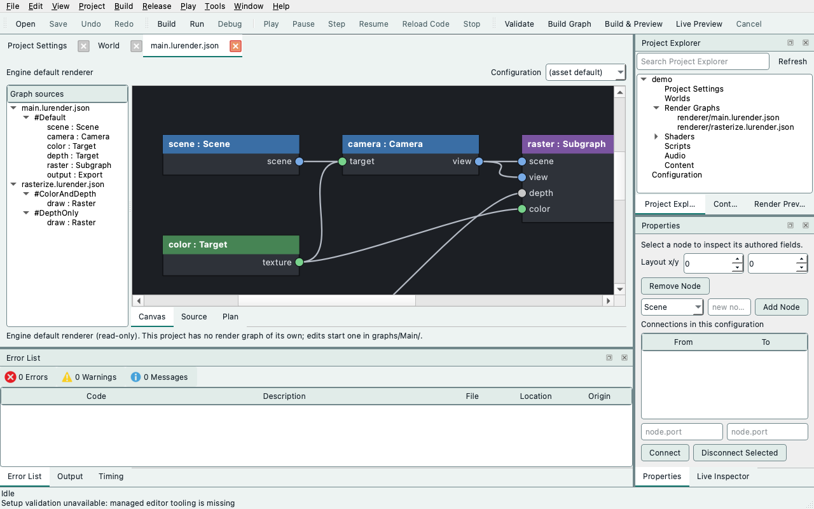

# Save, validate and build render graphs

RG0 implements the offline graph contract in the installable `ludus` host tools.
It saves reusable graph assets, validates explicit configurations and camera
output routes, and prints a deterministic serial plan. The same Python backend
is available to future editor jobs; no Qt or engine checkout is required after
installation. See [host tools](host-tools.md) for installation and the
[architecture](../architecture/render-graph-authoring.md) for ownership and later
stages. RG1 adds explicit offline shader/schema builds and immutable packages,
using the same CLI/backend. RG2 adds bounded static opaque Renderer admission and
execution through cooked headers. RG3a adds the editor's Render Graph document, mapped
diagnostics, runtime generations and atomic activation; the node canvas and live
in-editor preview are RG3b. RG4a adds measured exact-descriptor pooling of
transient attachments with a serial control. To begin in the editor, see
[Start customizing the renderer](#start-customizing-the-renderer).

**RG0 plans are contract diagnostics, not executable renderer packages.** They
do not compile shaders, evaluate scene draw-item coverage, negotiate device
capabilities or render pixels. Those checks are reported as pending. RG1 builds shader packages; RG2 owns
Renderer/RHI integration. `DefaultOpaque`, `DefaultMasked` and `RendererStatic`
identify the qualified static profile described below; arbitrary mesh/material
compatibility is never inferred from those labels.

## Author pipeline nodes

The node type picker offers **GraphicsPipeline**, **ComputePipeline** and
**RayTracingPipeline** for GPU work. Scene, Camera, Target, RenderSize, Subgraph, Export and
Present remain supporting nodes; OutputSize is the final-resolution provider. A new pipeline has no inputs, outputs or shader
assignments. It is an editable draft, not a ready rendering pass.

Select the node in Properties. **Read Inputs** declares resources and values the
pass consumes. **Writable Resources** declares paired input/output ports: each
row owns the input receiving the texture or buffer and the output exposing its
updated contents. Add one row instead of declaring those ports separately. New
pairs start with the same name; renaming the output also renames its input while
the names match. Existing graphs with different port names retain both names, shown in the
resource name tooltip. A missing or incompatible old target association is rebuilt
as a same-name pair on the next completed edit; opening the inspector does not rewrite sources.
The editor writes the serialized `target` association automatically; there is no
editable target field. Connect a compatible resource to the pair's input, then
connect its output to the next pass or configuration output. A writable input
needs a connection even when its Load operation is Clear or Discard. Paired ports
line up horizontally on the canvas. Changing the resource type changes both
port types and selects its corresponding format.

**Shaders**, **Pipeline State** and **Invocation** edit the rest of the node.
Completed edits enter the undoable draft directly in Properties or the canvas node editor.
There is no **Apply Pipeline** button. **Save** publishes the draft and updates Live Preview;
unsaved edits do not build shaders. Removing a
writable row removes both ports. Disconnect affected links before removing,
renaming or changing the type of a connected port. A rejected edit preserves
the draft and identifies the affected endpoint and repair. Duplicate or invalid
port names are explained beside the controls; graph validation names missing
connections and incompatible output/input pairs with concrete repair actions.
Undo restores the complete record and document version. Double-click any ordinary
node to open **Details**. A pipeline's clickable parts are **Read Inputs**,
**Writable Resources**, **Shaders**, **Pipeline State**, **Invocation** and
**Public Options**. Each part opens the same controls used by Properties;
Properties may remain hidden. Click an individual shader card to select its assignment;
double-click it to close **Details** and open that shader in the **Source** editor.
The source comes from the current build-manifest program reference, including any
per-use program override. An unmapped shader keeps **Details** open and reports the
missing source. Double-clicking a Subgraph enters its graph.
Right-click a pipeline and choose **View Shaders** to open a mapped source through
its explicit build-manifest program reference. **Show Details / Edit Node** opens
a Subgraph instance's choices without entering its shared source.

Pipeline records use document `version: 2`; adding one upgrades the draft in the
same undo step. Version-1 graphs remain readable and are never rewritten on load.
Select a legacy Raster node and choose **Convert to Graphics Pipeline** to retain
its ID, ports, load/store operations, shaders and selected recipe. Conversion
requires exactly one explicit recipe for that technique; an ambiguous or missing
mapping preserves the draft. Convert each legacy node explicitly, including
nodes in referenced subgraphs. The CLI can print a converted document for review:

```bash
ludus render-graph migrate-pipelines graphs/Main/rasterize.lurender.json \
  --manifest graphs/Main/main.lushader.json
```

The command writes only stdout (`--json` returns a `document` object). It does
not replace files or convert imported assets automatically.

In **Properties → Shaders** or the canvas node editor, add a row, choose its stage
and set its shader ID. Completed edits automatically create a `.slang` template and register a program in the root
`.lushader.json` for each new program name. The initial `Program` value
receives a unique name from the node and shader IDs. Program IDs belong to the root
shader manifest and are shared across all imported graphs and configurations;
graph-local node names do not create separate program namespaces. Generated names
choose an available suffix on creation and shader-row rename, including when a
source file already occupies the suggested name. Select a shader row to inspect
and copy its full program ID above the table; shader cards also show it in their
tooltip. Rejected edits show their cause and repair instruction above the fields
in **Details**, preserving the accepted draft. To share a shader, enter an existing
program name with a matching stage. New sources appear immediately in **Source**;
**Save** writes them beside the manifest. Creation, manifest registration and node
assignments form one undo step. Completing an executable graphics or triangle ray
pipeline also registers its technique and pipeline recipe in the root manifest
in that same undo step, including pipelines in imported subgraphs. Recipe edits
retain existing recipes. Graphics passes in the same package can select different
vertex/fragment programs, including separate functions in one `.slang` source.
The editor registers an independent technique within the material/mode family
when a pair differs; legacy Raster assignments remain unchanged. In Shaders,
select the desired program IDs. To share one source with different entry points,
register separate programs in the manifest with the same `source` and different
`function` values, then select those programs on the nodes. The compiler preserves
these choices in both compiled headers and runtime packages. Adding a new shader
program automatically grows `budgets.programs` and `budgets.artifacts` to the
required counts, including every target profile. You do not need to edit the
manifest first. Larger authored budgets are retained. Budget changes, source
creation and node assignments share the same undo step and **Save** operation;
undo restores the previous budgets too. Reusing an existing compatible program
creates no additional program or budget change. Direct manifest edits and CLI
builds continue to enforce their declared budgets.
The build service's supported artifact ceiling and package file/byte limits still
apply. Exceeding the artifact ceiling names the manifest, program/profile counts
and supported limit, and preserves the complete draft. Reuse compatible programs,
remove unused shaders or reduce target profiles before retrying.
A new triangle ray pipeline needs three programs (`ray_generation`, `miss` and
`closest_hit`); each addition grows the relevant budgets as needed. Ray callbacks
still share the single bounded ray technique.
To clean up the open package, choose **Edit → Remove Unused Shaders**, or
**Remove Unused Shaders** in the canvas context menu. The command checks every
loaded graph file and configuration (including disconnected nodes and unselected
subgraphs), and every technique in every loaded shader manifest. Techniques remain
authored build roots even when no node currently selects them; their programs survive.
Remove an unwanted technique explicitly in **Source** before running cleanup.

Unused program registrations are removed in one undoable draft edit. Their `.slang`
files are removed only when exclusive to one registration and unmentioned by other
loaded shader sources. Shared sources, includes, transitive includes, Slang imports
and loose unregistered files are retained. Include/import protection is conservative:
filename or module-name mentions, including comments, can retain an otherwise unused
source. A computed include or an include outside the tracked snapshot retains all
source files while still removing unused registrations. Programs with the same ID in different manifests are conservatively retained
if that ID is referenced anywhere in the loaded package. References outside the open
package are outside this scan; keep cross-package shared code outside package-owned
shader files. Malformed graphs/manifests or missing subgraphs stop cleanup without
changing the draft. The status line reports removed program/file counts.
**Undo** restores the edit; **Save** publishes removals after checking for external
file changes. Nothing is deleted from disk until Save.

Incomplete shader tables remain authoring drafts. Name/file conflicts or incompatible references
preserve the draft. Templates are starting points: vertex/fragment interfaces use
the manifest schemas; ray-generation, miss and closest-hit functions use the
renderer’s triangle ray interfaces. A new ray technique uses scene-aware callbacks:
closest-hit receives `SurfaceHit` and `SceneContext`, and its template demonstrates
`MaterialSample material = EvaluateMaterial(scene, hit)` and `material.BaseColor`.
The editor creates the shared `ScenePayload` source and manifest interface alongside
the callbacks. Raygen traces the camera ray once; the template displays material
color and adds no lighting estimator.

For a scene-aware ray pipeline, **Properties → Scene query budgets** sets the
maximum **Surface queries** (1–8) and **Visibility queries** (0–16) per camera
sample. The same controls are available from the canvas node's **Edit Node**
dialog with Properties hidden. Surface queries include the camera intersection;
camera plus one BSDF ray for direct-light MIS needs at least two. Visibility
queries count shadow tests; zero permits none. Exceeding either budget rejects
the sample rather than committing partial lighting.

The optional [line visibility](#find-the-visible-parts-of-a-segment) budget,
`line_queries` (0–8), has no Properties control yet: set it in the manifest's
`scene_interface`. Editing the other two budgets keeps it.

These budgets belong to the package's shared ray technique, so changing them
affects every scene-aware ray pipeline using it, including imported subgraphs.
Completed edits update the existing manifest interface as one undoable change;
**Save** publishes it and updates Live Preview. Legacy pipelines first need
**Enable Scene Materials**, described below.

Existing ray techniques keep their interface and authored sources. For a legacy
`ShaderMain(RayHit input)`, material tint is `input.Color.xyz`; full material
parameters are unavailable through `RayHit`. Select the ray pipeline and choose
**Enable Scene Materials** in its canvas context menu or Properties. This upgrades
the package's shared ray technique and all references in one undoable draft edit.
The builder adapts the original shaders without rewriting their sources or adding
project helper files. New stages use scene-aware callbacks; replace a legacy stage
when its shading needs `EvaluateMaterial(scene, hit)` and the full material properties.
The conversion reuses the existing program records, IDs and profile artifact slots.
It works with full program/artifact budgets and preserves those authored limits;
you do not need to edit the manifest before converting. **Save** publishes the manifest change.
Projects converted by older editors may retain a generated `scene_legacy_callbacks.slang`
helper that includes the original callbacks. The builder recognizes that generated
helper, supplies the renderer-owned `RayHit` declaration, and includes each callback
once from the pipeline wrapper. Replacing a callback can therefore retain its helper
include without recursively including itself. This compatibility step leaves project
files unchanged; customized helper declarations or directives are preserved without
automatic migration. The compiled program's `compatibility-sources.json` records the
staged helper text; the package's `sources/` retains the original source snapshot.
The Source interface panel describes the active interface and available material
fields. See [scene-aware ray shaders](#author-scene-aware-ray-shaders) for callback
and material contracts.

Other stages remain authoring drafts subject
to the execution limits below. Changing stage creates a new matching program and
retains the previous source for reuse. Removing a shader row retains its program and source for reuse.

In **Source**, **Shader API** shows the selected ray callback signature, its input
struct and nested field types. Scene callbacks also list material, light and
query function signatures, constants, and the current draft `ScenePayload`.
Declarations come from the renderer shader sources used by the graph compiler;
lookup requires no build. Type a field, type or function name in the search box;
**Enter** or **Next** advances through matches and wraps at the end. Refreshing
the same source preserves the reference pane's scroll position.

The version-2 node fields are:

| Field | Contract |
| --- | --- |
| `inputs` | Up to eight `{id, type, required}` records; stable port IDs and explicit connection requirements |
| `outputs` | Up to eight `{id, type, target, format, load, store}` records; `target` names a same-type input carrying the previous resource version |
| `shaders` | Up to sixteen `{id, stage, program}` records; `program` references an explicitly declared build-manifest program, not a guessed source filename |
| `state` | Graphics topology/cull/front/depth comparison/depth writes/blending/samples; compute `group_size` (scene compute passes use `{}`); ray tracing recursion/payload/attribute bounds |
| `invocation` | Graphics mode, vertex layout, material family and Scene/View input names; compute dispatch `dimensions`; scene compute and ray launch `dimensions` as `"ColorTarget"` or explicit `[width, height, 1]`, plus optional [`traversal`](#reuse-ray-callbacks-in-compute-pipelines) (`NativeQuery`, `TriangleLoop` or `ComputeBvh`) |

Input types include Scene, View, ColorTexture, DepthTexture, Buffer,
AccelerationStructure, Float32, Float2, Float3, Float4 and UInt32. Outputs are
resource versions (ColorTexture, DepthTexture or Buffer). Texture output formats
are RGBA8Unorm/Depth32Float; Buffer uses Bytes. These declarations do not establish
execution support or create a buffer/acceleration-structure provider. Outputs
still need compatible resources connected through their target inputs.

**Execution remains qualified by the current graph profile.** A complete graphics
node supports custom Scene/View and attachment port names while lowering to the
existing RendererStatic ColorAndDepth/DepthOnly implementation. The build checks
its exact vertex/fragment assignments and complete state against the authored
technique/recipe; settings are never silently ignored. Each admitted output's
format/sample count must match its connected target. Additional resources,
optional geometry/tessellation stages and unsupported state produce an explicit
capability error. Triangle ray pipelines execute through the
[authored ray profile](#execute-a-triangle-ray-pipeline) below. A Compute Pipeline
with a Scene input executes as a [scene compute pass](#author-scene-compute-passes)
in the same profile. Other compute settings can be authored and saved, but those
nodes remain outside this graph profile and report a capability error. Device capabilities
and the complete authored interface are checked before activation. Missing required shader assignments
produce IncompletePipeline; an invalid/pending candidate leaves the current
viewport generation intact. Blending/rasterization remain fields inside the
node; separate state blocks and stream output are deferred.

## Upscaling presets

**Bilinear and MetalFX Spatial are executable** in the single-sample RGBA8
renderer profile. MetalFX Spatial requires a supported Metal device and the
system MetalFX framework. Other vendor presets remain authoring-only and report
a mapped `Capability` diagnostic when selected. No algorithm is substituted automatically. An unused preset can remain in a graph
without blocking its existing render path. Validation/build failure retains the
previously drawable generation.

Use **Create Node → Upscale — Bilinear** or **Upscale — MetalFX Spatial**
on the canvas, or **Upscale — … (draft)** for an unavailable vendor preset. The same choices are available in
Properties' Add Node picker. Both create the same version-2 supporting operation:

```json
{"id": "upscale", "kind": "Upscale", "algorithm": "dlss-sr"}
```

These are **node presets**, not complete renderer configuration templates. Each
preset inserts an unused, sized target group around the fixed interface for one algorithm; vendor work is owned by a
Renderer/RHI adapter rather than a user-authored ComputePipeline shader.
Select **Edit Node…** on the canvas or use Properties to change `algorithm`.
Changing temporal to spatial requires disconnecting any ports that would disappear;
the editor rejects the edit and preserves wires until that is done. Creation,
changes, wiring, removal, copy/paste, undo/redo and Save use the ordinary document
operations. Properties may stay hidden throughout canvas authoring.

| Algorithm identity | Preset | Interface |
| --- | --- | --- |
| `bilinear` | Bilinear (implemented) | Spatial |
| `dlss-sr` | DLSS Super Resolution | Temporal |
| `fsr-1` | FSR 1 spatial | Spatial |
| `fsr-2` | FSR 2 temporal | Temporal |
| `fsr-3` | FSR 3 upscaling | Temporal |
| `metalfx-spatial` | MetalFX Spatial (implemented on supported Metal devices) | Spatial |
| `metalfx-temporal` | MetalFX Temporal | Temporal |
| `xess-sr` | XeSS Super Resolution | Temporal |

All presets consume `color: ColorTexture` and
`destination: ColorTexture`, and expose `color: ColorTexture` as the written
version of the destination. The source texture determines input resolution; the
separate destination determines output resolution. Targets can use the existing
fixed or shared RenderSize policies. The canvas infers the output descriptor
from destination storage. No quality preset silently changes either resolution.

Temporal presets additionally declare the following required per-frame inputs:

| Input | Graph type | Intended adapter contract |
| --- | --- | --- |
| `depth` | DepthTexture | Current frame depth |
| `motion` | ColorTexture | Current-to-previous motion in RG; multiply by `motion_scale` to obtain render pixels, excluding projection jitter |
| `jitter_pixel` | Float2 | Current projection jitter in render pixels |
| `motion_scale` | Float2 | Per-axis conversion from encoded motion to render pixels |
| `exposure` | Float32 | Positive linear exposure multiplier |
| `reset` | UInt32 | Zero retains history; nonzero resets it, including camera cuts |

These names record a draft interface, **not an implemented native texture ABI**.
The current RGBA8 graph texture vocabulary cannot establish HDR or motion-vector
precision. Typed wiring checks remain active, including on unused branches. Vendor presets
do not allocate history or perform SDK resource/content validation. A future
adapter must qualify texture formats, color/exposure and depth conventions,
initialization, resource aliasing, dynamic extents, jitter/motion producers and
history lifetime before execution is admitted. The current raster profile does
not manufacture these temporal inputs. There is no automatic algorithm fallback.
Frame generation, ray reconstruction, driver overrides and SDK version selection
are separate work and are not represented by these super-resolution presets.

Thanks to NVIDIA, [DLSS Programming Guide](https://github.com/NVIDIA/DLSS/tree/main/doc),
AMD, [FidelityFX Super Resolution 2.3.3, Inputs](https://gpuopen.com/manuals/fidelityfx_sdk/techniques/super-resolution-temporal/),
Apple, [MTLFXTemporalScaler](https://developer.apple.com/documentation/metalfx/mtlfxtemporalscaler),
and Intel, [XeSS Super Resolution Developer Guide](https://github.com/intel/xess/blob/main/doc/xess_sr_developer_guide_english.md),
for the spatial/temporal input distinction. Ludus adapts that distinction into a
shared draft interface; it does not copy their SDK implementations or imply
that their native contracts are interchangeable.

### Run MetalFX Spatial

Create **Upscale — MetalFX Spatial**, then wire the source renderer's stored color
output to `color` and the distinct output-sized target to `destination`. Route the
camera target and final presentation/export through that destination, as in the
bilinear workflow below. Its OutputSize and RenderSize providers use the same
**Project → Project Settings → Rendering resolution** output resolution and render scale controls.
Output width and height must each be at least the render dimensions; equal sizes
are allowed. Odd viewport dimensions follow the existing size-provider rounding.

Edit `color_processing` through **Edit Node…** on the canvas or Properties:

- **Linear** (default, including older nodes without this field): stored RGBA8
  channels represent linear light in [0,1]. Use with the ordinary linear raster path.
- **Perceptual**: stored channels already represent tone-mapped perceptual/sRGB
  values in [0,1]. Choose it when the source producer performs that encoding.

```json
{"id": "upscale", "kind": "Upscale", "algorithm": "metalfx-spatial", "color_processing": "Linear"}
```

Neither mode inserts tone mapping, display conversion or anti-aliasing. Apple
recommends perceptual input after tone mapping and an anti-aliased, noise-free
source; Spatial does not reconstruct temporal history or provide temporal AA.
The current graph adapter supports RGBA8 only, with one mip, layer and sample;
HDR formats and temporal inputs are outside this profile. Temporal MetalFX stays
an unavailable authoring preset.

Scaler setup can compile vendor pipelines, so Ludus prepares and reuses it between
frames. Scene and camera edits reuse the scaler; dimension changes prepare a new
attachment/effect generation before publication. Pending or failed replacements
retain the previous drawable view. Offscreen output is written directly; surface
output uses a private RGBA8 intermediate and the existing fullscreen composition
pass. There is no CPU image transfer or per-frame scaler creation. Framework-private
GPU allocation sizes are opaque; RHI resource-instance limits still apply.
Unsupported devices/backends report `Unsupported` at runtime without fallback.

Thanks to Kelvin Chiu / Apple, [“Boost performance with MetalFX Upscaling”,
WWDC22 session 10103](https://developer.apple.com/videos/play/wwdc2022/10103/),
spatial setup and frame encoding (3:39 and 9:16), for the integration, color
interpretation and effect-reuse guidance. MetalFX owns the reconstruction algorithm.

### Run a bilinear upscale

Create the Bilinear preset to add OutputSize, RenderSize, render-sized source
storage and an output-sized destination as one undoable group. The initial render
scale is 1/2. Wire the existing renderer as follows:

1. Connect `OutputSize.size` to `RenderSize.output` and the destination Target's
   `size`. Connect `RenderSize.size` to the scene color and depth Targets' `size`.
2. Render the scene into those smaller color/depth Targets. Replace the preset's
   raw `color.texture → upscale.color` connection with the renderer's **written
   color output**, which must retain initialized contents.
3. Connect the output-sized destination Target to `upscale.destination` and the
   upscaler's color output to Export or Present. The camera's target must name
   that final destination; its rendered camera route survives the upscale.
   Present additionally requires an imported presentation Target; the preset's
   destination starts as an ordinary offscreen Target for Export.
4. Use Project Settings → Rendering resolution to edit the exposed provider pair,
   or edit either provider through its canvas menu. Build and Preview the graph.

The pass samples the source with bilinear filtering, edge clamping and normalized
pixel-center coordinates, covering the complete destination. Both textures must
be distinct, single-sample RGBA8 images; the source must be initialized offscreen
color with one camera route. Fixed dimensions and viewport-relative fractions
both work. Odd render dimensions round up using the existing size-provider policy.
Equal source/output dimensions are permitted. The pass interpolates stored RGBA
channels; it does not apply tone mapping, color-space conversion, sharpening,
alpha conversion or anti-aliasing. It needs no depth, motion, jitter or history.
This initial profile does not expose HDR texture formats or temporal reconstruction.

The installed renderer composition recipe supplies the shader stages. Its sampler
is explicitly linear/clamp; ordinary viewport composition retains its own sampling
policy. Shaders, buffers and pipelines are prepared outside drawing and reused
across camera/scene edits and resize. Replacement source bindings become visible
with their Ready scene/resource generation; pending or failed preparation retains
the last drawable view. RHI tracks attachment-to-sampling dependencies and leases
through submission completion. No CPU image copy or GPU readback runs in the pass.

## Output and render resolution

Configure rendering resolution in the **project's saved render graph**. Select an
**OutputSize** or **RenderSize** node in Properties, or choose **Edit Node…** from
its canvas menu. These are renderer settings, saved and reviewed with the graph;
they are not machine preferences or shader compiler options. Separate graph
configurations can own different output sizes and render scales.

For everyday changes, open **Project → Project Settings → Rendering resolution**.
Choose the renderer configuration/provider pair, **Viewport pixels** or **Fixed
resolution**, and a **Render scale** preset or exact custom numerator/denominator.
The 100% preset uses 1/1. These controls edit the same nodes as the canvas;
Undo/Redo while focused in this section uses render-graph history. When several
RenderSize nodes share an OutputSize, editing that output changes all its consumers.

The built-in default renderer already exposes one pair (`outputSize` at Viewport
pixels, `renderSize` at 1/1), so its controls need no setup. An ordinary root
renderer with one color Target can use **Enable resolution controls** to add the
pair in one undo step. Fixed target dimensions are retained,
as are existing fixed/view-relative RenderSize dimensions and scale. Matching
fixed Targets (including depth) are wired to the new render provider. Custom or
ambiguous layouts are left intact with a setup message; expose the desired pair
on the canvas instead. Simply opening settings never creates or changes nodes.

**Save settings** saves the project descriptor and the active renderer's pending
graph edits. Editing the built-in default creates its project copy under
`graphs/Main/` on Save. The resolution values remain in the graph, so there is no
second resolution override in `ludus.project.json` or machine preferences.
Selecting another graph changes which providers these controls expose. Source-root
changes retain the existing save/discard confirmation for the previous renderer.
Lower render scale changes target sizing. Connect an explicit Bilinear Upscale
operation to reconstruct the full output; resolution controls do not insert passes
or make a vendor backend available.

- **OutputSize → Viewport pixels** follows the current viewport drawable in
  physical pixels, including display scaling and subsequent resizes. For an
  offscreen image or fixed resolution, choose **Fixed dimensions** and edit the
  pixel width and height.
- **RenderSize → From OutputSize** receives the output provider on its `output`
  input. Edit the adjacent multiply/divide controls for the render scale.
  **1/1** gives native resolution; **1/2** gives half the width and height.
  Each dimension uses `ceil(output × numerator / denominator)`, so 1921 × 1081
  at 1/2 becomes 961 × 541. Bounds are checked against the actual drawable at
  runtime, rather than the offline Plan's nominal reporting dimensions.

```json
[
  {"id": "outputSize", "kind": "OutputSize", "extent": "Viewport"},
  {"id": "renderSize", "kind": "RenderSize", "extent": "OutputSize", "scale": [1, 1]}
]
```

Connect `outputSize.size` to `renderSize.output`. Connect `renderSize.size` to
scene color/depth/motion Targets' `size` inputs, and `outputSize.size` to the final
output Target's `size` input. Those Targets use `"extent": "RenderSize"`, the
existing size-input representation. Both providers expose the existing
`RenderSize` graph value type, which can cross subgraph interfaces. Neither
provider allocates GPU storage or emits a GPU pass. Other targets, including
shadow maps, keep their independently authored dimensions.

New RenderSize nodes default to **From OutputSize**, with a 1/1 scale. Existing
fixed, texture-derived and view-relative RenderSize records retain their saved
behavior and controls. A derived RenderSize accepts fixed output dimensions or
the full viewport reference. A second already-scaled view reference is rejected;
this keeps output ownership explicit and avoids ambiguous repeated rounding.
A connected `output` input must be disconnected before changing the RenderSize
source policy. Rejected edits preserve the graph, wires and history.

Every **Upscale — … (draft)** preset now inserts one unused group: an OutputSize
provider, a RenderSize provider at 1/2, render-sized source targets, an output-sized
destination target and the Upscale node. Color, depth and motion sources use
RenderSize; destination uses OutputSize. Edit the two named size providers to
configure that preset. The entire insertion is one undoable operation, and IDs
are made unique when multiple presets coexist. The preset does not replace the
active renderer path or invent scene/motion producers. Its source targets need
authored render passes and its temporal values need per-frame providers.
Vendor execution remains explicitly unavailable as described above.

## Share render sizes

Use a **RenderSize** node when targets should share a resolution. Its
**Fixed dimensions** policy owns one width/height pair in pixels. Select each
Target's **extent > From size input**, then connect the size output to its new
`size` input. For example, this size node can drive both `color.size` and
`depth.size`:

```json
{"id": "scene_size", "kind": "RenderSize", "extent": [1280, 720]}
```

```json
[
  {"from": "scene_size.size", "to": "color.size"},
  {"from": "scene_size.size", "to": "depth.size"}
]
```

Targets using that input store `"extent": "RenderSize"`. Existing targets with
`"extent": [width, height]` keep their fixed dimensions and source representation.
Adding a RenderSize node or selecting **From size input** upgrades that graph's
draft to version 2. These edits, including size-mode changes, support undo/save.
Disconnect an existing size/texture input before switching its owner back to fixed
dimensions; a rejected edit preserves the connected policy. All controls and node
creation are also available from the canvas context menu with Properties hidden.

To derive a size from another texture, select the RenderSize node's
**extent > Match texture** policy (`"extent": "Texture"`). Connect a color or
depth texture output to its `texture` input. This reads dimensions rather than
pixel contents, so a Target's uninitialized `texture` output is sufficient. A
target consulted only for size metadata does not enter the GPU resource table.
Using a rendered texture output retains its producer dependency; connect the
underlying Target's output when only its declared dimensions are needed. Size
dependencies are explicit graph edges and cannot form within-frame cycles.

`RenderSize` is a graph value type available on version-2 subgraph inputs and
outputs. It is distinct from GPU textures/buffers and shader parameters, and it
cannot be an Export/Present or root configuration output. Subgraphs resolve sizes
through each caller's bindings. No size node allocates a GPU resource or creates
a shader program; the compiled Plan and generated SDK resources contain concrete
numeric nominal extents and, for view-relative targets, their scale policy.

Texture compatibility belongs to the operation using the texture. The current
color/depth raster operation requires equal attachment extents and sample counts;
GraphicsPipeline writable resources must match their declared format and pipeline
samples. The triangle ray profile requires a single-sample offscreen RGBA8Unorm
color target, with target-derived launch sizing or matching explicit dimensions.
The canvas and Properties connection controls reject newly provable mismatches,
including ones resolved through nested subgraphs. The message names the operation,
dimensions or format/samples, and the repair. A size alone does not imply that two
textures have compatible formats, sample counts or usages.

Unbound subgraph inputs and incomplete drafts may not yet have a known size.
Bounded editor inference defers unknown contracts to build validation, which checks
the selected concrete graph instance. Existing unrelated draft problems do not
block an otherwise compatible new connection. This is not a universal same-size
rule for sampled textures; future resize/composite operations need their own
declared relationships. Adaptive resolution and arbitrary texture resampling remain
separate work.

Choose **Full view**, **Half view**, **Quarter view**, or **Custom view scale** in
the RenderSize node's extent control. The same controls are available from the
canvas node menu with Properties hidden. Half view scales both dimensions, so it
uses one quarter of the full-view pixel count. Custom scale is a positive integer
numerator/denominator; each component is at most 16384. The source representation is:

```json
{"id": "scene_size", "kind": "RenderSize",
 "extent": {"reference": "View", "scale": [1, 2]}}
```

The reference belongs to each viewport or export request, in **drawable pixels**
(after display scaling, before render scaling), rather than to the project or a
particular output texture. Each dimension resolves with integer ceiling; a
193 × 129 view at half size produces 97 × 65 attachments. A positive reference
always produces at least one pixel. Resolved dimensions above 16384 or the device's
attachment limit reject. Zero/minimized view sizes suspend new work and retain the
last view. Fixed targets ignore the reference, so a 1920 × 1080 export stays fixed
while the window changes. Independent graph instances supply independent references.

The compiler normalizes scale fractions, propagates them through texture metadata
and subgraph bindings, and retains them in generated plans/runtime packages.
Attachment compatibility compares policies as well as nominal dimensions: a fixed
320 × 240 image and a half-view image are not guaranteed to match. Relative ray
outputs require **Match color target**, since an explicit launch cannot cover
every reference size.

For direct SDK use, pass the drawable width/height after the optional pool argument
to `RenderGraph::Initialize`. For `RenderGraphActivation`, call `Resize(width, height)`
before `Stage`. Supply an explicit reference for an offscreen export that uses a
relative policy; no global window is inferred. On a later view change, finish
outstanding export/readback consumers, call `Resize`, then `Update` with the current
World/camera extraction (even if the scene revision did not change), and `Poll`
between frames. `HasPendingResize` reports resource preparation. Repeated identical
requests reuse the pending candidate; a newer request supersedes it. Read the actual
published extent through `GetResourceDescription`.

Resize allocates a candidate attachment set and prepares its scene beside the
current one. It reuses existing shader/pipeline contexts, with no offline compiler,
source rewrite or shader variant. The replacement attachments and scene publish
together only when Ready. Pending or failed replacement keeps the old drawable
scene and the editor's last completed image; retired GPU resources follow the
existing RHI completion/pool ledger. The editor reads physical viewport dimensions
before its ordinary edit-preview cap, and updates target inspection dimensions
only after publication. Resolution changes create fresh ray jobs and reset their
accumulation. Fixed-capacity graph buffers retain their contents across resize. Pixel buffers
follow their connected RenderSize and stage zeroed replacement allocations when
capacity changes. Shaders must validate capacity and invalidate incompatible history; foreign
texture/history imports remain unsupported. See [ordered ray passes](#order-ray-passes-and-share-persistent-buffers).

## Expose finite choices on reusable nodes

Open a pipeline's **Details → Public Options**. **Add Option** declares an ID,
label, type (**Enum**, **Bool**, **UInt32** or **Float32**), target, allowed values
and default. Separate allowed values with commas; Boolean values are `true` and
`false`. **Apply Options** commits the declaration as one undoable draft edit.
Targets are existing scalar **Pipeline State** or **Invocation** fields, or a
shader row's program reference (`shaders.<shader ID>.program`). Resource ports,
node IDs, arbitrary JSON paths and shader text are outside this interface.

An option selects from its declared finite set. The current use's choice appears
above the declarations. **Default (value)** removes the override, so later author
default changes are inherited. A concrete choice remains an override even when it
equals today's default. Changing a choice changes only this use's saved record;
it never changes a shared subgraph's source or another instance. Save and rebuild
to apply it to rendering.

To publish a pipeline choice through a graph, right-click the graph canvas and
choose **Edit Exposed Options**. Declare the public option with a target such as
`shade.Quality`, where `shade` is the child node ID and `Quality` is its option ID.
The public type must match; its allowed values must be a subset of the child's.
This can forward through another Subgraph's public option, so nested libraries
retain an explicit public interface. In the parent graph, right-click the Subgraph
and choose **Show Details / Edit Node** to set its per-use choices. The same choices
are available in Properties. Enter the Subgraph to edit its authoring source.
Existing callers prevent removal or narrowing of an option when their overrides
would become invalid; reset those callers before changing the declaration.
Renaming a node updates exposed option targets in the same undo step.

Each declaration list and value list admits at most sixteen entries; an interface
admits at most 64 combinations across its independent choices. Prefer one named
mode over many independent Boolean switches. Numeric
values are bounded to one million in magnitude (UInt32 values are nonnegative).
These are build-time choices. They select existing shader programs and pipeline
fields; they do not inject raw preprocessor macros or synthesize shader programs.
Register alternate programs and their compatible techniques/recipes in the build
manifest before selecting them. Unused alternatives remain protected from
**Remove Unused Shaders**. Rename a program exposed as an allowed choice only
after removing that choice from its public interfaces. State and shader choices
remain subject to the selected execution profile: for example, the static raster
profile still rejects unsupported culling/blending state. An allowed-value list
does not expand backend capabilities. Only instantiated choices are lowered;
ordinary build budgets still limit compiled programs, recipes and artifacts.

The authored representation keeps defaults beside declarations and overrides on
uses. For example, on a pipeline whose fragment shader row is `pixel`:

```json
"options": [{
  "id": "Quality", "label": "Quality", "type": "Enum",
  "target": "shaders.pixel.program",
  "values": ["FastPixel", "QualityPixel"], "default": "QualityPixel"
}],
"overrides": {"Quality": "FastPixel"}
```

Its configuration can expose the same choice as `shade.Quality` by declaring
`"target": "shade.Quality"`. A Subgraph use then stores
`"overrides": {"Quality": "FastPixel"}` beside its `asset` and `configuration`.
Absent overrides inherit the selected configuration's defaults. Validation rejects
unknown IDs, incompatible forwarding, duplicate targets and values outside the
allowlist. Resolution copies the selected instance before graph lowering; library
records and source bytes remain unchanged.

## Execute a triangle ray pipeline

A `RayTracingPipeline` can run authored ray-generation, miss and closest-hit
functions over the selected World's static opaque triangles. The renderer freezes
an immutable World extraction, builds native triangle BLAS/TLAS structures during
scene preparation, and uploads geometry and camera inputs. A GPU shader uses native
ray queries for accelerated traversal and invokes the authored shading functions; a
renderer-owned image pass transfers GPU-produced colors to the graph's attachment.
There is no CPU tracing or pixel readback in this path. The editor's World/camera
updates create replacement inputs, retaining the last drawable view until they
are ready, just as raster graph updates do.

The default native-query profile requires Vulkan acceleration structures and
`VK_KHR_ray_query`, or Metal acceleration structures/intersection queries on Apple
GPU family 9 or newer. Metal API availability alone does not admit older GPUs
without dedicated ray hardware. Software/CPU Vulkan adapters are excluded. The
shader uses native traversal inside a compute invocation; dedicated ray stages or
shader tables are not required for hardware acceleration. The default
RayTracingPipeline traversal is native. The explicit triangle-loop and compute-BVH
strategies described below use ordinary GPU compute and do not require ray hardware.
WebGPU and WebGL2 do not execute this
profile. Packages can retain browser raster targets alongside native targets;
their `capability_profiles.ray_tracing` lists only `metal` and/or `spirv`, and no
browser RT recipe or ray shader artifact is emitted. A browser-only RT manifest
is rejected and needs an authored raster configuration. Metal cooking
requires the SDK-pinned SPIRV-Cross translator (`LUDUS_SPIRV_CROSS` in CMake or
`--spirv-cross` for the package builder).

Request `DeviceDescription.Preferred.RayQueries = true` when creating a device
for a renderer with optional RT, then inspect `GetRayCapabilities` on that actual
device/API. A capable physical GPU is insufficient when its logical device has
not enabled the ray profile. In particular, the currently adopted Vulkan editor
device does not expose ray queries; engine-owned Vulkan device negotiation is a
separate path. Use `Required.RayQueries` for an application that requires native
queries. Software-only configurations do not request this feature. An unavailable native
profile returns `Unsupported` before scene retention or ray dispatch; a failed
replacement preserves the prior drawable view. Old software-ray runtime packages
must be rebuilt; they are rejected rather than reinterpreted as accelerated graphs.

### Reuse ray callbacks in compute pipelines

Assign the same `ray_generation`, `miss` and `closest_hit` manifest programs to
both a **RayTracingPipeline** and a **ComputePipeline** with a Scene input. Keep
the shader sources, ScenePayload and query budgets shared. Choose the pipeline in
each graph configuration; only the node kind and its state differ. Scene compute
nodes use `"state": {}` and inherit the bundle workgroup (64×1×1 when no pass overrides it). A callback compute node
must have all three callbacks and no `compute` shader. Existing single-kernel
compute nodes remain supported.

The graph node is a logical ray program. **Invocation → Invocation type** in the
pipeline editor, accessible from both Properties and the canvas pipeline editor,
selects its execution model without changing the node kind or its callbacks:

| Invocation type | Contract |
| --- | --- |
| Hardware RT pipeline (`RayTracing`) | Uses Metal native intersectors, an intersection function table for alpha acceptance, and visible function tables for ray-generation, closest-hit and miss callbacks. Requires hardware ray traversal and function pointers. Other backends reject this invocation explicitly; it never selects inline-query compute as a fallback. |
| Compute pipeline (`Compute`) | Runs the ray callbacks through a compute entry and selects their query implementation with **Ray traversal**. |

An omitted `invocation.type` retains the legacy compute execution model. Selecting
an explicit Compute invocation defaults to the engine's triangle loop when no
traversal is specified. A logical RayTracingPipeline may select either invocation;
a scene ComputePipeline remains a compute invocation. Metal uses a native function-table backend because the pinned Slang compiler
does not emit Metal ray-generation stages directly. The offline compiler retains
the authored Slang callbacks and lowers the reserved stage/table ABI to native MSL.
Hardware invocation requires the scene callback interface (`scene_interface.version: 1`);
legacy callback signatures use that interface's existing adapters. The driver
independently compiles and links all stages. This does not promise a
performance improvement over inline queries; measure the same scene and settings.

Use **Invocation → Ray traversal** to choose the compute intersection strategy:

| Selection | Behavior |
| --- | --- |
| Automatic | An explicit Compute invocation uses `TriangleLoop`. Legacy documents without an invocation type retain their defaults: shared callbacks in a ComputePipeline use `TriangleLoop`; a RayTracingPipeline and existing single-kernel compute passes use `NativeQuery`. |
| Triangle loop (`TriangleLoop`) | Renderer-owned two-sided ray/triangle intersections scan the selected World's packed triangles. Closest queries retain the nearest accepted hit; visibility queries stop at the first accepted hit. |
| Compute BVH (`ComputeBvh`) | Ordinary GPU compute walks the renderer's packed binned-SAH BVH with watertight triangle tests. Closest queries retain the nearest accepted hit; visibility queries stop at the first accepted hit. |
| Native ray query (`NativeQuery`) | Inline native acceleration-structure queries perform triangle traversal. |
| Custom traversal (`Custom`) | The package-relative **Traversal source** implements closest and visibility queries in compute. No native acceleration structure is created or bound. |

The optional JSON field is `invocation.traversal`:

```json
"invocation": {"type": "Compute", "dimensions": "ColorTarget", "traversal": "ComputeBvh"}
```

Every strategy applies to `TraceClosest`, `TestVisibility` and `TraceAndShade`,
including queries issued by closest-hit and miss callbacks. The wrapper dispatches
the same authored callbacks and preserves payload, query budgets and failure
status. Passes sharing the same callbacks can select different strategies in one
package; the cooked variant includes the strategy so one pass cannot overwrite
another's selection. Changing it rebuilds the wrapper without rewriting shaders.

For custom compute queries, supply a source implementing this function:

```slang
Hit TraceWorld(float3 originWorld, float3 directionWorld,
               float nearDistanceWorld, float farDistanceWorld, bool isVisibility)
{
    return TraceTriangleLoop(originWorld, directionWorld,
                             nearDistanceWorld, farDistanceWorld, isVisibility);
}
```

Select it with
`"invocation": {"type": "Compute", "dimensions": "ColorTarget", "traversal": "Custom", "traversal_source": "queries/custom.slang"}`.
The example delegates to the engine default; replace its body with the desired
query algorithm. Custom sources can access the selected World's packed geometry
and the existing `GraphBuffer0`/`GraphBuffer1` persistent storage slots, so preceding
compute passes can build an acceleration structure in authored Buffer resources.
The custom source must return a packed World triangle index, distance in world
meters and barycentrics through `Hit`. Return `LUDUS_GPU_PREVIEW_INVALID_TRIANGLE`
for a miss or `LUDUS_GPU_PREVIEW_FAILED_TRIANGLE` for failure. Closest queries
return the nearest accepted triangle; visibility queries may return any accepted
triangle. The implementation owns interval bounds, alpha acceptance and bounded
traversal storage; the engine does not substitute another query on failure.
Procedural geometry that cannot identify a packed World triangle is outside this
callback contract. Each pass retains its own source selection, even when callbacks
are shared. Sources and literal includes enter the immutable build snapshot, cache
identity and compiler diagnostics. Shader compilation or publication failure keeps
the preceding active generation.

The loop uses the same fixed-mip material alpha acceptance as native traversal.
Its relative parallel tolerance rejects degenerate and nearly parallel triangles;
its far endpoint is exclusive, and equal-distance hits retain the first packed
triangle. Edge, tolerance and tie behavior can differ from hardware intersection.
It is a linear scan intended for small scenes and comparison, not an acceleration
structure. Strategies are added at this shared traversal boundary rather than in
each author's callbacks.

`ComputeBvh` uses the BVH that scene preparation already builds for every ray
graph; it adds no structure and no preparation work. The kernel shares its node
walk and float32 port of Woop, Benthin and Wald's watertight triangle test with the
[GPU-compute RT1 reference](../architecture/renderer-systems.md#gpu-compute-reference)
(`ray_bvh_traversal.slang`, which reads nodes through `ray_bvh_nodes.slang`, shared
with the [line query](#find-the-visible-parts-of-a-segment)). Its ray interval is closed: a hit exactly at the
maximum distance is accepted, and equal-distance hits keep the lowest packed
triangle. Candidates pass the same fixed-mip material alpha acceptance as the other
strategies. Each ray's traversal stack holds 64 nodes, and the builder's 48-level
depth limit keeps admitted scenes within it; an overflow would fail the query rather
than return a partial result. Use it for scenes larger than a few hundred triangles,
and `TriangleLoop` for small comparisons. Edge, tolerance and tie behavior can differ
from hardware intersection and from the loop's Moller-Trumbore test. Ludus compiles
Metal with fast math, which may fuse the watertight test's edge products into
multiply-adds; each edge function is therefore evaluated in a canonical vertex order,
so triangles sharing an edge still compute exactly negated values and rays through
the edge cannot miss both.

The `ludus_render_graph_ray_tests` traversal parity test renders a
[fixture](../../tests/sdk_consumer/rg2/traversal_parity/main.lurender.json) with
the three strategies over one set of callbacks. Each pixel encodes the camera
ray's triangle, a secondary closest query's triangle and a visibility result. On
a room with nested blocks, `ComputeBvh` must match `TriangleLoop` and, on devices
with native ray queries, `NativeQuery`. Camera rays sample off the pixel center so
none lies exactly on a corner line, where strategies may break an equal-distance tie
differently. On native Metal (Apple M5) all three images are identical; the test
allows one pixel in a thousand for other backends. Vulkan compiles and first runs
these tests in batch CI. The
compiled kernel uses no native ray constructs; the build test also compiles it to
WGSL with the pinned Slang compiler. WebGPU execution is not part of this profile
yet, so no browser ray recipe is emitted.

A configuration whose ray passes all select `TriangleLoop` or `ComputeBvh` runs on native Metal
or Vulkan devices with the required ordinary compute/storage capabilities, including
GPUs without RT hardware and Vulkan software adapters. Its cooked compute artifact
has no ray-query instructions or acceleration-structure binding. Preparation uploads
the World triangle, BVH and material data without creating BLAS/TLAS resources. Callback
sources, payloads, query budgets, persistent buffers, camera updates and transactional
publication use the same contracts as native queries.

A configuration containing any `NativeQuery` pass still requires enabled native ray
support. An unavailable explicit native strategy returns `Unsupported`; it is not
silently changed to another traversal. Native and software configurations can share
one package and the same authored callback functions. Cooking a configuration selects
its matching compute artifact and records each pass's traversal requirement in
version 18 runtime packages. Earlier package versions retain native-ray requirements.
Version 19 additionally records custom software traversal distinctly from the
engine triangle loop. Version 20 carries a separate native Metal stage artifact
and records hardware invocation per pass, allowing mixed native/compute sequences.
Version 22 admits `ComputeBvh` in the same traversal field without a layout change.
Older runtimes reject the new package versions.
Browser rendering remains outside this profile. The legacy RayTracingPipeline
invocation uses inline queries in a compute wrapper. Explicit hardware invocation
uses native stage and intersection function tables on supported Metal devices.
Profiling labels those operations **Native RT** (`gpu.raytracing`); Metal submits
them through a compute encoder, so physical encoder type alone does not identify
the traversal or callback execution model. The final image copy remains raster. Any-hit, procedural intersection and callable stages
remain outside this triangle callback profile.

### Support developers and players without RT hardware

The World viewport selects its renderer automatically. An authored project graph
with native-query raytracing passes runs only when the current logical device has enabled native
triangle acceleration structures, inline ray queries and the required compute
profile. Otherwise the viewport uses the engine's authored raster graph and keeps
rendering the current World and camera. A raster project graph continues to run as
a raster graph. The preview status identifies the selected renderer and explains
when hardware raytracing is unavailable on the current GPU/API.

Turn on **Force raster** in the viewport toolbar to exercise the raster path on RT
hardware. This is a local saved viewport preference, restored with navigation
settings; it does not edit the project's graph or shader manifest. Turn it off to
return to Automatic and re-evaluate the requested project graph. Device restarts
also re-evaluate selection against the new device's enabled capabilities. Pending
or failed replacements keep the last completed image until the new renderer
presents. Automatic renderer selection never changes the authored traversal strategy or invokes CPU raytracing.

Runtime applications ship an authored raster package alongside an optional native
RT package and use `RenderGraphActivation::StageSelected`. After initializing the
activation and setting its drawable reference size, pass ownership of both decoded
packages:

```cpp
const ludus::graphics::rhi::RasterStatus status = activation.StageSelected(
    ludus::foundation::core::Move(rasterPackage),
    ludus::foundation::core::Move(rayPackageOrNull),
    shouldForceRaster == true
        ? ludus::graphics::renderer::RenderGraphPreference::ForceRaster
        : ludus::graphics::renderer::RenderGraphPreference::Automatic);
```

The optional ray package may instead be a software-only `TriangleLoop` or `ComputeBvh` configuration.
Automatic then stages it without requiring native ray capabilities; its normal compute
admission still applies. Force raster continues to select the raster package. Activation
reports `ComputeRayTracing` for the software configuration and `HardwareRayTracing` when
any pass requires native queries.

The raster package is mandatory and must contain no raytracing pass. An omitted
ray package selects raster even on RT hardware. For native-query packages, selection
queries enabled native capabilities before preparing any ray shader or acceleration structure, releases
the unselected package and then follows normal asynchronous activation. Use
`GetReport().ActiveRenderer` to identify the drawing renderer and
`CandidateRenderer` for a staged selection. Re-stage fresh packages to change the
runtime preference. `SelectRenderGraphRenderer` exposes the same capability policy
for hosts that manage their own package loading. Packages still need artifacts for
the selected backend and the host's compiled CPU interface. Malformed packages,
shader/scene errors and allocation failures remain explicit errors; selection does
not hide them by rewriting a graph.

Keep World, gameplay and material inputs shared; only renderer-specific effects
and quality settings should depend on RT. Software traversal configurations keep
the same World, camera and material inputs on devices without native ray support. Raster can use authored shadow maps,
probes, baked lighting and reflection approximations. Validate both renderer
selections and the explicit unsupported-RT case in CI; native ray pixel tests
require a qualified physical GPU. An RT-only host can instead use `Stage` and
report the unsupported-hardware error as its minimum requirement. Browser backends
select raster and perform no raytracing.

Author three manifest programs with these built-in function interfaces:

| Stage | Manifest input / output | Authored function |
| --- | --- | --- |
| `ray_generation` | `RayLaunch` / `Ray` | `Ray GenerateRay(RayLaunch launch)` |
| `miss` | `Ray` / `Color` | `float3 ShadeMiss(Ray ray)` |
| `closest_hit` | `RayHit` / `Color` | `float3 ShadeClosest(RayHit hit)` |

Each program still declares `id`, `stage`, package-relative `source`, `function`,
`input`, `output` and an empty `bindings` array. The builder supplies these input
types. `Ray` contains `OriginWorld`, `MinDistanceWorld`, `DirectionWorld` and
`MaxDistanceWorld`, in world meters; directions must be finite unit vectors and
distances finite, nonnegative and ordered. `RayLaunch` supplies `PositionPixel`,
`ExtentPixel` and `CameraRay`, a center ray clipped to the current camera's near/far
planes. Return that ray or author another one. `RayHit` supplies `IncomingRay`,
`PositionWorld`, `DistanceWorld`, geometric `NormalWorld`, packed world triangle
`Primitive`, vertex-one/two `Barycentric` weights and `Color` (RGB material tint;
its W component is reserved). Hit/miss functions return linear RGB, clamped into
RGBA8 with opaque alpha. Invalid/nonfinite/negative colors or invalid rays show
magenta error pixels. This profile performs exactly one trace per pixel; it adds
no lights or automatic transport model.

Declare the linked technique alongside the manifest's existing static opaque
setup technique:

```json
{
  "id": "RendererTriangles.RayTracing",
  "configuration": "RayTracing",
  "ray_generation": "Generate",
  "miss": "Miss",
  "closest_hit": "Closest",
  "recipes": [
    {"id": "Triangles"}
  ]
}
```

Select those exact program IDs in the node's Shaders table. New ray nodes use
`"state": {}`: the selected execution profile derives its limits automatically.
The triangle profile resolves to `max_recursion: 1`, `payload_bytes: 0` and
`attribute_bytes: 8`. Attributes are the intersection's `float2` barycentric
coordinates; normals, UVs and material data come from the triangle and scene.
There is no byte count to maintain when editing ordinary shader code.

**Pipeline State → Advanced overrides** exposes the explicit limits in both
Properties and the canvas node editor. Each field can remain **Automatic**;
**Use automatic settings** clears all overrides in one undoable edit. Collapsing
Advanced retains authored values. Existing numeric state and recipe records stay
compatible and are never silently rewritten; invalid overrides receive a build
diagnostic. In particular, old drafts with `attribute_bytes: 0` can be repaired
with **Use automatic settings**. Omitted limits in a manifest triangle recipe
resolve identically, and built packages record the concrete effective state.
Explicit overrides must match the supported profile. Custom intersection
attributes require a procedural geometry profile; procedural execution is not
currently supported. Trace recursion is independent of an integrator's bounce
count.

Declare exactly one input each of type Scene, View and ColorTexture, and one
RGBA8Unorm color output naming that color input as its `target`, with `Clear` and
`Store`. In the editor, add the color through **Writable Resources**; its paired
input and target association are automatic. Port names are authored, not fixed.
New ray nodes use **Invocation > Launch size > Match color target**
(`"dimensions": "ColorTarget"`). The compiler derives `[width, height, 1]` from
the connected writable color target separately for each graph instance; the
Plan lists the resolved launch dimensions. Reusing the subgraph with a different
target extent requires no edit to its ray node. Existing explicit dimensions
remain supported and are preserved when opening or saving a graph. To keep an
explicit launch size, select **Explicit size** and enter the color target's exact
`[width, height, 1]`; a mismatch reports both sizes and the target's identity.
The same launch-size controls are available from the canvas node editor with
Properties hidden. Feed Scene and Camera into those inputs,
the target into both Camera's designated target and the ray node, and the ray
color output into Export. Use a single-sample offscreen target. Raster and ray
versions of a renderer can be separate configurations; do not branch physical
writes from the same attachment version.

An execution plan includes only dependencies of Export/Present operations,
root configuration outputs, and explicit active-camera routing obligations.
Disconnected pipeline/subgraph drafts do not require shader assignments, bound
inputs or execution-profile support until a live route consumes them. Inside a
retained subgraph, only consumed interface output branches and explicit effects
are expanded. A retained subgraph still requires its declared interface inputs;
an unused interface output does not change the selected pipeline's attachment or
shader contract. Nested Export/Present operations and active cameras are explicit
effects and are retained even without an interface-output consumer.

All saved configurations still receive structural validation: malformed fields,
missing ports, type-mismatched wires, duplicate incoming connections, import
recursion and cycles remain errors, including on unused branches. Required-output
consumer checks apply to retained subgraphs and live consumers. Library inspection
can report an incomplete draft's interface without requiring execution-ready inputs.
Compilation never removes or rewrites unused authored nodes, ports or wires.

The target-derived launch mode uses each target's resolved extent, including
[shared and view-relative render sizes](#share-render-sizes). Runtime launch coverage
follows the instantiated color extent; adaptive resolution remains separate work.

The profile admits up to four consecutive ray invocations per configuration and the existing graph
mesh/item limits. Multiple invocations or persistent buffers require the scene callback interface. It rejects native ray payloads, recursive tracing, additional hit groups,
any-hit/intersection/callable stages, resources beyond the two persistent buffer slots and optional visibility/depth pair, masked/transparent or
deformed geometry, reverse-Z and infinite-far cameras. Color is the only produced
aspect; no ray depth output is inferred. Ray preparation has renderer-owned
2 GiB CPU and 2 GiB GPU limits across retained jobs; device storage limits can
be tighter. The existing static opaque setup technique remains in the manifest
for shared mesh/snapshot ownership and is never used to rasterize ray scene
geometry. A complete source example is the
[SDK ray fixture](../../tests/sdk_consumer/rg2/raytracing/main.lurender.json) and its
[manifest](../../tests/sdk_consumer/rg2/raytracing/main.lushader.json.in).

Build, cook and activate it through the same graph commands as a raster package.
SDK callers using `RenderGraph::Render` need no separate ray job. Callers composing
an acquired frame call `PrepareEncoding()` between frames before `Encode()`, then
`ConfirmSubmission()` with their actual `EndFrame` token. Preparation and failed
candidates preserve the last drawable scene; an exported color is valid only
after its tracked producer completes. Shader changes continue through immutable
packages and atomic graph activation.


### Order ray passes and share persistent buffers

This ordered profile uses raw `Buffer` nodes and fixed `uint4` shader slots.
The separately described `StructuredBuffer` profile retains typed schemas and
per-job reset behavior for a single ray pass; the profiles cannot share one
executable configuration.

Create up to four Ray Tracing Pipeline nodes for candidate generation, temporal reuse,
spatial reuse and final shading. Give each node its own registered ray-generation,
miss and closest-hit programs. They share the manifest's `scene_interface` payload
and query budgets, while each invocation receives its selected callbacks. Callback
sources are isolated in generated namespaces, so different files may use the same
function names. Reusable type/helper headers are included globally; do not make a
callback source depend on declarations hidden in another callback source. All ray
nodes must form one consecutive sequence in the lowered execution plan; raster
passes may precede or follow it.

Add a **Buffer** node from the canvas Add Node menu or Properties. **Edit Node** on
its canvas context menu edits the same byte-capacity field, with undo and explicit
Save. A buffer starts with sixteen zero bytes. Set `bytes` to the required capacity,
a positive multiple of sixteen, at most 256 MiB per buffer. For example, a
96 × 64 image with one `uint4` per pixel needs:

```json
{"id": "reservoirs", "kind": "Buffer", "bytes": 98304}
```

In each ray node, add up to two **Buffer** Read Inputs. Pair each with a **Buffer**
Writable Resource using `Bytes`, **Load**, and **Store**. Connect `reservoirs.buffer`
to the first writer, then connect that writer's buffer output to the next pass's
input. Continue through the sequence. Connect the color outputs in the same way
and route the final color to Export. Branching two writers from an earlier version,
within-frame cycles, and binding the same allocation in both slots of one pass are
errors. Unconnected optional Buffer inputs are not an executable binding: remove
an unused declaration. Missing slots receive private dummy storage.

The first Buffer input in a node's input list binds `GraphBuffer0`; the second
binds `GraphBuffer1`. Both are `RWStructuredBuffer<uint4>`, with sixteen-byte words.
The compiler generates and checks their resource slots; author shaders do not
write descriptor annotations. Pack a reservoir into as many words as its schema
needs, using `asuint`/`asfloat` for floating values. Query `GetDimensions` and bound
all indices against the allocation's word count. A simple storage access is:

```slang
uint pixel = launch.PositionPixel.y * launch.ExtentPixel.x + launch.PositionPixel.x;
uint4 previous = GraphBuffer0[pixel];
GraphBuffer1[pixel] = previous;
```

For spatial reuse, read neighbours from one allocation and write the other, then
swap their input order in the next pass. Separate passes establish GPU visibility;
there is no cross-thread synchronization between arbitrary pixels inside a dispatch.
The graph conservatively declares both slots read/write, even if a particular
callback only reads one. Native RHI dependencies track the final storage versions
as history roots. The sequence compiles into one ordered graph, so shared resources
are imported once and RAW/WAR/WAW hazards span every invocation. The default RHI
logical-resource ceiling is 64; explicitly smaller device limits may reject a
sequence. Resource and byte budgets still include all retained scenes/jobs.

Buffers belong to the graph instance. They are zeroed once on creation, survive
frames, camera/World replacements and attachment-only resize, and are released
with the graph through normal GPU retirement. Shader edits that activate a new
graph instance create fresh buffers. Fixed `bytes` capacities stay unchanged on
resize: allocate for the intended maximum or rebuild with larger capacity. For
automatic capacity, use `bytes_per_pixel` (a multiple of 16, at most 4096) and
`extent: "RenderSize"`, then connect a size output to the buffer's `size` input.
Pixel buffers stage zeroed replacements when capacity changes, publishing beside
the matching attachments and scene. The
shader owns history validation, reprojection, and reset metadata, including changes
to scene generation, camera, extent or reservoir layout. A previous-frame resource
is the persistent allocation's contents; do not draw a cyclic edge back into the
same frame's first pass.

Without an [Accumulate node](#accumulate-ray-samples-explicitly), this profile
executes every frame and presents that frame's radiance without color averaging. `launch.SampleIndex` is a bit-preserved
32-bit invocation counter that starts at zero with each new scene job and wraps;
it is not a persistent-buffer validity flag. `HasPendingSamples()` stays true for
individual-sample output; an explicit final Accumulate node supplies a stop limit. Finish the
previous producer and export consumers before the next frame. Pending or failed
candidate preparation cannot write the live buffers; GPU shader writes in an
encoded frame are ordinary persistent effects and are not rolled back.

The [ordered-ray fixture](../../tests/sdk_consumer/rg2/ordered_ray/main.lurender.json)
and its [shaders](../../tests/sdk_consumer/rg2/ordered_ray/main_shaders/initial.slang)
exercise independent callbacks, inter-pass writes and cross-frame accumulation of
buffer values. They establish the storage/ordering seam for an authored ReSTIR
implementation; reservoir sampling, temporal reprojection and disocclusion logic
remain shader policy.

### Author scene compute passes

A **ComputePipeline** with a **Scene** input is a *scene compute pass*. It accepts
either one authored compute function returning linear radiance per pixel, or the
[shared ray callback set](#reuse-ray-callbacks-in-compute-pipelines). A single-kernel
pass has no hit or miss callbacks. Its queries use native traversal by default;
`invocation.traversal` selects the strategy explicitly. It joins the [ordered ray sequence](#order-ray-passes-and-share-persistent-buffers)
as a member like a Ray Tracing Pipeline node, so it uses the same traversal profile,
the same renderer selection and the same post-processing. A package that contains
one is a ray package: `SelectRenderGraphRenderer`, `StageSelected` and the
viewport's automatic and **Force raster** choices fall back to the authored raster
graph when the selected configuration requires unavailable native queries.
An explicitly selected `TriangleLoop` or `ComputeBvh` configuration runs through ordinary
compute; renderer selection does not substitute another traversal strategy. Existing kernel
passes keep their native default unless `invocation.traversal` selects a compute strategy.
The [simple triangle-loop template](#use-the-simple-triangle-loop-template) implements
its own intersection tests and can select this compute-only runtime too. A ComputePipeline
without a Scene input is still a draft and returns the `Capability` diagnostic.

The node accepts the same ports as a Ray Tracing Pipeline node:

- exactly one Scene input and one View input;
- exactly one writable RGBA8Unorm ColorTexture with **Clear**/**Store**;
- up to two writable **Buffer** resources with **Load**/**Store**, bound as `GraphBuffer0/1`;
- optionally the read-only visibility color and depth input pair.

`StructuredBuffer` inputs are rejected: connect a `Buffer` node instead. Set
`invocation.dimensions` to `"ColorTarget"`, or to the exact `[width, height, 1]` of
a fixed color target. Use `"state": {}` for automatic grouping, or
`"state": {"group_size": [8, 8, 1]}` to opt into square groups. The admitted
explicit shapes are `[64, 1, 1]` and `[8, 8, 1]`. All explicit overrides across
all configurations in one shader bundle must agree; automatic passes inherit
that choice. With no override the bundle uses 64×1×1. Conflicts and unsupported
shapes fail the build without rewriting sources. Partial edge groups are bounds
checked. See the [measured scope and reproduction workflow](../architecture/renderer-systems.md#authored-graph-workgroup-experiment).

Runtime package version 21 stores reflected X/Y/Z dimensions after the six fixed
fields of every ray compute stage. All target artifacts for a role must agree.
Earlier packages retain their implicit 64×1×1 grouping. Cooked headers and runtime
packages dispatch the same reflected dimensions; device limits still apply.

```json
{
  "id": "info", "kind": "ComputePipeline",
  "inputs": [{"id": "scene", "type": "Scene", "required": true},
             {"id": "view", "type": "View", "required": true},
             {"id": "color", "type": "ColorTexture", "required": true}],
  "outputs": [{"id": "color", "type": "ColorTexture", "target": "color",
               "format": "RGBA8Unorm", "load": "Clear", "store": "Store"}],
  "shaders": [{"id": "compute", "stage": "compute", "program": "SceneInfo"}],
  "state": {}, "invocation": {"dimensions": "ColorTarget"}
}
```

Register the kernel in the build manifest with `"stage": "compute"`,
`"input": "RayLaunch"`, `"output": "Radiance"` and an empty `bindings` array. The
generated wrapper supplies the scene resources and slots. The `RendererTriangles.RayTracing`
technique must declare `scene_interface`, which sets the query budgets and payload for
every member of the sequence. Its default `ray_generation`, `miss` and
`closest_hit` programs are optional as a group. Omit all three when every ray pass
is owned by a node, as in a graph that has only scene compute passes.

```json
{"id": "SceneInfo", "stage": "compute", "source": "main_shaders/scene_info.slang",
 "function": "ShadeSceneInfo", "input": "RayLaunch", "output": "Radiance", "bindings": []}
```

The function has the ray-generation signature and the whole
[scene shader API](#read-surfaces-sample-sources-and-trace-visibility):

```slang
float3 ShadeSceneInfo(SceneContext scene, RayLaunch launch, inout RayQueryContext queries)
{
    SurfaceHit hit;
    uint status = TraceClosest(scene, queries, launch.CameraRay, hit);
    return float3(status == SCENE_QUERY_SURFACE ? 1 : 0, 0, float(GetSceneInfo(scene).TriangleCount));
}
```

The return value is handled like a ray-generation result. Accumulate, Denoise
and ToneMap accept the pass as their producer under the same rules as a ray pass. Nonfinite or
negative radiance, an exhausted query budget and a latched failure show the
magenta error color. A pass whose color is only an intermediate returns
`float3(0)`, and a later pass that Clears/Stores the color replaces it.
`TraceAndShade` stays declared so shared helper headers compile. A compute pass
has no hit or miss callback, so a call to it latches `queries.HasFailed` and the
pixel shows the error color. Use `TraceClosest`, `TestVisibility` and the
material and light helpers directly.

Scene compute and ray passes can be mixed in one sequence. The limits do not
change: at most four consecutive passes per configuration, and the existing
hazard tracking for color and Buffer versions. Every sequence that contains a scene compute pass compiles
to the persistent ray wrapper, even a single pass, because only that wrapper
declares `GraphBuffer0/1` and `GetGraphPassIndex()`. The cooked plan and runtime
package formats do not change: a scene compute pass is an ordinary numeric
`RayTracing` pass record, so runtimes that read the current package version run it
unchanged. The readable plan summary names the source with a
`source: ComputePipeline` line.

**Random streams in multi-pass sequences.** Every pass of a sequence is seeded
identically, and each pass's automatic stream starts at dimension zero. Two passes
that both draw automatic samples (`SampleSceneRandom(queries)`, `SelectLight(scene,
queries)`) therefore see the same values at each pixel. Decorrelate them with one
of two patterns:

- **Explicit dimension ranges.** Give each pass a disjoint, documented range and
  draw with the address overloads `SampleSceneRandom(launch, dimension)` and
  `SelectLight(scene, launch, dimension)`. For example, a primary pass draws its
  subpixel jitter from `[0, 2)`, and a shading pass draws its light selection and
  light sample from `[2, 6)`. These overloads do not advance or reset
  `RayQueryContext`. Use this pattern when each pass needs a fixed number of draws.
- **Pass-scoped addresses.** Address draws with `(pixel, GetGraphPassIndex())`, as
  `SampleReuseRandom` in the ReSTIR DI template's
  [reservoir.slang](../../modules/graphics/renderer/render_graphs/restir_di/main_shaders/reservoir.slang)
  does. Use this when a pass's draw count is unbounded or depends on data.

**Author a scene compute pass in the editor.** Each step works from Properties
or from the canvas with Properties hidden. The canvas actions are on the node's
right-click menu, and **Edit Node...** opens the same controls in a dialog. Both
surfaces make the same undoable document edit, and **Save** publishes it.

1. Create a **ComputePipeline** from the node type picker, **Create Node** or
   **Quick Add**. A new compute node is a generic draft with `group_size` and
   `dimensions` of `[1, 1, 1]`.
2. Choose **Add Scene and View Inputs** (a Properties button and a canvas
   action). In one undoable edit it adds the `scene` and `view` inputs, sets
   `"state": {}` and sets Launch size to **Match color target**. Adding a Scene
   row in **Read Inputs** has the same effect. Removing the last Scene input
   makes the node a generic draft again with `[1, 1, 1]` group size and
   dimensions.
3. Connect the Scene node's `scene` output to `scene`, or use
   [Expand Scene Bundle](#connect-or-expand-a-scene-bundle) to connect only
   some members. Connect the active camera's `view` output to `view`.
4. In **Writable Resources**, add the RGBA8Unorm color row with **Clear**/**Store**,
   and up to two **Buffer** rows with **Load**/**Store**. Connect them as for a
   Ray Tracing Pipeline node.
5. **Invocation → Launch size** offers **Match color target** or **Explicit
   size**, as for ray nodes. An explicit `[width, height, 1]` must match the
   connected color target. The canvas reports a mismatch when you connect it.
6. **Pipeline State → Advanced overrides → Group size** offers **64 × 1 × 1**
   and **8 × 8 × 1**. The same form is available from the canvas with Properties
   hidden. All explicit overrides in the bundle must agree; automatic passes
   inherit that choice. An unsupported saved size opens unchanged with a warning.
   **Use automatic settings** clears the override; with no overrides the bundle
   uses 64×1×1.
7. Add a row in **Shaders**. The editor creates the program with `"stage":
   "compute"`, `"input": "RayLaunch"`, `"output": "Radiance"` and empty
   `bindings`. It also writes a C03 stub that traces the camera ray with
   `TraceClosest` and returns the material base color. If the package has no
   `RendererTriangles.RayTracing` technique, the same edit adds one with the
   automatic `Triangles` recipe and the default `scene_interface`. Properties
   then shows the shared **Scene query budgets**. If the package's ray technique
   still uses legacy callbacks, use **Enable Scene Materials** on a ray node first.
   Otherwise the new kernel uses the generic compute stub.
8. The **Shader API** panel beside the source lists the kernel signature, the
   scene types and the query functions. It notes that `TraceAndShade` fails in a
   compute pass.

A compute node that gains its Scene input replaces an unchanged generated kernel
with the C03 stub. A node that loses its Scene input restores the generic stub.
Edited kernel sources keep their bytes and manifest signature. Generic compute
drafts that never get a Scene input keep their `state`, `invocation` and sources
byte for byte.

Two fixtures show complete examples. The
[scene compute fixture](../../tests/sdk_consumer/rg2/scene_compute/main.lurender.json)
is a single pass with Accumulate and ToneMap, plus a raster configuration for
renderer selection; see its [kernel](../../tests/sdk_consumer/rg2/scene_compute/main_shaders/scene_info.slang).
The [mixed sequence fixture](../../tests/sdk_consumer/rg2/compute_mixed/main.lurender.json)
has a scene compute primary pass that records per-pixel hits in a Buffer, followed
by a ray pass that resolves them. `ludus_render_graph_ray_tests` renders both on
native ray hardware.

<a id="select-emitters-per-screen-tile"></a>

### Select emitters per screen tile (tiled vbuffer NEE)

The **Tiled vbuffer NEE — many-light direct lighting** template (`tiled-vbuffer-nee`)
amortizes emitter importance over screen tiles. Scoring every emitter triangle for
every pixel costs O(emissive triangles) per sample; this template scores each emitter
once per 16 × 16 tile and leaves the pixel an O(log emitters) CDF lookup. Create it from
**New Render Graph → Template**, the CLI command above, or **Apply Configuration
Template...** (also in Quick Add), which inserts the `TiledVbufferNee` configuration with
the [visibility template ports](#raster-first-hits-and-secondary-rays).

The library holds the visibility raster producer, one `table` **Buffer**
(`bytes_per_pixel: 32`, `extent: "RenderSize"`) and three visibility-driven ray
passes. The table chains `table.buffer → tiles.table → prefix.table → shade.table`
and binds `GraphBuffer0` in each pass:

| Pipeline node | Ray-generation source | Work |
| --- | --- | --- |
| `tiles` | `main_shaders/tiles.slang` | Reconstruct four representative surfaces of the tile with `LoadVisibilitySurface` (a `RayLaunch` whose `PositionPixel` is the representative pixel); each invocation scores whole `uint4` words of four emitters, so no atomics are needed |
| `prefix` | `main_shaders/prefix.slang` | The tile's first invocation turns the weights into an inclusive CDF in place and publishes the tile header |
| `shade` | `main_shaders/shade.slang` | Load the pixel's surface; pick an emitter from its tile's CDF and a triangle by area; one `TestVisibility` query plus one BSDF-sampled `TraceClosest` ray, combined with the power heuristic |

An emitter's weight is the sum over its triangles of area × clamped inverse-square
distance × receiver/emitter cosines, averaged over the representative surfaces. A
per-triangle orientation floor and a floor of 1% of the tile's mean bin keep every
emitter with positive area selectable from every pixel. A BSDF ray that hits an emitter
reads that emitter's probability from the **same** tile table in O(1), so sampling and
MIS evaluation always agree within a frame and the estimator stays unbiased. Tables
that cannot be built (no emitters, invalid weights, a stale header, or an image too
small to hold every tile record) fall back to uniform emitter selection in both places.

Each tile record is 256 `uint4` words: a header with the bin count, emitter count,
total weight, layout tag and scene generation, then 1,016 binary32 bins. With more
emitters than bins, the last bin is an overflow bucket at the mean scored weight whose
emitters are chosen uniformly. At 32 bytes per pixel the table is about 66 MB at
1920 × 1080 and fits the 256 MiB buffer limit at 3840 × 2160. The template uses one
surface query and one visibility query per invocation; the tiles and prefix passes
issue none. It covers registered mesh emitters only: no analytic lights,
environment importance sampling or indirect bounces, and pixels that
`LoadVisibilitySurface` cannot reconstruct are rejected. The final shade output
feeds an **Accumulate** node.

Thanks to Ola Olsson and Ulf Assarsson, *Tiled Shading*, Journal of Graphics, GPU,
and Game Tools 15(4), 2011, and to Jan Boksanský, Paula Jukarainen and Chris Wyman,
*Rendering Many Lights with Grid-Based Reservoirs*, Ray Tracing Gems II, 2021, whose
per-tile and per-cell light work this template adapts to one exact emitter CDF per tile.

<a id="run-the-three-pass-restir-di-example"></a>

### Use the built-in ReSTIR DI template

In an open graph, right-click the canvas or a configuration in **Graph sources**
and choose **Apply Configuration Template... → ReSTIR DI — mesh emitter lighting**.
In a library such as `raytracing.lurender.json`, enter `RestirDi` to add that
configuration or populate an existing empty `#RestirDi`. Existing nonempty
configurations are never overwritten. In the root graph, the same action creates
a new library file and inserts a Subgraph node into the selected parent
configuration. Cancellation and failed imports preserve all authored files.

The reusable configuration exposes these ports:

| Parent connection | ReSTIR Subgraph port |
| --- | --- |
| Scene output | `scene: Scene` input |
| Camera view (camera targets the same color texture) | `view: View` input |
| Initialized or writable RGBA8 color target | `color: ColorTexture` input |
| Subgraph `color: ColorTexture` output | Next pass or Export input |

For an existing Subgraph node, choose `raytracing.lurender.json` and configuration
`RestirDi` in its fields; the same field editor is available from its canvas
context menu. Connect the three inputs and route its color output. The library
contains the initial, temporal and spatial/shading pipeline nodes, both reservoir
buffers and a texture-derived RenderSize node. Opening `#RestirDi` shows the full
editable wiring. Import, shader/manifest changes and any inserted Subgraph are
one undo step; **Save** publishes them together. New shader programs have `Restir`
prefixed IDs and sources under `restir_di/main_shaders/`. No shader copying or
pasting is required. Import captures every declared ray shader and its transitive
local includes before committing the draft. If an embedded source is missing,
application fails with its path instead of publishing a manifest that cannot build.
Explicit **Build Graph** includes these new files in its immutable draft snapshot
before Save; building does not publish them to the project. Existing callbacks remain unchanged; a shared custom payload
keeps its fields and gains `RayLaunch Launch`. Importing upgrades unchanged Raster
admission defaults to the ReSTIR template capacities (16 programs and 64 artifacts),
so an existing ray pipeline can coexist with the five imported programs. Custom
admission limits are retained unless you approve a program-budget increase. If the
merged programs exceed `budgets.programs`, the template picker shows the current
and required counts and offers **Increase and apply** or **Cancel**. Approval raises
only that limit to the required count in the same undoable edit; Cancel preserves
the draft. An incompatible payload, visibility ray profile,
source/setting collision or other insufficient admission budget reports a repair
and preserves the draft. Program, source and setting conflicts name the conflicting
input; a program capacity error gives the required count and `budgets.programs` limit.
Undo restores the previous budgets along with the graph and shader edits.
Settings are shared by this package's ReSTIR
configurations. Keep explicit payload byte caps large enough for the extended
payload; the compiler remains authoritative for that admission check.

To start a whole package instead, choose **New Render Graph → Template → ReSTIR DI**.
It creates `graphs/<name>/` with a root graph instantiating the same reusable
[library](../../modules/graphics/renderer/render_graphs/restir_di/library.lurender.json).
The default New Render Graph choice remains Raster. Both workflows use your
World and camera when built/selected. ReSTIR DI requires native Metal or Vulkan
ray tracing; it cannot execute in the browser.

Change **Graph settings** in Properties, or right-click the canvas and choose
**Edit Graph Settings...** with Properties hidden. Both use the same controls and
undoable document edit. **Save** publishes changes, then rebuild (or let Live
Preview rebuild the saved graph). Cancelling graph creation writes nothing;
existing graph folders are never replaced. Created shaders belong to your project.

| Setting | Default | Range |
| --- | --- | --- |
| Initial candidates | 8 | 1–32 |
| History candidate limit | 128 | 1–1024 |
| Temporal reuse | Enabled | Enabled/disabled |
| Spatial neighbours | 4 | 0–4 |
| Minimum normal cosine | 0.95 | 0–1 |
| Maximum neighbour distance (world units) | 0.25 | 0–1000 |

These are typed `settings` in the build manifest. The offline builder validates
their ranges and emits shader constants, including them in stage/cache identity.
They are compile-time settings, so changing one requires a shader rebuild and
starts a new runtime generation with empty history. No shader text parsing is
used to discover settings. You can also create the same template with the CLI:

```bash
ludus render-graph new graphs/Lighting --template restir-di --output offscreen \
  --renderer-static --profiles metal wgsl
```

Use `spirv wgsl` for a Vulkan build. The canonical [template sources](../../modules/graphics/renderer/render_graphs/restir_di/main.lurender.json)
and manifest are shipped with the SDK. Its raster declarations provide the graph
package's required static setup; the three ray callbacks own direct lighting.

| Pipeline node | Closest-hit source | Shader slots and work |
| --- | --- | --- |
| `initial` | `main_shaders/initial.slang` | Generate eight mesh-light candidates and write initial RIS into scratch |
| `temporal` | `main_shaders/temporal.slang` | Read old history, merge with this pixel's initial RIS, update scratch in place |
| `shade` | `main_shaders/spatial.slang` | Read scratch neighbours, write history, test final visibility and output radiance |

All three use `generate.slang` and `miss.slang`. The ray-generation callback
copies `RayLaunch` into the shared payload and traces the camera ray once, so the
closest-hit callbacks have the pixel/extent and current receiver. Misses clear
the current pass's destination record. Emissive primary hits retain their authored
emission; misses return black, matching the supplied direct-light estimator's
registered-mesh-emitter scope. Analytic lights, environment lighting, indirect
bounces and the old separate BSDF-light sampler are not included.

Use **Buffer** nodes for this ordered profile. Its fixed shader resources are
`RWStructuredBuffer<uint4> GraphBuffer0` and `GraphBuffer1`; this is distinct from
the single-job **StructuredBuffer** schema profile. `reservoir.slang` defines a
named logical `Reservoir` and explicitly encodes it into four sixteen-byte words
per pixel, preserving full binary32 barycentrics and weights:

| Word | Contents |
| --- | --- |
| 0 | Light triangle index, two barycentrics, finalized normalization weight |
| 1 | Effective candidate count, receiver triangle index, two receiver barycentrics |
| 2 | View direction in world space, layout/version tag |
| 3 | Scene generation and image extent |

The graph always connects **history first** and **scratch second**, binding them
to `GraphBuffer0` and `GraphBuffer1` respectively. Its exact buffer-version wires
are `history.buffer → initial.history → temporal.history → shade.history` and
`reservoir.buffer → initial.reservoir → temporal.reservoir → shade.reservoir`.
The library color chain ends at its `color` output, connected by the parent to
`output.texture` or a later pass. History persists through the
frame boundary in the same allocation; no cyclic graph wire is needed.
The final `shade.history` and `shade.reservoir` outputs may remain unconnected:
those output ports name the updated logical resource versions; they do not allocate
copies or control retention. All declared pass reads/writes and their resource
hazards remain in the execution plan. The graph owns both persistent allocations
through the frame boundary, until their generation is replaced or destroyed.
Expose a Buffer output from the library only when a later parent pass needs it;
that consumer must connect to the updated version. Do not
swap the two buffer input positions between these particular passes. Temporal
reuse writes only each invocation's own scratch record; spatial reuse reads only
scratch while writing history. Thus neither pass races a neighbouring reader.

The standalone root connects a view-relative **RenderSize** to its output Target.
Inside the reusable library, a texture-derived **RenderSize** reads the parent's
`input.color` and sizes both Buffer nodes. Its extent and scale therefore follow
the connected target, including a parent's view-relative policy. Each buffer declares `"extent": "RenderSize"` and
`"bytes_per_pixel": 64`, with a `size` input; it has no fixed `bytes` field.
The runtime computes **each** capacity as `ceil(width × scale) × ceil(height × scale) × 64`.
For 1920 × 1080 at full scale this is 132,710,400 bytes per buffer. Change the
RenderSize scale to change output resolution and both reservoirs together.

Growing or shrinking capacity stages zeroed replacement buffers and matching ray
jobs. They publish with the ready scene/output size; pending or failed preparation
keeps the last drawable generation. An unchanged capacity retains its allocation,
and the shaders' extent/scene/receiver checks still govern history reuse. Fixed
Buffer nodes with a `bytes` capacity remain supported.

Every dispatch checks buffer capacity with `GetDimensions`; Metal supplies the
SPIRV-Cross auxiliary length table from the bound ranges. Four-word records at
3840 × 2160 exceed the current 256 MiB per-buffer limit. Reduce the connected
RenderSize scale (for example to 1/2); oversized requests fail without replacing
the working view. Automatic sizing does not bypass resource budgets. Merely
changing `RESERVOIR_WORD_COUNT` or buffer stride does not redesign the encoding.

The original emitter-selection and uniform/area-weighted triangle proposal modes
remain in `emitter_sampling.slang`. All RIS densities use area measure:
`q = emitterSelectionPmf × conditionalPdfArea`. The target is the luminance of
`emission × BSDF × cosReceiver × cosEmitter / distanceSquared`, with a small
positive floor to retain proposal support at other receivers. Visibility is
excluded from selection and queried for the final selected sample. Initial
normalization is `W = sum(target / q) / (M × target(selected))`; reuse streams
`targetAtCurrentReceiver(selected) × source.W × source.M`, then normalizes again.
The effective count is capped only after normalization, leaving finalized `W`
unchanged. Reuse selection coins use FoundationMath addressed-random scopes
separated by pass index, so they do not repeat the initial proposal stream.
This is a bounded-history ReSTIR template, not a full unbiased spatiotemporal
reference implementation. The
original light/BSDF power or balance MIS weights cannot be applied to these
resampled light estimates; the template uses a light-only estimator with reservoir
normalization. Debug emitter-index display is not part of these passes.

Temporal reuse is deliberately conservative: generation, extent, layout tag,
receiver triangle/barycentrics and view direction must match exactly. A zeroed
buffer is empty history; `launch.SampleIndex` is not used as its validity flag.
Moving the camera normally rejects that pixel's history and starts with fresh RIS.
There is no motion-vector reprojection or history reuse across World generations.
Spatial reuse checks the four immediate axial neighbours, matching material,
normal cosine and world-space distance. The thresholds and history/candidate
limits are named constants in `reservoir.slang`; tune distance in your scene's
world units. Reprojection, denoising and reduction of correlations from overlapping history remain
separate shader improvements.

Initial proposal generation evaluates the distance-weighted emitter geometry once
per receiver, sharing those weights across all initial candidates. For at most
16 emitters it builds a local alias table; larger sets use independent weighted
reservoir selections over one shared emitter stream. Sixteen is a local table
capacity, not an emitter admission limit. Each candidate keeps the original
emitter PMF and the original conditional triangle/area proposal, so the RIS
normalization above is unchanged. Selection draws remain independent; no candidate
count or history/spatial setting is reduced. Random dimensions change, so images
are statistically comparable rather than bit-identical. Conditional triangle
sampling still scans the chosen emitter's triangles per candidate, and three
passes still trace their camera rays. Large emitters and traversal-heavy scenes
can therefore remain expensive.

Created template shaders are project-owned copies. Upgrading the SDK updates the
built-in template for future imports, but does not overwrite those copies. To
upgrade an existing package, save and close its graph in the editor, then use the
updated SDK's CLI (preview first):

```bash
ludus --json render-graph update-template graphs/Main/main.lushader.json
ludus --json render-graph update-template graphs/Main/main.lushader.json --apply
```

This operation recognizes the original initial-RIS source by its exact content
hash, replaces that source and adds `initial_emitter_sampling.slang` beside it.
It supports both standalone and imported/prefixed programs. It leaves manifests,
graph wiring, settings, generic emitter helpers and customized initial callbacks
unchanged; the JSON report lists preserved custom sources for manual adaptation.
A conflicting helper aborts the update. Originals are backed up under the package's
`out/template-updates/restir-initial-sampling-v2/`, preserving relative paths.
Repeated application is harmless; a missing helper beside an already-current
callback is repaired. Failed publication rolls back this operation's writes if
those bytes have not changed externally. Keep the graph closed during the update,
then reopen it and rebuild so the editor captures the updated include closure.

The opt-in native editor test `[.restir-benchmark]` compares baseline/candidate
runtime packages against a supplied project's `assets/staircase2.world.json`.
Set `LUDUS_RESTIR_BENCHMARK_PROJECT`, `LUDUS_RESTIR_BASELINE_RUNTIME`,
`LUDUS_RESTIR_CANDIDATE_RUNTIME` and `LUDUS_RESTIR_BENCHMARK_OUTPUT` to explicit
paths. It uses the same extracted scene/camera at 640×480, three warmup and sixty
measured frames per round in baseline/candidate/candidate/baseline order. It writes
raw GPU frame and first-compute durations plus adapter identity; preparation is
excluded. Compare matching workloads, rather than treating a different viewport's
profiler capture as the baseline.

Thanks to Benedikt Bitterli, Chris Wyman, Matt Pharr, Peter Shirley, Aaron Lefohn
and Wojciech Jarosz, [*Spatiotemporal reservoir resampling for real-time ray tracing
with dynamic direct lighting*, ACM TOG 39(4), 2020](https://doi.org/10.1145/3386569.3392481),
and its [supplemental reservoir-combination algorithms](https://benedikt-bitterli.me/restir/bitterli20restir-supplemental.pdf).
The authored source retains the supplied emitter-sampling attribution to Pharr,
Jakob and Humphreys, PBRT 4e, Appendix A.2. The optimized selector also thanks
those authors for [Appendix A.1, “The Alias Method”](https://pbr-book.org/4ed/Sampling_Algorithms/The_Alias_Method)
and [Appendix A.2, “Reservoir Sampling”](https://pbr-book.org/4ed/Sampling_Algorithms/Reservoir_Sampling);
it adapts their sampling ideas to bounded GPU-local tables and one shared emitter
stream, rather than copying the book's container implementation.

<a id="use-the-compute-ray-tracing-template"></a>

### Use the simple triangle-loop template

Choose **New Render Graph → Template → Simple compute ray tracing — triangle loop**,
or create its editable sources with:

```bash
ludus render-graph new graphs/SimpleRays --template simple-compute-ray-tracing --output offscreen \
  --renderer-static --profiles metal wgsl
```

Use `spirv wgsl` for Vulkan. **Apply Configuration Template** and canvas Quick Add
also offer the `SimpleComputeRayTracing` snippet, with `scene`, `view` and `color`
inputs and a `color` output. Its only node is a **ComputePipeline**. The standalone
graph connects **Scene + Camera + Target → SimpleComputeRayTracing → ToneMap → Export**;
RenderSize controls the Target resolution. No hit buffer or accumulation is needed.

Open `main_shaders/trace.slang` to edit the algorithm (after snippet insertion it
lives under `simple_compute_ray_tracing/main_shaders/`, with program ID
`SimpleComputeRayTrace`). One invocation handles one pixel:

```text
make a camera ray through the pixel center
for every World triangle:
    test the ray against the triangle
    keep the closest intersection within the ray interval
if a surface was found:
    reconstruct its material and return base color + emission
otherwise:
    return the authored environment
```

The renderer already flattens primitive instances into world-space triangles for
`GetTriangle`, so this visits every instance without a second primitive loop.
`TryIntersectTriangle` implements the two-sided barycentric test from Tomas Möller
and Ben Trumbore, *Fast, Minimum Storage Ray-Triangle Intersection*, Journal of
Graphics Tools 2(1), 1997, pp. 21–28, section 2
([paper](https://doi.org/10.1080/10867651.1997.10487468)). It rejects degenerate and
nearly parallel triangles using a relative determinant tolerance. This simple test
does not promise watertight shared edges. Each accepted hit shortens the ray's
maximum distance, so triangle order cannot cause a farther hit to overwrite it;
equal-distance ties keep the first triangle.

This is an educational unlit material preview. It does not evaluate scene lights,
shadow rays, reflections, indirect bounces or antialiasing. Add light sampling and
a second triangle loop at the shading comment to extend it with shadows. Work is
linear in the triangle count for every pixel; start with a small scene/resolution.
The kernel makes no `TraceClosest` or visibility query, although the scene ABI
still reserves its minimum one-surface-query budget. The existing runtime still
prepares native ray resources and requires a supported Metal/Vulkan ray device;
the template does not enable browser execution or ray-incapable GPUs. The generated
wrapper retains the fixed native-scene binding in its ABI liveness branch
(`Dimensions.z == 0`); graph jobs always set that field to one, so valid pixel
launches execute only the authored triangle loop.

### Use the compute ray-tracing template

The **Compute ray tracing — primary hits + direct lighting** template
(`compute-ray-tracing`) splits a first-hit direct-lighting renderer into two
[scene compute passes](#author-scene-compute-passes): one finds each pixel's primary
hit and records it in a buffer, the next reads that record and shades it. Create a
whole package from **New Render Graph → Template**, or with the CLI:

```bash
ludus render-graph new graphs/ComputeLighting --template compute-ray-tracing --output offscreen \
  --renderer-static --profiles metal wgsl
```

Use `spirv wgsl` for Vulkan. To add it to an open graph, choose **Apply
Configuration Template... → Compute ray tracing — primary hits + direct lighting**
(also in Quick Add). It inserts the `ComputeRayTracing` configuration with the same
`scene: Scene`, `view: View` and `color: ColorTexture` inputs and `color` output as
the [ReSTIR DI configuration](#run-the-three-pass-restir-di-example), and the same
rules for libraries, the root canvas, undo and Save. The package requires a native
Metal or Vulkan profile.

Both pipeline nodes expose a `Traversal` [public option](#expose-finite-choices-on-reusable-nodes)
on `invocation.traversal`, with `NativeQuery`, `ComputeBvh` and `TriangleLoop`
allowed and `NativeQuery` the default. The library configuration forwards them as
`PrimaryTraversal` and `ShadeTraversal`. The main graph's `Default` configuration
uses native ray queries; its `ComputeBvh` configuration sets both overrides to
`ComputeBvh` and needs only ordinary compute, so it also runs on GPUs and Vulkan
adapters without ray hardware:

```json
{"id": "transport", "kind": "Subgraph", "asset": "library.lurender.json",
 "configuration": "ComputeRayTracing",
 "overrides": {"PrimaryTraversal": "ComputeBvh", "ShadeTraversal": "ComputeBvh"}}
```

Build it with `--configuration ComputeBvh` (`CONFIGURATION ComputeBvh` in
`ludus_compile_render_graph`), or ship it as the
[optional ray package](#support-developers-and-players-without-rt-hardware) that
Automatic selection stages without native ray capabilities.

The library holds one `hits` **Buffer** (`bytes_per_pixel: 32`, `extent: "RenderSize"`,
sized from the color input) and two ComputePipeline nodes. The buffer chains
`hits.buffer → primary.hits → shade.hits` and binds `GraphBuffer0` in both passes.
The main graph ends in **Accumulate → ToneMap → Export**; both fuse into the shade
pass.

| Pipeline node | Kernel source | Work | Queries |
| --- | --- | --- | --- |
| `primary` | `main_shaders/primary.slang` (`TracePrimaryHit`) | Draw a subpixel jitter, build the ray with `MakeCameraRay`, call `TraceClosest` and write the hit record. Returns `float3(0)`. | One surface query |
| `shade` | `main_shaders/shade.slang` (`ShadeRecordedHit`) | Validate the record, rebuild the surface with `GetSurfaceHit`, then return the surface emission plus one light sample: `SelectLight` and `SampleIncidentLight` choose it, `TestVisibility` traces the shadow ray from the surface, and `EvaluateStandardBsdf` weights it. A miss returns `EvaluateEnvironment`. | One visibility query |

`main_shaders/hit_record.slang` owns the record layout, two `uint4` words per pixel:

| Word | x | y | z | w |
| --- | --- | --- | --- | --- |
| 0 | packed triangle + 1 (0 = miss) | `asuint(DistanceWorld)` | `asuint(Barycentric.x)` | `asuint(Barycentric.y)` |
| 1 | `asuint(jitter.x)` | `asuint(jitter.y)` | the primary pass's `SampleIndex` | flags: bit 0 front face, bit 1 failed query |

The triangle is the renderer's packed scene index, which names the same triangle in
every pass of one sequence. It is stored plus one, so a new or resized buffer, which
starts zeroed, reads as "no hit" rather than as triangle 0. The shade pass rebuilds
the camera ray from the stored jitter and restores the incoming ray, distance and
front-face flag on the reconstructed hit, as `LoadVisibilitySurface` does. It shows
the magenta error color for a record from another sample, a failed primary query,
an out-of-range triangle, distance or jitter, an invalid material, or nonfinite or
negative radiance.

Each pass draws from its own explicit [random dimension range](#author-scene-compute-passes)
with the `RayLaunch` address overloads: `primary` uses `[0, 2)` for the jitter, and
`shade` uses `[2, 6)` for the light selection and the three light-shape coordinates.
Neither uses the automatic stream. The constants are next to the record layout; keep
the ranges disjoint when you add draws.

This is a demonstration of the compute split, not a new integrator: one uniformly
selected light sample per pixel and frame, no BSDF sampling or MIS, and no indirect
bounces. The [Veach and Guibas MIS template](#compare-light-and-bsdf-sampling-with-mis)
adds a BSDF sample and multiple importance sampling to the same split. Use
[ReSTIR DI](#run-the-three-pass-restir-di-example) or
[tiled vbuffer NEE](#select-emitters-per-screen-tile) for many-light scenes. Because
ray queues and compaction are not available, both passes run over every pixel.

New shader programs have `ComputeRay`-prefixed IDs (`ComputeRayPrimary`,
`ComputeRayShade`) and sources under `compute_ray_tracing/main_shaders/`, including
the included `hit_record.slang`. The shared `RendererTriangles.RayTracing` technique
gains `scene_interface` version 1 when it has none, and its surface and visibility
query budgets rise to at least one each. Existing callbacks, payload and larger
budgets are kept. A source or program collision, an unsupported scene interface
version or a capacity limit reports the repair and preserves the draft.

`ludus_render_graph_ray_tests` renders the template on a lit Cornell-box-style room
and compares it with a single-pass RayTracingPipeline
[reference](../../tests/sdk_consumer/rg2/direct_lighting_reference/main.lurender.json)
that applies the same direct-lighting policy. The reference draws the same random
values from its automatic stream, so on Metal the two accumulated images are
byte-identical; the test allows a 2% difference in mean radiance for other backends.
It also resizes the graph and checks that the replacement hit buffer produces no
error pixels. A second test renders the `ComputeBvh` configuration on a device
created without requesting ray features, then compares it over 64 samples with the
native `Default` configuration: mean radiance within 2%, and at most one pixel in a
thousand differing by more than two bytes.

Thanks to Samuli Laine, Tero Karras and Timo Aila,
[*Megakernels Considered Harmful: Wavefront Path Tracing on GPUs*, HPG 2013](https://doi.org/10.1145/2492045.2492060),
whose stage split motivates separating hit generation from shading, and to
Christopher A. Burns and Warren A. Hunt,
[*The Visibility Buffer: A Cache-Friendly Approach to Deferred Shading*, JCGT 2(2), 2013](https://jcgt.org/published/0002/02/04/),
for storing hit identity rather than shaded attributes. See the canonical
[package](../../modules/graphics/renderer/render_graphs/compute_ray_tracing/main.lurender.json).

### Compare light and BSDF sampling with MIS

The **Veach & Guibas MIS — light vs BSDF sampling** template (`veach-guibas-mis`)
estimates first-hit direct lighting with the two strategies of Eric Veach and
Leonidas J. Guibas,
[*Optimally Combining Sampling Techniques for Monte Carlo Rendering*, SIGGRAPH 1995, pp. 419–428](https://doi.org/10.1145/218380.218498),
and exports their combination next to each strategy alone, so you can watch MIS
remove the noise that each strategy leaves where it is weak. Create it from
**New Render Graph → Template**, or with the CLI:

```bash
ludus render-graph new graphs/Mis --template veach-guibas-mis --output offscreen \
  --renderer-static --profiles metal wgsl
```

Use `spirv wgsl` for Vulkan. **Apply Configuration Template...** and Quick Add also
offer the `VeachGuibasMis` configuration. It has the `scene`, `view` and `color`
inputs of the [compute ray-tracing template](#use-the-compute-ray-tracing-template),
a required `color` output (MIS) and optional `lightSampling` and `bsdfSampling`
outputs. The package requires a native Metal or Vulkan ray profile.

It reuses that template's `primary` pass and 32-byte hit record, then runs three
shade passes over every pixel. They read the same record and the same random
dimensions, `[2, 9)`: light selection, three light-shape coordinates and three
`SampleStandardBsdf` coordinates. So each MIS sample combines exactly the light and
BSDF samples shown in the two comparison images.

| Pipeline node | Function in `main_shaders/shade.slang` | Estimate | Output |
| --- | --- | --- | --- |
| `shade` | `ShadeMultipleImportance` | Emission plus one light sample and one BSDF sample, MIS-weighted | `color` → `output` export |
| `shadeLight` | `ShadeLightSampling` | Emission plus the light sample alone | `lightSampling` → `lightSamplingOutput` |
| `shadeBsdf` | `ShadeBsdfSampling` | Emission plus the BSDF sample alone | `bsdfSampling` → `bsdfSamplingOutput` |

Each output has its own **Accumulate → ToneMap → Export** chain in the main graph.
The viewport shows the first export, MIS, by default. Choose
`lightSamplingOutput` or `bsdfSamplingOutput` in its output selector to compare.
Every pass makes at most one surface query and one visibility query.

The **light strategy** selects a light uniformly with `SelectLight`, proposes a point
or direction on it with `SampleIncidentLight` and traces the shadow ray with
`TestVisibility`. Its density is the selection probability times the conditional
solid-angle density. The **BSDF strategy** samples `SampleStandardBsdf` and follows
the direction with `TraceClosest`. It collects emission from the surface it hits, or
the environment on a miss. `EvaluateLightPdfSolidAngle` and
`EvaluateEnvironmentPdfSolidAngle` give the light strategy's density for that same
direction, measured from the receiver. `ComputeMisWeight` in
`main_shaders/multiple_importance.slang` weights each sample against the other
strategy's density, and the MIS pass sums the two weighted estimates. A directional,
point or spot light is a delta light that BSDF sampling never reaches: its light
sample keeps weight one under MIS, and it is absent from the BSDF-sampling image. An
emitter or environment outside the light set has light density zero, so a BSDF
sample that reaches it keeps weight one.

| Graph setting | Default | Range | Meaning |
| --- | --- | --- | --- |
| `MIS_HEURISTIC` | `1` (power) | `0`–`3` | `0` balance, `1` power, `2` cutoff, `3` maximum |
| `MIS_POWER_EXPONENT` | `2` | `1`–`16` | Exponent β of the power heuristic |
| `MIS_CUTOFF_THRESHOLD` | `0.1` | `0`–`1` | A strategy whose density is below this fraction of the larger one gets no weight |

Change them in Properties or with the canvas's **Edit Graph Settings...** action, as
for the [ReSTIR DI template](#use-the-built-in-restir-di-template). The
balance heuristic is the paper's provably near-optimal choice; the power heuristic
with β = 2, the paper's recommendation, sharpens it where one strategy is already
much better. The weights of the two strategies sum to one for every direction under
each heuristic, so the MIS image converges to the same result as each strategy
alone; the heuristics differ only in noise. The template has no indirect bounce.

New shader programs have `VeachMis`-prefixed IDs (`VeachMisPrimary`,
`VeachMisShadeMultipleImportance`, `VeachMisShadeLightSampling`,
`VeachMisShadeBsdfSampling`) and sources under `veach_guibas_mis/main_shaders/`.
The MIS settings join the manifest's Graph settings; existing values are kept. The
shared ray technique is extended as for the compute ray-tracing template.

`ludus_render_graph_ray_tests` renders the template in a Cornell-box-style room
with glossy metal surfaces under a grey sky, where light sampling is noisy in the
highlights and BSDF sampling is noisy on the diffuse walls:

- Each output matches a single-pass RayTracingPipeline
  [reference](../../tests/sdk_consumer/rg2/veach_guibas_reference/main.lurender.json)
  for the same estimator, which draws the same random values; on Metal the
  accumulated images are byte-identical.
- The power, balance, cutoff and maximum variants, and BSDF sampling alone, converge
  to the light-sampling mean within 2% at 256 samples per pixel.
- After 16 samples, the MIS image has a lower mean squared error than either
  strategy alone, measured against an independently seeded 1024-sample image.

See the canonical
[package](../../modules/graphics/renderer/render_graphs/veach_guibas_mis/main.lurender.json).

### Resample many area lights with projected solid angle sampling

The **RIS + projected solid angle — many area lights** template
(`ris-projected-solid-angle`) estimates first-hit direct lighting from many
emissive triangles. It implements Ishaan Shah, Aakash KT and P. J. Narayanan,
[*Combining Resampled Importance and Projected Solid Angle Samplings for Many Area Light Rendering*, SIGGRAPH Asia 2023 Technical Communications](https://doi.org/10.1145/3610543.3626165),
with both sampling techniques of Christoph Peters,
[*BRDF Importance Sampling for Polygonal Lights*, ACM TOG 40(4), article 140, 2021](https://doi.org/10.1145/3450626.3459672).
It adds BSDF-hit MIS through a surrogate light density. The estimator, its
decisions and its random layout are owned by the
[many-area-light sampling review](../architecture/many-area-light-sampling-reference-review.md#template-ris-projected-solid-angle).
Create it from **New Render Graph → Template**, or with the CLI:

```bash
ludus render-graph new graphs/Ris --template ris-projected-solid-angle --output offscreen \
  --renderer-static --profiles metal wgsl
```

Use `spirv wgsl` for Vulkan. A `wgsl`-only package is rejected with a `Capability`
diagnostic that names Metal or Vulkan compute. **Apply Configuration Template...**
and Quick Add also offer the `RisProjectedSolidAngle` configuration. Its inputs and
outputs match the [MIS template](#compare-light-and-bsdf-sampling-with-mis): `scene`,
`view` and `color` in, a required `color` output and optional `lightSampling` and
`bsdfSampling` outputs.

Every pass selects the `ComputeBvh` traversal, so the package needs Metal or Vulkan
compute but no hardware ray tracing. Its registry requirement is
`compute-ray-tracing`. Browser execution is outside the graph ray profile.

The package has the MIS template's shape: one `primary` pass, a 32-byte hit record,
and three shade passes with their own **Accumulate → ToneMap → Export** chains.

| Pipeline node | Function in `main_shaders/shade.slang` | Estimate | Output |
| --- | --- | --- | --- |
| `shade` | `ShadeMultipleImportance` | Emission plus the resampled light strategy and one BSDF sample, MIS-weighted | `color` → `output` export |
| `shadeLight` | `ShadeLightSampling` | Emission plus the light strategy alone: Shah et al.'s estimator | `lightSampling` → `lightSamplingOutput` |
| `shadeBsdf` | `ShadeBsdfSampling` | Emission plus the BSDF sample alone | `bsdfSampling` → `bsdfSamplingOutput` |

The **light strategy** keeps `SelectLight`'s uniform category draw. Analytic lights
and the environment use `SampleIncidentLight`, as in the MIS template. When the draw
lands on a mesh emitter, the strategy works on the whole emissive set, chosen with
probability `P_E` (emitters over lights):

1. `MakeReceiverLightingFrame` looks up the receiver's specular LTC once, and sets
   the diffuse technique's albedo, clamped to 0.01 per channel.
2. `RIS_CANDIDATE_COUNT` candidates are drawn with `SelectEmissiveTriangle`. Each is
   weighted by its target `p̂ / p_src` and streamed through the weighted reservoir.
   The target `p̂` is the triangle's unshadowed LTC shading (constant emission
   luminance times the albedo-weighted diffuse and LTC integrals), and zero for a
   one-sided emitter seen from behind. By default (`RIS_TARGET` 1) the integrals
   are Stephen Hill and Eric Heitz's approximate horizon-clipped form factors,
   [*Real-Time Area Lighting: a Journey from Research to Production*, SIGGRAPH 2016 course](https://advances.realtimerendering.com/s2016/),
   with a defensive term that keeps the target positive wherever the triangle is
   above the horizon. That costs about a quarter as much per sample as the exact
   clipped integrals, with the same image error at equal samples
   ([measurements](../architecture/many-area-light-sampling-reference-review.md#approximate-target-measurements)).
   Only the selected triangle and a BSDF hit's triangle prepare exact polygons.
3. The selected triangle receives one diffuse projected-solid-angle sample and,
   unless its LTC-space clip is empty, one LTC sample. Peters' clamped optimal MIS
   weights them, with visibility estimate `PROJECTED_SOLID_ANGLE_MIS_VISIBILITY`.
4. Each direction is mapped to a point on the triangle. Emission maps and sidedness
   are evaluated there, and `TestVisibility` traces the shadow ray. Emissive NEE
   therefore costs up to two shadow rays.

The **BSDF strategy** is the MIS template's. RIS has no tractable density, so a BSDF
ray that reaches an emissive triangle uses a surrogate density. It is built from
`RIS_NORMALIZATION_CANDIDATE_COUNT` further, independent power-CDF draws
(`TryEnsureTargetTotalEstimate`) and capped by the triangle's chance of being a
candidate at all. The light group and the BSDF sample are weighted against each
other with the power heuristic, so the combined image converges to the same
integral as each strategy alone. The scene interface declares `surface_queries: 1`,
`visibility_queries: 2` and `polygonal_light_sampling: true`.

| Graph setting | Default | Range | Meaning |
| --- | --- | --- | --- |
| `RIS_CANDIDATE_COUNT` | `8` | `1`–`32` | Candidates `M` per receiver |
| `RIS_NORMALIZATION_CANDIDATE_COUNT` | `4` | `1`–`16` | Normalization candidates `K` for the BSDF-hit density |
| `RIS_TARGET` | `1` | `0`–`1` | How the target evaluates its integrals: `1` Hill and Heitz's approximate form factors, `0` the exact clipped polygon integrals |
| `PROJECTED_SOLID_ANGLE_MIS_VISIBILITY` | `0.5` | `0`–`1` | Peters' `v`: `1` is the weighted balance heuristic, `0` the balance heuristic |

Settings never change the random layout. Dimensions 2–8 keep the MIS template's
meanings, so analytic, environment and BSDF draws are paired across the two
templates. The table is in `main_shaders/hit_record.slang` and in the review.

New shader programs have `RisProjectedSolidAngle`-prefixed IDs and sources under
`ris_projected_solid_angle/main_shaders/`. The settings join the manifest's Graph
settings, and existing values are kept. The shared ray technique is extended as for
the compute ray-tracing template, and it gains `polygonal_light_sampling`.

Scope and limits:

- Light samples do not apply the emitter's own alpha cutoff, because the scene
  interface has no alpha-acceptance query. This is the same as the MIS template.
- Emission maps are integrated but not importance sampled.
- The diffuse technique's albedo uses Schlick's reflectance at normal incidence.
- The fixed two-iteration inversion of Peters' sampler has a small backward error;
  a direction that misses its triangle in float32 contributes zero.
- There is no indirect bounce and no reservoir reuse.

`ludus_render_graph_ray_tests` renders the template on Metal, with its compute BVH.
These cases run as their own CTest entry,
`ludus_render_graph_ris_projected_solid_angle_pixels`. The fixtures are:

- the glossy Cornell-box-style room under a sky;
- a room with sixteen small emitters whose power spans a factor of 64;
- a ceiling light with a 4 × 4 emission map, which is black on a quarter of its
  area, over rough dielectric surfaces;
- a two-sided emitter over minimum-roughness metal.

They check two properties:

- At 256 samples per pixel, all three outputs converge to the MIS template's
  light-sampling output within 2%. The exception is the two-sided case, where they
  are compared with its MIS output instead. There the light lies 2 cm below the
  ceiling, so area-uniform light sampling has unbounded variance and its 256-sample
  mean reads about 4% low.
- After 16 samples in the many-emitter room, the combined image has a lower mean
  squared error than the MIS template's, measured against a 1024-sample image of the
  MIS template with an independent seed. The error is measured on the tone-mapped
  image, about 0.0011 against 0.0025 on Apple M5. The decoded linear error is
  reported beside it but is dominated by pixels that see an emitter directly.

The opt-in `[.ris-projected-solid-angle-benchmark]` case of the same executable
compares this template with the MIS template at equal samples and at equal kernel
time. CTest does not run it. Its room has 3200 emissive triangles, and it has a
diffuse and a specular variant:

```bash
out/build/macos-clang-debug/modules/graphics/renderer/ludus_render_graph_ray_tests "[.ris-projected-solid-angle-benchmark]"
```

It reports kernel times, shadow rays per pixel, MAPE, linear RMSE and tone-mapped
error for each template. By default it measures two cooks of this template: the
exact target with `M = 32`, `K = 8`, and the defaults. To measure other settings in
the same run, list `RIS_TARGET:RIS_CANDIDATE_COUNT:RIS_NORMALIZATION_CANDIDATE_COUNT`
triples in the CMake cache variable `LUDUS_RIS_PROJECTED_SOLID_ANGLE_BENCHMARK_VARIANTS`
and rebuild; each triple cooks one more package:

```bash
cmake -S . -B out/build/macos-clang-debug \
  "-DLUDUS_RIS_PROJECTED_SOLID_ANGLE_BENCHMARK_VARIANTS=0:32:8;1:32:8;1:16:4;1:8:4"
```

The method and the recorded results are in the
[review's evidence](../architecture/many-area-light-sampling-reference-review.md#equal-time-benchmark)
and its [approximate target measurements](../architecture/many-area-light-sampling-reference-review.md#approximate-target-measurements).

`ludus_renderer_render_tests` runs the weights on the GPU. It checks that Peters'
weights and the light/BSDF split sum to one wherever a technique can sample, that
`Ẑ = 0` applies the inclusion cap, that an empty LTC clip leaves the diffuse
technique all the weight, and that the approximate target is positive wherever the
exact diffuse integral is. Vulkan has not been run for this template.

See the canonical
[package](../../modules/graphics/renderer/render_graphs/ris_projected_solid_angle/main.lurender.json).

### Compare BRDF importance sampling for polygonal lights

The **Peters — BRDF importance sampling for polygonal lights** template
(`polygonal-light-sampling`) reproduces the comparison in Christoph Peters,
[*BRDF Importance Sampling for Polygonal Lights*, ACM TOG 40(4), article 140, 2021](https://doi.org/10.1145/3450626.3459672).
Every emissive triangle of the scene is shaded with his two techniques, and each
estimator that combines them is exported as its own image. Unlike the
[RIS template](#resample-many-area-lights-with-projected-solid-angle-sampling), it
selects no light: like Peters' renderer (section 6.1), it shades every light, traces
one shadow ray per sample, and computes direct lighting only. Create it from
**New Render Graph → Template**, or with the CLI:

```bash
ludus render-graph new graphs/Polygonal --template polygonal-light-sampling --output offscreen \
  --renderer-static --profiles metal wgsl
```

Use `spirv wgsl` for Vulkan. A `wgsl`-only package is rejected with a `Capability`
diagnostic that names Metal or Vulkan compute. **Apply Configuration Template...**
and Quick Add also offer the `PolygonalLightSampling` configuration, with `scene`,
`view` and `color` inputs, a required `color` output and optional
`balanceHeuristic`, `projectedSolidAngle` and `ltc` outputs.

Every pass selects the `ComputeBvh` traversal, so the package needs Metal or Vulkan
compute but no hardware ray tracing. Its registry requirement is
`compute-ray-tracing`. Browser execution is outside the graph ray profile.

Four compute passes share a 32-byte hit record, each with its own
**Accumulate → ToneMap → Export** chain. The first pass traces the camera ray and
records the hit for the other three, so all four shade the same point with the
same random numbers.

| Pipeline node | Function in `main_shaders/shade.slang` | Estimate (paper section) | Output |
| --- | --- | --- | --- |
| `shade` | `ShadeClampedOptimalMis` | One projected-solid-angle and one LTC sample per triangle, combined by clamped optimal MIS (§4.3) | `color` → `output` export |
| `shadeBalanceHeuristic` | `ShadeBalanceHeuristic` | The same two samples with Veach's balance heuristic (Fig. 10b) | `balanceHeuristic` → `balanceHeuristicOutput` |
| `shadeProjectedSolidAngle` | `ShadeProjectedSolidAngle` | The projected-solid-angle sample alone (§3, Fig. 12l) | `projectedSolidAngle` → `projectedSolidAngleOutput` |
| `shadeLtc` | `ShadeLtc` | The LTC sample alone (§4.1) | `ltc` → `ltcOutput` |

For each receiver and each emissive triangle, `main_shaders/polygonal_light.slang`
follows the paper section by section:

1. `ClipShadingNormalToOutgoingHemisphere` clips the shading normal to the
   hemisphere of the view direction, as Peters' renderer does "to avoid black pixels
   due to normal mapping" (§6.1). The shading frame, both techniques and the BSDF use
   the clipped normal. `shade.slang` clips front faces only.
2. `MakePolygonalLightReceiver` builds the shading frame and looks up the specular
   LTC `M₁` with the receiver's `F0` from the renderer's
   [LTC table](ltc-table.md), which the technique's
   `scene_interface.polygonal_light_sampling` binds. The diffuse technique uses
   `M₀ = I` (§4.2).
3. `TryPreparePolygonalLight` clips the triangle to the horizon for projected
   solid angle sampling (§3, supplement A.1) and transforms it by `M₁⁻¹` before
   clipping it there for LTC sampling (§4.1). An empty LTC clip disables that
   technique. It computes Peters' coefficients `c_j = L_e a_j E_j` **per color
   channel**, with the diffuse albedo `a₀` clamped to 0.01 per channel (§4.2).
4. `TrySamplePolygonalLight` draws a direction with FoundationMath's
   [projected solid angle](../modules/foundation/math.md) or LTC sampler, evaluates
   both densities at the normalized direction and maps it to a point on the
   triangle.
5. `ComputePolygonalLightWeight` returns the estimator's weight per channel:
   `v·c_j p_j / Σ c_k p_k + (1 − v)·p_j / Σ p_k` for clamped optimal MIS,
   `p_j / Σ p_k` for the balance heuristic, and one for a single technique.
6. `shade.slang` evaluates the emission at the sampled point, including emission
   maps and sidedness, and traces the shadow ray with `TestVisibility`.

| Graph setting | Default | Range | Meaning |
| --- | --- | --- | --- |
| `PROJECTED_SOLID_ANGLE_MIS_VISIBILITY` | `0.5` | `0`–`1` | Peters' visibility estimate `v` (§4.3). `1` gives the weighted balance heuristic of §4.2 (Fig. 10c); `0` makes the color output equal to the balance-heuristic output |

The setting is the RIS template's, with the same meaning, so a project that
imports both shares one value. The random layout is in
`main_shaders/hit_record.slang`: dimensions 0–1 jitter the camera ray, and emissive
triangle `k` draws its projected-solid-angle sample at `2 + 4k` and `3 + 4k` and its
LTC sample at `4 + 4k` and `5 + 4k`. The single-technique outputs therefore reuse
the MIS outputs' samples.

Each emissive triangle costs two shadow rays in the MIS passes and one in each
single-technique pass. The technique declares `surface_queries: 1` and the scene
interface's maximum of `visibility_queries: 16`, so a scene may have at most **eight
emissive triangles**. A larger scene fails explicitly with the failure color rather
than dropping lights; use the RIS template for many lights.

The limit cannot be lifted without changing the scene-interface contract.
`TestVisibility` counts the budget per invocation of each pass, and it is the
contract's only shadow-ray query, so a loop of shadow rays inside the shader spends
the same budget. Calling the traversal directly (`Trace`) would bypass the budget and
tie the template to the compute BVH, which the contract keeps behind
`TestVisibility`. The options, none of them implemented:

| Option | What it changes |
| --- | --- |
| Raise `MAX_VISIBILITY_QUERIES` in `scripts/python/ludus_tools/render_graph_ray.py` | The contract's limit, which the build admission, the editor's **Visibility queries** control (0–16) and every ray technique share. Each extra pair of queries admits one more triangle; the limit still exists |
| Add a scene-interface query that tests many shadow rays at once, or one that is not budgeted | A new contract operation with its own budget, implemented for every traversal |
| Split the triangles across more shade passes and add a pass that sums them | Eight more triangles per pass, still a fixed number, and a different graph from Peters' one pass per estimator |
| Shade a randomly selected subset of triangles | Leaves Peters' protocol of shading every light; the RIS template already does this |

New shader programs have `PolygonalLight`-prefixed IDs and sources under
`polygonal_light_sampling/main_shaders/`. The setting joins the manifest's Graph
settings, and existing values are kept. The shared ray technique is extended as for
the compute ray-tracing template, and it gains `polygonal_light_sampling`.

Departures from the paper, also listed in `polygonal_light.slang`:

- Polygons are the scene's emissive triangles. A quad light is two triangles, each
  with its own pair of samples, where Peters samples the whole convex polygon.
- The diffuse albedo `a₀` is `baseColor · (1 − metallic) · (1 − F0)`, Schlick's
  reflectance at normal incidence for Ludus's Fresnel-weighted Lambert lobe. Peters
  uses the Frostbite BRDF's diffuse albedo.
- §6.1 gives no margin for the clipped shading normal. Ludus keeps its cosine with
  the view direction at least 0.01 (`MINIMUM_OUTGOING_COSINE`; after renormalizing,
  at least 0.01/√1.0001), because the BSDF is zero on the shading horizon.
- §6.1 does not discuss back faces. Only front faces are clipped, so a one-sided
  surface seen from behind stays black, as in the other templates. A normal clipped
  towards the viewer would light such a surface through itself.
- A sampled direction that misses its triangle in float32 contributes zero.
- Analytic lights and the environment do not light surfaces. A camera ray that
  misses the scene shows the environment.
- Light samples do not apply the emitter's own alpha cutoff, as in the other
  templates.

The LTC output is not an unbiased image of the scene: the LTC can be zero where the
BRDF is not (§4.1), so it estimates the shading only within the LTC's support. The
MIS outputs need the diffuse technique for exactly this reason (§4.2).

Evidence:

- **CPU oracle.** `tests/polygonal_light_sampling_oracle.cpp` implements the same
  four estimators with FoundationMath's C++ primitives, the CPU LTC lookup and the
  RT1 reference BSDF, for one unoccluded triangle with constant emission.
- **Unbiasedness.** `ludus_renderer_tests` (`[polygonal-light-sampling]`)
  compares each estimator's mean over 65,536 oracle samples with a midpoint
  quadrature of the same integral over 512² subtriangles. Every channel agrees
  within four standard errors plus 0.2% for a rough dielectric, glossy metal with
  the triangle in its highlight, a two-sided triangle straddling the horizon
  with `v = 1`, and a normal-mapped receiver whose shading normal faces away from
  the view (cosine −0.28), which only §6.1's clip lights. A separate case checks
  the clip itself: a facing normal is unchanged, a normal facing directly away
  becomes the view direction, and a grazing one ends 0.01 inside the hemisphere. The LTC estimator is compared with the integral over the LTC's
  support. On the glossy case the variance is 0.087 for clamped optimal MIS, 0.34
  for the balance heuristic and 3.6 for projected solid angle sampling alone, the
  ordering of Peters' Fig. 10.
- **CPU and GPU parity.** `ludus_renderer_render_tests` runs
  `polygonal_light.slang` in a test kernel on 4,096 drawn receivers, materials and
  triangles, a quarter of them at the minimum roughness, and compares the raw
  linear radiance of all four estimators with the oracle. A quarter of the
  receivers have their view mirrored below the shading horizon, so the kernel and
  the oracle each clip the normal (§6.1); 980 receivers are clipped and 268 of them
  are lit. On Apple M5 the integrals and coefficients agree to a p99 relative
  difference of 5·10⁻⁵, the per-case radiance to p90 3.2·10⁻⁵ and p99 1.7·10⁻³,
  and the summed radiance to 6.4·10⁻⁴; the test allows 5·10⁻⁴, 10⁻⁴, 5·10⁻³ and
  2·10⁻³. LTC clips with an integral below 10⁻⁴ are slivers whose samples are not
  reproducible across precisions (Peters §3.7), so the estimators that use the LTC
  sample skip them, as FoundationMath's LTC parity test does. A sliver on either
  side counts: at the minimum roughness and a grazing view, the GPU finds LTC
  integrals of 10⁻¹³ to 10⁻¹⁰ where the oracle's clip is empty.
- **Template.** `ludus_render_graph_ray_tests` runs as its own CTest entry,
  `ludus_render_graph_polygonal_light_sampling_pixels`. At 256 samples per pixel,
  the clamped optimal MIS, balance-heuristic and projected-solid-angle outputs agree
  with the [MIS template](#compare-light-and-bsdf-sampling-with-mis)'s MIS output
  within 2% in a diffuse and a glossy-metal Cornell room (within 0.05% on Apple
  M5). The LTC output is not above it. At 16 samples in the glossy room, against a
  1024-sample image with an independent seed, the tone-mapped mean squared error is
  1.24·10⁻⁴ for clamped optimal MIS, 1.25·10⁻⁴ for the balance heuristic and
  1.46·10⁻⁴ for projected solid angle sampling alone; the test requires the first
  to be below the last. A room with 32 emissive triangles shows the failure color.
- **Occluded penumbra.** Like Peters' Fig. 10, a blue diffuse plane and a white
  glossy plane are lit by a rectangular emitter, and a wall casts a large penumbra
  over their lower halves. The test renders the template and a test-only copy with
  `PROJECTED_SOLID_ANGLE_MIS_VISIBILITY = 1`, whose color output is the weighted
  balance heuristic (§4.2), at 16 samples with the same random numbers, and
  compares both with a 1024-sample clamped optimal MIS image of another seed. The
  three outputs that do not depend on `v` must match byte for byte. On Apple M5,
  over six seeds against a 4096-sample reference, the tone-mapped error of clamped
  optimal MIS was 0.63–0.67 times the weighted balance heuristic's in the diffuse
  plane's penumbra, 0.82–0.86 times in the glossy plane's, equal in the fully lit
  strip and 0.93–0.96 times over the image. Peters reports the same ordering with
  clamped pixels (RMSE 0.188 against 0.202). The test requires ratios below 0.8,
  0.95 and 1, each at least four seed-to-seed standard deviations away.
- **Not covered.** Vulkan has not been run; it first runs in batch CI. There is no
  textured-emitter or equal-time fixture. No GPU test shows clamped optimal MIS
  beating Veach's balance heuristic (`v = 0`): in the glossy room and in the
  occluded penumbra their errors agree within 1%, where Peters' Fig. 10 measures
  0.188 against 0.198.

See the canonical
[package](../../modules/graphics/renderer/render_graphs/polygonal_light_sampling/main.lurender.json).

### Sample lights along lines

The **Line sampling — visible chords of area lights** template (`line-sampling`)
estimates first-hit direct lighting from emissive triangles with one line sample
instead of one point sample. It is the surface-area line estimator of Niels Billen
and Philip Dutré,
[*Line Sampling for Direct Illumination*, Computer Graphics Forum 35(4), EGSR 2016](https://doi.org/10/f84z2h),
in the joint-density form of Katherine Salesin and Wojciech Jarosz,
[*Combining Point and Line Samples for Direct Illumination*, Computer Graphics Forum 38(4), EGSR 2019, pp. 159–169](https://doi.org/10.1111/cgf.13779),
section 4. Create it from **New Render Graph → Template**, or with the CLI:

```bash
ludus render-graph new graphs/Lines --template line-sampling --output offscreen \
  --renderer-static --profiles metal wgsl
```

Use `spirv wgsl` for Vulkan. A `wgsl`-only package is rejected with a `Capability`
diagnostic that names Metal or Vulkan compute. **Apply Configuration Template...**
and Quick Add also offer the `LineSampling` configuration. It has the `scene`,
`view` and `color` inputs of the
[compute ray-tracing template](#use-the-compute-ray-tracing-template), a required
`color` output and an optional `visibleFraction` output.

Every pass selects the `TriangleLoop` traversal, so this is a compute ray-tracing
package: it needs Metal or Vulkan compute but no hardware ray tracing. Its registry
requirement is `compute-ray-tracing`, shown as "Metal or Vulkan compute".

It reuses the compute ray-tracing template's `primary` pass and 32-byte hit
record, then runs two shade passes over every pixel. Both read the random
dimensions `[2, 7)`: light selection, three light-shape coordinates, then the
position along the chord. `shadeVisibleFraction` reads the first four only, so it
builds the same chord as `shade` for every sample.

| Pipeline node | Function in `main_shaders/shade.slang` | Estimate | Output |
| --- | --- | --- | --- |
| `shade` | `ShadeLineSampling` | Emission plus one line sample in direction `U` | `color` → `output` export |
| `shadeVisibleFraction` | `ShadeVisibleFraction` | The same chord's visible fraction `L_visible / c`, as gray | `visibleFraction` → `visibleFractionOutput` |

Each output has its own **Accumulate → ToneMap → Export** chain in the main graph.
The viewport shows `color` by default; choose `visibleFractionOutput` in its output
selector to see where the query finds penumbra and umbra. Accumulated,
`visibleFraction` is the mean visible fraction of the chords, between 0 and 1. It is
**not radiance**: it is 1 where the selected emitters are unoccluded and 0 in umbra,
and it is 0 for non-mesh lights. ToneMap still applies to it, so decode the export
before reading values.

The **line strategy** in `main_shaders/line_sampling.slang`:

1. selects a light with `SelectLight` and draws an area-uniform point on it with
   `SampleIncidentLight`;
2. for a mesh light, forms the chord of that point's triangle along the triangle's
   first edge (`U`), with length `c`;
3. finds the chord's visible intervals with `FindVisibleLineIntervals`;
4. draws a point uniformly by length over them, or contributes zero when none
   remain;
5. weights it by the joint area density `P(light) * c / (A_light * L_visible)`,
   converted to solid angle, where `A_light` is the emitter's area and `L_visible`
   the visible length.

The area point already has chord-offset density `c / A_T`, so no extra inversion is
needed. With no occluder the density equals `EvaluateLightPdfSolidAngle` for the
same point. If the result reports masked occluders, the drawn point is confirmed
with `TestVisibility`. A directional, point, spot or environment light keeps the
ordinary point proposal and its shadow ray. A receiver in an emitter's own plane
receives nothing from it. Emission is evaluated at the drawn point, so textured
emission is integrated but not importance sampled. There is no indirect bounce.

The scene interface declares `surface_queries: 1` (the primary hit),
`visibility_queries: 1` (a masked confirmation or a non-mesh shadow ray) and
`line_queries: 1`. The template has no Graph settings.

New shader programs have `LineSampling`-prefixed IDs (`LineSamplingPrimary`,
`LineSamplingShadeLineSampling`, `LineSamplingShadeVisibleFraction`) and sources
under `line_sampling/main_shaders/`. The shared ray technique is extended as for
the compute ray-tracing template, and its `line_queries` rises to at least 1.

Scope and limits. Lines are chords of one emitter triangle in one direction;
chords across coplanar triangles and the paper's solid-angle strategy are not part
of this template. The paper's second line direction and MIS with BSDF samples are in
the [point-and-line template](#combine-point-and-line-samples). Line queries walk
the packed BVH ([Find the visible parts of a segment](#find-the-visible-parts-of-a-segment)),
but the template's rays use `TriangleLoop`, which scans every triangle, so for large
scenes set each pass's `invocation.traversal` to `ComputeBvh`.

`ludus_render_graph_ray_tests` renders the template in the Cornell-box-style room on
Metal with the triangle loop:

- `color` converges to the light-sampling output of the
  [Veach and Guibas template](#compare-light-and-bsdf-sampling-with-mis), cooked with
  every pass on the triangle loop, within 2% at 256 samples per pixel;
- `visibleFraction` is 1 on a fully lit floor region and 0 in the umbra of the
  block;
- both outputs are byte-identical, after one sample and after 64, to the template
  cooked with `line_traversal` `"TriangleLoop"`.

The query itself is tested against analytic intervals by the
[line visibility fixture](../../tests/sdk_consumer/rg2/line_visibility/main.lurender.json),
under both ray strategies and both line traversals, whose readouts must agree byte
for byte. Vulkan has not been run for this template.

See the canonical
[package](../../modules/graphics/renderer/render_graphs/line_sampling/main.lurender.json).

### Combine point and line samples

The **Salesin & Jarosz — point and line samples with MIS** template
(`salesin-jarosz-lines`) combines BSDF samples with line samples in two directions
by multiple importance sampling. It follows Katherine Salesin and Wojciech Jarosz,
[*Combining Point and Line Samples for Direct Illumination*, Computer Graphics Forum 38(4), EGSR 2019, pp. 159–169](https://doi.org/10.1111/cgf.13779),
section 4.2: a line sample is a point sample with the joint density
`p(u, v) = p(v) p(u | v)`, so it can be weighted against any other point
strategy. The weights are the balance and power heuristics of
[Veach and Guibas](#compare-light-and-bsdf-sampling-with-mis), and each line is the
surface-area line estimator of [the line-sampling template](#sample-lights-along-lines).
Create it from **New Render Graph → Template**, or with the CLI:

```bash
ludus render-graph new graphs/PointLine --template salesin-jarosz-lines --output offscreen \
  --renderer-static --profiles metal wgsl
```

Use `spirv wgsl` for Vulkan. A `wgsl`-only package is rejected with a `Capability`
diagnostic that names Metal or Vulkan compute. **Apply Configuration Template...**
and Quick Add also offer the `PointLineMis` configuration. It has the `scene`, `view`
and `color` inputs of the
[compute ray-tracing template](#use-the-compute-ray-tracing-template), a required
`color` output and optional `lineSampling` and `pointSampling` outputs. Every pass
selects the `TriangleLoop` traversal, so the package needs Metal or Vulkan compute
but no hardware ray tracing (registry requirement `compute-ray-tracing`).

It reuses the `primary` pass and 32-byte hit record, then runs three shade passes
over every pixel. All three read one random layout:

| Dimensions | Draws |
| --- | --- |
| 2–5 | line `U`: light selection and three `SampleIncidentLight` shape coordinates |
| 6 | line `U`: position along the visible intervals |
| 7–10 | line `V`: light selection and three shape coordinates |
| 11 | line `V`: position along the visible intervals |
| 12–14 | `SampleStandardBsdf`: lobe, radius and angle |

`shadePoints` draws its area-light point from dimensions 2–5, so its point is the
one that seeds the `U` chord in the other passes, and every image shares the same
BSDF samples.

| Pipeline node | Function in `main_shaders/shade.slang` | Estimate | Output |
| --- | --- | --- | --- |
| `shade` | `ShadeMultipleImportance` | Emission plus a BSDF sample, a line `U` sample and a line `V` sample, each weighted against the other two | `color` → `output` export |
| `shadeLines` | `ShadeLineSampling` | Emission plus the two line samples, each weighted against the other | `lineSampling` → `lineSamplingOutput` |
| `shadePoints` | `ShadePointSampling` | Emission plus a BSDF sample and an area-light point sample, each weighted against the other | `pointSampling` → `pointSamplingOutput` |

Each output has its own **Accumulate → ToneMap → Export** chain. The viewport shows
the combined image first; choose `lineSamplingOutput` or `pointSamplingOutput` in
its output selector to compare. `pointSampling` is the
[Veach and Guibas](#compare-light-and-bsdf-sampling-with-mis) estimator with the
light strategy drawing area points, so it is the baseline the line samples improve
on.

**Line strategies.** `main_shaders/line_sampling.slang` extends the line-sampling
strategy to two directions on the selected emitter triangle `T`: `U` along its first
edge and `V = cross(n, U)` across it, in its plane. Each draws a chord through an
area-uniform point, finds the chord's visible intervals with
`FindVisibleLineIntervals`, draws a point uniformly by length over them and weights
it by the joint density `P(light) * c / (A_light * L_visible)`, converted to solid
angle. `EvaluateLineDensity` gives a strategy's density at a point drawn by another
strategy: it builds the chord through that point in its own direction, runs a line
query, and returns the joint density if the point lies in a visible interval and
zero otherwise. A sample therefore costs a line query for each other line strategy
that weights it. With no occluder both densities equal `EvaluateLightPdfSolidAngle`
for the same point.

**Weights.** `ComputeMisWeight(sampledDensity, otherDensity0, otherDensity1)` in
`main_shaders/multiple_importance.slang` is `p_s^β / (p_s^β + p_0^β + p_1^β)`, with
β = 1 for the balance heuristic and `MIS_POWER_EXPONENT` for the power heuristic. A
zero other density drops that strategy: `shadeLines` and `shadePoints` pass zero for
the strategy they omit, and a line strategy has zero density at a point that its
chord query finds occluded. For finite positive densities the three weights sum to
one, so the combined image converges to the same result as each other output.

**Other lights.** A directional, point, spot or environment light keeps the ordinary
point proposal in both line strategies, with its own density. The two line
strategies then propose such a sample with the same density, so each takes half of
it; BSDF sampling never reaches a delta light, and reaches the environment with
`EvaluateEnvironmentPdfSolidAngle`. A sample that crosses alpha-tested triangles is
confirmed with `TestVisibility`, as in the line-sampling template.

| Graph setting | Default | Range | Meaning |
| --- | --- | --- | --- |
| `MIS_HEURISTIC` | `0` (balance) | `0`–`1` | `0` balance, `1` power |
| `MIS_POWER_EXPONENT` | `2` | `1`–`16` | Exponent β of the power heuristic |

Balance is the paper's choice. Change the settings in Properties or with the
canvas's **Edit Graph Settings...** action. A value outside its range is rejected
when the package is built.

**Budgets.** Passes in one sequence share a scene interface, which declares the
maximum over the passes:

| Pass | Surface | Visibility | Line |
| --- | --- | --- | --- |
| `shade` | 1 | 2 | 6 |
| `shadeLines` | 0 | 2 | 4 |
| `shadePoints` | 1 | 1 | 0 |
| declared | 1 | 2 | 6 |

The two visibility queries are a masked confirmation or a non-mesh shadow ray, one
per line strategy. The six line queries in `shade` are each line sample's own chord,
the other direction's density at its point, and both densities at an emitter a BSDF
sample reaches.

New shader programs have `PointLine`-prefixed IDs (`PointLinePrimary`,
`PointLineShadeMultipleImportance`, `PointLineShadeLineSampling`,
`PointLineShadePointSampling`) and sources under `salesin_jarosz_lines/main_shaders/`.
The MIS settings join the manifest's Graph settings, and the shared ray technique's
`visibility_queries` and `line_queries` rise to at least the template's.

`ProposeLine` and `EvaluateLineDensity` run their line queries in `[noinline]`
functions that take the query context by value and return it through an `out`
parameter. Inlined at every call path, the ten line queries of the three shade
passes made the merged Metal stage exceed the 2 MiB generated-artifact limit. Slang
inlines a `[noinline]` function that has an `inout` parameter, so keep that shape if
you add another query site.

Scope and limits. Lines are chords of one emitter triangle; chords across coplanar
triangles, the paper's solid-angle line strategy (which needs parallelogram
emitters) and its discontinuity-smoothing heuristic (which needs stratified
samples) are not part of this template. Line samples cost line queries. Those walk
the packed BVH, but the template's rays use `TriangleLoop`, so for large scenes set
each pass's `invocation.traversal` to `ComputeBvh`. There is no indirect bounce.

`ludus_render_graph_ray_tests` renders the template on Metal with the triangle loop:

- A [weights and densities fixture](../../tests/sdk_consumer/rg2/point_line_densities/main.lurender.json),
  which includes the template's own `line_sampling.slang` and
  `multiple_importance.slang`, checks that the three weights sum to one over
  densities from zero to 1e12, under both heuristics, including a delta light
  shared by the two line strategies. With no occluder, each line strategy's density
  at an area point equals `EvaluateLightPdfSolidAngle` within the test's 1e-5
  relative tolerance (largest measured difference 9.6e-7).
- In the Cornell-box-style room, where the block casts a penumbra from the
  two-triangle quad light, `color`, `lineSampling` and `pointSampling` converge to
  one mean within 2% at 256 samples per pixel under both heuristics, and match the
  light-sampling output of the Veach and Guibas template.
- With an analytic point light and a constant sky instead of the ceiling light, the
  three outputs converge to one mean in the same way.
- After 16 samples per pixel, `color` has less than half the mean squared error of
  `pointSampling` in the penumbra on the floor, against an independently seeded
  1024-sample image. The test reports the GPU time of each pass beside it. Line
  samples cost line queries, so this is an equal-sample comparison and supports no
  speed claim.
- All three outputs are byte-identical, after one sample and after 64, to the
  template cooked with `line_traversal` `"TriangleLoop"`.
- At equal GPU time the result reverses on this 14-triangle room. A `color` sample
  (primary plus `shade` pass) cost 6.4-6.6 times a `pointSampling` sample (primary
  plus `shadePoints`). With 102-106 samples in the time of 16, `pointSampling`
  reached a penumbra mean squared error of 9.9e-5, against 3.05e-4 for `color`.
  The hidden test `[.point-line-performance]` repeats this measurement.

A masked occluder cannot be tested yet, because render-graph scenes cannot hold
alpha-tested triangles. Vulkan has not been run for this template.

See the canonical
[package](../../modules/graphics/renderer/render_graphs/salesin_jarosz_lines/main.lurender.json).

## Author scene-aware ray shaders

The optional scene interface extends the portable triangle profile above with
material bindings, geometric emitters, analytic lights, explicit queries and
shader-local callbacks. The renderer performs no NEE, MIS or bounce integration
for this interface: those algorithms belong to the author's raygen and
closest-hit source. The existing Ray/Color function interfaces remain compatible.

### Connect or expand a Scene bundle

A full **Scene → RayTracing** connection selects Geometry, Materials and Lights
from one immutable scene generation. New ray shaders use the scene-aware callback
interface automatically. Connecting a complete legacy ray pipeline upgrades its
callbacks through adapters in the same undo step, preserving the authored shader
behavior and existing manifest program/artifact budgets. Source and manifest
changes remain drafts until **Save**.

Right-click the **Scene** or **RayTracing** node and choose **Expand Scene Bundle**
(the same control is available in Properties). For a direct Scene-to-pipeline
connection, expansion replaces the full wire with all three member wires in one
undoable edit. Disconnect the members the pass does not need:

| Member | Data supplied |
| --- | --- |
| **Geometry** | Vertices, indices, instances/transforms, normals, tangents, UVs and vertex colors |
| **Materials** | Base color, roughness, metallic, emission and retained material texture/sampler views |
| **Lights** | Analytic lights, geometric emitters and environment; emission records/maps remain dependencies of mesh lights |

Ray tracing requires Geometry. Materials and Lights are optional. For example,
leave only Geometry connected for a normal or primitive-ID visualization. Members
must originate from the same Scene generation. A pipeline accepts either its
full Scene input or members, never both. Collapsing hides disconnected derived
ports; connected members remain visible. Expansion preference is local to the
canvas, while the member connections survive Save/reload and undo/redo.

In source JSON, the Scene node exposes `scene`, `geometry`, `materials`, `lights`.
A pipeline input declared `{ "id": "scene", "type": "Scene", "required": true }`
also accepts implicit `scene_geometry`, `scene_materials`, `scene_lights` inputs;
these IDs are reserved and need no additional input declarations. Component
values have types `SceneGeometry`, `SceneMaterials`, `SceneLights` and can be
forwarded through explicitly typed subgraph interfaces. Whole-Scene subgraph
interfaces retain their full bundle contract. Geometry is currently the smallest
renderable selection; raw vertex-only compute execution is outside this profile.

The selected mask reaches each compiled `Pass.SceneData`. Runtime ray preparation
omits unrequested light/environment resources and material texture maps. Selecting
Lights without Materials retains emission dependencies, with neutral surface
parameters. Shaders can test selection with
`HasSceneData(scene, SCENE_DATA_MATERIALS)` or
`HasSceneData(scene, SCENE_DATA_LIGHTS)`. Material lookup returns invalid when
neither Materials nor its Lights dependency is present; light enumeration is
empty without Lights. This selects data, without generating shader permutations
or adding an integrator. Raster shader bindings keep their existing authored
uniform contract; the scene-aware query API belongs to the ray profile.

### Select the interface in the manifest

New ray-tracing pipeline nodes supply the scene API and a default `ScenePayload`
containing `float3 Radiance` automatically. No project `scene_payload.slang` or
`scene_legacy_callbacks.slang` is needed. **Enable Scene Materials** on an older
pipeline preserves its shader sources, signatures and program IDs; the builder
adapts legacy callbacks in generated build output. Replace individual stages with
scene-aware callbacks as needed. Existing projects with explicit custom payloads
continue to use them.

For manual authoring, keep the graph node's existing Scene/View/ColorTexture ports and its bounded
triangle recipe state. Add this record to the manifest's
`RendererTriangles.RayTracing` technique:

```json
"scene_interface": {
  "version": 1,
  "surface_queries": 2,
  "visibility_queries": 2
}
```

Add `"line_queries": 1` (up to 8) only when a callback calls
`FindVisibleLineIntervals`. An absent field means 0, and the generated wrapper is
then byte-identical to one without the field.

`"line_traversal"` chooses how that query finds occluders: `"ComputeBvh"`, the
default, walks the packed BVH; `"TriangleLoop"` scans every packed triangle. Both
give the same intervals (see [Find the visible parts of a segment](#find-the-visible-parts-of-a-segment)),
so the scan is for comparison. The choice applies to every pass that shares the
technique, whatever each pass's `invocation.traversal`, and any other value is
rejected when the package is built. An absent field and `"ComputeBvh"` generate the
same wrapper.

Add `"polygonal_light_sampling": true` to use the polygonal-light primitives in
callbacks. The wrapper then stages and includes, before your sources:

- FoundationMath's `projected_solid_angle.slang` (Peters' projected-solid-angle
  clipping, integral and sampler);
- `linearly_transformed_cosine.slang` (the LTC polygon transform);
- `weighted_reservoir.slang` (the sequential weighted reservoir);
- the renderer's `ltc_table.slang` (`LookupSpecularLtc`, `ComputeSpecularLtcAlbedo`)
  with its layout.

Their contracts are on the
[FoundationMath page](../modules/foundation/math.md#linearly-transformed-cosines-over-polygons),
in [randomness](../architecture/randomness.md#sequential-weighted-reservoir) and in
the [LTC table guide](ltc-table.md). The table itself is 3.4 MB, so it is not
part of the source snapshot: the renderer uploads it once and binds it read-only
at slot 13 when the linked kernel's reflection keeps that binding. A flag
without a `LookupSpecularLtc` call binds nothing. Version 25 runtime packages
record the binding in one scene resource word. Native ray stages
(`"type": "RayTracing"` invocations) cannot bind the table, so read it from a
compute-invoked pass. Omit the field when you do not need the helpers. It must
be a Boolean, and older SDKs reject the unknown field instead of building
without the helpers. The
[RIS and projected-solid-angle template](#resample-many-area-lights-with-projected-solid-angle-sampling)
declares it.

Scene-aware programs use these manifest input/output names and signatures.
The pipeline can also retain legacy `RayLaunch / Ray`, `Ray / Color` and
`RayHit / Color` stages independently; their adapters preserve authored results:

| Stage | Input / output | Authored signature |
| --- | --- | --- |
| ray_generation | RayLaunch / Radiance | `float3 GenerateRay(SceneContext scene, RayLaunch launch, inout RayQueryContext queries)` |
| closest_hit | SurfaceHit / ScenePayload | `void ShadeClosest(SceneContext scene, SurfaceHit hit, inout RayQueryContext queries, inout ScenePayload payload)` |
| miss | Ray / ScenePayload | `void ShadeMiss(SceneContext scene, Ray ray, inout RayQueryContext queries, inout ScenePayload payload)` |

Bindings remain empty: the linked wrapper supplies the scene resources (and opt-in visibility/depth reads), validates
the compute interface and records their RHI uses. To customize the shared payload,
add `"payload": "main_shaders/payload.slang"` to `scene_interface`. The payload file defines one
flat `struct ScenePayload` and no other declarations except `#pragma once` and
comments. Fields can be float scalars/vectors/matrices, uint/int scalars/vectors,
bool, Ray, RayLaunch, SurfaceHit or MaterialSample, optionally in fixed literal
length arrays. Resources, pointers, methods and unbounded arrays are unsupported.
Slang determines the struct's actual shader-local layout automatically. The
builder separately admits it using conservative sixteen-byte field accounting
plus bounded built-in record sizes, up to 4096 bytes. This admission accounting
is not an ABI size or allocation request. Editing the struct requires no matching
byte setting. Advanced authors can optionally set `local_payload_bytes` (16..4096)
in `scene_interface` to impose a lower admission cap; exceeding the cap fails the
build before package publication. This is ordinary shader-local storage,
independent of the node's native `payload_bytes: 0`. Surface queries are bounded to 1..8, visibility queries
to 0..16. Budget exhaustion latches failure and does not commit a partial sample.

For example, the author can start with this payload:

```slang
#pragma once
struct ScenePayload
{
    float3 Radiance;
    float3 Throughput;
    Ray NextRay;
    bool HasContinuation;
};
```

Raygen initializes it, calls
`TraceAndShade(scene, queries, launch.CameraRay, payload)`, then decides whether
to dispatch another ray based on fields written by closest-hit. TraceAndShade
issues exactly one closest query and invokes the selected hit or miss function.
Closest-hit can call TestVisibility and raw TraceClosest, but must not recursively
call TraceAndShade. Shader compilation rejects recursive callback call graphs.
The mutable query context must be forwarded unchanged; resetting/copying its
counters is outside this interface contract. It is not a shader sandbox.

### Bind materials and lights to the scene

`RenderGraph::Update` and `RenderGraphActivation::Update` accept an optional
`const SceneShaderInputs*` after the existing report parameter. It contains a
SceneShaderMaterial table, directional/point/spot DirectLight records and a
constant or equirectangular HDR environment. Update consumes all borrowed input
and map bytes synchronously, retaining owned scene data and uploaded resources
through asynchronous preparation and GPU completion. HDR pixels are north-to-south
linear RGB; Environment multiplies the pixels when dimensions are nonzero.

Each RenderGraphMesh declares an optional per-triangle MaterialSlots view and a
MaterialBindings table mapping slot to global material index. Each instance's
MaterialOverrides can replace selected slot assignments;
INHERIT_SCENE_MATERIAL keeps the mesh assignment. SurfaceTint multiplies the
resolved base reflectance. Empty triangle-slot views mean slot zero; nonempty
ones must contain exactly IndexCount/3 entries. Malformed slot extents reject.

DEFAULT_SCENE_MATERIAL or an unassigned slot produces a neutral 0.5 linear RGB,
fully rough, dielectric, non-emissive material. An invalid material index,
SceneShaderMaterial.HasError, unsupported map format or malformed material uses
non-emissive magenta only under DiagnosticColor admission. RejectIncomplete
rejects those errors and preserves the last drawable generation. Diagnostics
report default/error binding counts, the first bad source/material and skipped
zero-area triangles. Intentional format-defined defaults that an importer has
already resolved remain ordinary assigned materials; this does not reinterpret
glTF's default material or historical black PBRT surfaces.

The editor supplies the selected World's full material parameters, retained
texture pixels, UVs, normals, tangents, per-object assignments and authored lights
through this same interface. Invalid optional texture references are errors;
absent optional textures use neutral factors. Imported emission power is resolved per placed mesh using its transformed area.
Imported emissive material slots remain actual geometry and do not become point-light proxies. Analytic sources
need no mesh. Raster area quadrature records are not accepted as exact sources:
provide their emitting geometry instead, avoiding duplicate illumination.

The current graph limits still apply, including 32 meshes and 128 draw items.
The initial material/slot table is bounded by MAX_ITEMS; scene CPU/GPU setup
shares the existing 256 MiB budgets. Unsupported masked/transmissive/deformed
geometry rejects or uses the graph's explicit diagnostic coverage policy; it
does not acquire transparent transport by connecting Scene. Material evaluation
uses the supplied fixed mip and UV0; derivative mip selection is not inferred.

### Read surfaces, sample sources and trace visibility

The public logical Slang helper is installed as `scene_shader.slang`; generated
wrappers include it automatically. Authors do not read private packed buffers.

| Operation | Meaning |
| --- | --- |
| GetSceneInfo | Snapshot revision (uint2), interface version and triangle/material/light/emitter counts |
| GetMaterial / EvaluateMaterial | Bound constant factors / sampled base color, metallic, roughness, emission and mapped world normal |
| EvaluateEmission | Emission at a hit or sampled surface, respecting geometric sidedness |
| GetLightInfo | Checked typed record for directional, point, spot, mesh or aggregate environment source |
| GetEmitter / GetEmitterTriangle / GetTriangle | Emitter range/area and checked world geometry for custom proposals |
| GetEmitterBounds | Precomputed emitter bounding sphere, geometric-normal cone and emission sidedness, for one weight per emitter without a triangle loop |
| GetSurfaceHit | Surface endpoint from triangle/barycentrics, without tracing; IncomingRay and DistanceWorld are zero |
| SelectLight / SampleIncidentLight | Optional default source selection and incident-light proposal; SelectLight(scene, queries) uses the invocation stream; no radiance estimate is added |
| EvaluateLightSelectionPmf / EvaluateLightPdfSolidAngle | Matching source PMF / emitter-endpoint joint solid-angle density |
| SelectEmissiveTriangle / EvaluateEmissiveTriangleSelectionPmf | [Power-weighted emissive triangle](#select-emissive-triangles-by-power) at an explicit dimension / that selection's probability for a triangle |
| EvaluateEnvironment / EvaluateEnvironmentPdfSolidAngle | Environment emission and joint density under the uniform-source proposal |
| TraceClosest / TestVisibility | Closest or occlusion query with explicit miss/surface/failure status |
| FindVisibleLineIntervals / ClearLineVisibility | Visible parts of a world-space segment from a receiver, as sorted parameter intervals; see [Find the visible parts of a segment](#find-the-visible-parts-of-a-segment) |
| SpawnSurfaceRay | Error-bound origin offset for a unit world direction and explicit maximum distance |
| SampleSceneRandom / MakeCameraRay | Automatic invocation-stream draw or explicit random dimension / chosen subpixel camera ray |
| EvaluateStandardBsdf / SampleStandardBsdf | Optional existing reflection-model primitives; no integrator or MIS |

### Find the visible parts of a segment

`FindVisibleLineIntervals` answers a visibility question for a whole segment at
once: which parts of it does a receiver see past opaque scene triangles? It is the
line query of Niels Billen and Philip Dutré,
[*Line Sampling for Direct Illumination*, Computer Graphics Forum 35(4), EGSR 2016](https://doi.org/10/f84z2h),
section 4, which intersects the shadow triangle spanned by the receiver and the
segment with each occluder. The [line-sampling template](#sample-lights-along-lines)
uses it on chords of emissive triangles.

```slang
LineSegment segment;
segment.StartWorld = chordStartWorld;
segment.EndWorld = chordEndWorld;
segment.TriangleIndex = emitterTriangle; // or SCENE_INVALID_INDEX
LineVisibility visibility;
uint status = FindVisibleLineIntervals(scene, queries, receiver, segment, visibility);
// visibility.Intervals[0, IntervalCount): sorted, disjoint [start, end) parameters in [0, 1]
```

| Result | Meaning |
| --- | --- |
| `SCENE_QUERY_MISS` | No opaque triangle removes any part of the segment: one interval, `[0, 1]` |
| `SCENE_QUERY_SURFACE` | At least one opaque triangle removes length; a fully occluded segment has zero intervals |
| `SCENE_QUERY_FAILURE` | `queries.HasFailed` is latched and `visibility` is zero; the sample shows the error color |

To reset a `LineVisibility` you keep across calls, use `ClearLineVisibility`
rather than assigning `(LineVisibility)0`. On an Apple M5 under macOS 26.6 the
whole-struct zero followed by indexed interval stores lost those stores in large
merged kernels. For the same reason, read the intervals in the function that
called the query and pass on only what you need from them, such as the visible
length or a drawn parameter, rather than copying a `LineVisibility` into other
functions or structs.

`VisibleLengthWorld` is the visible length in metres; parameters run from
`StartWorld` (0) to `EndWorld` (1). Geometry matches `TestVisibility`: the receiver
is offset as `SpawnSurfaceRay` offsets it toward the segment's midpoint, and the
endpoints are offset toward the receiver on `segment.TriangleIndex`. The receiver's
and the carrying triangle are excluded. Triangles coplanar with the shadow
triangle, behind the receiver or beyond the segment do not occlude. The query draws
no random dimensions: its result depends only on the receiver, the segment and the
packed scene.

Bounds. A result holds at most `SCENE_LINE_INTERVAL_CAPACITY` (32) visible
intervals; while scanning, the query keeps at most 31 occluded ones. Occluded
intervals whose gap is at most `SCENE_LINE_INTERVAL_MERGE_TOLERANCE` (1e-6 of the
segment) merge, and shorter visible intervals are dropped. That rule only removes
visible length, so abutting occluders never leak light through a numerical crack.
Each occluder edge is intersected from its lexicographically smaller vertex, so
triangles that share an edge compute the same point. Both constants are defined in
`scene_shader_layout.h` and mirrored in C++ by `scene_shader.hpp`; their values come
from the [point-line feasibility evidence](../../.kiro/specs/point-line-direct-lighting/design.md#4-pl0-evidence).

The query fails, rather than approximating, when the line budget is exhausted, an
earlier query failed, the receiver or the segment's triangle index is invalid, a
position is not finite, the segment is shorter than `SCENE_UNIT_TOLERANCE`, the
receiver lies in the segment's line, or a segment needs more than 31 occluded
intervals.

Alpha policy. Alpha-tested triangles are never clipped. When one crosses the path,
`HasMaskedOccluders` is set, and a point drawn from the intervals must be confirmed
with `TestVisibility`, whose result is that point's visibility. Densities still use
the opaque-only intervals, so sampling and evaluation agree. In an opaque scene the
flag is always false. Render-graph scenes are currently always opaque: their
materials have no alpha mode, so the flag is never set there.

Budget. Each call counts against the scene interface's `line_queries`, which is 0
when absent; see the [manual manifest record](#author-scene-aware-ray-shaders)
above.

Traversal. In every pass, whatever its `TriangleLoop`, `ComputeBvh` or `NativeQuery`
choice, the query walks the renderer's packed BVH in ordinary compute, because
native ray queries cannot be walked with a triangle. Calling it therefore never
makes a package require ray hardware. The walk shares the `ComputeBvh` ray
strategy's node reader, leaf order and 64-entry stack (`ray_bvh_nodes.slang`). It
visits a node when its box overlaps the shadow triangle, by the separating-axis test
of Tomas Akenine-Möller,
[*Fast 3D Triangle-Box Overlap Testing*, Journal of Graphics Tools 6(1), 2001](https://doi.org/10.1080/10867651.2001.10487535).
Each box is widened by a rounding margin, so the walk visits every triangle that a
scan would clip and computes each interval with the same arithmetic. The intervals
are therefore bitwise equal to a scan's except where insertion order matters: a
segment that overflows the occluded capacity, or a nonfinite interval met before the
segment is fully occluded. Once the segment is fully occluded, the walk stops, and
`HasMaskedOccluders` is false whenever no length is visible. An exhausted stack fails
the query; the BVH builder's 48-level depth limit keeps admitted scenes within it.
Set the scene interface's `line_traversal` to `"TriangleLoop"` to scan every packed
triangle instead, for example to compare on a scene of your own.

Measured on an Apple M5 (macOS 26.6) at 96×64 pixels, with one line query per pixel
in the [line-sampling template](#sample-lights-along-lines)'s shading pass and
`ComputeBvh` rays in both runs, the first 500,000 triangles of Intel's Sponza took
2.2 ms per frame with the BVH and 427-452 ms with the scan, with byte-identical
images. On the 14-triangle Cornell-style room the BVH pass was 13-28% slower than
the scan. These are measurements, not performance claims; see the
[point-line PL3 evidence](../../.kiro/specs/point-line-direct-lighting/tasks.md#pl3-bvh-line-traversal).

### Raster first hits and secondary rays

The visibility profile rasterizes the first visible surface, then reconstructs it in
an authored scene-aware ray callback. It stores identity rather than evaluated
normals or material channels. One RGBA8Unorm color attachment and its private
Depth32Float aspect are sufficient. This follows the indirection in Christopher A.
Burns and Warren A. Hunt, [*The Visibility Buffer: A Cache-Friendly Approach to
Deferred Shading*, JCGT 2(2), 2013](https://jcgt.org/published/0002/02/04/).

In an open graph, right-click the canvas or a configuration in **Graph sources**
and choose **Apply Configuration Template...**, then **Visibility buffer + depth**,
**Visibility + secondary rays** or [**Tiled vbuffer NEE**](#select-emitters-per-screen-tile).
Enter a new configuration name or select an
existing empty one. In a library asset, this fills that configuration. On the root
canvas, it creates a library asset and inserts a Subgraph node into the selected
parent configuration. Existing nonempty configurations are preserved.

| Configuration template | Parent inputs | Outputs |
| --- | --- | --- |
| Visibility buffer + depth | `scene: Scene`, `view: View`, `visibility: ColorTexture`, `depth: DepthTexture` | `visibility: ColorTexture`, optional `depth: DepthTexture` |
| Visibility + secondary rays | `scene: Scene`, `view: View`, `color: ColorTexture` | `color: ColorTexture`, optional `visibility: ColorTexture` and `depth: DepthTexture` |
| Tiled vbuffer NEE — many-light direct lighting | `scene: Scene`, `view: View`, `color: ColorTexture` | `color: ColorTexture`, optional `visibility: ColorTexture` and `depth: DepthTexture` |
| [Compute ray tracing — primary hits + direct lighting](#use-the-compute-ray-tracing-template) | `scene: Scene`, `view: View`, `color: ColorTexture` | `color: ColorTexture` |

Connect the first template's two attachment inputs to matching single-sample
RGBA8/Depth32Float targets. For the ray templates, connect a separate shaded color target;
its internal visibility/depth targets derive their size from that color input.
Both use the parent's camera view. Route the primary output to the next pass or
Export; inspection outputs need connections only when consumed.

Applying a template adds its graph, shader sources, compatible identity attributes
and manifest records in one undo step. **Save** publishes the complete edit.
Ordinary raster shader bytes are retained; the shared `RendererStatic` schema gains
its two visibility attributes, and a separate flat varying/graphics technique
keeps visibility shaders distinct. The exact built-in visibility vertex layout
is compatible with the editor's static preview interface. After updating the
cooking tools, use **Build & Preview** again to recook an older runtime whose
fingerprint included the extra fields; restarting alone does not recook it.
This compatibility does not admit custom vertex fields or changed uniform/binding
layouts. The previous drawable view remains visible if a replacement is rejected.
Unchanged engine-default authoring budgets
expand to the template's budgets; custom limits remain authoritative. If a custom
program limit is too small, the picker offers **Increase and apply**, showing the
current and required counts. Approval raises `budgets.programs` to the required
count together with the template; **Cancel** preserves the draft. Undo/Redo restores
both changes, and **Save** publishes them together. Other capacity failures still
report the required repair.
Secondary rays require a native profile. Existing ordinary ray configurations can
share the package: their callbacks, payload source and query limits are retained.
The shared `ScenePayload` needs a `float3 Radiance` field; comments, whitespace and
additional fields are accepted, with full payload validation at build time. An
unsupported ray interface version, incompatible payload, changed reserved
shader/schema or source collision reports the specific repair and preserves the
draft. The same canonical libraries back the New Render Graph starters and are
included in installed SDK packages.

Choose a starter in **New Render Graph → Template**. The editor copies the
complete editable graph, manifest and shaders into `graphs/<name>/` and opens it.
Each uses explicit GraphicsPipeline nodes and a shared view-relative **RenderSize**
node connected to every attachment. Edit RenderSize from Properties or the canvas
node editor to resize them together.

| Template | Result |
| --- | --- |
| **Visibility buffer + depth** (`visibility-buffer`) | One raster pass exports the exact RGBA8 identity image and its Depth32Float attachment. The identity image is the camera output; its alpha channel encodes identity rather than transparency. No ray-tracing capability is needed. |
| **Visibility + secondary rays** (`visibility-secondary-rays`) | The same raster producer feeds a ray pass and a separate shaded color target. It also exports visibility and depth for inspection. Requires native Metal or Vulkan ray tracing. |
| **Tiled vbuffer NEE — many-light direct lighting** (`tiled-vbuffer-nee`) | The same raster producer feeds three ray passes that build one emitter-selection table per 16 × 16 tile and shade direct mesh-emitter lighting with MIS, then Accumulate. Exports visibility and depth for inspection. Requires native Metal or Vulkan ray tracing. See [Select emitters per screen tile](#select-emitters-per-screen-tile). |

Create the same packages through the CLI:

```bash
ludus render-graph new graphs/Visibility --template visibility-buffer --output offscreen \
  --renderer-static --profiles metal wgsl
ludus render-graph new graphs/Reflections --template visibility-secondary-rays --output offscreen \
  --renderer-static --profiles metal wgsl
ludus render-graph new graphs/DirectLighting --template tiled-vbuffer-nee --output offscreen \
  --renderer-static --profiles metal wgsl
```

Use `spirv wgsl` for Vulkan. The raster-only template also accepts `wgsl` alone.
The canonical packages are shipped with the SDK:
[visibility and depth](../../modules/graphics/renderer/render_graphs/visibility_buffer/main.lurender.json),
[secondary rays](../../modules/graphics/renderer/render_graphs/visibility_secondary_rays/main.lurender.json)
and [tiled vbuffer NEE](../../modules/graphics/renderer/render_graphs/tiled_vbuffer_nee/main.lurender.json).
Existing graph folders are never overwritten; cancelling creation writes nothing.

The secondary-ray starter calls `LoadVisibilitySurface` in
`main_shaders/generate.slang`, evaluates the resolved material, and traces one
base-color-tinted ideal reflection with `SpawnSurfaceRay` and `TraceAndShade`.
Its closest-hit callback returns authored surface emission; its miss callback
returns the authored environment. Primary surface emission is added separately.
It uses one surface-query slot and no visibility queries: reconstruction consumes
neither. The starter has no recursive bounce, roughness/metallic BRDF, direct-light
sampling, accumulation or denoising. A scene without emission or environment
lighting produces black. These are editable transport choices, not engine lights.

Extend the manifest's `RendererStatic` vertex schema with these two fields:

| ID (example) | Type | Semantic | Location | Meaning |
| --- | --- | --- | --- | --- |
| `Primitive` | Float2 | TEXCOORD4 | 6 | Low/high 16-bit halves of the original mesh-local triangle index |
| `DrawInstance` | Float2 | TEXCOORD5 | 7 | Mesh-table draw reference and original extraction item/instance index |

The existing first six attributes stay unchanged. The renderer recognizes this
eight-attribute interface and expands indexed triangle corners **only for this
profile**. This costs additional mesh memory; ordinary six-attribute raster meshes
keep their indexed representation. IDs do not depend on culling, batching order,
physical draw-call numbers, material-slot packing, or native acceleration-structure
primitive order. Draw/instance references are generation-local, not persistent IDs.

Add matching Float2 fields to the varying schema at distinct locations, with
`"interpolation": "Flat"`, and copy them through the vertex shader. These fields
can use different names; location and type establish the vertex ABI. The compiler
supplies the packing functions when `RendererStatic` has this visibility interface:

```slang
float4 ShaderMain(RasterVarying input)
{
    uint instanceIndex = uint(round(input.DrawInstance.y));
    uint primitiveIndex = GetRasterPrimitiveIndex(input.Primitive);
    return EncodeVisibility(instanceIndex, primitiveIndex);
}
```

The standard encoding stores the primitive's low/middle/high bytes in RGB and
`instanceIndex + 1` in A. All-zero clear denotes background and A=255 is reserved
for invalid input. The graph admits 128 extraction instances and primitive indices
through `0xffffff`. Packing outside the representation capacity writes an invalid
sentinel; unresolved scene references also report reconstruction failure. The draw reference need
not occupy another channel: instance identity resolves its geometry and material
bindings. Use opaque writes with no sRGB encoding, blending, filtering, mipmaps or
MSAA resolve. Every channel is a normalized byte, not a floating-point bitcast of
the whole integer.

Add `"visibility_buffer": true` to the ray technique's existing `scene_interface`.
On the ray node, add one read-only ColorTexture and one DepthTexture input and wire
them from the raster's color/depth outputs. Their port names are authored. The ray
node's color output still names its **separate** writable color input as `target`.
The first visibility ray invocation requires its producer to be the immediately
preceding opaque ColorAndDepth operation, using the same View and matching fixed
or view-relative extents. Both producer aspects must Clear/Store. Up to three
further ray invocations of the same ordered sequence (for example ReSTIR DI's
initial, temporal and shade passes sharing persistent Buffer nodes) may wire the
same raster color/depth outputs; each must follow the previous one directly and
read the same View. The producer rasterizes once per frame and every invocation
samples that image, so a ray invocation cannot target the visibility image. The
[sequence fixture](../../tests/sdk_consumer/rg2/visibility_sequence/main.lurender.json)
reconstructs one raster image in three passes. Its visibility
shader pair has no authored uniform bindings. Masked/transmissive/deformed geometry,
world-grid/overlay packets, multisampling and reverse/infinite depth remain outside
this initial profile. The technique flag enables visibility support for the
package. Each configuration selects its ordinary or visibility shader bindings
from its authored ray inputs; ordinary configurations keep their original
resources. A configuration cannot mix ordinary and visibility ray invocations.
The compiler keeps their callback dispatch tables and reflected resource layouts
separate, and both runtime-package and generated-header paths select the matching
profile. A visibility invocation requires the paired inputs; ordinary invocations
do not acquire texture inputs implicitly.

In raygen, reconstruct the surface before authoring secondary transport:

```slang
float3 GenerateRay(SceneContext scene, RayLaunch launch, inout RayQueryContext inoutQueries)
{
    SurfaceHit hit;
    uint status = LoadVisibilitySurface(scene, launch, inoutQueries, hit);
    if (status == SCENE_QUERY_MISS)
        return EvaluateEnvironment(scene, launch.CameraRay.DirectionWorld);
    if (status != SCENE_QUERY_SURFACE)
        return float3(-1);

    MaterialSample material = EvaluateMaterial(scene, hit);
    // Author your BSDF/light sampling here; this example traces a reflection.
    float3 directionWorld = reflect(launch.CameraRay.DirectionWorld, material.ShadingNormalWorld);
    Ray secondary = SpawnSurfaceRay(hit, directionWorld, launch.CameraRay.MaxDistanceWorld);
    SurfaceHit secondaryHit;
    uint secondaryStatus = TraceClosest(scene, inoutQueries, secondary, secondaryHit);
    return secondaryStatus == SCENE_QUERY_MISS ? EvaluateEnvironment(scene, directionWorld) : float3(0);
}
```

`LoadVisibilitySurface` loads exact texels, resolves instance/primitive through a
sorted immutable indirection, unprojects stored depth, and computes barycentrics.
It fills the incoming camera ray, distance and front-face state in addition to the
attributes supplied by `GetSurfaceHit`. Background returns MISS; invalid IDs,
depth or reconstruction latch query failure and return FAILURE. Reconstruction
uses no ray query budget. `EvaluateMaterial` applies the triangle's slot and
instance overrides; material identity is not duplicated in the image. Material
sampling retains the scene interface's fixed-mip policy.

`LoadVisibilityAndShade(scene, queries, launch, payload)` is the visibility
counterpart of `TraceAndShade`: it reconstructs the first hit, then runs the
current pass's closest-hit callback for a surface or its miss callback with
`launch.CameraRay` for background, and returns the same status. A raygen shared
by an ordered sequence, such as ReSTIR DI's, can replace
`TraceAndShade(scene, queries, launch.CameraRay, payload)` with it and keep each
pass's callbacks unchanged.

SDK hosts should set
`DeviceDescription.Storage.ResourcesPerGraph` to at least
`renderer::VISIBILITY_GRAPH_RESOURCE_CAPACITY` before creating their device. The
editor requests this budget. It covers fixed transport/image inputs plus each
mesh's vertex/index buffers and both optional structured buffers; the default RHI quota can be sufficient for small
fixtures but is not the full graph mesh limit. Quotas are admission ceilings,
not eager allocations.

Runtime preparation puts the raster producer and compute reader in one ordered
RHI graph. Color and depth views, immutable scene resources and bindings are
retained through submission completion. A new scene/camera generation prepares a
replacement; rejection preserves the last drawable generation. No CPU readback or
primary acceleration-structure query is used. The
[source/SDK fixture](../../tests/sdk_consumer/rg2/visibility/main.lurender.json)
and its [manifest](../../tests/sdk_consumer/rg2/visibility/main.lushader.json.in)
exercise the complete path, including a secondary ray. Runtime package version 10
adds the two optional read indices; older version-7/8/9 packages retain their existing
behavior when decoded.

SurfaceHit includes InstanceIndex, original mesh-local Primitive, source identity,
MaterialIndex, SourceMaterialIndex, MaterialKind, MaterialSlot, EmitterIndex, barycentrics,
UV, geometric/shading normals, tangent and position error. MaterialIndex addresses
the resolved instance/slot table used by GetMaterial; SourceMaterialIndex is the
original global assignment, or the default sentinel. MaterialKind is assigned=0,
default=1, error=2. Checked data getters return IsValid=false for invalid indices;
authors must not use invalid results. Query/ray failures latch HasFailed and
produce diagnostic pixels. Miss/clear is SCENE_QUERY_MISS, hit/occluded is
SCENE_QUERY_SURFACE, and failure is SCENE_QUERY_FAILURE.

Random sampling is available directly in ray generation, closest-hit and miss.
The renderer initializes a deterministic stream from the seed, pixel and
progressive sample index before invoking raygen. Each call advances the stream:

```slang
const float u = SampleSceneRandom(queries);
const float v = SampleSceneRandom(queries);
const float root = sqrt(u);
const float2 barycentric = float2(root * (1 - v), root * v);
```

Both draws are uniform pseudorandom values in `[0, 1)`; the barycentrics sample
a triangle uniformly in area. These helpers require no launch field, seed or
dimension counter in `ScenePayload`. Forward the same `queries` through callbacks and continuations;
do not reset or copy its sampling state. `SelectLight(scene, queries)` shares this
stream and consumes one dimension when the source set is nonempty. A bounded
selection failure latches `HasFailed`; an empty source set is an ordinary no-sample
result and consumes no dimension.

For a uniform unsigned integer, pass an inclusive lower bound and an exclusive
upper bound:

```slang
const uint index = SampleSceneRandom(queries, 0, count);
```

For positive `count`, this returns an index in `[0, count)`. Any `uint` bounds
with `minimumInclusive < maximumExclusive` are supported, including values near
the largest unsigned integer. A one-value range still consumes one dimension
and always returns its lower bound. The helper reuses FoundationMath's unbiased
bounded integer mapper; it does not scale a float or apply a modulo reduction.
Empty/reversed ranges latch `HasFailed`, return zero and consume no dimension.
Stream exhaustion or bounded-mapping failure also latches `HasFailed` and returns
zero, which must not be used as a sample after failure. Float draws, integer draws
and automatic light selection share the same invocation stream.

The stream admits dimensions zero through FoundationMath's
`RANDOM_MAX_DIMENSION`, inclusive. Exhaustion latches `HasFailed` and returns
zero/no sample; the renderer rejects that invocation's result. Scheduling other
pixels does not change the stream. Changing the callback's draw order does.
The existing `SampleSceneRandom(launch, dimension)` and
`SelectLight(scene, launch, dimension)` overloads remain available for explicitly
addressed algorithms. They do not advance the automatic stream and can address
the same draws; use one addressing strategy or reserve disjoint dimensions when
combining them.

The default distribution is uniform over analytic sources, emitting instance/slot
groups and the optional environment. Mesh triangles are selected by world area,
then sampled uniformly on the triangle. Splitting a triangle does not multiply
its source selection probability. Emission maps are sampled at the actual UV;
black texels and back-side one-sided samples remain zero-contribution events.
The initial environment proposal is uniform sphere, including HDR maps.

### Select emissive triangles by power

For estimators that choose among emissive triangles themselves, such as
resampled importance sampling, the interface exposes the renderer's
power-weighted triangle distribution. It is the same packed CDF that the RT1
reference uses for its emitter ticket, so graph and reference estimators draw
from one distribution:

```slang
EmissiveTriangleSelection candidate = SelectEmissiveTriangle(scene, launch, dimension);
if (candidate.HasSample == true)
{
    // candidate.TriangleIndex ~ p_src, with p_src(t) = candidate.SelectionPmf.
    SurfaceHit point = GetSurfaceHit(scene, candidate.TriangleIndex, barycentric);
}
float pmf = EvaluateEmissiveTriangleSelectionPmf(scene, hit.TriangleIndex);
```

- A triangle's weight is the BT.709 luminance of its surface's constant emission
  factor, with negative channels clamped to zero, times its world area. The
  renderer quantizes the weights against 2²⁴ and keeps at least one unit for
  every positive weight, so every emitting triangle stays selectable.
- `SelectEmissiveTriangle` makes one bounded integer draw over the CDF total at
  the explicit `launch`/`dimension` address, in the same way as
  `SelectLight(scene, launch, dimension)`. It does not advance the automatic
  stream. `SelectionPmf` is the triangle's discrete probability among emissive
  triangles. It excludes any category choice such as `SelectLight`.
- `EvaluateEmissiveTriangleSelectionPmf` returns that probability for any
  triangle index, for example `SurfaceHit.TriangleIndex` from `TraceClosest`. It
  returns zero for triangles without emitted power and for out-of-range indices.
- A Scene connection without the lights group, a scene without emitted power
  and an invalid or exhausted random address return `HasSample == false` and a
  zero PMF. These are ordinary no-sample results; they do not latch `HasFailed`.
- Weights use the constant emission factor only. Emission maps, alpha cutoff,
  sidedness and visibility can only make the true contribution smaller, so
  evaluate them at the sampled point with `GetSurfaceHit`, `EvaluateEmission` and
  `TestVisibility`.

The C++ reference counterparts (`SelectReferenceEmissiveTriangle` and
`EvaluateReferenceEmissiveTriangleSelectionPmf`) are private to the renderer. The
`[power-cdf]` GPU test compares the two implementations: triangle selections must
match exactly, and PMFs must agree within the division error of Metal's fast math.

LightSample exposes SelectionPmf and ConditionalPdf separately. Continuous
sources use inverse-steradian density; delta sources set IsDiscrete and sampled
conditional mass one. IncidentCoefficient excludes receiver BRDF/cosine,
visibility, probability division and MIS. Point/spot coefficients already include
the Renderer range/cone and inverse-square falloff. Continuous mesh emission does
not include another inverse-square factor: its PDF includes the area-to-solid-angle
conversion. TestVisibility offsets both finite mesh endpoints and permits other
triangles of that emitter to occlude; it invokes no user shading callbacks.

Your shader decides how to combine light samples with BSDF samples. In particular,
the terminal surface's NEE contribution has weight one if you never sample a
competing BSDF continuation there. The engine does not apply that weight for you.

Scene callbacks return unclamped linear RGB. Without an **Accumulate** node, each
ray frame displays its individual sample. Exposure, Reinhard compression and sRGB
encoding require an explicit [ToneMap node](#tone-map-ray-output-explicitly). Without it,
the RGBA8 output clamps linear RGB to [0, 1]. Holding the camera still does not implicitly average
these colors. ReSTIR reservoir reuse remains an independent, shader-authored
operation that can also reduce noise.

### Denoise ray output with OIDN

Add **Denoise** from the canvas's **Add Node** menu or Properties. Connect its
`color: ColorTexture` input to a Ray Tracing Pipeline output, or to an Accumulate
output. Connect its color output to ToneMap, Export or Present:

```text
RayTracingPipeline → Accumulate (optional) → Denoise → ToneMap → Export / Present
```

```json
{"id": "denoise", "kind": "Denoise", "quality": "Balanced"}
```

Denoise uses Intel Open Image Denoise (OIDN)'s `RT` filter with HDR enabled.
The graph retains linear float32 radiance until filtering finishes. A connected
ToneMap applies exposure, Reinhard compression and sRGB encoding after filtering,
followed by RGBA8 presentation. Without ToneMap, RGBA8 output clamps raw radiance.
The compensated accumulation buffer remains unfiltered. An unused draft has no
runtime effect; [disable the node](#disable-a-node) to turn filtering off
without rewiring, which also keeps the graph buildable without OIDN. A ray output admits one
Denoise operation. Raster RGBA8 inputs, filtering after ToneMap, repeated filtering
and accumulation after filtering are rejected during graph validation.

| Quality | Intended preference |
| --- | --- |
| **Fast** | Lower cost and memory use for previews; lower reconstruction quality. |
| **Balanced** (new-node default) | Quality/cost tradeoff for interactive rendering. |
| **High** | Favor final-image quality over filter cost. |

These are explicit processing-quality values, not shader permutations or promises
of a frame rate. OIDN can share model weights between quality modes depending on
the supplied features; distinct settings do not guarantee distinct cost or output.
The shared `ProcessingQuality` format enum and authoring quality vocabulary provide the same policy pattern for future image-processing nodes.
Changing quality changes the cooked graph generation. There is no automatic
hardware-dependent selection. Edit quality through Properties or the canvas's
**Edit Node** action; both use the same validation, undo, redo and Save path.

#### Build and platform requirements

`./init.sh` includes the denoiser by default on macOS Apple silicon: the
**Include OIDN denoiser** setup checkbox, or `--with-denoiser` on the command
line. It downloads the official **OIDN 2.5.1** release from the
[RenderKit releases](https://github.com/RenderKit/oidn/releases/tag/v2.5.1),
verifies the SHA-256 pinned in `config/tool_versions.json`, unpacks it to
`out/denoiser/oidn` and saves the choice for the prepared presets. To build
without the denoiser, uncheck the box or run:

```bash
./init.sh --no-denoiser
```

Configuration and graph loading never download OIDN. A configure without a
saved init choice turns the denoiser on only when it finds the official 2.5.1
release layout (runtime libraries, device modules and notices) in
`out/denoiser/oidn` or on `CMAKE_PREFIX_PATH`; otherwise it builds without it.
Custom CMake builds may still set `LUDUS_ENABLE_OIDN` (`OFF`, or `ON`, which fails
with setup instructions when that release is missing or incomplete). On Linux, browser and
Windows setups the option is unavailable: init notes that the build goes
without it, and `--with-denoiser` there is rejected.

An installed SDK built with the denoiser carries OIDN's runtime libraries,
device modules and CMake package under `lib/`, and its license and third-party
notices under `share/Ludus/licenses/OpenImageDenoise/`. The SDK's
`find_package(Ludus)` resolves that bundled copy. Executables that link
`Ludus::GraphicsRenderer` load the runtime; a project's generated macOS
release component calls `ludus_install_denoiser_runtime`, which copies it into
the app's `Contents/Frameworks` only when the game links it. Projects created
before this helper existed should add the same call to `cmake/GameRelease.cmake`
before packaging a renderer-linked game:

```cmake
if(COMMAND ludus_install_denoiser_runtime)
    ludus_install_denoiser_runtime(TARGET MyGame DESTINATION MyGame.app/Contents/Frameworks COMPONENT GameRelease)
endif()
```

The standard release helper already copies the SDK's license directory. The
engine's static library does not embed the neural models or device modules.
OIDN headers stay private to Renderer.
The integration uses OIDN's C API and explicit status results; it does not enable
C++ exceptions in engine translation units.

This initial execution profile requires an OIDN-supported **Apple silicon Metal
GPU**. It shares the renderer's native buffers on the same Metal device, caches one
filter per immutable ray job, and submits filtering on a dedicated queue. Native
events order the ray producer, filtering and presentation without CPU waits.
This keeps model initialization off the renderer/framework queue. Filtering runs
between ray transport and presentation. There is no CPU pixel readback, CPU filter fallback,
or alternate-device selection. Builds without OIDN reject a graph with an enabled
Denoise node with `Unsupported` when the graph is set up, before any World is
supplied. A host may call `RenderGraphPackage::BypassDenoising` first to run it as
if its Denoise nodes were disabled; the editor does this, so its preview shows
unfiltered color and says the denoiser was skipped. Vulkan and
browser execution are not yet supported; explicitly enabling the build option on
those platforms is a configuration error. Libraries advertise
broader hardware support, but that does not establish engine interoperability.

The initial filter uses **color only**. Albedo/normal guide ports and temporal
reprojection are not implemented. Measure moving-image stability and fine-detail
preservation on the intended content; a clean still image does not establish
stable motion. OIDN's internal model/scratch allocations are outside Renderer/RHI
resource byte accounting. The adapter requests a 256 MiB scratch target through
`maxMemoryMB`; upstream treats this as a target, not a hard memory ceiling.
Filter allocation, model uploads and initialization run on a dedicated worker;
preparation remains Pending until that task completes. Shutdown drains outstanding
initialization before releasing native resources. Frame GPU wall timing is reported as disjoint when the native queue is split; ordinary
measured RHI passes retain their own timings, which exclude OIDN's internal work.

Thanks to Intel and the RenderKit contributors for the
[*Open Image Denoise API*](https://www.openimagedenoise.org/documentation.html),
particularly the RT filter's quality modes, Metal buffer sharing and asynchronous
execution contracts. OIDN filters each image; this integration adds no temporal
history reconstruction.

### Tone map ray output explicitly

Add **ToneMap** from the canvas's **Add Node** menu or Properties. Connect its
required `color: ColorTexture` input to a ray pipeline's color output, or to an
Accumulate output, then connect its `color: ColorTexture` output to Export,
Present or the containing subgraph's output:

```text
RayTracingPipeline → Accumulate → ToneMap → Export / Present
```

```json
{"id": "tonemap", "kind": "ToneMap", "exposure": 1}
```

**Exposure multiplier** is a finite linear multiplier from 0.01 to 64; one leaves
exposure unchanged, two doubles it, and 0.5 halves it. Edit it in Properties or
through the canvas's **Edit Node** action. Both use the same validation, undo,
redo and Save operations. The canvas displays the exposure and Reinhard operator.
The conversion applies exposure to linear RGB, compresses each channel with
`x / (1 + x)`, then encodes sRGB. Connect Accumulate before ToneMap so averaging
uses linear radiance. Accumulating already mapped colors is rejected.

Bypass ToneMap without rewiring by [disabling it](#disable-a-node), or by
connecting its input's source directly to its consumer. An unused draft does not
enable conversion. With no connected ToneMap, the graph
writes clamped linear RGB to RGBA8; this is useful for inspecting raw samples,
but does not preserve HDR values in the exported texture. The ReSTIR DI and
Visibility + Secondary Rays templates include explicit ToneMap nodes at unit
exposure. Existing source graphs need this node added when recooked to retain
historical scene-ray display conversion. Cooked packages before version 14 keep
their historical display behavior until recooked.

This initial operation accepts ray output (including subgraphs and persistent
sequences), optionally through one Accumulate. Raster and already tone-mapped
inputs are rejected. The offline plan retains the node, exposure, ordering and
resource version; the GPU backend fuses conversion into the producing ray
dispatch, after optional accumulation and before quantizing RGBA8. It does not
allocate another texture or GPU pass. Route other consumers through its output;
simultaneous raw and mapped images require separate ray targets. Editing exposure
recooks the graph and restarts its sample history through normal graph activation.

### Accumulate ray samples explicitly

Add **Accumulate** from the canvas's Add Node menu or Properties. Connect the ray
pipeline's color output to `accumulate.color`, then connect `accumulate.color` to
ToneMap, Export or the containing configuration's color output. The node has one required
ColorTexture input and one ColorTexture output, both named `color`:

```json
{"id": "accumulate", "kind": "Accumulate", "samples": 4096}
```

**Sample limit** is a positive integer from 1 to 4096, editable through either
Properties or the canvas's **Edit Node** action, with shared undo and Save. The
canvas displays the limit and explains reset behavior on hover. [Disable the
node](#disable-a-node) to display individual samples. An unused Accumulate draft does not enable averaging.
The Visibility + Secondary Rays template includes this node explicitly; ReSTIR DI
keeps its reservoir reuse without color averaging unless you add it.

The operation computes a compensated running mean of linear radiance before
exposure and display conversion. The offline plan retains the Accumulate operation
and its resource version; the GPU backend fuses it into its producing ray dispatch.
It does not average quantized RGBA8 pixels or allocate an extra display pass.
It accepts ray output, including the final ray output of a subgraph or a persistent
sequence. Raster inputs and already accumulated images are rejected. The input
version belongs to this operation: route its other consumers through its output.
For simultaneous raw and averaged images, author separate ray targets.

Accepted camera, scene, extent or shader replacement starts a new mean and sample
budget. Pending or failed replacements preserve the drawable history. Camera and
scene revisions also reseed sampling; replaying identical revisions and inputs
remains deterministic. `RenderGraph::HasPendingSamples()` schedules another frame
when a final ray writer has unfinished averaging or outputs individual samples.
An averaged final output stops at its limit, even when earlier reservoir passes
share its target. Finish the previous producer and export consumers before
rendering again. Raster-only graphs remain on demand. History and presentation
stay on the GPU; an optional ToneMap node owns exposure and display conversion.

Recook source graphs to use this explicit policy. Runtime packages before version
13 retain their historical implicit averaging or persistent-sequence behavior.
Selective history preservation when changing only the stop limit remains unsupported.

See the [installed-consumer scene ray fixture](../../tests/sdk_consumer/rg2/scene_ray/main.lushader.json.in)
and its [raygen source](../../tests/sdk_consumer/rg2/scene_ray/main_shaders/generate.slang).
That acceptance shader exercises scene data and queries without implementing NEE
or bounce transport, so it is also a minimal place to start authoring.

### Disable a node

Accumulate, Denoise, ToneMap and Export can be disabled without deleting them or
their wires. Right-click the node and choose **Disable Node**, or clear **Enabled** in
Properties or **Edit Node...**. Choose the same action again to re-enable it.
Each toggle is one undoable edit, saved with the graph:

```json
{"id": "tonemap", "kind": "ToneMap", "exposure": 1, "enabled": false}
```

The compiler treats a disabled Accumulate, Denoise or ToneMap node as a wire: every consumer of its `color`
output reads the source connected to its `color` input instead, and the plan
contains no operation for it. Disabling both nodes in
`RayTracingPipeline → Accumulate → ToneMap → Export` therefore cooks the same
passes as connecting the ray output straight to Export: individual samples,
clamped to RGBA8. Chains of disabled nodes collapse to the first enabled source.
A disabled Denoise needs no OIDN support, so a graph that keeps one can still be
built and previewed where OIDN is unavailable.

`enabled` is optional and defaults to `true`; the editor writes it only when the
node is disabled. Settings such as the sample limit and exposure are kept and
still validated, including Denoise quality. A disabled node whose output is used must have its input
connected, otherwise validation reports `RenderGraphUnboundInput`. Export is
the one sink that admits the field ([below](#switch-between-exported-routes)). Other node
kinds reject the field: a pipeline, Upscale or Subgraph has no single input of
the same type and size that it could pass through. The canvas dims disabled
nodes and labels them **Disabled · bypassed**.

#### Switch between exported routes

A disabled Export is not a pass-through: it has no output, so the compiler
builds no root for it. Its input may stay unconnected, and nodes that only it
used become inactive and are skipped. A connected wire is kept and still
type-checked. The canvas labels the node **Disabled · not exported**.

Use this to keep several finished routes in one configuration and choose
between them without rewiring. Exports that write the same target conflict;
for example, one Export reading a ray pipeline's raw `color` and another
reading a ToneMap of that output fail with `RenderGraphStaleVersion` while both
are enabled. Disable one of them to build the other route:

```json
{"id": "raw", "kind": "Export", "type": "ColorTexture", "enabled": false},
{"id": "mapped", "kind": "Export", "type": "ColorTexture"}
```

Likewise, disable an unconnected depth Export instead of deleting it when the
selected route produces no depth. The editor preview shows an exported color
texture, so leaving one color Export enabled selects the route it displays.
Two limits still apply: an active camera needs an enabled route
to its target (`RenderGraphCameraRouteMissing`), and a graph whose Exports are
all disabled and that has no Present fails with `RenderGraphUnboundOutput`.

### Create structured reservoir buffers

Native triangle-ray pipelines can bind up to two graph-owned structured buffers.
Add **StructuredBuffer** nodes from the canvas Add Node menu (or Properties).
Each node exposes `buffer: Buffer`. Edit **stride** in bytes and **count** through
**Edit Node** on the canvas; the same fields appear in Properties. `ColorTarget`
allocates one element per resolved output pixel, including view-relative resize;
a positive integer allocates a fixed element count. A new node starts with a
16-byte stride and `ColorTarget` count.

For each buffer, add a `Buffer` input to the RayTracingPipeline and connect the
node's `buffer` output. The input ID is the shader binding name, for example
`ReservoirA` or `ReservoirB`. A read-only input uses `StructuredBuffer<T>`.
To write, add a paired writable `Buffer` output with format `Bytes`, **Load** and
**Store**; it uses `RWStructuredBuffer<T>`. These outputs name updated versions of
the same allocation. Subgraph interfaces can forward them. One allocation cannot
occupy two input ports of the same invocation.

Declare the element schema and matching bindings in the package's build manifest
(`main.lushader.json`, editable in the graph's source editor). For example:

```json
{
  "id": "Reservoir",
  "role": "Storage",
  "fields": [
    {"id": "Sample", "type": "Float4"},
    {"id": "Weights", "type": "Float4"}
  ]
}
```

Add bindings to the ray program(s) that use them:

```json
"bindings": [
  {"id": "ReservoirA", "schema": "Reservoir", "slot": 6, "access": "ReadWrite"},
  {"id": "ReservoirB", "schema": "Reservoir", "slot": 7, "access": "ReadWrite"}
]
```

Slots 6 and 7 are the user storage slots; slots 0–5 belong to the renderer. The
builder merges identical declarations shared by ray callbacks and rejects
conflicting names, slots, schemas or access. Storage fields support `Float32`, `UInt32`, `Int32` and their two-, three-
and four-component vector forms (`Float2`…`Float4`, `UInt2`…`UInt4`, `Int2`…`Int4`).
Nested structs, arrays, matrices and resource-valued fields are rejected. Generated declarations are visible to all linked callbacks. Set both
nodes' stride to **32** for this example. Reflection on every carried native
target must agree with each node's stride, binding name and access. Prefer
`Float4` fields for layouts shared across targets. Every declared buffer must be
connected and used; missing or additional reflected bindings fail the build.

Your scene ray-generation callback can now read and write typed records:

```slang
uint pixel = launch.PositionPixel.y * launch.ExtentPixel.x + launch.PositionPixel.x;
Reservoir previous = ReservoirA[pixel];
Reservoir current = previous;
current.Weights.x += 1;
ReservoirB[pixel] = current;
```

Both buffers start completely zeroed. Contents persist across progressive
samples of the same accepted extraction. Alternate A/B in the shader using
`launch.SampleIndex` when implementing temporal ping-pong; the graph does not
swap bindings. A scene, camera, extent or shader-generation replacement allocates
fresh storage with new history. Pending or failed replacements retain the old
job's buffers and drawable output. Buffers retire through the RHI with their
last GPU uses. Their total allocation and zero-upload scratch count against the
existing preparation/GPU budgets, and each range must fit the device storage limit.

The shader owns index bounds and race freedom. Keep writes to disjoint elements;
reading another pixel's current-dispatch writes has no global synchronization.
The first dispatch must handle zero history. Fixed counts are not automatically
large enough for pixel indexing. Strides are multiples of four up to 4096 bytes;
counts are at most 16,777,216 elements. This profile binds storage only to native
triangle-ray compute, with one ray invocation per configuration. Arbitrary
compute/raster storage, host uploads, buffer exports and history across extraction
replacement remain unsupported. The [two-reservoir GPU fixture](../../tests/sdk_consumer/rg2/storage_ray/reservoir.slang)
checks alternating writes, persistence and replacement reset.

### Capture ray paths for inspection

Ray path capture records the rays that `RayTracingPipeline` nodes (triangle and
scene callback profiles, with or without a visibility buffer) and scene
`ComputePipeline` nodes trace for one pixel. The
[design](../architecture/render-graph-authoring.md#ray-path-inspection-proposed)
explains what the kernel can observe. The editor freezes the World viewport's
graph, traces the pixel and draws the frozen paths over the scene, which you then
explore with the free camera. It is not a GPU frame debugger.

**Inspect a pixel in the editor.**

1. Show the World with the project's ray graph in the World viewport. Capture needs
   the hardware raytracing renderer: a GPU or API without native ray queries, **Force
   raster**, or a software-traversal graph reports capture as unavailable in the
   **Ray Paths** panel. The viewport keeps rendering and navigating normally.
2. On the Renderer canvas, right-click a `RayTracingPipeline` or scene
   `ComputePipeline` node and choose **Capture Ray Paths**. To capture every ray
   pass of the configuration, right-click the canvas background and choose
   **Capture Ray Paths (All Ray Passes)** instead. The **Ray Paths** panel opens.
   You can also start an all-pass capture with **Capture ray paths** in that
   panel when the viewport is ready.
3. Click a pixel of the graph output in the World viewport. Esc cancels. The
   editor then freezes the graph camera, the World revision (which also seeds
   sampling), the drawing generation and the viewport size.
4. The editor compiles the capture variant from the drawing generation's saved
   source snapshot (see below), then traces 16 samples of that pixel from the
   frozen camera in a separate diagnostic graph. The panel shows each step. The
   first capture waits for the variant's shaders and pipelines.
5. The viewport now shows the built-in raster preview of the same World, so you
   can fly freely: hold the right mouse button and use WASD, Alt to orbit, F to
   frame. The frozen camera's frustum and the pixel's footprint are drawn in gray
   and yellow. Each traced ray is a segment, colored by kind or by bounce depth:
   orange for hits, blue for misses (drawn to the scene bounds with a faded tail),
   green and red for unoccluded and occluded visibility rays, yellow for raster
   first hits, and magenta for failures. Hits get small markers. Segments are
   depth-tested against the scene; **X-ray** draws them through geometry. The
   overlay passes through the viewport's display conversion, so its colors look
   slightly muted.
6. The panel groups events by sample, then invocation (pass), then sequence.
   The first sample starts expanded, as do failed or truncated samples so their
   warnings remain visible. Use **Expand all** or **Collapse all** to explore
   larger captures. Event names and hit distances share a full-width list, with
   complete labels available on hover. Select an invocation to see its event
   count, linear RGB radiance and truncation/failure status. Select an event to
   highlight its segment and read its world-space origin, direction, interval,
   hit distance and full object ID in the selectable **Details** area. Drag the
   divider to resize the list and details; long details scroll independently.
   Selecting a hit also selects its World entity. **Sample** filters both the
   list and viewport, clearing a selection hidden by the filter. **Color by**
   and **X-ray** control the viewport overlay. These are event counts and ray
   distances; capture does not report GPU invocation timings.
7. Choose **Leave Inspection** to return to the live graph from the current editor
   camera. **Capture Again** picks another pixel for the same target.

While frozen, navigation never moves the graph camera, and the live graph renders
no frames. A World edit, a viewport resize or a newly built generation marks the
capture **Stale**. The paths stay visible but are never mixed with the newer
inputs, and the edit reaches the live graph when you leave. A path whose records
ran out of capacity is labeled truncated and drawn thin and faded, never as a
complete path. One overlay draws at most 512 segments; the frustum always fits,
and later segments are dropped. A capture of the engine's prebuilt default
renderer is unavailable because it has no build package in the project: Build &
Preview the project's graph first.

**How the editor gets the capture variant.** Runtime packages never carry the
variant. The editor runs

```bash
python -m ludus_tools --json render-graph ray-path-capture <build>/generations/<generation> <capture-build> <graph>.lurgrd --configuration <name> --project <project>
```

It compiles the variant from the generation's own `sources/` snapshot, never from
newer edits, so it traces exactly what the drawing runtime package was cooked from.
The output is a diagnostic package with the runtime package layout and its own
magic (`RAY_PATH_CAPTURE_PACKAGE_MAGIC`, "LURP"). `RenderGraphPackage::Decode`, and
therefore every runtime host and `RenderGraphActivation`, refuses it. Only
`RenderGraphPackage::DecodeRayPathCapture` admits it, and its programs set
`HasRayPathCapture`. The same tool options as `build` select the shader tools,
including `--worker-socket`. In CMake, `RAY_PATH_CAPTURE_PACKAGE` (with
`RAY_PATH_CAPTURE`) also cooks `<NAME>.lurgrd`.

**Build the capture variant.** Capture uses a separate diagnostic kernel, compiled
from the same source snapshot with `LUDUS_RAY_PATH_CAPTURE` defined. It adds one
read-write `uint` buffer at slot 10. Ordinary kernels, numeric plans and runtime
packages are unchanged and pay nothing. In CMake, compile a second header from the
same manifest:

```cmake
ludus_compile_render_graph(TARGET my_tool NAME my_graph_capture
    MANIFEST "${staged}/main.lushader.json" RAY_PATH_CAPTURE)
```

`RAY_PATH_CAPTURE` cannot be combined with `RUNTIME_PACKAGE`. Python callers pass
`ray_path_capture=True` to `render_graph_build.build_package`. The flag is part of
the ray kernel's stage cache identity, including for native shader worker builds,
so the plain kernel stays cached. `emit_runtime` writes a header whose
`MakePrograms()` sets `RenderGraphPrograms::HasRayPathCapture`. `cook_runtime`
refuses capture builds, so a shipping package never contains the variant.

**Run a capture.** Use a second `RenderGraph` for the capture, not the live graph.
Its output is diagnostic, and the live graph's drawable scene and image never
change:

```cpp
renderer::RenderGraph capture;
// Initialize with the plan and the capture header's programs, then Poll until Ready.
renderer::RayPathCaptureDescription selection;
selection.PixelX = pixelX; // A launch pixel of the ray passes' color extent.
selection.PixelY = pixelY;
selection.SampleCount = renderer::DEFAULT_RAY_PATH_SAMPLES; // 16
status = capture.RequestRayPathCapture(selection);          // Before the first Update.
// Update with the frozen camera and the current extraction, then Render until
// SampleCount samples have completed.
renderer::RayPathCaptureReport report;
status = capture.PollRayPathCapture(report); // Pending: readback started.
// ... next frame or event-loop turn ...
status = capture.PollRayPathCapture(report); // Ready: decoded.
const foundation::BorrowedView<const renderer::RayPathEvent> events = capture.GetRayPathEvents();
for (foundation::usize index = 0; index < events.GetSize(); ++index) { /* events[index] */ }
```

`RequestRayPathCapture` must come after `Initialize` reaches Ready and before the
first `Update`. `Update` returns `InvalidState` until a capture is requested, and
again after the graph has accepted its one extraction: a replacement would record
the same samples twice. Start another capture with a new graph. A
graph whose `RayCompute` is not the capture variant returns `Unsupported`.
`PollRayPathCapture` never waits. It returns Pending until the last producer
completes and the bounded readback arrives. Calling it again starts a new
readback, so you can poll while more samples render.

Each `RayPathEvent` is one `Trace()` call: a camera ray, bounce, `TraceClosest`,
or `TestVisibility` shadow ray. A visibility-buffer launch also records one
`RasterFirstHit` event, which has no traversal. Events contain the submitted
origin, direction and interval, the outcome (`Miss`, `Hit` or `Failure`), the
hit distance and identity (triangle, instance, primitive and
`RenderGraphItem::SourceId`), and the number of candidates the alpha test
rejected. Events are sorted by pixel, sample, plan pass and sequence. `Pass`
indexes the plan's `Passes`, so it maps to node names through the runtime
package's pass names. Each `RayPathSummary` reports one invocation's event count,
failure state and the sample radiance passed to accumulation.

Capture records progressive samples `[0, SampleCount)` of the capture graph's
history. A pass with a lower authored **Accumulate** limit traces only that many
samples. When `RecordCapacity` (default 1,024, at most 2,048) runs out, earlier
records are kept and `DroppedRecords` counts the rest. Summaries have their own
region, so they are never dropped. A summary whose recorded sequences are not
exactly `0..EventCount-1` has `IsTruncated` set; never present a truncated path as
complete. The whole buffer must fit the device's transfer budget
(`rhi::LifetimeCapabilities::TransferBytes`), otherwise the request returns
`CapacityExceeded`.

Current limits:

- One pixel per capture. The buffer layout already stores a rectangle.
- Two ray passes that share one cooked callback set cannot be told apart, so the
  request returns `Unsupported`.
- Driver BVH traversal (box tests, node visits and order) is not observable.
  The built-in GPU preview integrator is not instrumented.
- RenderGraph scene inputs have no masked materials yet, so no graph produces
  alpha-rejected candidates today. The counter is decoded and tested, but no
  scene can exercise it end to end yet.
- Native ray queries are required. Without them, `Initialize` of the capture
  variant fails like any native ray kernel; raster navigation is unaffected.
- The editor captures one pixel at 16 samples and draws at most 512 segments.
  Larger rectangles need a world-space line pass, which is a separate change.

The capture keeps the plain kernel's output. The
[capture GPU tests](../../modules/graphics/renderer/tests/render_graph_ray_path_tests.cpp)
compare the exported image of the plain and capture graphs byte for byte on every
frame. They also check known hits, misses, occluded and unoccluded visibility
rays, raster first hits, pass mapping and overflow truncation for each node form.

## Start customizing the renderer

You don't need to create a render graph first. The engine ships a default one, and
the editor uses it for any project that has no graph of its own.

1. **Look at the default.** Open a project and open the **Render Graph** document
   from the **Window** menu (or a render graph in Project Explorer). If the project has
   no `graphs/Main/main.lurender.json`, the document shows the **Engine default
   renderer**. This is the static opaque `RendererStatic` graph: Scene and Camera feed
   `RasterizeGraph` into color and depth targets, and the color target is exported.
   Both targets follow an **OutputSize → Viewport pixels** provider through a
   **RenderSize** at 1/1, so the default renders at the drawable's physical pixel
   size and resizes with it. Change the output or render scale in
   **Project Settings → Rendering resolution** (see
   [Output and render resolution](#output-and-render-resolution)); the first edit
   turns the default into a project draft like any other edit. Its sources live in
   [`modules/graphics/renderer/render_graphs/default`](../../modules/graphics/renderer/render_graphs/default/main.lurender.json).
   The SDK installs a read-only copy to `share/Ludus/render-graphs/default`, and
   the editor embeds the same copy. Showing the default writes nothing to the
   project.
2. **Open a World.** Its viewport renders through the project's graph automatically. When
   the project graph has not produced a usable generation yet, it uses the engine default
   generation cooked with the editor. The viewport labels this fallback; it needs no project
   shader compilation. Opening the project writes nothing. The **Render Preview** panel mirrors the same graph
   output and is optional. Camera navigation and scene edits feed that graph directly.
3. **Edit it.** Change anything: move a node on the canvas, edit a selected node's
   field in **Properties**, or apply shader text in the **Source** view. The first edit turns the
   default into a project draft:
   - The path label changes to `graphs/Main/main.lurender.json (new, unsaved)`, and the
     status line names the folder that Save will create.
   - Undo works as usual. Undoing every edit returns to the unedited default.
   - **Save** (Ctrl+S or Command-S) creates the whole package under `graphs/Main/`,
     beside graphs made with **New Render Graph...**, and reports where it went. After that,
     the project always opens its own graph.

   To copy the default without editing it, right-click the source tree and choose
   **Customize in Project**. Neither path ever replaces a file. If `graphs/Main/`
   already holds any of the package's files, nothing is written; open that graph with
   **File → Open Render Graph...** instead. A linked `graphs` folder is refused, as for
   New Render Graph.
4. **Iterate.** Pipeline inspector edits go directly into the undoable draft; there is no
   **Apply Pipeline** step. Finish a field with Enter, Tab or focus loss; dropdowns,
   checkboxes and row additions/removals update the draft immediately. **Save** (Ctrl+S or
   Command-S) finishes the active inspector field, writes the draft, then schedules a
   background preview update when **Live Preview** is enabled. Unsaved edits, Undo and Redo
   do not compile shaders. Layout-only saves do not rebuild. Several saves during a build
   coalesce into the newest saved version; later unsaved edits stay out of that snapshot.
   Saved external shader edits are watched too, including editors that replace files on save.
   Validation or compilation failure keeps the last working World preview and reports the
   failing source in the Error List; invalid drafts can still be saved and corrected.
   On a first build failure or shader-worker timeout, the engine default continues rendering
   the current scene and camera. The diagnostic remains visible, but does not cancel scene
   loading. A successful project generation replaces the fallback only when ready.
   Generated ray wrappers own their compute entry point; the included renderer kernel is
   an ordinary helper, avoiding nested entry-point lowering in the native shader compiler.
   No worker socket or shader paths need to be entered when the project's SDK is configured.
   **Build & Preview** explicitly builds the current draft without saving; **Live Preview**
   pauses/resumes automatic builds of saved sources. Changing the preview configuration
   selects that configuration of the saved sources.

**File → New Render Graph... → Raster** copies the engine default graph and its
editable shaders into `graphs/<name>/`, then makes it active in the World viewport.
Its shared OutputSize/RenderSize controls follow the viewport size, just like the
engine default. The package is a project-owned snapshot; subsequent engine updates
do not overwrite your edits. **Customize in Project**
copies the engine default into `graphs/Main/`. At project opening, `graphs/Main/main.lurender.json`
has priority; otherwise the first `graphs/<name>/main.lurender.json` in name order is used.
With no such graph, the engine default is used. A malformed project graph reports its
error; the viewport explicitly labels its engine-default fallback until a usable project
generation is ready. Fallback rendering leaves the authored sources unchanged. Opening a library in an existing package keeps
its `main.lurender.json` as the execution root while editing the library.

The viewport's output selector lists **Final output** and every attachment of the active
runtime generation, including intermediate colour and depth targets. It does not require
an Export node for each diagnostic target. Selection follows expanded resource names across
rebuilds; a removed target returns to Final output. Discarded/undefined attachments report
that their contents cannot be shown. Depth is displayed with an automatic value range.
The separate texture inspector has an independent selection.

The **Stats** toggle beside the viewport controls shows a live performance overlay.
The preference is saved with World navigation. It refreshes four times a second;
time measurements average the last 30 completed samples:

- **FPS (updates)** counts completed graph output images delivered to the viewport,
  using the average interval between images. Raster graphs render on demand;
  ray graphs also produce progressive samples until their budget is exhausted.
  This is an image update rate, not monitor refresh or a continuous benchmark.
  It shows zero before two images arrive and after one second without a new image;
  a new interaction after that idle gap starts a fresh rate window.
- **CPU** sums active owner-thread World/camera extraction, graph preparation,
  submission, polling and output conversion work per delivered image. It excludes
  the wall-clock gaps between asynchronous service calls and other editor work.
- **GPU** uses the existing asynchronous device timestamp probe for graph frame
  execution. It excludes CPU conversion and is not input-to-display latency.
  `…` means no sample has completed; `n/a` means timestamps are unavailable.
  The overlay and profiling recorder share the device's timing owner.
- **Readback** measures elapsed time from requesting the output copy until its
  CPU display image is ready, including asynchronous copy waits, polling cadence
  and image conversion. It excludes the earlier graph render and final Qt paint.
  Shared-device GPU snapshots report zero because they perform no CPU readback.

Pending or failed output copies do not publish successful frame samples or erase
last-completed time averages. Device replacement clears the graph series. These
measurements do not add a GPU wait or change the graph's scheduling.

The adjacent configuration selector lists configurations authored in the root graph. Use
those for custom debug permutations or open another project graph. The editor does not
invent graph passes or infer a normal/UV buffer from a target's name. A normal/UV debug
program must receive those attributes through an admitted runtime interface; the current
`RendererStatic` interface carries position, transform and tint only. Authored normal/UV,
textured material and lighting interfaces remain outside that profile and are diagnosed,
not replaced by the old editor shading modes. The engine default is a static opaque tint
renderer, not the former Lit material preview.

Limits:

- This World integration is native-only. Browser authoring retains its existing viewport;
  it has no local shader compiler or native runtime-graph preview.
- The current runtime profile and CPU interface identity restrictions below still apply.
  Target extents come from the graph. The default's targets follow the viewport's
  OutputSize, so resizing the World widget resizes their resource instances with the
  drawable view and the image fills the viewport. A graph with fixed extents (for example
  after choosing **Fixed resolution**) keeps its size; resizing the widget scales that
  output and preserves its aspect ratio. Neither path rewrites project data.
- On macOS Metal and shared-device Linux Vulkan, exported color output is copied on the GPU into
  three bounded display slots and sampled directly by Qt Quick. Native read leases retain
  each slot through Qt submission and consumer completion; graph activation and resize do
  not overwrite the last displayed image. Pending or failed replacements preserve it.
  Ordinary color navigation performs no CPU pixel readback or image conversion. Depth
  visualization, transient debug attachments and the explicit offscreen fallback retain asynchronous readback; the
  texture inspector reads only its selected attachment.
- Submitted producer, display-copy and readback work is polled at 1 ms while pending.
  Navigation changes, completed frames and returned display slots coalesce immediate
  owner-thread wakes; the 16 ms fallback clock is not a delay between pipeline stages.
  A GPU display snapshot adds a device-side copy, so this is not a zero-copy claim.
- Opening or saving an unedited default writes nothing. Project loading never bootstraps
  tools or repairs an SDK. Missing tools are build diagnostics; use project setup to repair them.

<a id="default-clustered-forward-lighting"></a>

## Default clustered deferred lighting

The engine default and the **Raster** starter use the `ClusteredDeferred` scene
profile. They shade the current World's authored materials, textures, analytic
lights and environment; an unlit World with no emission or environment is dark.
A World without a lighting model, such as the World demo's flat-coloured rooms, is
extracted as each object's tint (times its colour texture) in emission over a black
base colour. It shows its authored colours without an invented light; that emission
also registers as mesh area lighting, which reflects from nothing because every base
colour is black.
They require static opaque triangles with normals. Masked/transparent materials
and invalid inputs reject preparation and retain the last drawable generation.
Emissive meshes also provide unshadowed direct area lighting. No proxy lights, ray tracing, shadow maps or indirect illumination are added.
The color target remains linear RGBA8, so radiance above one clips.

The logical color/depth node runs an opaque material pass followed by a fullscreen
clustered lighting resolve. Its three single-sample RGBA16F targets store world
normal/roughness, linear base color/metallic, and emission/coverage. The resolve
reconstructs world position from sampled depth and the inverse camera transform,
then shares the forward renderer's GGX and environment evaluation. It writes both
the linear RGBA8 color output and the logical scene depth. Grid/overlay rendering
loads that output afterward. Background coverage remains clear. Half-float material
storage and reconstructed positions introduce numerical differences; native tests
compare against the same material callback in clustered forward within two linear
RGBA8 codes per channel. This is a correctness tolerance, not a performance claim.

Emissive triangles are integrated over their actual transformed geometry. The
Lambert term uses the polygon's projected solid angle with view-dependent Schlick
Fresnel; specular uses the renderer's [LTC table](ltc-table.md), an approximation to
GGX. The receiver horizon is clipped before transforming the polygon. Emission
sidedness uses the inverse-transpose geometric normal, including reflected and
nonuniform instances. Exactly collapsed triangles contribute nothing. A plane
tolerance of 10 micrometres plus two parts per million of coordinate magnitude
suppresses coplanar self-lighting from depth reconstruction; distinct surfaces
closer than that tolerance are also treated as coplanar. Constant
emission is integrated per triangle; an emission map splits each source triangle
into four equal-area patches and samples fixed-mip emission at each centroid,
including UV transforms, address/filter policy and sRGB decoding. This piecewise
constant texture approximation can miss small features; it is not the reference
path tracer's textured-emitter estimator.

The raster resolve computes these integrals from spherical polygon edges, streaming
horizon intersections without constructing the ellipse/sector state needed for
importance sampling. The independent CPU check retains that sampling preparation.
Polygons entirely below the receiver horizon contribute zero; crossing polygons
are clipped before the LTC transform. This preserves emitter geometry and the
lighting integral, without sampling lights or imposing a distance cutoff. The
cost still grows with shaded pixels and admitted emitter triangles.

There is no mesh-light visibility test yet: area lights can illuminate through
walls. Every admitted emitter triangle is evaluated, independently of the analytic
light clusters, with no finite-distance cutoff. At most 4096 nonzero-emission
triangles/patches are admitted per scene; excess geometry rejects preparation and
retains the last drawable generation. The immutable scene upload uses four Float4
words per triangle plus a dummy record for an empty light set. Camera-only updates
reuse it. Fragment read-only storage is required for this upload and the shared
LTC table; the resolve repurposes unused bake/shadow slots three and four, keeping
sixteen total slots. Forward-only profiles retain their existing behavior. Runtime
package version 26 changes these two deferred binding kinds; older deferred packages
must be cooked again. Linear RGBA8 output still clips bright radiance.

Select **ZPrepass** in the preview configuration
selector to enable a separate depth-only pass. That pass clears and stores depth;
a GPU-only fullscreen transfer copies it into the G-buffer depth owner, and the
material pass loads it with `LessEqual`. RHI currently associates private depth with
the first color attachment, so the transfer avoids sampling a bound allocation.
The resolve exports the resulting depth back to the logical output. Both geometry passes use the same
geometry transforms, camera and viewport-relative extent. The prepass uses the same authored vertex stage, calls the editable
`main_shaders/depth.slang` coverage function, and writes no color or material shading. It is disabled in `Default`; choose it after
measuring geometry and fragment costs for the target workload. The canvas shows
both passes in `rasterize.lurender.json` → `ColorAndDepthWithPrepass`.

Light assignment reuses the [portable L5 clustered profile](../architecture/renderer-systems.md#l5-opt-in-portable-scaling).
The CPU builds conservative 8×8×8 world-space cells over the scene's transformed
geometry bounds, padded by half a metre and clamped to the profile's coordinate
limits. Shading runs on the GPU. Only directional, point and spot records are admitted in the analytic list; legacy
area quadrature proxies reject preparation to avoid double-counting mesh emitters.
All admitted analytic lights (up to 128) are retained;
each cell stores up to 32 indices. Overflowing cells and samples outside the grid
evaluate the complete list. `RenderGraphReport::Resources` exposes dropped lights,
overflow cells and stored assignments. Camera-only edits reuse the scene's lists;
changed scene/light inputs prepare immutable replacement materials and lists.
This first integration uses the existing per-material list texture/upload path,
not GPU light assignment, projection-shaped clusters or depth occupancy pruning.

Edit `main_shaders/color.slang::MaterialMain` to return the sampled `SurfaceSample`,
and `main_shaders/lighting.slang::LightingMain` to customize the fullscreen lighting
callback. Geometry and optional coverage remain separately editable. The fixed
G-buffer is renderer-owned; its physical targets are not generic canvas MRT nodes.
The profile requires three RGBA16F attachments, attachment views, sampled private
depth and sixteen binding slots. Unsupported devices fail explicitly. The initial
profile admits one clear/store opaque color node and its optional immediately
preceding prepass with the same camera/depth.
The profile retains the graph adapter's conventional-depth requirement. Transparent
and masked deferred materials, MSAA, baked lighting, GPU cluster assignment, image
upscale integration and arbitrary MRT graph authoring remain outside this initial
offline profile.

Prepared scenes own immutable resolve bindings and private targets. Camera edits
replace only the view bindings; resize/scene changes prepare a separate target set
before publication. Pending or failed changes retain the last drawable scene.
`GetAllocationReport()` separates live deferred allocations and their logical color
plus private depth bytes from plan allocations, including pending scenes (36 bytes
per pixel per set under the current RHI). Native padding and per-view bindings are
excluded. GPU scopes identify material, lighting, optional depth transfer and overlays.

The manifest selects `"scene_interface": {"version": 1, "profile": "ClusteredDeferred"}`
on `DefaultStaticOpaque.ColorAndDepth`, with a `LessEqual` recipe. The optional
`DefaultStaticOpaque.DepthOnly` technique shares the renderer setup geometry stage.
Other raster technique families are rejected by this profile. Existing `ForwardLit`
and `ClusteredForward` packages keep their existing lighting ABI and behavior.
Runtime package version 24 appends four deferred support roles without changing
record widths or older role IDs; older packages remain readable.

## Create a saved graph and import it

In the native editor, open your game project and choose **File → New Render Graph...**.
(Without any graph, the Render Graph document already shows the
[engine default](#start-customizing-the-renderer).) Enter a graph name and
choose **Create**. The editor creates `graphs/<name>/` inside the selected game
project, including `main.lurender.json`, the reusable `rasterize.lurender.json`,
`main.lushader.json` and editable `main_shaders/*.slang` functions, then opens the
graph on the canvas. The Raster starter copies the same canonical package used by
the engine default, with viewport-relative color/depth targets and editable clustered
deferred material and lighting shaders. It exports a color image and uses the RendererStatic interface
required by the editor preview. Target profiles are
Metal/WGSL on macOS and SPIR-V/WGSL on Linux. Creation needs no shader compiler or
running viewport and never overwrites an existing graph folder. A failed creation
keeps the previously open draft. Graphs and shader sources belong to the game
project; engine/SDK files are read-only inputs.

Next, open a World viewport and choose **Build & Preview**. The result appears in the
**Render Preview** tool window. The editor detects the
selected project's SDK shader helper and prepared shader compiler automatically;
SPIR-V/GLSL dependencies are detected only when the graph declares those targets. See
[editing and building](#edit-and-reload-graphs-rg3) and the
[preview's supported rendering profile](#preview-a-cooked-generation).
Creation and building do not change the game's selected runtime renderer.

From a checkout, use `./scripts/ludus`; after installation use `ludus`:

```bash
./scripts/ludus render-graph new out/my-render-graphs
./scripts/ludus render-graph validate out/my-render-graphs/main.lurender.json
./scripts/ludus render-graph dump out/my-render-graphs/main.lurender.json
./scripts/ludus --json render-graph dump out/my-render-graphs/main.lurender.json
```

`new` creates a new directory containing `rasterize.lurender.json` and
`main.lurender.json`. Existing directories/files/symlinks are never replaced.
Sources are staged and validated before publication; failure cleans the owned
staging directory. This creates graph sources, not a game project, SDK, build
tree or shader package. No command downloads tools or starts the renderer.

The root has Scene, Camera, color/depth Target, imported Subgraph and Present
nodes. The camera's target input names its designated presentation texture;
its view and the scene feed the imported graph. The raster result, rather than
the unwritten target, feeds Present. Its import is an ordinary editable source
record:

```json
{
  "id": "raster",
  "kind": "Subgraph",
  "asset": "rasterize.lurender.json",
  "configuration": "ColorAndDepth"
}
```

The asset path is relative to the graph package root, not to the importing file
or current working directory. By default the package root is the root graph's
directory; `--root path/to/package` supports root documents in a subdirectory.
Imports cannot use absolute paths, `..`, URLs or symlinks escaping that root.
Each file owns a distinct asset ID. Repeated imports of the same file are
separate instances with shared asset/configuration identity and scoped node IDs.

`validate` and `dump` only read files. They validate the entire declared import
closure's interfaces and reject bad unselected configurations too. Initialization
and active camera routing are evaluated for the selected root configuration.
Source bytes are rechecked before a result is returned; a changed source rejects
the candidate. A caller can retain its previously validated plan unchanged.

## Offscreen and depth-only roots

```bash
./scripts/ludus render-graph new out/offscreen-graphs --output offscreen
./scripts/ludus render-graph dump out/offscreen-graphs/main.lurender.json
./scripts/ludus render-graph new out/depth-graphs --output depth
./scripts/ludus render-graph dump out/depth-graphs/main.lurender.json
```

All three creation modes save the identical `RasterizeGraph` source asset. The
presentation and offscreen-color roots import its `ColorAndDepth` configuration;
only their targets and terminal operations differ. The depth root explicitly
imports `DepthOnly` and exports a depth texture, with no color port/attachment.

Consuming only Depth from a `ColorAndDepth` import is legal: Color's consumer is
optional, but the authored color work/attachment remain in the plan. It never
selects or creates `DepthOnly`. Authors must expose another configuration and
users must select it explicitly. Changing a selected configuration does not
repair incompatible connections automatically. Unknown configurations or
connections to unavailable ports fail validation.

Inspect a reusable library without pretending its unbound inputs are a closed
execution graph:

```bash
./scripts/ludus render-graph validate out/my-render-graphs/rasterize.lurender.json --library
```

This returns `InterfacesOnly`, listing all declared configurations and ports.
It does not prove concrete resource initialization or camera routes. For a closed
root with additional authored configurations, use `--configuration Name` on
`validate` or `dump`; omission chooses the asset's declared default. Imports
always contain an explicit configuration name. There is no connection-driven
automatic selection in RG0.

## Version 1 source format

Sources are bounded UTF-8 JSON. Duplicate fields, nonfinite constants, unknown
fields/versions, duplicate identities and unsupported node kinds are errors.
Text editors modify the saved source directly; future editor UI will use this
same document representation. Generated plans are not a second authored source.

| Record | Required fields and contract |
| --- | --- |
| Asset | `version: 1`, `id`, `default`, `configurations`; default names a declared entry |
| Configuration | `id`, `inputs`, `outputs`, `nodes`, `edges`; optional `layout` |
| Interface input | `id`, `type`; each required input is bound by the containing Subgraph node |
| Interface output | `id`, `type`, `source`, `required`; source is `node.port`; required means the imported output must have a consumer |
| Connection | `from`, `to`, each `node.port`; `input.port` denotes a configuration input and cannot be a destination |
| Layout | `positions`, containing unique `{node, x, y}` records for existing configuration nodes; coordinates are bounded integers |

IDs are 1..63 ASCII characters: first a letter, then letters, digits, `_` or `-`.
`input` is reserved as a node ID. Node/input/output IDs are unique within their
respective configuration tables; configuration IDs are unique within an asset.
Texture outputs of a root configuration are explicit Export roots. Other library
outputs become roots only when a containing graph consumes or exports them.
Root execution configurations cannot contain unbound interface inputs.

| Node kind | Additional fields | Inputs / outputs |
| --- | --- | --- |
| Scene | None | Outputs `scene: Scene`; declares a future scene-snapshot binding |
| Camera | `active`, `role` (`Presentation` or `Offscreen`), `target_type` | Input `target` of the specified texture type; output `view: View`. An inactive camera may leave target unbound and needs no route, but cannot drive a raster pass |
| Target | `type`, `format`, `extent: [width, height]` or `"RenderSize"`, `samples`, `imported`, `initialized`, `presentation` | Optional `size: RenderSize` input; outputs `texture` of the specified texture type; names physical resource version 0 |
| Buffer | Fixed `bytes`, or `bytes_per_pixel` and `extent: "RenderSize"` | Optional `size: RenderSize` input; outputs shared persistent `buffer: Buffer` for [ordered ray passes](#order-ray-passes-and-share-persistent-buffers) |
| StructuredBuffer (version 2) | `stride` in bytes, `count` as a positive integer or `"ColorTarget"` | Outputs zero-initialized `buffer: Buffer`; native ray storage follows the [reservoir workflow](#create-structured-reservoir-buffers) |
| OutputSize (version 2) | `extent: "Viewport"` or fixed `[width,height]` | Outputs graph-only `size: RenderSize`; the viewport mode uses physical drawable pixels |
| RenderSize (version 2) | `extent: "OutputSize"` with `scale: [numerator,denominator]`, fixed `extent`, `"Texture"`, or `{"reference":"View","scale":[numerator,denominator]}` | `output: RenderSize` for output-derived scaling, or optional color/depth `texture` metadata input; outputs graph-only `size: RenderSize` |
| Raster | `mode`, `vertex_layout: RendererStatic`, `material` (`DefaultOpaque` or `DefaultMasked`), `depth_load`, `depth_store`; also `color_load`, `color_store` for ColorAndDepth | Inputs Scene/View/DepthTexture, plus ColorTexture for ColorAndDepth; outputs written depth/color versions |
| Accumulate | `samples` (1..4096); optional `enabled` ([disable a node](#disable-a-node)) | Required `color: ColorTexture` input and written `color: ColorTexture` output; [linear ray mean](#accumulate-ray-samples-explicitly) |
| Denoise | `quality` (`Fast`, `Balanced` or `High`); optional `enabled` ([disable a node](#disable-a-node)) | Required `color: ColorTexture` input and written `color: ColorTexture` output; [OIDN filtering](#denoise-ray-output-with-oidn) |
| ToneMap | `exposure` (0.01..64 linear multiplier); optional `enabled` ([disable a node](#disable-a-node)) | Required `color: ColorTexture` input and written `color: ColorTexture` output; [Reinhard and sRGB conversion](#tone-map-ray-output-explicitly) |
| Subgraph | `asset`, `configuration` | Selected asset interface defines its input/output ports |
| Export | `type`; optional `enabled` ([disable a node](#switch-between-exported-routes)) | Input `texture` matching ColorTexture or DepthTexture; external output root when enabled |
| Present | None | Input `color: ColorTexture`; root for the written version of an imported presentation target |

The Raster input names are `scene`, `view`, `depth`, and (when available) `color`.
Outputs are `depth` and `color`. Types are `Scene`, `View`, `ColorTexture` and
`DepthTexture`; interface outputs and Export nodes accept only texture types.
Color targets use `RGBA8Unorm`; depth targets use `Depth32Float`. The initial
profile admits one sample and width/height each in 1..16384 pixels. These bounds
describe RG0's contract profile, not a hardware-capability guarantee. Unsupported
formats/samples/layouts/material families reject rather than invent variants.

All Boolean fields require JSON `true`/`false`; Boolean values are not integers.
Only imported targets may declare initialized previous contents. A presentation
target must be an imported color texture. Active presentation cameras require a
color target flagged for presentation; offscreen cameras require a target without
that flag. A valid active route must carry the camera's rendered result to Present
or Export on its designated physical resource. Presenting an already initialized
target without rendering the camera does not satisfy that requirement.

## Initialization, versions and order

Raster attachment load is `Clear`, `Load` or `Discard`; store is `Store` or
`Discard`. Clear initializes the complete attachment; Load requires defined prior
contents. Arbitrary scene geometry after Discard does not establish complete
initialization. Store preserves defined contents; Discard invalidates them even
after a clear. Undefined outputs cannot be exported/presented. Color/depth extents
and sample counts must match in a ColorAndDepth pass.

Writes produce a new logical version of the same physical target. Two passes
cannot independently write from the same preceding version: connect the first
pass's output to the second pass's input. Exports/Present must consume the final
physical version. A texture connection does not copy previous contents to another
physical allocation. Copies, history, resolve, stencil and sampled-texture/compute
nodes are outside RG0's profile and are rejected as unknown kinds/fields.

Dependencies determine order; the earliest ready node in the authored node array
breaks ties. Imported nodes expand at that position through their own deterministic
order. Within-frame cycles and recursive imports are errors. The dump preserves
nested instance paths, source asset/configuration, scene/view identity, technique,
attachment versions and initialization, dependencies and observable roots.

Two cameras contributing to one target need explicit ordering and preservation.
A later full Clear removes the earlier camera's contribution and its final route
fails. An explicitly authored Load technique receiving the previous version can
preserve both. Viewport rectangles/compositing remain later Renderer integration;
RG0 never infers merging or blending from two output connections.

Repeated instances reuse the same authored technique identity; the plan reports
the selected unique technique IDs. This is not a shader binary or device pipeline
count. Moving nodes through `layout` changes source hashes but not the semantic
digest or serial plan. Plans and source labels are deterministic after relocation
under the same package-relative paths.

## Bounds, errors and verification

Each asset is at most 128 KiB; a closure contains at most 32 files, 2 MiB of
source bytes and eight levels including the root. Each asset has at most eight
configurations; each configuration admits eight input/output ports, 128 nodes
and 512 edges. Expansion admits at most 1024 nodes and 256 serial operations.
The validator rejects capacity excess before publishing a plan.

CLI success exits 0; contract/source failures exit 1. `--json` returns schema 1
with `plan`, `library` or `created`; failure returns `error.code` and
`error.message`. Stable graph error codes have prefix `RenderGraph` and suffix
`Schema`, `Version`, `Capacity`, `Source`, `SourceChanged`, `Configuration`,
`DuplicateIdentity`, `Port`, `TypeMismatch`, `UnboundInput`, `UnboundOutput`,
`UnusedRequiredOutput`, `Recursion`, `Cycle`, `Initialization`,
`AttachmentMismatch`, `MultipleWriters`, `StaleVersion`, `CameraTarget` or
`CameraRouteMissing`. Messages identify the source/configuration or nested node
path; diagnostics are capped at 4 KiB of UTF-8. Directory-creation conflicts use
the existing host-tooling errors.

Run the source and CLI regressions with:

```bash
PYTHONPATH=scripts/python python3 -m unittest test_render_graph test_ludus_cli -v
```

The project-SDK CI job also installs the wheel and exercises saved/imported
presentation and depth roots outside the checkout. The macOS host-tooling suite
runs the graph regressions. RG0 assertions cover contracts and provenance; GPU
pixel, shader compilation and scene-coverage evidence must come from their later
stages and cannot be inferred from this validator's success.


## Build explicit shader packages (RG1)

RG1 delivers the bounded scalar/vector uniform raster profile of the
[build contract](../architecture/render-graph-authoring.md#deterministic-shader-and-graph-build).
It generates shared CPU/schema/shader declarations, resource bindings and entry
wrappers; calls the existing SDK shader helper; verifies target layouts and stage
links; and publishes all authored techniques/profiles/recipes as one immutable
package. It does not create device pipelines or execute the diagnostic graph.

Start with an RG0 closed root and create its sibling build source:

```bash
ludus render-graph new out/raster-sources
ludus render-graph new-build out/raster-sources/main.lurender.json --profiles metal wgsl
ludus --json render-graph build out/raster-sources/main.lushader.json out/raster-build \
  --helper /path/to/sdk/lib/cmake/Ludus/shaders \
  --compiler /path/to/pinned/slangc
```

Use the SDK built from this revision or later: its `shaders` directory includes
`compile_graph_stage.py`. The helper remains the owner of target compilation;
the editor/CLI share the build service, rather than introducing another compiler.
The host tools wheel owns the editable starter graph/functions. The source
checkout's `cmake/shaders` directory by itself lacks installed toolchain locks;
use an installed SDK. No command downloads tools, repairs game projects or
changes engine capabilities. See [shader toolchain setup](../decisions/0010-shader-toolchain-feasibility.md).

For the Linux Vulkan/browser chain, explicitly admit its three targets:

```bash
ludus render-graph new out/browser-raster
ludus render-graph new-build out/browser-raster/main.lurender.json --profiles spirv wgsl glsl
ludus render-graph build out/browser-raster/main.lushader.json out/browser-build \
  --helper /path/to/sdk/lib/cmake/Ludus/shaders \
  --compiler /path/to/pinned/slangc \
  --validator /path/to/pinned/spirv-val \
  --spirv-cross /path/to/verified/spirv-cross
```

Targets are `metal`, `spirv`, `wgsl` and `glsl` (ES 3.00). Slang must match the
SDK pin, SPIR-V uses the pinned validator, and GLSL additionally verifies the
SPIRV-Cross source/build identity and binary digest. Metal and WGSL can build on
macOS without a Linux SPIR-V validator. The initial build profile has vertex and
fragment functions, float scalar/vector fields, read-only uniform bindings in
set/group zero, and one color plus depth or depth alone. Matrices, arrays,
texture/storage bindings, compute/ray stages, custom fragment-depth outputs,
MSAA and broader attachment profiles reject; extend them with independently
qualified schema/target fixtures. Transform rows can use explicit `Float4` fields.
The illustrative starter vertex takes clip-space positions; it does not wire an
engine scene or implement scene-material/deformation/coverage parity.

### Source ownership and finite choices

The closed version-1 `.lushader.json` source has these fields:

| Field | Contract |
| --- | --- |
| `version`, `id` | Version 1 and an ASCII identifier |
| `profiles` | Nonempty, unique list of admitted targets; all are built |
| `schemas` | At most 16 named `Uniform`, `Vertex` or `Varying` schemas; at most 16 fields each |
| `programs` | Named stage/function/source records; input/output schemas and explicit uniform bindings |
| `techniques` | Explicit `DefaultStaticOpaque.ColorAndDepth`/`.DepthOnly` and/or `DefaultStaticMasked.ColorAndDepth`/`.DepthOnly` mappings and legal pipeline recipes |
| `budgets` | Author bounds for configurations, programs, emitted artifacts and pipeline recipes |
| `settings` (optional) | Up to 16 typed shader constants exposed in Properties and the canvas Graph Settings dialog |

Each setting declares `id`, `label`, `type`, and `value`. Types are `UInt32`,
`Float32`, or `Bool`; numeric settings also require `minimum` and `maximum` with
`0 ≤ minimum ≤ value ≤ maximum ≤ 1,000,000`. UInt32 values/ranges must be JSON
integers; Float32 numbers must be finite. Bool values are booleans and omit ranges.
IDs are unique shader identifiers; labels are nonempty and at most 128 characters.
The builder emits global `static const` declarations before authored stage sources
and includes them in stage cache identity. They create no runtime uniform binding.
Save/rebuild applies a changed value; undo/redo and source edits use the same manifest.

Identifiers use 1–63 ASCII letters/digits/underscores and start with a letter;
reserved C++/Slang/wrapper names reject. A field has `id` and `type`
(`Float32`, `Float2`, `Float3`, `Float4`). Vertex/varying fields also declare
`semantic` and `location` in 0–15; ordinary varying locations are unique. Vertex inputs use Float2/3/4.
Vertex output has exactly one Float4 `SV_Position`; other supported semantics
are POSITION, NORMAL, TEXCOORD0–9 and COLOR0–9. System position is not a user
varying link. Field names are stable schema identities in this initial format;
a rename is a schema change, rather than an implicit migration.

A program declares `id`, `stage`, `source`, `function`, `input`, `output` and
`bindings`. Vertex input/output name Vertex/Varying schemas; fragment input names
a Varying schema and output is `Color` or `Depth`. Color functions return float4;
Depth functions return void and may implement authored coverage/discard. Entry
wrappers add stage and target semantics. Uniform bindings declare `id`, `schema`
and a unique `slot` in 0–7. Shader authors write functions using those generated
values, with no manually duplicated structs or resource register declarations:

```slang
float4 PSMain(RasterVarying value)
{
    return float4(material.tint * material.gain, 1);
}
```

Each technique declares `id`, `configuration`, `vertex`, `fragment` and nonempty
`recipes`. A graph raster with `material: DefaultMasked` selects the
`DefaultStaticMasked` technique of its mode. When both depth-only techniques are
declared, `DefaultStaticMasked.DepthOnly` must name its own authored coverage
program rather than the opaque void depth program. The starter manifest shows the entire source format. Every program
belongs to a technique; unknown, implicit or wrong-stage selections fail.
All root graph configurations and their import interfaces are validated, and
selected graph techniques must appear in the build manifest. Both authored
techniques are cooked even if the current root only selects one. Unused Color
never manufactures a depth-only program.

A recipe declares `id`, `color`, `depth`, `samples`, `topology`, `cull`, `front`,
`depth_compare`, `depth_write` and `blend`. The profile admits RGBA8Unorm or None,
Depth32Float, one sample, TriangleList, None/Back/Front culling,
Clockwise/CounterClockwise front face, Less/LessEqual/Equal/Always comparison,
explicit Boolean depth writes and Opaque blend. This describes portable prewarm
requests; device capability and Ready status remain pending. Load/store belongs
to the graph plan, rather than the shader program. Recipe keys compare complete
canonical state, stage identities, vertex schema and target binding layouts;
recipe/node names and camera/extent values do not create extra shader programs.

Program counts have no separate fixed engine ceiling: `budgets.programs` is a
positive integer chosen by the author. Adding programs beyond 32 is supported
when that authored budget admits them; editor shader creation grows it as needed.
Independent ceilings remain 8
configurations, 128 target artifacts and 64 target pipeline recipes; source and
package byte/file limits also apply. Target artifacts count registered programs
multiplied by target profiles, so increasing the program budget does not bypass
the artifact budget. The author may choose smaller bounds. The
configuration bound counts authored techniques and the root graph's own
configurations. Imported configurations that Subgraph nodes reach do not spend
it: they expand into the root plans, whose techniques, programs, ray variants,
expanded nodes, passes, files and depth keep their own bounds. The package
reports the reachable count as `graph_configurations`. Reports distinguish declared programs,
unique stage identities, target artifacts and unique recipe keys. Deduplication
never permits the authored count to exceed its bound or silently drops a target.

Shader sources and literal quoted includes must remain inside the package root.
Includes are relative to their shader file; graph imports are relative to the
package root. Module imports, dynamic/continued includes and source remapping
reject. An include cycle is captured when an unconditional leading `#pragma once`
in the cycle proves traversal can terminate; Slang still validates declarations
and rejects recursive shader calls or duplicate callbacks. Unguarded include cycles
report the complete cycle, separately from the include-depth limit. Conditional
includes are conservatively tracked; a conditional pragma is not treated as a guard.
The compiler reads staged captured sources only, and its dependency file is
checked against that closure. The combined build snapshot is bounded to 128
files/4 MiB, including graph metadata, authored shaders and SDK helpers; each
file is at most 128 KiB, with include depth 16. The native shader worker retains
its separate 64-file request limit, including the generated wrapper. Each stage
receives only its captured closure from the larger package snapshot. Source or
compiler limit failures preserve the prior package. Generated artifacts are at most 2 MiB each
and a generation is at most 64 MiB/1024 files. Use `--root` for a containing
package when the sibling root/manifest lives in a subdirectory; program source
paths are relative to that package root, not the manifest directory.

### Generated layouts and publication

`current.json` names a content-addressed directory under `generations/`.
`build-report.json` contains candidate job timing and cache hit/miss counts outside
the immutable generation. Only `current.json` determines activation; a failure
after reporting can leave an unactivated candidate report. Inspect the report's package path:

```bash
ludus --json render-graph verify-package /path/to/raster-build/generations/GENERATION_DIGEST
```

| File/directory | Purpose |
| --- | --- |
| `package.json` | Plans, explicit selections, counts/bounds, program descriptors, complete recipe keys, routes, pending runtime checks and provenance |
| `schemas.json`, `schemas.h` | Logical schema source and generated C++ values/per-program/target uniform packers |
| `programs/KEY/` | Target artifact, raw reflection, verified stage descriptor and generated wrapper |
| `sources/` | Captured graph/build/function/include sources for source-directed diagnostics |
| `integrity.json` | Complete bounded file inventory and SHA-256 identities |

Generated C++ uses Ludus primitive aliases and has no owning runtime containers,
allocation or exceptions. Include `schemas.h`, fill logical values, and call the
appropriate `ludus::render_graph_generated::Pack_PROGRAM_TARGET_BINDING` with
caller-owned native-endian upload bytes. Null/short output returns false and
preserves output; input/output must not overlap. Padding is zeroed, and bytes
beyond the target's occupied size remain untouched. The packer is usable on any
thread when callers provide independent storage; device uploads retain their
own RHI ownership/thread rules. A native C++ struct is never reinterpreted as the
shader buffer: `Float3` followed by `Float32` places the scalar at 16 in Metal
and at 12 in the qualified SPIR-V/WGSL/GLSL profile. Target reflection and emitted
Metal/WGSL/GLSL declarations are checked independently, including field identities
and offsets; inter-stage consumers must match a typed subset of vertex outputs.

Stage cache identities include captured transitive sources, generated wrappers,
used schemas, target/profile and the actual helper/generator/tool/library/lock
identities. Graph layout, camera count, extent and recipe state do not enter stage
identity. Pipeline state changes rebuild packages/recipes and reuse stages;
a changed included function rebuilds only its affected stage/targets. Cached
entries compare full identity and every artifact digest. Corrupt/missing entries
rebuild; a corrupt cooked generation is rejected, never reported ready. Metal
source debug paths are remapped to package-relative owners for clean-build
reproducibility, and saved wrappers/source snapshots retain provenance.

One nonblocking cooperative writer owns a build tree; a second CLI/editor job
reports Busy. Different trees do not share writable compiler state. Cancellation
is supported through the shared API callback and CLI interruption; compiler
process groups are terminated/reaped and private staging is removed. Source/tool
snapshots are rechecked before publication. Compiler/reflection/budget failures,
cancellation, stale sources and failed publication preserve the previous
`current.json`. Cache entries completed by a failed job may be reused later;
they cannot activate a partial package. A completed generation is published
before the pointer is atomically replaced, and old generations remain available.
This guarantees process-level publication, not power-loss durability across all
filesystems; raw edits to cache/generation/build trees are unsupported.

### Acceptance evidence

`test_render_graph_build` covers deterministic clean/warm builds, transitive
invalidation, independent target packing, budgets, strict source boundaries,
corrupt artifacts/descriptors, cancellation/staleness/compiler failures, Busy,
CLI/backend equivalence and unchanged prior publication. Pinned Slang acceptance
can be enabled with `LUDUS_RG1_SLANG`; optional `LUDUS_RG1_CXX` compiles/runs the
generated header. `tests/sdk_consumer/verify_render_graph_build.py` exercises the
installed wheel/SDK helper outside the checkout, clean/warm builds, real include
invalidation, compiler failure, relocated package verification and generated CPU
packing under ASan/UBSan. `render-graph-browser-test.mjs` validates emitted WGSL
and GLSL stages on pinned Chromium's software adapter; this is shader admission,
not a rendering or physical-GPU performance claim.

Local macOS evidence covers pinned Slang Metal/WGSL, pinned Chromium WGSL
admission and Clang 18 generated packing. On macOS 26.6 the local sanitizer
packing executable and an empty Clang 18 sanitizer control both stall at startup;
local ASan/UBSan acceptance is unavailable. CI runs the packing fixture with
sanitizers on its supported macOS/Linux hosts.
CI includes installed macOS Metal/WGSL and Linux SPIR-V/WGSL/GLSL acceptance.
Linux SPIR-V/GLSL evidence must pass that job; it is not inferred from macOS.
DeviceCapabilities, SceneCoverage, PipelineReadiness and GpuExecution remain
explicitly pending even after successful RG1 publication.


## Execute cooked static graphs (RG2)

Use an explicitly authored Renderer instance interface when creating build sources:

```bash
ludus render-graph new render-graphs --output offscreen
ludus render-graph new-build render-graphs/main.lurender.json --renderer-static --profiles metal wgsl
ludus render-graph build render-graphs/main.lushader.json out/raster-package \
  --helper /path/to/sdk/lib/cmake/Ludus/shaders --compiler /path/to/pinned/slangc
ludus render-graph emit-runtime out/raster-package out/RasterGraph.h --name RasterGraph
```

For a depth export, use `new ... --output depth`: the saved graph selects the
already declared DepthOnly technique. Neither disconnecting color nor
`emit-runtime` invents shader programs. Both declared techniques still enter the
bounded offline build; the generated execution header includes only selected
stages. A nonvoid depth function rejects at shader compilation instead of silently
discarding its return value. Generic `new-build` manifests (clip-space starter
inputs) still reject; executed techniques keep the `RendererStatic` instance
interface and may add the per-draw uniform bindings described below.

The source and installed SDK expose the same build helper:

```cmake
find_package(Ludus REQUIRED COMPONENTS GraphicsRenderer RenderGraphFormat)
add_executable(my_viewer main.cpp)
target_link_libraries(my_viewer PRIVATE Ludus::GraphicsRenderer)
ludus_compile_renderer_shaders(TARGET my_viewer SHADERS renderer_composite)
ludus_compile_render_graph(TARGET my_viewer NAME RasterGraph
    MANIFEST "${CMAKE_CURRENT_SOURCE_DIR}/render-graphs/main.lushader.json")
```

`LUDUS_SLANG_COMPILER`, and for declared SPIR-V/GLSL profiles
`LUDUS_SPIRV_VALIDATOR`/`LUDUS_SPIRV_CROSS`, identify prepared pinned host tools.
No configure/build step downloads tools. `ROOT` defaults to the manifest's
directory; use a dedicated source directory outside generated output. Nested
graph/shader paths are package relative; `new-build --root` preserves this owner.
`CONFIGURATION` defaults to Default. Target-local build outputs contain immutable
RG1 generations, a stage cache and the generated `RasterGraph.h`. Source and
installed helpers reuse the exact Python services; the SDK includes their stdlib
modules, so CMake generation requires Python but no installed wheel or checkout.

At setup, include `RasterGraph.h` and `renderer_composite.h`, call
`RasterGraph::MakePlan()` and `RasterGraph::MakePrograms()` in namespace
`ludus::render_graph_packages`. Pass the installed
`ludus::shaders::renderer_composite::Vertex()` and `Fragment()` descriptions to
`MakePrograms`; built-in recipe paths/entry points stay with Renderer. Initialize
`ludus::graphics::renderer::RenderGraph` with those values and the owned RHI
device. Ready permits Update; Pending requires Poll between frames. Generated
shader strings/reflection arrays have static storage. Pipeline/device/capability
failure never becomes a request to compile at draw time.

The World/extraction adapter supplies borrowed tables of `RenderGraphMesh`,
`RenderGraphItem` and generation-local `ViewDescription`, then a nonzero revision
and explicit coverage policy to Update. Emit one item for each intended
submesh/material slot, with a unique stable source identity; do not filter
incompatible items out beforehand. Static geometry and runtime transform/color
values are copied before Update returns. Camera input order and required target
indices are emitted into the plan. Each active camera must reach its designated
surface color or exported image, independently of another camera’s route.
View matrices must use the authored conventional [0,1] depth convention.

`RejectIncomplete` is the shipping policy. `DiagnosticColor` can admit an editor
marker route for unsupported material/layout inputs. Known static positions use
magenta overlay geometry; an unknown vertex layout requires explicit finite
mesh bounds and uses a bounds proxy without reading unknown vertex data.
Diagnostic overlay draws never write required depth, and the coverage record
stays Unsupported. Transparent, masked and deformation contracts remain
unsupported even when invisible or rendered diagnostically. Explicit exclusions
are reported separately. Duplicate source identities or unapproved repeated
camera/role coverage remain conflicting under either policy.

`GetReport()` describes the latest candidate; `GetDrawableSceneRevision()`
identifies the last Ready extraction. `GetOutputSceneRevision()` identifies a
valid completed producer’s pixels; it returns zero while that producer is pending
or invalid and never relabels old pixels after a new scene becomes Ready. Actual
platform presentation/external consumer completion remain the caller’s ownership.
Pending or failed replacements preserve
that extraction. A rejected newer report remains rejected if an older pending
candidate becomes drawable. Coverage records belong to the graph until the next
Update/Reset. Mesh streaming and camera changes cause a fresh scan/preparation;
there is no coverage cache that can hide changed inputs.

For an export-only graph, prewarm its consumers with GetExportAllocation after
initialization. This borrows the allocation/aspect without claiming valid pixels.
Begin one caller-owned RHI frame, call Encode, then draw the prepared consumer
(e.g. Renderer composition) in that same frame. Encode does not acquire or present
a surface. End that frame with an actual submission token and pass it to
ConfirmSubmission whenever HasUnconfirmedEncoding is true, including after a
partial encoding failure. A missing/failed submission invalidates output; a
foreign token rejects. The actual token must belong to the encoded frame.
Update/Poll/Render cannot replace that unconfirmed encoding. Completion and
GetOutputSceneRevision/GetExport remain separate from submission admission.
This path lets offscreen rendering and presentation share one submission.

Render is a whole-frame convenience that acquires, clears and ends the carrier
surface under existing RHI rules, including for export-only roots; use Encode
when the caller owns frame composition. Call Render between frames with the
surface owner’s current drawable pixel width
and height and an empty completion token. It submits retained Ready views in
authored serial order and creates no shaders or pipelines. Resize preflight,
pending producer or device failure preserves the drawable extraction. The
acquired dimensions are rechecked; if a resize races acquisition, ending that
frame may clear/present the surface. Failed partial encoding returns actual
completion when available and invalidates export correctness; it does not roll
back accepted GPU work or promise unchanged surface pixels.

After producer completion, GetExport returns the graph-owned texture allocation
and Color/Depth aspect. Create the matching sampled RHI view; finish every
consumer before another Render or Reset. Export ownership is borrowed, not
transferred. Reuse is conservatively completion gated. Distinct logical depth images cannot
share one private color/depth allocation, and one plan has at most one acquired
surface owner; such topology is rejected before GPU setup. Depth is the allocation’s
private depth aspect; a depth-only graph currently pays for a compatibility RGBA8
allocation as well. Resize, foreign image import and history need another
qualified profile/generation; they reject here instead of silently changing
allocation identity. Reset before destroying the device.

The profile is bounded to 16 passes, 32 logical resources, 8 cameras, 128 draw
items and 32 meshes. It qualifies RGBA8/Depth32, single-sample static geometry,
TriangleList, no culling, counter-clockwise front and conventional
Less/depth-write, for the opaque and explicitly authored masked families. A depth
export does not establish pre-Z equivalence for later shading with another
comparison, transparency, custom depth or deformation path. Arbitrary programs
with those semantics require explicit author qualification and parity fixtures.

### Per-draw uniform values

Add RG1 uniform bindings to the techniques' programs in a `--renderer-static`
manifest. Fields are `Float32`–`Float4` in slots 0–7, as in RG1. The emitted
header exports `UNIFORM_VALUE_COUNT` and one `UNIFORM_VALUE_<SCHEMA>_<FIELD>`
offset per schema field, for example:

```cpp
ludus::foundation::StaticArray<ludus::foundation::float32, RasterGraph::UNIFORM_VALUE_COUNT> values{};
values[RasterGraph::UNIFORM_VALUE_MATERIAL_TINT + 0] = 1; // Tint is Float3.
values[RasterGraph::UNIFORM_VALUE_MATERIAL_GAIN] = .5F;
item.Uniforms = {values.GetData(), values.GetSize()};
```

Values are grouped by uniform schema in identifier order; techniques reading one
schema share its values. Every item that is not intentionally excluded must supply
exactly `UNIFORM_VALUE_COUNT` finite values. An unbound plan requires none. Values
are copied before Update returns. Renderer packs them with the selected backend's
reflected layout: Metal, SPIR-V, WGSL or GLSL ES, never by reinterpreting a host
struct. Equal value sets share one immutable uniform buffer and binding snapshot
and stay instanced. Each bound technique admits at most 16 distinct sets per
extraction; more return CapacityExceeded and preserve the drawable scene. Each
item carries at most 64 logical values, a plan at most 16 bindings, and each block
at most 1024 bytes. A vertex and fragment stage may share a slot only with an
identical schema and layout. Changing values republishes the extraction and never
creates a shader or pipeline. The diagnostic magenta route is unavailable when the
opaque color technique binds uniforms, because it cannot honor the instance color.
Coverage stays Unsupported. Per-view values, matrices, arrays, textures and storage
bindings remain unqualified.

### Masked coverage

Declare `material: DefaultMasked` on the graph raster and author both
`DefaultStaticMasked` techniques. Share the coverage function between their
fragments through an include, and give the depth-only fragment its own program.
The checked-in [masked fixtures](../../tests/sdk_consumer/rg2/masked_color/main.lushader.json.in)
discard by a per-draw mesh-space threshold:

```slang
void ApplyCoverage(RasterVarying value)
{
    if (value.PositionMesh.x < mask.Threshold)
    {
        discard;
    }
}
```

Masked techniques cover only items declared `RenderGraphMaterial::Masked`, and
opaque techniques cover only `Opaque` items. A graph with both families serves
mixed scenes, each item drawn only by its own family's passes. `Transparent`,
`Unsupported` and deformation contracts are still rejected under either family.
Renderer rejects a masked depth-only fragment identical to the opaque depth
fragment, or a masked geometry stage that differs between the masked techniques. Renderer prewarms additional
finite built-in state combinations; these physical PSOs are separate from RG1’s
authored recipe budget. RG2 makes no scheduling/memory/performance improvement
claim. Interactive editor adoption, graph editing and reload are RG3.

`test_render_graph_execution` checks lowering, rejection, deterministic header
publication, profile bounds and the RG1 nested-root/packer-name regressions. It
also checks uniform table lowering, merged stage slots, the interface identity
changing with uniform schemas and layouts, masked technique lowering, masked
coverage needing its own depth function, and still-rejected transparent
materials, deformation layouts and masked plans without masked techniques.
Renderer `[render-graph]` unit tests cover per-draw packing for the selected
target, set deduplication and its bound, incomplete or nonfinite values,
mismatched stage interfaces, malformed and missing target layouts, masked family
coverage, mixed opaque/masked views, and masked depth/geometry admission. Native
GPU tests render the `bound` fixture's per-draw values, compare its cooked
`.lurgrt` uniform tables and pixels with the compiled header, and require the
`masked_color` and `masked_depth` exports to agree byte for byte in depth and
pixel for pixel in coverage.
Renderer’s deterministic tests cover mixed material slots, visibility-independent
coverage, missing/conflicting routes, streaming readiness/failure and preserved
revisions, resize preflight and export initialization/completion. Native GPU tests
compile the actual graph package via the shared CMake helper, render changing
camera/instance inputs, compare direct/offscreen color byte for byte within one caller-owned frame and sample
DepthOnly output at independently expected geometry/background depths. The
installed `verify_render_graph_execution.py` fixture checks relocated CLI/CMake
header equivalence and rejects a nonvoid depth function with real Slang.

Local qualification uses warning-clean Clang 18 production code, pinned Slang
Metal/WGSL and Metal pixel regressions. CI additionally compiles/renders the
SPIR-V/Vulkan profile and qualifies installed SPIR-V/WGSL/GLSL headers. WGSL
stage admission alone does not establish browser runtime graph execution. The
installed RG3 runtime fixture (see [RG3 acceptance evidence](#rg3-acceptance-evidence))
also executes a compiled-header graph on WebGPU in the browser CI job. The RG2
Renderer unit suite also passes UBSan locally; ASan still stalls before
main in an empty control executable on this host. RG2 WGSL stages pass pinned
Chromium software-adapter admission.


## Edit and reload graphs (RG3)

RG3a delivers the editing, diagnostics and activation half of the
[RG3 contract](../architecture/render-graph-authoring.md#editor-interaction-diagnostics-and-hot-reload):
a tree, field inspector, connection table and source editor, and runtime
generations with atomic activation. RG3b adds the node canvas and the trusted
in-editor preview; see [Node canvas and preview (RG3b)](#node-canvas-and-preview-rg3b).

### Edit in the Render Graph document

Open a project and open the **Render Graph** document. It shows the project's
`graphs/Main/main.lurender.json`, or else the
[engine default](#start-customizing-the-renderer). To edit another graph, choose
**File → Open Render Graph...** and select a root `.lurender.json` inside the
project, or double-click a render graph or shader in Project Explorer. Its
directory is the package root. The document
loads every `.lurender.json`, `.lushader.json` and `.slang` file below it (at
most 64 files, 128 KiB each and 4 MiB in total; hidden and `out` directories and
symlinks are skipped).

For a project without graph sources, the document shows the engine default, and build
actions work on it right away. Use **File → New Render Graph...**, as described in
[graph creation](#create-a-saved-graph-and-import-it), to start another graph.



The document is the package's source tree beside three views, switched by the tabs
below them: **Canvas**, **Source** and **Plan**. A bar above them shows the open
graph's path and the root **Configuration** to validate and cook. The document has
no command buttons of its own; its commands are in the **File** and **Build** menus
and on the Render Graph toolbar (see the
[editor workspace layout](editor-workspace.md#workspace-layout)).

- **Properties** (the tool window, F4) edits the node selected on the canvas, in the
  source tree or by Error List navigation: its authored fields by stable ID, its
  layout position, removal (which also drops its connections and layout position),
  new nodes, and `node.port` connections in the configuration. Layout x/y edits
  only change the `layout` record; consecutive moves of one node coalesce into one
  undo step.
- **Source** edits graph, build-manifest/schema and shader text directly in the
  shared document draft/history. Save publishes accepted changes; rejected text
  admission restores the previous accepted source. See
  [in-app source editing](#edit-shader-sources-inside-ludus) for commands,
  undo grouping and native shader formatting. Generated wrappers and packages
  are build products and never editable sources.
- An explicit **Build Graph** or **Build & Preview** registers missing techniques
  for complete pipelines in older graph packages as one undoable draft edit.
  **Save** publishes the repaired manifest; shader sources are preserved. Automatic
  saved-source Live Preview does not rewrite the saved package.
- **Plan** shows the deterministic serial plan of the last validation, or the last
  build's report.
- Edit > Undo/Redo and Save act on the render-graph draft while the Render Graph is
  the active document, including while you edit it in Properties.
  Save writes only changed files, each through an atomic replacement, and first
  checks that disk still holds the bytes that were loaded or last saved. An
  external change returns a conflict and writes nothing. Template shader directories
  are created before any changed files are published in an existing package. A
  blocked or linked parent directory fails Save before graph/manifest references
  change, leaving the draft available for retry. Graph documents are
  saved in the same canonical form as `ludus render-graph new`.

Closing the project, opening another one or launching a build asks to save or
discard a dirty render-graph draft.

### Validate, build and cook a draft

**Build → Validate Render Graph** (Ctrl+F7), **Build Render Graph** (F7) and **Cook
Render Graph Runtime** run the installed
`ludus --json render-graph` backend as a separate process; the GUI never waits
for it; **Cancel Render Graph Job** (Ctrl+Break) stops the running job. Results and
diagnostics appear in the **Error List**; double-click a row to select its graph
node or open its source line. The workspace status area stays bounded when a compiler
returns a long report; scroll it to read the full message or select text to copy it.
Validate and Build first write an immutable copy of the current draft to
`out/render-graph/drafts/` in the project and delete it afterwards, so unsaved
edits can be checked without touching saved sources. The same files give the
same result through the CLI:

```bash
ludus --json render-graph dump graphs/main.lurender.json --root graphs
```

A result names the draft revision it checked; a later edit marks it as describing
an older revision. Results from a cancelled job, an earlier request or another
project are discarded. Build resolves the saved project's current native profile
through the same SDK resolver as ordinary project builds: a saved local SDK
selection takes precedence over an installed locked SDK in the shared store.
Its installed `lib/cmake/Ludus/shaders` directory supplies the shader helper and
toolchain pins. Ordinary offline compilation does not require the optional
`native_worker.py` client, so SDKs that predate native-worker support remain usable.
That client is required and included in tool identity only when a native worker
is selected. Slang and, when needed, the SPIR-V validator and SPIRV-Cross come
from the selected local setup preset or the editor's prepared shader tools.
No path entry is needed for **New Graph → Build & Preview**. Loading and building
do not download tools, repair the project or write into the engine/SDK.

Build publishes to `out/render-graph/<graph>/build`. Cook Runtime writes
`out/render-graph/<graph>.lurgrt` from that build tree. These paths are resolved
from the project's canonical location, so a project opened through a symlink
still builds inside its own folder. Build and Cook Runtime refuse a graph whose
package lies outside the project.

### Build settings

**Tools → Options... → Render Graph** holds the render-graph build settings and
shows the paths the last automatic build resolved. Its **Override detected shader
tools (advanced)** checkbox explicitly enables manual paths for an exceptional tool
setup; an override needs at least the SDK shader helper and the Slang compiler, and
the dialog refuses OK until both are set. Turning the override off keeps the paths
for later but builds detect tools again. Old editor-wide path preferences do not
override project detection, and switching projects clears these overrides.
Each automatic build resolves selection again, so SDK switches and repairs take
effect without restarting the editor. Missing/incomplete SDKs or tools report a
setup error; use **Project → Repair Project Setup**. A selection change during
compilation/cooking rejects publication and retains the previous runtime.
**Native shader worker** is an editor preference that stays across projects (see
[editor and game clients](#editor-and-game-clients)).

The same automatic path is available to tooling without the editor:

```bash
ludus render-graph build graphs/Main/main.lushader.json out/graph-build \
  --project /path/to/game --tooling-root /path/to/prepared/ludus \
  --runtime-package out/graph.lurgrt
```

`--tooling-root` is unnecessary when the selected local preset records all required
shader-tool paths. Explicit `--helper`/`--compiler` arguments remain supported for
standalone packages. Pin/version, reflection and publication checks still apply.

### Mapped diagnostics

With `--json`, a failure's `error.location` names its authored owner:

| Failure | Location fields | Editor action |
| --- | --- | --- |
| Source/document error | `source`, optional `configuration` and `node` | Selects the configuration or node |
| Expanded-plan error | `source`, `configuration`, `node`, `instance` (nested path such as `Main/raster/draw`) | Selects the node in its own library |
| Shader compiler error | `source`, `line`, optional `column` and `length`; `diagnostics` lists up to 32 compiler messages | Opens the function file at that line and column; the Source pane marks each message |
| Generated wrapper error | `generated: wrapper.slang`, `program`, `line` | Opens the program record in the build manifest |

`column` is a one-based Unicode scalar column and `length` counts Unicode scalars
(0 marks a position, such as a missing `;` at the end of a line). The tool takes
them from the caret Slang prints under the source line, after checking that
Slang's echo, with its four-column tab stops and byte-counted columns, matches
the captured source. When Slang truncates a long line or prints no caret, the
location stays line-only rather than guessing.

Locations are package-relative and never contain machine paths. Activate a
diagnostic (double-click or Enter) to navigate to it. Wiring diagnostics add
`port` and `direction` (`input` or `output`); the canvas rings that connector and
marks its owner. A removed connector falls back to the owner. Editable field
diagnostics use a stable `field` key, such as `invocation.dimensions` or
`depth_load`, to open the shared canvas node editor, select its tab and highlight
the control. These actions work with Properties hidden and do not change the draft
or undo history. Markers clear on graph rebuild or replacement of the report.
Reactivating a report after its captured source identity changes labels it as an
earlier source version and asks for validation again.

Graph validation returns an ordered `diagnostics` array with `code`, `severity`,
`message` and `location`. Supported wiring, missing-input, pipeline profile and
ray launch errors also include bounded `expected`, `actual` and `repair` strings.
The Error List shows each record once; selecting a row displays its complete
message and repair guidance in a scrollable details area. The CLI's text mode
prints each issue and these details too. For compatibility, top-level `error.code`,
`message` and `location` still describe the first issue.

Collection stops between dependent phases: invalid source/schema/imports prevent
wiring analysis; broken wiring prevents execution checks; missing bindings or
pipeline declaration errors prevent resource lowering. Independent wires across
loaded configurations and missing ports/profile failures across retained nested
subgraphs are collected in authored order. Resource-version and initialization
checks remain fail-fast because later checks depend on successful lowering. Reports
contain at most 32 records (31 issues and an explicit omission notice when the
limit is exceeded); repair the reported issues and validate again. No partial plan
is published and failed validation preserves the last drawable preview.

Shader failure messages are portable too. The helper's own command echoes
(`+ <tool> <arguments>`, with absolute tool and temporary paths) are dropped,
because the stage descriptor and build manifest already identify tools and
inputs, and they would otherwise use up the 4 KiB message bound before the
compiler's diagnostics. In the remaining text, captured sources appear
package-relative, stage outputs as `artifact/`, helper files as `helper/` and the
compiler by its file name.

The shader helper (`compile_shader.py`) reports a compiler failure as one stderr
line prefixed `Ludus shader build: `, so the compiler's first diagnostic arrives as
`Ludus shader build: main_shaders/color.slang(3): error 30015: ...`. The mapper
accepts that prefix; later compiler lines arrive unprefixed. The installed CLI
consumer and the editor tests assert the location from the pinned compiler's real
output.

### Runtime generations and activation

```bash
ludus render-graph cook-runtime out/raster-package out/main.lurgrt --configuration Default
```

`cook-runtime` accepts the same verified `--renderer-static` packages as
`emit-runtime` and writes the same plan records, stages and CPU interface
identity into a little-endian file described by
`ludus/content/render_graph_format/runtime_package.h` (layout version 11, with
independent raster shader pairs, native-only ray roles, structured storage records,
optional visibility/depth reads, per-pixel buffer strides, per-pass Scene data masks, view-relative size policies, pass names, uniform
binding/block/field records and GLSL ES block names; native-ray packages from
versions 6 through 10 with the current ray-image interface and raster packages from
versions 2 through 10 remain readable, with versions 2 through 4 implying full Scene
data. Older ray-image interfaces and software-ray packages require recooking). `emit-runtime`
headers also export `INTERFACE_IDENTITY`, which covers the vertex/instance
interface and the per-draw uniform schemas with their target layouts. With CMake, add `RUNTIME_PACKAGE` to
`ludus_compile_render_graph`; it sets `<NAME>_RUNTIME_PACKAGE` to the cooked file.

At runtime, decode the file into a `RenderGraphPackage` (bytes are copied, so the
source buffer may be released immediately) and pass it to a
`RenderGraphActivation` initialized with the host's `INTERFACE_IDENTITY` and the
installed composite recipes:

1. `Stage` prewarms the candidate beside the drawing generation. A different
   CPU interface returns Unsupported with `RestartRequired` and stages nothing.
2. Call `Poll` between frames. While pipelines are pending the active generation
   keeps drawing. When the report says `NeedsUpdate`, call `Update` with the
   current extraction; the candidate must prepare it before activation.
3. `Poll` publishes the candidate once it is Ready, only when the active graph has
   no unconfirmed encoding. `ActiveGeneration` changes, so re-query
   `GetActiveOrNull` and exports. The new graph reports no output revision until it
   renders, so it never relabels the previous generation's pixels.
4. A failed setup, failed pipeline or a candidate that rejects an extraction the
   active generation accepts reports `Failed` with `LastFailure`; the active
   generation, its pixels and output revision are unchanged. A newer `Stage`
   supersedes an unactivated candidate.

Export consumers of the active generation must finish before a `Poll` that may
activate, as before `Render`/`Reset`. The replaced graph's GPU uses retire through
RHI completion; unloading game code is a separate GameHost obligation and never
implied by activation.

### Schema changes and parameter migration

```bash
ludus --json render-graph schema-diff out/old-build out/new-build
ludus --json render-graph migrate out/old-build out/new-build --values values.json --defaults defaults.json
```

`schema-diff` compares logical schemas field by field and every program/target
binding layout. Any changed Uniform or Vertex schema or layout makes
`cpu_interface` `RestartRequired`: rebuild the host/game interface before
activating that generation. `migrate` maps `schema -> field -> numbers` (a
`Float32` uses one number). A value is kept only when the field identity and type
are unchanged. An added field or a changed type needs an explicit default, or the
result is `Rejected` with no values and exit status 1. Removed values are reported
as dropped. Field IDs are stable identities, so a rename is a removal plus an
addition. Neither command writes sources, values or packages.

### RG3 acceptance evidence

What each fixture establishes:

- `test_render_graph_authoring` covers mapped graph/shader locations, CLI JSON
  locations, draft-snapshot plan equality, layout-only digest stability,
  migration and restart verdicts, deterministic runtime packages and header/package
  identity agreement.
- Renderer `[activation]` tests cover decoding and malformed packages, first
  activation, pending replacements that keep drawing without creating pipelines,
  failed reloads that preserve output revisions, `RestartRequired`, activation
  waiting for a confirmed submission, completion-gated retirement and superseded
  candidates. They also check that caller bytes can be released after decoding.
- SPIR-V decoding: a generation carrying Metal, SPIR-V, WGSL and GLSL ES stages
  decodes each SPIR-V word little-endian, from a source buffer at an odd address,
  beside the text targets and their entries. A SPIR-V artifact that is not a whole
  number of words, or a vertex stage without its fragment stage for that target, is
  rejected as malformed. A role the generation does not carry stays empty, as it
  does in a compiled header.
- The cooked-fixture `[render-graph][activation]` test decodes the CMake-cooked
  `rg2_surface.lurgrt` and compares it with its compiled header: plan records,
  CPU interface identity and every stage artifact (SPIR-V words, Metal/WGSL/GLSL
  text, entries and inputs). The host's native target (Metal on macOS, SPIR-V
  elsewhere) and WGSL must be present.
- The `[render-graph][gpu][activation]` test loads the same `.lurgrt`, activates
  it twice and compares its pixels byte for byte with the compiled-header graph.
- The installed-SDK check (`tests/sdk_consumer/verify_render_graph_execution.py`)
  requires identical `.lurgrt` bytes from three cooks of one package: the installed
  CLI's `cook-runtime`, the relocated CMake helper's `RUNTIME_PACKAGE`, and the
  source-tree tool. The generation's identity must equal the emitted header's
  `INTERFACE_IDENTITY`. The installed CLI also runs `schema-diff`.
- The installed runtime consumer (`tests/sdk_consumer/render_graph_runtime.cpp`)
  is built against the installed SDK for the host's single target: Metal, SPIR-V,
  or WGSL in the browser. It qualifies two cooked offscreen graphs in turn: the
  opaque static graph, and the `masked_color` graph, whose authored masked
  coverage reads a per-draw uniform value. For each graph it renders the compiled
  header's frame, then decodes the embedded `.lurgrt` and activates it twice. After
  each activation it reads the exported color back through the RHI and compares
  every byte with the compiled-header frame. The masked graph must also keep its
  covered half and leave the discarded half at the cleared background.
- Editor `[render-graph]` tests cover canonical JSON bytes, draft/save separation,
  undo coalescing, save conflicts, snapshots and diagnostic navigation. They run
  the real CLI to check that the editor and CLI produce the same plan and the same
  mapped failure.

`render_graph_authoring.py`, which provides `schema-diff` and `migrate`, ships in
the `ludus-tools` package behind the installed `ludus` CLI. The relocated CMake
helper installs only the build and execution modules. `cook_runtime` lives in
`render_graph_execution.py`, so the helper never imports the authoring module.

Platform status:

| Platform | Established | Evidence |
| --- | --- | --- |
| macOS / Metal | Decode, artifact equivalence, activation pixel parity, installed CLI/CMake/source byte equivalence, installed runtime consumer | Local Clang 18 runs; CI macOS jobs run the same suites |
| Linux / Vulkan (Mesa llvmpipe) | Activation pixel parity under the Khronos validation layer | The October 16, 2026 batch validation of `develop` commit `c2d299d0` ran the 20 non-hidden `ludus_renderer_render_tests` cases with none skipped, including this parity case, and reported no validation messages |
| Linux / Vulkan, added checks | SPIR-V decode and artifact equivalence; a dedicated `[render-graph]` step that fails on any skipped case; installed `.lurgrt` equivalence for SPIR-V/WGSL/GLSL; installed runtime consumer under the validation layer | CI "Development and SDK" job; not runnable on the macOS development host |
| Browser / WebGPU | `GraphicsRenderer`, including `RenderGraphPackage` and `RenderGraphActivation`, is part of the web SDK. A WGSL-only `.lurgrt` is decoded and activated twice in Chromium on the SwiftShader WebGPU adapter, with byte-identical exported pixels | `render-graph-runtime-browser-test.mjs` in the "Renderer browser tests (baseline)" job. First passed on October 17, 2026 (Chromium 140): two generations activated, zero mismatched bytes. Browser builds need the Linux-pinned SPIR-V validator, so this fixture has no local run |

Remaining gaps:

- WebGL 2 / GLSL ES: the browser fixture cooks only WGSL and requests WebGPU; no
  runtime generation is qualified on the WebGL 2 fallback.
- Browser delivery: the fixture embeds the `.lurgrt` bytes in the module. Fetching
  a generation at run time, and browser editor preview, are not established.
- Physical GPUs: Linux and browser evidence uses software adapters (llvmpipe and
  SwiftShader).
- RG3b editor preview on Linux/Vulkan is not covered by this evidence.
- No scheduling, memory or performance claim; RG4 owns measured pooling, aliasing
  and scheduling (see [RG4a pooling](#pool-transient-attachments-rg4)). The editor renders runtime generations only through the RG3b
  preview below.

## Node canvas and preview (RG3b)

RG3b completes the editor half of the
[RG3 contract](../architecture/render-graph-authoring.md#editor-interaction-diagnostics-and-hot-reload):
a visual node canvas over the same draft, and a trusted preview of the cooked
runtime generation on the editor's existing viewport device.

### Rename a node

Choose **Edit Node...** from the canvas context menu, edit **Name**, and press
**Rename** or Enter. **Rename Node...** in the same menu opens a focused name
editor. The Name controls are also available in Properties. Names must be unique
within their configuration: 1–63 ASCII letters, digits, underscores or hyphens,
starting with a letter. `input` is reserved for the configuration interface.
Rejected names show a repair beside the field and preserve the draft.

Renaming updates incoming and outgoing connections, configuration output sources
and canvas positions together in one Undo/Redo step, retaining selection under
the restored name. Other configurations, shared shader/program IDs and source
files retain their names. Cancel leaves the draft unchanged; **Save** publishes
the accepted rename with the graph.

### Edit shader sources inside Ludus

The **Source** pane uses the shared code editor: line numbers, Slang lexical
coloring, current-line and matching-bracket highlighting, and native text
selection, clipboard and navigation. Strings and comments are excluded from
bracket matching; matching is bounded for responsiveness. Shader formatting and
unified source/canvas undo are available; language-server hover and completion
remain future increments, described in the
[shared editor architecture](../architecture/editor-gui-systems.md#source-editing-direction).

Use **Focus Source** or **Shift+Alt+Return** while Source is active to hide the
surrounding tool windows, graph source tree and API reference. **Restore Layout**
or the same shortcut restores the previous arrangement, selection and active
source. The View menu's **Focus Viewport** command also supports Source.
**Shader API** shows or hides the reference; it starts hidden, remembers the
choice, and retains the reference split width across focus and source changes.
External editor and reload actions are grouped under the **Source** menu.

The compact editor strip exposes **Edit**, text size in points, **Wrap** and
indentation **Guides**, plus the caret's line/Unicode-scalar column and a
clickable diagnostic count. Text defaults to 13 points; size (8–32 points),
wrapping and guides persist for subsequently opened editor views. These are
presentation preferences: they never alter source bytes or undo history.
Wrapping is visual; it does not insert newlines. The Edit menu lists commands
with their shortcuts, and the context menu offers the same editing commands.

The status beside the source separates the current draft revision and unsaved
changes from compilation and the generation actually presented in the viewport.
**Save** publishes files. **Live Preview** builds saved sources; when it is off,
use **Build & Preview** explicitly. A successful compile alone does not mean its
frame is presented. Verified presented sources show their captured document
revision and whether their renderer inputs match the current draft (layout-only
changes are excluded from that comparison). Pending or failed work keeps
the last drawable view; project/setup failures are identified separately in the
Error List. Older failed reports are labeled as earlier versions.

On macOS, use Command where
Ctrl is shown below (Qt's native shortcut mapping):

| Action | Shortcut |
| --- | --- |
| Find / replace | Platform Find / Replace shortcuts, also in the context menu |
| Go to line | Ctrl+G |
| Indent / outdent selected lines | Tab / Shift+Tab |
| Toggle Slang line comments | Ctrl+/ |
| Duplicate selected lines, or current line | Ctrl+D |
| Move selected/current lines | Alt+Up / Alt+Down |
| Delete selected/current lines | Ctrl+Shift+K |
| Format shader document (native desktop) | Ctrl+Shift+I |
| Increase / decrease text size | Platform Zoom In / Zoom Out shortcuts |
| Reset text size to 13 points | Ctrl+0 |
| Next / previous diagnostic in the current source | F8 / Shift+F8 |
| Focus Source / restore layout | Shift+Alt+Return |

Enter retains the current indentation and adds one level after an opening Slang
brace. Slang automatically pairs parentheses, square brackets and braces outside
comments and strings, skips an existing closing bracket, and deletes an empty
pair together with Backspace. Enter inside an empty brace pair creates an indented
line with the closing brace on its own line. Disable **Auto-close Brackets** in Edit or the
context menu to retain ordinary insertion. Line commands, pair insertion/deletion
and Replace All each form one document undo step.
Find supports forward/backward wrapping, case matching, and replacement; Escape
closes its controls and returns focus to the source. Go to line uses one-based
line numbers. Ordinary text and JSON sources share the commands, with Slang
coloring/comment toggling enabled only for `.slang` files.

#### Compiler messages in the source

After a Validate, Build or live preview build fails, the Source pane marks the
compiler messages for the file it shows. Each message gets a gutter marker beside
its line number and a wavy underline under the reported token (red for errors,
amber for warnings). A message without a column underlines the line's text.
Hover over the underline or the gutter marker to read the message. Activating a
row in the Error List opens the file with the caret on that token. The Error List
shows the column beside the line when one is known.

Markers stay on their text as you edit. The first edit marks them out of date:
the marker turns hollow, the underline turns dotted, and the hover text says
the report is for an earlier version. A report that already describes another
version is out of date when shown. Examples are a draft changed during the
build, or a live build of the saved file while the shown draft has unsaved
edits. The next result replaces the markers, and a successful build clears
them. Messages for generated wrappers stay in the Error List, which opens their
program record in the manifest.

Edits enter the package draft immediately. Text, canvas and inspector changes
share one Undo/Redo order, including keyboard, source context-menu and shell
commands. Adjacent typing coalesces within a word/time boundary; commands, source
switches, navigation and Save end the group. Undo returns to the affected source
and restores its selection. Save publishes accepted draft text without an Apply
step; external-file conflicts preserve it. An oversized/invalid edit restores the
last accepted text without blocking later navigation or adding an undo item.
Existing UTF-8 BOMs, Unicode text and CRLF line endings survive ordinary edits.

On native desktop, use **Format Document** in the source context menu or its
shortcut. It requires the pinned `clang-format` version in
`config/tool_versions.json` (currently 23.1.3). Ludus tries the build toolchain,
then `clang-format-23`/`clang-format` on PATH; **Choose Formatter...** selects an
executable explicitly. The process verifies its version before formatting.
Project `.clang-format` is resolved from the source path; without a style file,
clang-format's default style applies. Include sorting and qualifier rewriting
are disabled. Slang uses a C++-syntax profile, so validate/compile the result;
not every Slang extension is qualified. This command is shader-only and
unavailable in the browser host.

Formatting runs asynchronously, preserves selection/scroll and is one undoable
draft edit. Continuing to type makes the result stale; switching source/project
cancels it. Failure, timeout, incomplete parse or output beyond document limits
preserves the source. Formatting never saves a file or runs automatically on
Save. The shared document/controller and formatter boundary can be reused by
scripting without a dependency on shader compilation or graph schemas.

Ordinary edits convert only inserted UTF-16 ranges to UTF-8; whole-source byte
copies use implicit sharing until changed. Tree/interface/watch refreshes remain
debounced. Source editing itself requires no compiler or language server.
Extreme single-line files remain a known Qt layout performance limit; the
ordinary-line and plain-Qt comparison probes are opt-in `[.benchmark]` tests in
`ludus_code_editor_tests`.

### Edit shader sources in a code editor

On native desktop, select a file in the **Source** view and choose **Source >
Open in Code Editor**. The first use opens a native application picker; **Source >
Choose Code Editor…** changes that saved preference. On macOS, select the editor's `.app`
from Applications. No command-line launcher or shell command is required.
The selected application receives the saved project file; completion and
formatting come from that application's language support. This first launcher
opens the file without a diagnostic line argument. External application launch
is unavailable in the browser editor.

If the graph or text pane has unsaved changes, opening asks to save them first.
For the engine default, opening asks to create an editable copy in the project;
the engine sources stay unchanged. Cancelling retains the current text/draft.

Save in the code editor, then use **Build & Preview**. Validation and builds
refresh external saves when the draft is clean; **Reload Sources** performs the
same refresh without starting a job. Refresh uses the existing package limits
and creates one undoable revision. When local and external changes conflict,
the current draft is retained and the job does not start. Undo local edits or
reopen the graph to resolve the conflict. Apply or revert unapplied text before
reloading; source refresh never silently replaces that text.

Use **Shader API** to show the **Inputs / Outputs** reference beside a Slang file.
It reads the current draft build manifest and expands input and output schemas
into field names, types, semantics and locations, with read-only uniform bindings
and their slots. Every program sharing the source is listed by function and stage.
Fragment color output is labeled `Color : float4 → SV_Target0`; depth-only
functions return `void`, with depth supplied by rasterization and writes governed
by the pipeline recipe. These shader interfaces differ from the canvas's pass
resource ports (`scene`, `view`, `color`, `depth`). The reference describes authored
metadata, not compiler reflection or validation of unapplied shader text. Edit
schemas and program contracts in the manifest and apply the text to refresh it;
undo and external source reload also refresh it. Missing or invalid manifests and
unregistered sources show an unavailable message. The reference is separate from
the editable source, preserving saved bytes and compiler diagnostic line numbers.

### Create a subgraph without leaving the editor

Select the containing configuration in **Graph sources**, then choose **Create
Subgraph...** above the canvas or from the source-tree/canvas right-click menu.
Enter a unique name starting with an ASCII letter, followed by letters, digits,
`_` or `-` (up to 63 characters). The action creates `<name>.lurender.json` in
this graph package as an unsaved draft, adds a Subgraph reference to the selected
configuration and opens the new library's empty `Default` configuration.

When a Subgraph node is selected, **Create Subgraph...** instead points that node
to the new library. Its previous source remains intact; connections are retained
for explicit interface editing. Existing files and asset IDs are never replaced.
Cancel leaves the draft unchanged. Creation and reference changes are one undo
step; **Save** publishes the new file. Undoing a saved creation and saving again
removes the created file if its disk contents still match the editor's saved copy.
An external change reports a conflict and is preserved.

Add nodes using Properties or **Create Node** in the right-click menu. Choose
**Edit Inputs / Outputs...** above the canvas or in its right-click menu to define
the library interface. The empty library has no ports or rendering work until
authored. It does not add ray-tracing or compute
support; the supported node kinds above still apply. The original root remains
the execution root when editing the library.

Right-click a node in **Graph sources** or on the **Canvas** to use its menu:

- **Create Node** lists Scene, Camera, Target, Raster, Subgraph Reference, Export
  and Present. It is also available on empty canvas space and configuration/file
  rows in Graph sources. Choose a type to add it to the displayed configuration
  with a unique ID, selected and scrolled into view. This uses the same undoable
  operation as Properties' **Add Node**. Creation is disabled while a job runs or
  Source text needs applying/reverting. **Subgraph Reference** adds a reference
  node; **Create Subgraph...** creates a new library source as well.
- A selected Subgraph node's **asset** and **configuration** are dropdowns in
  Properties. **asset** lists the package's other `.lurender.json` graphs (never the
  graph that contains the node). **configuration** lists the selected asset's
  configurations. Choosing an asset that lacks the current configuration
  switches to that asset's `default`, or to its first configuration if it has no
  default. Changing either selection automatically removes connections to missing
  or incompatible ports and clears affected parent configuration-output sources,
  retaining their declarations. Compatible wires and unrelated nodes stay intact.
  The selection and cleanup form one undoable edit; **Save** publishes both. This
  applies to Properties, the canvas field editor and rebinding with **Create Subgraph...**.
  A missing asset or configuration is still listed, so you can see it
  and replace it. Validation still decides whether the reference is legal,
  including whether it creates a cycle.
- **Open Subgraph** opens the referenced configuration; a missing source disables
  this item. **Create Subgraph...** can supply a new source for that node.
- **View Shaders** on other nodes lists the source files mapped by the root build
  manifest to the Raster pass's material/mode technique. Choose a file to open it
  in the in-app Source editor. Scene, camera, target and output nodes have no
  shader sources, so this item is disabled for them.
- **Remove Node** removes that node and its connections as one undoable edit.
  Referenced subgraph files are retained.

Double-click a Subgraph to enter it, or any other node to show its editable details.
The source selector and **View Shaders** menu give access to mapped shader sources. Accepted Source edits stay in the shared draft when navigating or
creating nodes.

### Edit on the canvas

The **Canvas** view sits beside the source tree and shows the selected
configuration (a selected file shows its `default`); Properties shows the selected
node. It is another view of the same typed draft: every canvas edit is a
`RenderGraphDocument` operation, so undo, explicit save, validation and Properties
stay in step.

Use **Graph Sources** in the document header to hide or restore the source tree.
Its visibility and splitter width are remembered between sessions. The status
strip reserves one line; longer reports remain scrollable. **View → Focus
Viewport** (Shift+Alt+Enter; Shift+Option+Return on macOS), while the graph is
active, hides the surrounding tool windows and graph navigation to give the
canvas the window. Run it again to restore the layout and source-tree choice.
Opening the graph or completing its build collapses a visible Error List tab
group when no producer has errors or warnings. An explicitly selected Output,
Timing or Profiling tab stays open; new problems reveal Error List again.

Properties puts selected-node fields first, with **Graph settings** in a
collapsible section below them. Narrow forms wrap labels above controls; graph
setting explanations and labels wrap within the panel. These are the same draft
controls used by the canvas editors, with the same undo and Save behavior.

Every graph-authoring operation in Properties also has a canvas gesture or
context-menu entry. Right-click the background to create nodes and subgraphs or
edit the configuration interface; right-click a node to edit its fields or remove
it; right-click wires and ports to manage connections. Properties remains an
additional way to perform those same document edits.

Background menus contain Quick Add, categorized **Create Node** entries,
configuration/interface editing and package operations. **Configurations** groups
Add, Apply Template and Delete. Node menus contain editing, copy, removal and
the selected kind's actions; they do not inherit graph-wide commands from a
previous selection. Wire and port menus contain connection operations.

Choose a node type in Properties and click **Add Node**. It uses the configuration
currently shown on the canvas, including a selected file's default; selecting a
configuration row or entering an ID is unnecessary. IDs are generated from the
type (`scene`, `scene2`, `scene3`, and so on), avoiding existing IDs in that
configuration. The new node is selected and scrolled into view. Any failure is
explained beside **Add Node** and leaves the draft unchanged. Addition is one
undoable edit; **Save** writes it to the project.

#### Add nodes with Quick Add

Quick Add finds a node, snippet or existing package graph by name without scrolling through a list. Open it
with **Shift+A** over the canvas, by double-clicking empty canvas, or with
**Quick Add...** at the top of the canvas context menu. It opens where you asked:
Shift+A uses the pointer (or the view centre when the pointer is outside), and a
double-click or context menu uses that spot.

| Control | Effect |
| --- | --- |
| Type in the search field | Matches names, purposes and common terms, such as `hdr` for ToneMap or `fsr` for the FSR upscalers; the category list shows how many matches each category has |
| Up/Down, Enter or a click | Choose a result. A node is added at the opening position in one undoable edit; an Upscale preset places its Upscale node there and arranges its helpers automatically |
| Choose a snippet | Opens **Apply Configuration Template** with that snippet selected, so you still name the configuration and confirm any budget increase. Snippets: ReSTIR DI, Tiled vbuffer NEE, [Compute ray tracing](#use-the-compute-ray-tracing-template), [Simple triangle loop](#use-the-simple-triangle-loop-template), Visibility buffer + depth and Visibility + secondary rays |
| Choose a graph | Inserts a Subgraph reference to its default configuration at the opening position, in one undoable edit; change the referenced configuration afterward through the canvas node fields or Properties |
| Tab / Shift+Tab | Switch between All, Snippets, Nodes and Graphs |
| Click a category | Show only that category |
| ☆, or **Pin** | Keep a template under Suggested |
| Esc or click outside | Close without editing the draft |

The list shows at most eight results. When more match, a "+N more" line asks you
to keep typing or pick a category. With an empty search it opens on your three most
recent templates and your pinned ones; the editor remembers both between sessions.
When the search also matches complete graphs, a link opens **New Render Graph** with
the best match selected. Quick Add never creates a complete graph on the canvas.
The **Graphs** tab lists graph assets loaded in the package, including unused sources;
**All** searches them alongside nodes and snippets. Search matches graph names, paths,
configuration names, descriptions and exposed port names/types. The detail preview shows
the package-relative path, default configuration and its inputs/outputs. Insertion adds
a reference without copying or changing the graph source. Graphs that would introduce
a dependency cycle, have a missing default configuration or an unavailable dependency
stay visible with the reason and insertion disabled. Recent and pinned graph entries
use the asset path, so identically named graphs remain distinct. Reopening refreshes
the catalog from the current draft; insertion rechecks the default and dependencies.

Templates that cannot preview in this editor, such as Denoise without the OIDN
denoiser, stay listed with the reason, because the graph remains portable.

To add a node that is already connected, start from an output instead. Drag a wire
from an output port and release it on empty canvas, or click an output port without
dragging. Quick Add opens with a context line such as
`Connect from tonemap.color · ColorTexture` and lists only nodes that have an input
accepting that output. Each candidate input goes through the same link pre-check as a
drag onto an existing input, including type, cycle and texture-contract checks, so an
incompatible node template is never offered. Compatible graph references are ranked
first; other graphs stay visible with insertion disabled and an explanation. When you
choose a node or graph, Quick Add adds it with
the first accepting input lined up on the drop point, or one column gap to the right of
a clicked port. The node, its layout position and the new connection form one undoable
edit. An Upscale preset connects the wire to that input instead of creating a helper
target for it. Snippets are not offered while the filter is on: they apply through
**Apply Configuration Template** as a separate edit, so the wire could not be part of
the same undo step. **Show all**, or Backspace in an empty search, clears the filter.
After that, a chosen node or graph is added at the same spot without a connection. Esc closes
the palette and leaves the draft unchanged. Releasing on a node body does nothing, and
releasing on a port connects or rejects as usual.

| Gesture | Draft operation |
| --- | --- |
| Drag nodes (Ctrl-click adds to the selection) | One `MoveNodes` edit per gesture, applied on release: one undo step however far the drag went. A drag that returns to its start commits nothing. |
| Drag from an output port to an input port | `Connect`, after the pre-check below |
| Drag from an output port to empty canvas, or click an output port | Opens port-filtered Quick Add; choosing a node is one `AddNode` edit with its layout position and connection |
| Select a link and press Delete, or right-click a wire/port and choose Disconnect | `Disconnect` |
| Drag an output onto an occupied input | Replace its source as one undoable edit; invalid links preserve the existing source. |
| Right-click a port → Connect from / Connect to | Choose a compatible endpoint, replacing an occupied input in one undo step. |
| Right-click a node → Edit Node... | Edit the same authored fields, pipeline controls and layout coordinates as Properties, without opening that panel. |
| Right-click Accumulate, Denoise or ToneMap → Disable Node | Toggle its `enabled` field as one undoable edit; the compiler [forwards its input](#disable-a-node) |
| Select a node and press Delete | `RemoveNode` (also drops its links and layout position) |
| Double-click a Subgraph node | Opens its asset's configuration on the canvas, in the tree and in the Source view; not an edit |
| Double-click an ordinary node | Opens Details; pipeline parts share their controls with Properties |
| Pinch apart/together on a supported trackpad | Zoom in/out around the gesture position; does not edit the draft |
| Mouse wheel, or Ctrl/Command+scroll from any device | Zoom around the pointer, including smooth pixel scrolling |
| Two-finger scroll on a touchpad | Pan the view only, including momentum scrolling |
| Two-finger double-tap on a macOS trackpad | Frame the whole graph; does not edit the draft |
| Left-drag empty space | Box-select nodes; Shift adds to the selection |
| Middle-drag or Space+left-drag | Pan the view only |
| Fit Graph toolbar button, or Home | Frame all node boxes, including configuration interfaces |
| Fit Selection toolbar button, or F | Frame selected authored nodes; no selection leaves the view unchanged |
| 100% toolbar button, or Ctrl/Command+0 | Restore normal magnification around the view centre |

The framing toolbar stays above the canvas and shows the current zoom percentage.
Its shortcuts apply while the canvas has focus; typing in Properties or a source
editor does not frame the graph. Framing preserves selection, authored positions,
draft bytes and undo history. It ignores transient hints and diagnostic labels.
Fit commands use the current viewport size and keep magnification within the
same 1%–800% limits as wheel and pinch zoom. An empty graph has nothing to frame;
**Fit Selection** is disabled until an authored node is selected.

The canvas recognizes a touchpad from its scroll phases (macOS and Wayland) or
its reported device type. A driver that sends two-finger scrolling as plain
wheel steps, as some Windows drivers do, zooms like a mouse wheel; pan there with
Space+left-drag.

Header colours show the connection domain: blue scene/view (Scene, Camera),
orange execution (Raster, Present), green resource (Target, Export), purple
Subgraph and grey for a configuration's `input` ports and outputs. Port colours
show the value type. Nodes without a `layout` position are arranged by
dependency order for display only; nothing is written until you move them.
Configuration output links can be selected and deleted, just like pass connections.
They edit the configuration output's source rather than adding an ordinary edge.

### Arrange, align and distribute nodes

Right-click the canvas background or a selected node and open **Layout**. These
commands remain available in Focus Viewport mode with Properties hidden.

- **Auto-arrange Selection** places only selected authored nodes in dependency
  columns. **Auto-arrange All** places every authored node in the displayed
  configuration, including inactive, disabled and incomplete nodes.
- Dependencies between the affected nodes determine columns. Cyclic components
  stay in one column; node IDs give a stable order within columns. Card sizes
  determine spacing, so tall cards do not overlap other affected cards. This is
  a simple dependency layout, without a wire-crossing minimization pass.
- **Align Left / Horizontal Centres / Right** and **Align Top / Vertical Centres /
  Bottom** align two or more selected cards against their combined bounds.
- **Distribute Horizontally / Vertically** spaces three or more selected card
  centres evenly between the outermost centres. It preserves those endpoints
  and the perpendicular coordinates; cards can still overlap when the available
  span is too small. Move the outer cards farther apart before distributing.

Each command writes saved integer layout positions in one undo step. Undo and
Redo restore the whole operation; Save publishes the positions. A repeated
command that produces the same saved positions does not create another undo
step. Selection and upstream/downstream tracing remain active. Auto-arrange
frames the affected cards afterward; alignment and distribution keep the view.

Selection commands leave unselected nodes fixed and use only dependencies within
the selection. They do not avoid collisions with those fixed nodes. Configuration
input/output boxes are automatic interfaces and are never saved or moved by
these commands. Subgraphs remain single cards; their internal configurations are
unchanged. Layout does not change fields, connections, execution or build identity.

Arrangement starts at the affected cards' previous top-left bounds. A common
translation keeps positions within the document's coordinate limits; an
arrangement too large to fit, or an alignment/distribution outside those limits,
is rejected without a partial edit. Commands are
unavailable during a node or connection gesture. Menu actions that need a larger
selection are disabled.

### Label pipeline stages with comment frames

Select the nodes for a stage, then right-click the canvas and choose **Add Comment
Frame…**. The new frame surrounds the selection with space for a title and notes.
With no selected nodes, it starts at the context-menu position. Set a title,
plain-text notes and a colour using **Choose Colour…** or an RGB `#RRGGBB` value.
Cancel leaves the draft and undo history unchanged. These controls work in Focus
Viewport mode with Properties hidden.

Double-click the frame header, or right-click its header and choose **Edit Comment
Frame…**, to edit its title, notes and colour. Notes appear as a compact plain-text
preview; hover for the complete text. The frame's context menu also offers
**Remove Comment Frame**, which keeps every node and connection.

Drag the header to move the frame and every authored node fully enclosed by its
rectangle at the start of the drag. Node selection is independent: enclosed nodes
move even when unselected, while selected nodes outside the frame stay fixed.
Partially intersecting cards stay fixed. Each frame is independent; overlapping
frames can enclose the same nodes, and moving one frame leaves other frames fixed.
Configuration input/output boxes remain automatic. Drag the bottom-right handle
to resize only the frame; its new bounds determine the next move's group.

Each completed edit, resize, group move or removal is one undo step. Save publishes
the metadata and moved node positions. Escape or loss of canvas focus cancels an
active frame gesture without clearing node selection or dependency tracing. A
configuration switch discards its pending preview. Stale modal edits are rejected
if the document changes while the controls are open. Failed transactions restore
the saved presentation. Frames participate in **Fit Graph**; **Fit Selection**
continues to frame the selected nodes. Node arrangement/alignment/distribution
leave frames fixed.

Frames are editor metadata in each configuration's `layout.frames` array, beside
`layout.positions`. Each record has `id`, `title`, `notes`, `colour`, `x`, `y`,
`width` and `height`. IDs use the graph identifier grammar and are unique within
the frame array, independently of node IDs. There are at most 64 frames per
configuration; titles are nonempty single lines of up to 128 Unicode code points,
and notes allow up to 4,096. Frames have a minimum size of 160 × 100 scene units;
integer corners stay within ±32,768. These limits are shared by the editor and
offline validator. Source/package byte limits also apply. Malformed frame arrays
are skipped with a status message and must be repaired in Source before frame
editing resumes.

Comment metadata does not affect dependencies, semantic build identity, compiled
passes or rendering. The CLI validates and preserves it as authored source, and
the editor's live-build identity excludes it with the rest of `layout`.

### Collapse pipeline stages

Right-click a comment frame and choose **Collapse Stage** to show a compact stage
card. Choose **Expand Stage** from its context menu, or double-click the collapsed
card, to restore the full frame. Title, notes and colour remain editable from the
same menu. Only nonempty frames whose saved rectangles do not intersect another
frame can collapse; nested and overlapping frames stay expanded, including when
Source requests collapse. Membership is full containment of authored node cards
in the saved expanded rectangle. Configuration interface boxes remain visible.

The collapsed card shows its node count and node-targeted report error count.
**No report**, **stale** and **unverified** labels distinguish unavailable or older
results from current validation. Graph-level problems remain in the diagnostic
toolbar and Error List. Hover an abbreviated count to read it in full.

Boundary ports represent the original endpoints of connections crossing the stage,
with separate input and output ports even when they share a name. Shared output
endpoints appear once for fan-out; hover for the complete node/port name and type.
Internal connections are hidden. Boundary ports support the existing connection
replacement/removal and **Inspect Resource** actions. Tracing still follows the
complete logical graph, highlighting stage cards and crossing wires. Selection,
pan, zoom, node coordinates and saved wire routes survive collapse and expansion.
**Fit Selection** frames a collapsed card when its selected nodes are hidden.
Saved reroutes on wires touching a collapsed stage are retained but not displayed
or edited until the stage expands.

Dragging the collapsed card moves its saved expanded rectangle and all enclosed
nodes together in one undo step. Its compact dimensions never replace the saved
expanded dimensions. Expand before resizing the frame. Collapse/expand uses the
same document undo history as other frame edits; Save retains the optional boolean
`collapsed` field in `layout.frames`. Missing means expanded. It does not affect
build identity or rendering. Moving, arranging or deleting nodes re-evaluates
membership from the saved rectangle; no separate node group is serialized.

**Find Node**, node reveal and diagnostic navigation temporarily expand the
containing stage so the real node, port or field can be inspected. These reveals
do not edit the saved collapse state or create an undo step. Use **Collapse Stage**
on the revealed frame to fold it again. Back/Forward snapshots restore temporary
reveals alongside selection, pan, zoom and tracing. Switching configurations starts
with their saved collapse states; returning through history restores that visit.

### Inspect the execution plan on the canvas

Validate the selected root configuration, then enable **Execution Plan** in the
canvas toolbar. The Plan page lists accepted serial operations in compiler order,
with the expanded instance/node and authored source beside each entry. The raw
accepted JSON remains below the list. Double-click an entry, press Enter, or use
**Reveal on Canvas** to navigate to its real authored node. The jump creates one
Back/Forward visit, follows the exact subgraph caller chain and temporarily reveals
collapsed stages. Opening a shared library directly has no unique caller context;
its badges say **Plan unavailable** until a specific instance is visited.

Badges use one-based order numbers. A Subgraph badge aggregates its descendant
operations; collapsed stage summaries count distinct operations and list their
orders alongside the number of pruned members. **Active value** means a retained
Scene, Camera, Target, size provider or other value node with no serial operation.
**Pruned** means the current accepted plan omitted that node. It also covers
bypassed disabled nodes, which emit no operation. Interface boxes have no badge.
These are serial contract operations, including Export/Present and processing
that may be folded into another native pass. The numbers do not describe GPU
queue timestamps, execution duration or separate GPU dispatch counts.

The compiler emits `source` for the root graph and an additive `activity` array
in each plan. Every visited instance records its `instance`, package-relative
`source`, `configuration` and retained node IDs in compiler order, after resolving
requested outputs, overrides and disabled-node bypass. The retained lists share
the existing expanded-node budget. This provenance distinguishes callers of the
same library and includes value providers without inferring activity from wires
in the current draft. Existing pass IDs, order, semantic digest and numeric runtime
plan records retain their contracts. Older results without supported provenance
remain readable as raw JSON and label the overlay unavailable.

**Current plan**, **Stale plan** and **Unverified plan** distinguish the accepted
snapshot from the current root selection and draft/saved source identities.
Layout-only edits do not stale the plan. Stale/unverified snapshots retain known
order badges with explicit labels; they never mark newly absent nodes as pruned.
Stage summaries report unknown pruning in those states. Failed, cancelled or
unsupported later results retain the last accepted plan and identify the latest
outcome in the Plan page and tooltips. Missing or changed source nodes/caller
bindings disable navigation without editing the graph or adding a history visit.

Toggling the overlay and refreshing results preserve selection, dependency tracing,
pan, zoom, stage collapse preferences, node positions, wire reroutes and document
undo. Explicit Plan navigation selects and frames its target; Back restores the
previous selection, trace and view. All controls work with Properties hidden.

### Route wires around pipeline stages

Double-click a wire, or right-click it and choose **Add Reroute Point**, to insert
an ordered point on the clicked segment. Drag a point to change the route. Select
a point and press **Delete/Backspace**, or right-click it and choose **Remove
Reroute Point**, to remove it. Removing the last point restores the direct wire.
Nodes and ports take priority where they overlap a point. Each point has a screen
size hit target at every zoom level.

Adding, removing and completing a changed drag each create one undo step. Escape
or loss of canvas focus cancels a drag; a click without movement creates no edit.
Failed or stale edits preserve the document and restore the saved wire. Node
selection and upstream/downstream tracing remain active while routing. Routed
segments retain connection highlighting and their ordinary disconnect menu;
reroute points never become graph nodes or dependencies. **Fit Graph** includes
points. **Fit Selection** continues to frame the selected nodes.

Points stay fixed in canvas coordinates when nodes or comment frames move,
including auto-arrange, alignment and distribution. Node renaming updates route
endpoints. Structured authoring operations remove routes whose exact connection
pair disappears, including node deletion, disconnection, producer replacement
and interface repair; undo restores connection and layout together. A replaced
connection starts with a direct wire. Source edits and disk refresh preserve exact
source bytes; invalid routes can be repaired in Source rather than being rewritten
while typing.

Routes are optional editor metadata in each configuration's `layout.routes`,
beside `positions` and `frames`. Each record has `from`, `to` and a nonempty
`points` array of integer `{ "x": 100, "y": 200 }` positions. Endpoint pairs must
be unique and match an authored edge, or a configuration output source paired
with `#outputs.<output-id>`. The independent layout budget is 512 routes per
configuration and 16 points per route; coordinates stay within ±32,768 scene
units. Source/package byte limits also apply. The editor and offline validator
share these limits. Invalid route arrays are skipped with a status message;
route edits remain blocked until repaired. Structurally malformed arrays survive
other authoring edits for Source repair.

Save publishes route metadata. It does not affect resource ownership, dependency
traces, semantic build identity, compiled passes or rendering. The CLI validates
and preserves routes, while the semantic digest and live-build identity exclude
them with the rest of `layout`.

### Inspect a resource from the canvas

Right-click a wire, reroute point or input/output port and choose **Inspect
Resource**. A modeless window shows the endpoint type, its producer and consumers
in the displayed configuration, the existing draft size/format description, and
the fully expanded resource name when the caller instance can be established.
Unconnected, ambiguous, removed or cyclic bindings show an explanation. Graph
values such as Scene and RenderSize can be described but are not texture images.

The window follows other ports and wires as you hover while it is open and
unpinned. **Pin resource** holds the endpoint, breadcrumb caller path and resolved
resource identity while selecting, navigating or tracing other nodes. A changed
binding cannot silently substitute another resource: the window reports
Unavailable until you unpin or explicitly inspect again. An explicit **Inspect
Resource** request deliberately replaces the current pin. Closing (including
Escape), opening another package or changing projects releases it. This window
works with Properties hidden and never changes selection, pan, zoom, dependency
trace, navigation visits, document undo or saved layout.

Draft details and generation metadata are separate. The latter reuses the existing
texture viewer's verified resource-name catalogue, dimensions, formats and uses:

- **Current** means the presented generation's verified build source identity and
  root configuration match the draft. Layout-only changes do not make it stale.
- **Stale** means the presented generation describes older graph/shader sources
  or another root configuration. Its generation details stay explicitly labelled.
- **Unverified** means the runtime package has no verified source provenance from
  an accepted build. Names may still be verified against that exact package;
  **Build & Preview** supplies source provenance for the package it builds.
  The cooker reports its runtime SHA-256 (`runtime.sha256`); admission checks both
  that digest and the build-generation identity, so configurations sharing a build
  generation cannot inherit each other's provenance. Resource-name sidecars also
  carry `runtime_sha256`; port inspection requires that exact runtime binding.
  Legacy catalogues remain usable in the existing viewer, and the inspector asks
  for Build & Preview to regenerate their exact binding.
- **Unavailable** explains a missing port/resource, unbound caller, missing names,
  absent native preview, buffer/presentation surface, or active generation still
  awaiting presentation for its current drawable extent/device session. The existing
  last drawable view is retained.

**Open in Textures** selects the exact expanded resource in the existing Textures
page. It rechecks the attached and presented generation at activation time.
An older named image can still be opened with the Stale/Unverified label visible.
Buffers and presentation surfaces have metadata but no viewer image. A library
opened directly has no unique caller instance: enter it through the root graph's
Subgraph breadcrumbs instead. Repeated instances are resolved by the full caller
path, never by matching a node-name suffix.

Inspection and hover only read metadata. Opening Textures reuses its existing
single target selection and GPU readback; no additional device, image copy or
readback loop is created. While pinned, ordinary node clicks do not automatically
retarget that viewer. The viewer displays the generation's final resource
contents, rather than a historical version at the clicked wire; its own readback
status and pixel probe remain authoritative for the sampled image. Current refers
to graph sources, not to completion of a pending World edit or GPU readback.

### Find existing nodes and trace dependencies

Choose **Find Node…** on the canvas toolbar, or press **Ctrl/Command+F** while the
canvas has focus. The popup searches authored nodes in the current configuration
by name or kind, including inactive, disabled and incomplete nodes. Every word
must match either field; matching ignores case. Exact names appear first, then
name prefixes, then other matches, with names sorted within each group. Empty
search lists every authored node. Configuration interface boxes are not search
results because they are not authored-node selections.

Use Up/Down to choose a result and Enter or a double-click to select and frame
it. The selection also updates Graph sources and Properties. Search does not
preview selection as you type: Escape or clicking outside closes the popup and
keeps the previous view and selection. No matches leaves the popup open on Enter.
Edits, rebuilds and configuration switches close stale results. Text editing in
Properties or source editors keeps its own Find shortcut.

Select one or more nodes, then choose **Upstream** or **Downstream** on the canvas
toolbar. Upstream follows every producer recursively; downstream follows every
consumer. Multiple selections trace the union of their paths. The active button
stays checked; its tooltip reports the number of nodes and connections. Matching
wires and ports are emphasized, and unrelated nodes and wires are faded without
moving or hiding them. Hovering a port does not replace an explicit trace.

Tracing describes authored connections in the displayed configuration, including
configuration input/output links. It includes inactive and disabled branches;
their activity labels and dimming remain independent. A trace is not validation
or proof of execution. Subgraph nodes stay opaque: enter their configuration to
inspect its internal paths. Cycles terminate safely and missing node endpoints
are ignored.

The trace follows selection changes and refreshes after edits, undo and rebuilds.
Clearing the selection, deleting all its roots, or an ordinary configuration switch
clears it. Back/Forward and ancestor breadcrumbs restore each saved view's trace. **Clear Trace**, or Escape on the canvas while no drag/link gesture is active,
restores normal selection/hover highlighting and keeps the selected nodes. Escape in
Find Node cancels only the search. Search and tracing never change draft bytes,
authored positions, port geometry or undo history.

### Navigate subgraphs with breadcrumbs and history

Double-click a Subgraph node, or choose **Open Subgraph** in its context menu, to
enter its configuration. A breadcrumb bar above the canvas framing controls shows
the root graph/configuration followed by the Subgraph instance names. For example,
`Main#Default → left#Default → nested#Default` records the caller instances, so two
nodes that reference the same library can have different navigation paths and
saved views. Hover a breadcrumb for its package-relative file and configuration.
Long paths remain accessible through the toolbar's overflow menu.

Use **Back** and **Forward**, or the platform navigation shortcuts shown in their
tooltips while the canvas has focus, to return through visited configurations.
Returning restores the saved node selection, magnification, scene centre and
upstream/downstream trace mode. Graph sources, Properties and the Source file also
follow the restored location. The scene centre remains the reference point if the
window size changed while you were away. Scrollable background space may expand
to keep that point reachable; node positions and port geometry do not change.
The breadcrumb bar stays available in Focus Viewport mode with Graph sources and
Properties hidden.

Click an ancestor breadcrumb to return to its saved view. This is a new visit and
discards Forward history, as does entering another Subgraph or jumping to another
configuration through Graph sources. Selection changes and ordinary rebuilds in
the current configuration do not add visits. Navigation is separate from document
undo: it always shows the current draft, preserves draft bytes/revisions and does
not undo edits made since the previous visit.

History is kept only for the open package: up to 64 visits and 32 breadcrumb levels
including the root. Reopening or replacing the package/project clears it. Failed
opens keep the current package and history. Missing configurations are skipped.
If a caller is deleted or rebound, its broken instance path becomes a direct
location in the still-available asset rather than following a different binding.
Unambiguous instance renames repair the breadcrumb; ambiguous renames are not
guessed. Saved selection IDs that no longer exist are dropped, and no remaining
selection clears tracing.

### Navigate canvas diagnostics

The canvas toolbar shows error and warning counts for the latest accepted graph
report, plus **Previous** and **Next** diagnostic controls. Press **F8** for Next
or **Shift+F8** for Previous while the canvas has focus. The controls remain
available in Focus Viewport mode; a narrow canvas uses the toolbar overflow menu.
Source and Properties text editing and modal field editors keep their own keys.

Counts cover report errors/warnings across the open package. Compiler summary
rows are excluded when detailed messages follow them; informational messages are
not problems. The position label counts available **canvas** targets, which can
be fewer than the report's problems. Source-line/generated messages stay in the
Error List, and missing nodes/configurations are skipped by the canvas controls.
Next/Previous follow report order and wrap. A new report resets the cursor;
success or cancellation clears available problem targets. Pending work leaves the
last accepted report visible. Results for another request/project cannot replace it.

A jump selects and reveals the authored node in its configuration. Errors use a
red outline; warnings use an amber outline and **Warning:** label. A named port
receives a ring when it still exists, otherwise its owner stays highlighted.
Configuration interface diagnostics reveal their input/output box. A field
message opens the shared canvas node editor, selects its relevant tab, scrolls
to the control and highlights it, including with Properties hidden. Invalid
Error List graph targets preserve the current view and selection.

Every graph diagnostic jump creates a navigation visit, including a jump within
the same configuration. **Back** restores the preceding selection, pan, zoom and
dependency trace; **Forward** returns to the visited view. A same-configuration
jump retains its Subgraph instance breadcrumb path. Cross-configuration jumps
use direct graph locations because reports identify authored assets, rather than
one unique caller instance. Navigation never changes saved layout, draft bytes or
document undo. Diagnostic markers clear on a rebuild or configuration change;
Next/Previous reveal the current report's marker again.

**Current** means the captured semantic input identity matches the current draft
and the report's build-source version. A saved-source report with different
unsaved semantic edits is **Stale** (validate again), even when its saved inputs
are unchanged. Layout/comment edits do not make a matching report stale. Undoing
semantic edits can make it Current again. A report without an input fingerprint
is **Unverified**. The tooltip names its saved/draft source and captured revision;
these labels describe the report, independently of the last drawable preview.
Stale/unverified diagnostics can still reveal targets that remain available.

### Read canvas feedback

Canvas labels adapt to magnification without moving nodes, wires or port hit
targets. At 75% and above, cards show their full identity/kind title, port names,
activity and resource footer. Between 45% and 75%, cards show their identity,
port names and compact activity. Below 45%, port names disappear, leaving an
overview of node identities, activity and coloured connections. Small labels are
kept readable and elided within their cards. When a card becomes narrower than
60 screen pixels, its text disappears; compact activity also needs 38 pixels of
card height. Zoom in or hover for full names, resource contracts and explanations.
This display choice does not collapse ports or change which nodes execute.

Diagnostic outlines and port rings retain their screen-space line width, even
on inactive nodes. Their labels remain visible at every zoom level, reducing to
**!** when a card is too small for text. The tooltip and accessible diagnostic
description retain the full message. Returning to a detailed view restores the
labels automatically; reference-size refreshes and rebuilds respect the current
zoom level.

Select a node to emphasize its incoming and outgoing wires, their ports and the
connected nodes, while fading unrelated wires. Hovering a port temporarily
focuses just that port's connections, including every consumer of an output.
Leaving the canvas restores the selection highlight; clearing selection restores
normal activity styling. Highlighting never edits the draft or changes undo
history. It describes connectivity, independently of validation or execution.

Each node has a draft-route label. **Inactive branch** nodes and their incoming
wires are dimmed: they have no route to an exposed configuration output,
Export/Present effect or active camera. Hover the node or label for the reason.
These nodes remain selectable and editable. **Disabled · bypassed** nodes are
dimmed the same way, but their upstream branch stays on the route because the
compiler [forwards their input](#disable-a-node). **On draft route** means a dependency
is retained, including the complete input contract of a retained Subgraph; it
does not establish that its shaders, bindings or execution profile are valid.
**Activity unknown** keeps normal visibility when broken wires, unresolved or
cyclic imports, dependency cycles or an inspection bound prevent classification.
Validation still checks structural errors in unused branches.

Opening a library configuration alone assumes all of its exposed outputs are
requested. The node tooltip states this scope; it does not claim which branches
a particular enclosing instance will use.

Texture and RenderSize ports show inferred dimensions in their tooltips and a
compact node footer. Fixed/shared sizes, texture metadata, writable pipeline
targets and nested bindings use the same inference as connection checks. When
resource ports have different inferred sizes, the footer says **Mixed sizes**;
hover individual ports for their contracts. Missing, cyclic or unbound library
inputs say **Size unresolved**.

View-relative policies show their ratio and, when a World drawable reference is
available, the resolved physical pixel dimensions. For example, `View 1/2` at
1919 × 1079 resolves to 960 × 540 using integer ceiling. Resizing refreshes the
annotations. Without a current reference they say **awaiting viewport**; they
do not substitute nominal dimensions. Oversized results show an extent-limit
message. All feedback describes the current draft, independently of any older
image retained by the viewport after a pending or failed build.

While dragging a wire, the hovered port and preview wire turn green for a
compatible pre-check or red for a rejection. A nearby text hint gives the reason,
including type, cycle or attachment-contract mismatches. Occupied inputs are
checked as replacements. Drop commits through the existing document operation;
rejection or Escape preserves the previous connection and history. Feedback
itself never saves, builds shaders or creates GPU resources.

### Add configurations and reuse node groups

Right-click a graph file, configuration, or empty canvas and choose **Add
Configuration...** to create a named configuration in the selected `.lurender.json`.
Names must be unique within that file, begin with an ASCII letter, and contain at
most 63 ASCII letters, digits, underscores or hyphens. A file supports up to eight
configurations. The new empty configuration opens immediately; its ports can be
added through **Edit Inputs / Outputs...**. The existing asset default stays the
same. Creation is one undo step, and Save publishes it.

Choose **Delete Configuration** in the source-tree or canvas right-click menu to
remove the selected configuration, including its nodes, connections, ports and
layout. The tree also accepts Delete on a single configuration row. Deletion is
one undo step; Undo restores the configuration and its selection, Redo removes
it again, and Save publishes the deletion. At least one configuration must remain.
Deleting the asset default makes the first remaining configuration its default.
If a surviving Subgraph node in the loaded package references the configuration,
deletion is rejected with the caller's location: remove or rebind that node first.

Left-drag empty canvas space to box-select nodes. Shift-drag adds to the selection;
Shift-click adds a node and Ctrl-click toggles one. **Select All** and **Escape**
select or clear the group. Pan with middle-drag, hold Space while left-dragging,
or scroll with two fingers on a touchpad; pinch, the mouse wheel and
Ctrl/Command+scroll zoom. Dragging a selected node moves
the whole group in one undo step.

Use the platform **Copy** and **Paste** shortcuts (Command+C/Command+V on macOS,
Ctrl+C/Ctrl+V elsewhere), or **Copy Selected Nodes** and **Paste Nodes** in the
right-click menu. Paste targets the displayed configuration, at the viewport
center for keyboard paste or the canvas context-menu position. Copied node fields,
relative positions and connections within the group are retained; conflicting
node IDs receive unique suffixes and internal endpoints are remapped. Links to
unselected nodes and the configuration’s input/output declarations are excluded. Reconnect
those boundaries in the destination. Paste and group removal each have one undo
step. Save writes the edited graph file.

The Graph sources tree supports the same copy/paste operations for node rows in
one configuration. Right-clicking a selected row keeps the selected group; a
right-click on an unselected row selects that row. Mixed file/configuration
selections stay visible but do not form a copyable node group. Paste can target a
different configuration or graph file. Shader programs and Subgraph assets remain
shared references: copying does not duplicate their sources. Across packages,
referenced graph files, shader sources and the root shader manifest must match
in the destination. Missing or mismatched dependencies reject the paste with a
message, preserving the destination draft and history.

### Edit configuration inputs and outputs

Choose **Edit Inputs / Outputs...** above the canvas or in the source-tree/canvas
right-click menu. It edits the configuration currently displayed on the canvas,
including a selected file's default. Double-click an existing grey interface box
to open the same dialog.

- On **Inputs**, choose **Add Input**, enter a unique name and select its type.
- On **Outputs**, choose **Add Output**, enter a unique name and select its resource
  type. Choose a compatible **Source** from the dropdown, or leave it **Unconnected**
  and wire it on the canvas after applying. **Requires consumer** means every
  containing Subgraph instance must consume that output.
- Select rows and choose **Remove Selected** to remove ports. Names must begin
  with an ASCII letter and contain at most 63 letters, digits, `_` or `-`.
  Each direction supports up to eight ports. Types follow the graph's version.
- Review the repair preview beneath the tables. Renaming an existing row preserves
  compatible links inside the child and at every instance in the loaded package,
  including callers in other files or configurations. Removing a row or changing
  its type disconnects affected incompatible links. Compatible uses stay connected.
- Choose **Apply** to commit the interface and all listed caller repairs as one
  undoable draft edit; **Cancel** discards the dialog's edits. **Save** publishes
  all changed sources. Rejected edits keep the dialog open with an explanation
  and preserve the document.

The grey input/output boxes appear as soon as their first ports are applied.
Drag configuration input ports to pass inputs; drag pass outputs to configuration
output ports. Compatible resource inputs can also pass directly to configuration
outputs. Select a link and press Delete, or use a wire/port's right-click menu,
to disconnect it. Each input and configuration output has one source; dropping a
new wire onto it replaces that source in one undo step. Type or cycle rejection
preserves the previous source. Unconnected outputs are incomplete
drafts and must be connected before validation/build succeeds.

When a changed port invalidates a configuration output's source, repair clears
the source and retains that output's name, type and **Requires consumer** flag.
This leaves a visible incomplete draft for reconnection; it does not propagate
a different output type through further enclosing interfaces. Removing a
producing node likewise retains its configuration outputs as unconnected ports.

Edit an existing row's name to rename it. Removing a row and adding a different
name creates a new identity and disconnects the removed port's uses. Swapping
two existing row names is supported; reusing a renamed port's old name for a new
row, or renaming over a removed row's old name, needs separate Apply steps to
avoid ambiguous identities. Source choices track the original row while showing
its candidate name. The preview lists at most 128 repair details, with a count
of any remaining repairs; Apply includes them all.

Repair covers direct references to this configuration in the loaded package.
Malformed graph JSON blocks caller inspection until its Source is fixed. Raw
Source edits do not run interface repair. Typed Subgraph asset/configuration
changes repair that instance's direct connections automatically, as described
above. Editing interfaces does not change the admitted GPU pipeline
profile or rewrite pipeline port declarations.

Before a link reaches the draft, the canvas checks it against the configuration
and rejects it with the shared validator's error name and a reason in the status
line:

| Code | Rejected link |
| --- | --- |
| `Port` | Unknown output or input, or a link that starts at an input or ends at an output |
| `MultipleWriters` | The input already has a connection; disconnect it first |
| `TypeMismatch` | The output and input types differ, for example `DepthTexture` into a color input |
| `Cycle` | The link would make a node depend on its own result within a frame |

The pre-check gives immediate feedback; **Validate Render Graph** still runs the shared
CLI backend, which owns legality and reports the same codes as
`RenderGraph<Code>` for drafts edited another way.

### Preview a cooked generation

1. Build and **Cook Runtime** as above, so `out/render-graph/<graph>.lurgrt`
   exists. **Build & Preview** does both, then previews the result. An unedited
   engine default skips this step and uses the generation cooked with the editor.
2. Open a World and start its viewport; the preview borrows that device and the
   World extraction. It never starts a device of its own. The preview follows
   the viewport the World shows: the scene viewport of an imported-scene World
   (such as a converted `.lulevel` or a World with a `scene` section), otherwise
   the schema-bound render panel. Switching Worlds re-attaches the preview and
   re-stages the requested generation on the newly shown viewport's device.
3. The native World viewport shows that graph automatically. The optional **Render Preview**
   tool window (**View → Render Preview**) mirrors it; **Preview Runtime** explicitly reloads
   the last cooked file when needed.

Each accepted build reads the cooked file and stages it in a `RenderGraphActivation`
beside the generation already shown. Live Preview rebuilds saved graph/shader sources
only; unsaved changes remain in the draft. A result for an older saved version never
replaces the current request. Validation, compilation and activation failures preserve
the last drawable view; successful replacements publish only after readiness.
An activation failure appears in the **Error List** with its runtime status and
candidate generation, independently of compiler results. The viewport and Render
Preview retain the last drawable view and show the failure. A successful graph
build does not establish successful activation: its success row is hidden while
the current renderer reports a problem. A replacement candidate clears the prior
activation error; switching projects or graph documents clears diagnostics from
the previous context. Repeated polling of the same failure does not reopen the Error List.
Scene asset validation reports only validation, without claiming the renderer
has updated. By default the viewport shows the configuration's first exported
`ColorTexture`, using the World's current camera or orbit. Its output selector can
instead show any attachment after producer completion. Each World object becomes one static
item with its flat tint (object tint times the surface's flat tint); a
straight tint with alpha below one is declared `Transparent`, and the editor's
`DiagnosticColor` coverage policy draws unsupported items in magenta instead of
hiding them. Textures, lights and other materials are outside the current static
profile. An authored surface's flat tint is its schema tint.

Triangle-ray graphs admit up to **2 GiB of CPU preparation** and **2 GiB of GPU
preview resources**. These are ceilings, not allocations made when a graph opens.
CPU preparation includes frozen triangles, BVH construction, material and texture
data, fingerprints and upload scratch. The GPU ceiling includes current and
replacement previews until retained GPU uses retire. The device-wide RHI resource
budget and each device's storage-buffer binding range apply independently; a
larger graph ceiling cannot override either one. The supplied imported Sponza
World's two million triangles require more than the previous 256 MiB ceilings.
Native ray geometry and acceleration-structure build scratch use the backend's
enabled allocation range, rather than the former fixed 64 MiB ceiling. Each
creation still checks its explicit byte budget. Packed opacity metadata retains
its separate exact-float32-addressing bound; a larger native allocation range
does not enlarge that representation.

When measured byte admission fails, `RenderGraphReport::SceneDiagnostics` names
the exceeded budget and records required and available bytes. The editor displays
those values with the rejection while keeping the last drawable frame. CPU scene,
CPU scratch/upload, GPU preview, device-wide RHI resources and device storage-buffer
range have separate diagnostics. Available bytes are the remaining allowance at
that stage, not free physical RAM or VRAM. Allocation failures and non-memory
capacity failures retain their own status without inventing a byte requirement.

Ray-scene preparation retains off-screen geometry: authored shadow, reflection
and secondary rays may intersect it. Camera-frustum or raster occlusion rejection
alone does not establish that geometry can be removed from a ray BVH.

Imported and merged Worlds are cooked: their geometry lives only in the decoded
scene definition, which the extraction borrows (and keeps alive) without copying.
Their base color lives only in textures, which the static profile does not sample.
The preview approximates each cooked material by one flat color instead:

- A textured material's flat tint is the mean of its base-color texture's mip-zero
  texels in linear space. Each sRGB byte is decoded before averaging; every texel
  has equal weight. White and black texels average to linear one half, not to the
  decode of sRGB code 128.
- Alpha is one. The World viewport draws cooked materials `Opaque` and ignores
  sampled alpha, so a texture with partial alpha previews opaque rather than as a
  magenta `Transparent` item.
- An untextured cooked material stays black, as the cooked format defines it.
- The mean is computed once per texture when the World is decoded and stored on
  each material that uses it. Decoding has already applied the scene format's
  texture limits (4096 texels per axis, 16 MiB per texture, 32 MiB per scene), so
  the work is linear in a bounded byte count.

This is a coverage-free average, not a lit or textured image: a texture with
strong detail or high contrast previews as its overall color. Merged Worlds bake
each authored object's schema tint into its cooked texture, so authored objects in
a merged World render in their schema color. This static graph does not sample the
texture or provide the former viewport's Lit material path.

The runtime profile admits only conventional depth (near 0, far 1, `Less`, clear
1). The World viewport's editor camera is an infinite reverse-Z perspective, so the
preview asks for a finite conventional projection of the same camera instead:

- An infinite perspective lens becomes a finite one whose far plane is 1% beyond
  the farthest corner of the World's geometry bounds from the camera (at least
  twice the near plane). Finite authored perspective and orthographic lenses keep
  their planes.
- The finite reverse-Z clip z is rewritten as `w - z`. This is exact only for a
  finite projection; applied to an infinite one it would leave a degenerate far
  plane at depth 1.
- Position, orientation, field of view, near plane and the clip x, y and w rows
  are unchanged, so the image matches the viewport framing. Conventional depth
  has less precision than reverse-Z far from the camera; distant coplanar
  surfaces can z-fight in the preview where the viewport does not.
- A World without finite geometry bounds reports that in the preview status
  instead of drawing.

Reverse-Z graphs are not admitted: that would need an authored and qualified graph
configuration (depth compare `Greater`, clear 0), never an implicit variant of a
conventional graph.

The image changes only when a complete copy of a frame from the **active**
generation arrives:

- While a candidate prepares (`Preparing` or `NeedsUpdate`), the previous frame
  stays; the active generation keeps rendering World changes.
- A rejected file (unreadable, larger than 16 MiB, malformed or an unsupported
  version), a candidate that fails setup, coverage or device admission, and a
  `RestartRequired` interface mismatch all keep the previous frame and its
  generation number. The status line names the failure.
- Configurations that render to a presentation surface are not previewed; they
  run in the game host. A configuration without an exported color texture is
  reported instead of shown.
- When the World viewport stops, the preview releases every generation before the
  device is destroyed and keeps showing the last presented frame, labelled as such.
  Starting the viewport again re-stages the last requested file.

The status line distinguishes the shown frame (`Showing generation N at World
revision R`) from the candidate's state. The copy to the CPU is asynchronous and
always finishes before the preview polls for activation or renders again, so a
replaced generation is never reset while its export is being read.

The editor is built against the RendererStatic interface of the
[engine default graph](#start-customizing-the-renderer). CMake cooks it into the
editor, and its interface identity is the one every previewed generation must
match. A compile-time check keeps the checked-in
[offscreen fixture](../../tests/sdk_consumer/rg2/offscreen/main.lurender.json),
which the preview parity tests cook, on the same interface. Graphs scaffolded with
`ludus render-graph new-build --renderer-static` use that interface. Hot-swapping
a candidate whose camera count differs from the active generation's fails, because
one extraction feeds both; preview it after a viewport restart instead.

Camera navigation reuses the accepted scene's meshes, material tables, packed ray
scene and native acceleration structures. The editor gives `RenderGraph::Update`
a separate nonzero `contentRevision`; only a scene/material/light/transform change
advances it. Applications may opt into the same contract: a matching identity
ignores mesh/item/shader inputs and stages only camera views. Zero retains full
extraction behavior. Relative-size replacements and newly staged generations
still prepare the complete scene. Camera candidates publish together after every
new view/binding is Ready and the prior producer completes. Pending or failed
preparation retains the drawable revision and its display image.

Ray camera updates replace the small parameter buffer and its binding snapshot.
They retain geometry, texels, accumulation allocations and authored structured
buffers. Authored buffer contents survive camera updates; callbacks can use the
new source generation to invalidate camera-dependent data. An epoch in the
renderer kernel resets each pixel's history on its first invocation with the new
camera, including prior error state; no full-image CPU clear/upload is required.
Epoch exhaustion falls back to a complete scene replacement when geometry inputs
are supplied, as they are by the editor. Camera-only API calls instead return
`IdentityExhausted` and keep the drawable view; a full Update restarts the identity. Opaque-only scenes
force opaque native ray traversal. Scenes containing alpha-masked surfaces keep
the candidate alpha test. These are engine-kernel choices; authored callbacks and
sampling policies are unchanged.

The renderer image recipe draws one fullscreen quad and reads computed colors
through a fragment storage buffer. Draw geometry is constant with image size.
Project runtime packages using the prior pixel-instance image interface need
recooking with the matching SDK; incompatible artifacts are not reinterpreted.
The GUI recomputes camera/extraction inputs only after navigation, scene or target
size changes. GPU timing is collected at completed frames and by the profiling
controller, rather than on each completion poll. While a producer is pending,
only the completion clock runs; the fallback clock resumes afterward. Explicit
wakes remain coalesced and do not wait for the fallback interval.

### Texture viewer

The Renderer tab's **Textures** page shows any texture of the previewed generation,
not only its export: every Target (colour and depth), including transient
attachments that are never exported. It needs the native GPU preview, the same as
the Preview page.

- **Select** a texture from the list, or click a node on the canvas:
  - A Target node selects its texture.
  - A Raster node, or a Subgraph node containing Raster passes, selects the
    attachments the pass writes. Clicking it again cycles from colour to depth.
  - An Export or Present node selects the texture it publishes.
  - A Camera node selects its destination target.
  - A Raster node in a subgraph document opened on its own matches every
    instance of that subgraph.
- **Channel** offers RGBA, R, G, B, A, or Rec. 709 luminance. Single channels and
  luminance show as grey, and alpha is never composited. A depth texture has one
  channel.
- **Range** is either *Manual* (minimum and maximum) or *Auto min/max*.
  - Auto measures the finite shown values. For depth, it leaves out the cleared
    far plane (exactly 1), so a scene's depth spans black to white. Switching to
    Manual starts from the measured range.
  - RGBA8 colour starts on Manual [0, 1]. Depth and float data start on Auto.
  - NaN and infinite values show in magenta.
- **Exposure** (in stops) scales HDR formats before the range is applied, and is
  hidden for other formats. The cooker currently admits only `RGBA8Unorm` and
  `Depth32Float`, so it is hidden for every graph texture today. The viewer's
  `RGBA16Float` decoding is unit tested for when HDR targets are admitted.
- **Mip and layer:** graph attachments are single-mip, single-layer 2D textures
  (the cooker's admission rule), so there is nothing to pick. The info line says
  "1 mip, 1 layer".
- **Zoom and pan** use nearest-neighbour sampling, so texels stay square. The
  wheel zooms about the cursor, dragging pans, and a double-click fits the view.
- **Pixel probe:** hovering shows the texel under the cursor, and clicking pins
  it. The probe shows the coordinates and the raw stored value: RGBA8 bytes with
  their normalized values, or the binary32 depth with its bits (for example
  `depth 0.5 (0x3f000000)`).
- **Info line:** the expanded resource name, resolution, format, and each use
  with its load and store operations, for example
  `colour attachment of Main/raster/draw (Clear → Store)`. It also notes
  `exported by …`, the shared allocation for a depth texture, or `transient`.

Readback never stalls the GUI thread:

- The preview reads the selected texture after each presented frame. This happens
  only between frames, once the export copy finishes and before the next Poll or
  Render. While the read is outstanding, the graph's attachments are not
  rewritten or released.
- Colour textures use the same banded RGBA8 copy as the preview image.
- RHI readback is RGBA8 only. So an editor shader
  (`apps/editor/shaders/texture_depth_pack.slang`) first draws the depth aspect
  into an RGBA8 attachment, packing each texel's IEEE bits into its four bytes.
  The editor then copies that attachment and rebuilds the depth bit-exactly.
- Every step is a request polled on later ticks. Nothing waits on a fence.
- The textures come from `RenderGraph::GetResourceAllocation`. It hands out a
  graph's non-surface allocation once the producer has completed, under the same
  rules as an export lease, and it is meant for diagnostics only.

What the viewer shows is the allocation's contents at the end of the frame:

- A depth resource shares its colour resource's allocation (in the private
  depth aspect).
- A pooled transient shows its last write in this graph.
- A subresource whose last pass discards it (`Store = Discard`) or that nothing
  writes has no stored contents. The viewer says so instead of showing stale
  data.

With **Live Preview**, the selection is kept by name:

- Every new World revision re-reads it.
- Every rebuilt generation re-reads it as soon as that generation's first frame
  is presented.
- If a rebuild removes the texture, the viewer reports that it is not part of
  the active generation.

**Resource names:** the runtime package is numeric, so `ludus render-graph`
cooking writes `<name>.lurgrt.resources.json` beside it. The file holds the
generation identity, each resource's expanded ID, type, format and extent in
record order, the expanded operations with their attachments, and the camera
targets.

- The editor uses the file only when its generation and every record's extent and
  kind match the package.
- Otherwise the textures are listed as `Resource N`, uses are described per pass,
  and canvas selection is unavailable. The info line says why.
- Runtime activation never reads the file.

**Browser editor:** the texture viewer is disabled there. The render-graph
preview it reads from is native only (`LUDUS_EDITOR_NATIVE_PREVIEW`): the browser
editor has no RenderGraph preview device, so there is nothing to inspect. The
packing shader is portable Slang, and the readback uses only RGBA8 texture
transfers, so enabling it in the browser needs a browser render-graph preview
first.

### RG3b acceptance evidence

- Editor `[render-graph][canvas]` tests cover domain and port display, dependency
  placement without edits, a ten-step drag committing one undo step (and undo
  restoring every moved node), separate steps for separate gestures, a real mouse
  drag, Delete removal with undo, each rejected link code with an unchanged draft,
  a legal link as one undoable `Connect`, the CLI reporting `RenderGraphTypeMismatch`
  for the edge the canvas rejects, and double-click Subgraph navigation.
- Editor `[render-graph][preview]` tests run on a headless RHI device (skipped
  without a GPU adapter). They cover the World extraction mapping; a pending first
  candidate showing nothing; the first successful frame; truncated, foreign-interface
  and missing generations keeping the previous frame and generation; a pending
  replacement keeping the previous frame until it presents; and the last
  frame surviving a device stop. A cooked (definition-backed) scene composed by
  `RenderScene::Merge` checks that the extraction borrows the definition's geometry,
  that the reverse-Z editor camera yields a finite conventional view with the same
  x, y and w rows and in-range depths, and that the scene renders through the
  graph from the editor camera in its red base-color texture's flat color. Merged
  scenes with a non-white 1×1 texture (straight alpha 128) and a white/black 2×1
  texture check the linear mean, opaque coverage and the untouched lit tint. A World test checks that the Render Graph document's preview source
  follows a schema World's render panel, an imported World's scene viewport and
  back. A Renderer test builds a broken `color.slang` with the pinned compiler and
  opens line 3 from the diagnostic. Preview/live parity renders the frozen fixture
  through the preview (cooked `.lurgrt`, activation, World extraction adapter) and
  through the live runtime path (the compiled header and a directly owned
  `RenderGraph` with independently written inputs) and requires identical bytes.
- Editor `[texture-viewer]` tests cover:
  - binary16 and binary32 decoding, and probe text per format (RGBA8, RGBA16F,
    Depth32F);
  - channel selection, luminance, remapping (including empty, NaN and infinite
    inputs), automatic ranges that leave out the depth background, display images
    with exposure and magenta non-finite texels, and the zoom, pan and probe
    mapping;
  - the fixture's names sidecar, with uses, canvas resolution for Target, Subgraph,
    Export and Camera nodes and for a subgraph document, and refusal of a stale
    sidecar;
  - on a headless device, the transient depth target read bit-exactly (plane depth
    0.5, background 1) and the colour target byte-identical to the presented frame;
  - a reader that reports never-written attachments as undefined and returns
    Pending before completing over later polls;
  - Live Preview refresh across a World revision and a rebuilt generation, keeping
    the selection by name.

  The renderer's `[render-graph]` tests cover `GetResourceAllocation` admission
  (out of range, before and after producer completion, and the transient depth
  that GetExport refuses).

Local qualification ran these suites with Clang 18 on macOS (Metal) under the
offscreen Qt platform. A native (cocoa) editor run on a copy of an imported
staircase World (17 objects, 6 meshes) attached the preview to the World's scene
viewport, presented the offscreen fixture's generation from the editor camera, and
opened `main_shaders/color.slang` line 3 for an undefined identifier while keeping
the presented generation. They prove the preview's renderer output and publication
rules, not native Qt presentation of the Render Preview tool window or a live GameHost
session.
Linux/Vulkan and browser execution are not established by these local runs, and
RG3b makes no scheduling, memory or performance claim.

## Pool transient attachments (RG4)

RG4 is delivered as individually measured optimizations, each with a serial
control that issues legal commands. RG4a is the first: exact-descriptor pooling
of transient attachments, with proof of RHI completion before reuse. Physical heap
aliasing, pass merging, parallel recording and async queues are later, separate
slices; none of them is part of RG4a. The contract is in the
[architecture](../architecture/render-graph-authoring.md#pipeline-readiness-and-execution).

### Choose the allocation mode

`RenderGraphActivation::Initialize` takes a `RenderGraphAllocation`:

- `ExactPool` (the default) gives every staged generation one shared
  `RenderGraphAttachmentPool`.
- `SerialControl` is the diagnostic control. Each generation creates all of its
  attachments and destroys them on Reset, exactly as before RG4.

Both modes encode the same commands. `GetPoolReport` copies the pool counters, and
`TrimPool` destroys idle allocations between frames, for example under memory
pressure. A directly owned `RenderGraph` takes an optional pool in `Initialize`.
Pass null for the control; otherwise pass a pool initialized on the same device
that outlives the graph and is Reset before the device is destroyed.
`GetAllocationReport` reports a graph's export and transient allocations and how
many it created or reused.

### What is pooled

A transient backing is an allocation behind logical resources that are neither
exported nor the presentation surface. On Reset the graph returns it to the pool.
A later acquisition reuses an idle allocation only when both of these hold:

- Its complete RHI texture description (format, extent, sample count, mips,
  layers, dimension, attachment usage and private depth/stencil) is equal.
- `RasterTextureState::Dependency`, the ordered submission of its last frame use,
  has completed. A completed later submission also covers earlier ones.

If every exact match is still in flight, the acquisition creates an allocation and
counts as `DeferredAcquisitions`. An entry whose proof fails (failed submission or
lost device) is destroyed instead of reused. Exports are never pooled, because
their consumers may keep views or bindings beyond the graph. Surfaces allocate
nothing. A pool keeps at most its `idleCapacity` idle entries (default and maximum
`RENDER_GRAPH_POOL_CAPACITY`, 32) and evicts the least recently released one. Idle
entries keep their RHI texture records and bytes, which count against
`StorageLimits::ResourcesPerKind` (default 64) and `ResourceBytes`. Choose a
smaller capacity, or trim, when those budgets are tight.

A depth-only backing keeps its compatibility RGBA8 image, at 4 logical bytes per
pixel. The RHI private-depth contract cannot express a depth-only attachment:

- Attachment textures always pair a color image with private depth.
- `RasterPassDescription` has no depth-only form.
- Every raster pipeline targets one to four color formats.

Removing the image needs RHI support for depth-only attachments and color-less
pipelines on every backend, which is outside this slice.

### Which graphs benefit

None of the admitted cooked graphs. In the RG2 profile no pass samples a graph
resource, and lowering never approves repeated camera coverage. A scene pass into
an unexported target is therefore `Conflicting`, and every cooked fixture's
backings are exports or the surface. A GPU test checks that each cooked RG2
fixture leases nothing from the pool.

To qualify the mechanism, `tests/sdk_consumer/render_graph_scratch.h` rewrites
the cooked offscreen `.lurgrt` into a numeric plan the Renderer does admit:

- every pass approves repeated coverage;
- unexported scratch color + depth backings follow, each drawn by one more pass;
- all resources take a chosen extent, so a resize is a reload of a generation with
  another extent, as a re-cooked graph would be.

Pooling becomes useful for cooked graphs only once a later profile admits sampled
graph reads or approved pre-Z passes.

### RG4a acceptance evidence

What each fixture establishes:

- Renderer `[render-graph][pool]` unit tests (deterministic reference RHI, where
  submissions complete only when the test says so):
  - reuse only after the last frame's completion, with two frames in flight;
  - exact descriptors under alternating extents;
  - exports, of either aspect, never pooled;
  - least-recent eviction, trimming, and an unbound or stale-device pool;
  - identical draw and pass counts in the pooled and control paths;
  - generation reloads through `RenderGraphActivation`, including reuse deferred
    while a retired generation's frame is in flight, a superseded candidate
    returning its transients, alternating-extent reloads, and the serial control.
- `[render-graph][gpu][pool]` runs the scratch generation through
  `RenderGraphActivation` in both modes on the host GPU: six captured reloads
  alternating two extents, four reloads that each retire a generation with its
  frame in flight, and a final captured reload. Every exported RGBA8 byte of the
  pooled run must equal the control's, over an image that differs from the clear
  color.
- The installed measurement consumer
  (`tests/sdk_consumer/render_graph_pooling.cpp`) is built against the installed
  SDK for the host's single target: Metal, SPIR-V, or WGSL in the browser. Run it
  natively, or in Chromium with `render-graph-pooling-browser-test.mjs`. It runs
  two workloads at the named 640×360 profile: export-only (the cooked offscreen
  generation) and scratch-2 (two scratch backings). Each workload runs first with
  the serial control, then pooled. A run has six reloads, then six alternating
  360×640 and 640×360, then six in flight, then one final reload, and then times
  120 `Encode` calls. Every captured export of the pooled run is compared with the
  control's byte for byte, and the run fails on any mismatch or on reuse where none
  is expected.

The consumer logs one `RG4 run` line per run. Its fields are:

- attachments created and reused in each phase (counts include exports);
- the pool's deferred acquisitions;
- RHI `GetAllocationTelemetry` logical bytes and, where the backend exposes them,
  API allocation bytes: sampled after each completed capture (steady) and the
  maximum sampled after staging (peak);
- idle pool bytes, measured as the telemetry drop on `TrimPool`;
- p50/p95 CPU microseconds of `Stage` (graph initialization, including pipeline
  prewarm and attachment allocation or reuse) and of `Encode`.

Measured on macOS 26.6 / Metal, Apple M5 (10 cores), Clang 23.1.3, installed
SDK built RelWithDebInfo, five consecutive runs on October 18, 2026. Counts and
bytes were identical in all five runs except where a range is shown.

| Workload | Mode | Created (reload / resize / in flight) | Reused | Deferred | Logical bytes steady / peak | Metal API bytes steady / peak | Idle pool bytes (logical / API) |
| --- | --- | --- | --- | --- | --- | --- | --- |
| export-only | serial control | 6 / 6 / 7 | 0 | 0 | 1,843,668 / 3,686,892–5,530,536 | 1,982,932 / 3,965,420–5,948,328 | 0 / 0 |
| export-only | exact pool | 6 / 6 / 7 | 0 | 0 | 1,843,668 / 3,686,892 | 1,982,932 / 3,965,420 | 0 / 0 |
| scratch-2 | serial control | 18 / 18 / 21 | 0 | 0 | 5,530,452 / 11,060,076 | 5,948,244 / 11,895,660 | 0 / 0 |
| scratch-2 | exact pool | 10 / 8 / 7 | 8 / 10 / 14 | 0 | 12,903,252 / 14,746,476 | 13,878,100 / 15,860,588 | 7,372,800 / 7,929,856 |

Medians of the per-run p50 / p95 CPU times (µs), with the range of the per-run
p50 over the five runs in parentheses:

| Workload | Mode | Stage p50 / p95 | Encode p50 / p95 |
| --- | --- | --- | --- |
| export-only | serial control | 558 (551–578) / 750 | 17.0 (16.6–17.6) / 20.0 |
| export-only | exact pool | 564 (545–577) / 635 | 17.1 (16.5–17.8) / 18.8 |
| scratch-2 | serial control | 604 (598–618) / 641 | 38.8 (38.7–39.1) / 43.1 |
| scratch-2 | exact pool | 592 (590–603) / 658 | 38.7 (38.6–39.1) / 40.2 |

What these numbers show:

- Allocations: pooling cuts scratch-2's attachment creations from 57 to 25 over
  the 19 generations. After warm-up, each reload creates only its export.
- Memory: the cost is retained memory. Steady logical bytes rise from 5.5 MB to
  12.9 MB because both extents' scratch sets stay idle, and the sampled peak rises
  from 11.1 MB to 14.7 MB. Trimming returns the 7.4 MB idle pool.
- CPU time: there is no CPU-time claim. `Stage` is dominated by pipeline prewarm,
  and the export-only pair, which does identical work in both modes, differs by as
  much as the scratch pair. `Encode` is unchanged.
- In flight: no deferred acquisition was observed locally, because this small
  workload's frames completed before the next staging. Deferral is covered
  deterministically by the reference-backend tests, and was observed in CI below.

One run of the same consumer in the CI macOS job (GitHub `macos-15` runner,
"Apple Paravirtual device", October 18, 2026, ci run 39144503034):

| Workload | Mode | Created (reload / resize / in flight) | Reused | Deferred | Logical bytes steady / peak | Idle pool bytes (logical) | Stage p50 / p95 µs | Encode p50 / p95 µs |
| --- | --- | --- | --- | --- | --- | --- | --- | --- |
| export-only | serial control | 6 / 6 / 7 | 0 | 0 | 1,843,668 / 5,530,536 | 0 | 1458 / 2127 | 30.1 / 104.6 |
| export-only | exact pool | 6 / 6 / 7 | 0 | 0 | 1,843,668 / 5,530,536 | 0 | 1513 / 2457 | 35.7 / 129.0 |
| scratch-2 | serial control | 18 / 18 / 21 | 0 | 0 | 5,530,452 / 16,590,504 | 0 | 2621 / 4563 | 68.9 / 311.3 |
| scratch-2 | exact pool | 10 / 8 / 9 | 8 / 10 / 12 | 2 | 16,589,652 / 20,276,904 | 11,059,200 | 1644 / 4484 | 73.8 / 316.2 |

On this virtual device two in-flight acquisitions found only unfinished exact
matches, created new attachments instead, and left six entries idle. Exports
stayed byte identical. The single virtualized run's CPU times vary too much to
support a timing claim either way.

The same consumer also ran once in Chromium WebGPU on October 18, 2026, in the
"Renderer browser tests (pooling)" job of browser run 39166437459. It used the
pinned headless Chromium 140.0.7339.186 on a GitHub `ubuntu-24.04` runner, with
the SwiftShader adapter, which reports itself as software and exposes no adapter
name or IDs. The run built `develop` 9de35f00 plus the
one-line OBJ reader wasm32 tidy fix ([#380](https://github.com/The-Ludus-Project/Ludus/pull/380)), which does not touch the renderer.
The page was cross-origin isolated, and the smallest observed `performance.now()`
step was 5 µs, so the CPU times are quantized to 5 µs. WebGPU telemetry exposes
no API allocation bytes:

| Workload | Mode | Created (reload / resize / in flight) | Reused | Deferred | Logical bytes steady / peak | Idle pool bytes (logical) | Stage p50 / p95 µs | Encode p50 / p95 µs |
| --- | --- | --- | --- | --- | --- | --- | --- | --- |
| export-only | serial control | 6 / 6 / 7 | 0 | 0 | 1,843,668 / 3,686,868 | 0 | 805 / 1135 | 145 / 185 |
| export-only | exact pool | 6 / 6 / 7 | 0 | 0 | 1,843,668 / 3,686,868 | 0 | 800 / 835 | 145 / 195 |
| scratch-2 | serial control | 18 / 18 / 21 | 0 | 0 | 5,530,452 / 11,060,052 | 0 | 950 / 1040 | 280 / 365 |
| scratch-2 | exact pool | 10 / 8 / 7 | 8 / 10 / 14 | 0 | 12,903,252 / 14,746,452 | 7,372,800 | 850 / 935 | 275 / 340 |

The allocation counts and the 7.4 MB idle pool match the local Metal runs, and
every captured export of the pooled runs was byte identical to the control's. Every
peak is 24 bytes below the local Metal one. No deferred acquisition was observed: the
SwiftShader frames completed before the next staging. The scratch-2 `Stage` p50 is
100 µs lower pooled, but this is a single run on a software adapter, and the
export-only pair, which does identical work in both modes, differs by 300 µs at
p95. That supports no CPU-time claim. `Encode` is unchanged.

Platform status:

| Platform | Established | Evidence |
| --- | --- | --- |
| macOS / Metal (Apple M5; GitHub paravirtual device) | Unit and GPU byte parity, ASan/UBSan, and the measurement consumer above | Local runs, October 18, 2026; the CI macOS job runs the consumer and uploads `rg4-pooling-metal` (ci run 39144503034) |
| Linux / Vulkan (Mesa llvmpipe) | Not yet established. The GPU byte-parity cases are part of the existing `[render-graph]` validation-layer step; the measurement consumer step is pending | The consumer step and its `rg4-pooling-vulkan` artifact exist only in `develop`'s `ci.yml`. Batches and the nightly run use `main`'s workflow files, and `main` (5d8d2090 on October 18, 2026) predates RG4a, so no run has produced the artifact. A branch dispatch skips "Development and SDK", because its source-policy step compares against `main`. The numbers arrive with the first batch or nightly run after promotion |
| Browser / WebGPU (Chromium 140 SwiftShader) | Byte parity between the pooled and control runs, and the measurement consumer above, in the "Renderer browser tests (pooling)" suite | Browser run 39166437459, October 18, 2026; the suite uploads `report.json` in `renderer-browser-pooling-evidence` |

Unsupported or not established:

- No admitted cooked graph benefits (see above). Exports are never pooled.
- The depth-only compatibility RGBA8 image remains.
- Physical heap aliasing, pass merging, parallel recording and async queues are
  separate RG4 slices with their own controls.
- The Vulkan measurement is not established yet (see the platform table).
  WebGL 2 / GLSL ES is not measured. Linux and browser CI use software
  adapters, so no physical-GPU numbers will exist for Vulkan or WebGPU.
- Idle entries are bounded by count, not bytes: a large-extent workload retains
  correspondingly more memory until it is trimmed.

## Native shader worker and live development builds

Shader iteration is a development capability shared by the editor, standalone
applications and headless tooling. Slang runs in a persistent native worker;
Python retains graph/schema generation, independent layout validation and package
cooking. Compilation never requires starting the editor, GameHost or an RHI device.
The portable artifact and runtime-generation formats remain the shared boundary.

### Build and run the headless compiler

After preparing the pinned tools, select the host's native preset. For example:

```bash
cmake --preset macos-clang-development -B out/build/shader-worker \
  -DLUDUS_SHADER_WORKER_ONLY=ON -DLUDUS_BUILD_TESTS=OFF
cmake --build out/build/shader-worker --target ludus-shader-worker
cmake --install out/build/shader-worker --prefix "$PWD/out/shader-sdk"
```

Use `linux-clang-development` on Linux. `LUDUS_SLANG_ROOT` selects an already
verified Slang distribution; default is `out/shader-tools/slang`. Configuration
and compilation perform no tool downloads. The tools-only closure contains Base,
Memory, Hash, Strings, Containers, Filesystem and Parsing, plus the compiler and
client; it does not configure Qt, Platform, RHI, audio or game modules. A full SDK
can instead enable `LUDUS_BUILD_SHADER_WORKER=ON`. Native editor builds with 3D
preview enable the worker automatically.

The worker/API library supports native Linux and macOS. The pinned upstream macOS
Slang API library requires macOS 15; the compiler target advertises that deployment
minimum. Browser builds can consume cooked generations, but cannot run this native
worker or Unix-socket client. Existing offline helpers remain available, including
the older multi-entry fullscreen compatibility path.

Create a private directory for the socket, then keep the worker running:

```bash
worker_directory=$(mktemp -d)
out/shader-sdk/bin/ludus-shader-worker --serve "$worker_directory/compiler.sock"
```

The standalone prefix contains the worker and native libraries. Install the
`ludus-tools` Python CLI separately; `$SDK` below names an existing full SDK
containing the graph/schema validation helpers, and `$SLANG` its verified compiler
distribution. These are build inputs and do not initialize the engine.

In another terminal, use that endpoint explicitly (or set
`LUDUS_SHADER_WORKER_SOCKET` for the graph CLI):

```bash
ludus --json render-graph build graphs/main.lushader.json out/graph-build \
  --helper "$SDK/lib/cmake/Ludus/shaders" --compiler "$SLANG/bin/slangc" \
  --worker-socket "$worker_directory/compiler.sock" \
  --runtime-package out/render-graph/main.lurgrt --configuration Default
```

`worker_directory` must name the same directory in both terminals. CI and
packaging use the same one-shot `build` command and its exit status. Add the
pinned validator/translator arguments when the manifest declares SPIR-V or GLSL.
CMake's graph and renderer raster/compute helpers accept
`LUDUS_SHADER_WORKER_SOCKET`; for an external installed worker, also set
`LUDUS_SHADER_WORKER_EXECUTABLE` to make its binary an explicit build dependency.
When the worker target is part of the build, that dependency is automatic.
Built-in recipe selection continues to belong to
`ludus_compile_renderer_shaders` and its manifest.

For continuous source iteration, replace `build` with `watch`. It observes the
explicit source root, debounces changes, and emits JSON only for completed builds
or errors. It requires a native worker and `--runtime-package`. Stop with Ctrl-C.
The watcher preserves the last runtime file on source, compile, validation or cook
failure, and rejects source changes detected before publication. The source tree
must be separate from generated output; `out/` and hidden directories are ignored.
An unchanged failure is retried after the next source edit or a restarted command.

The native executable also accepts `--stdio`: each request/reply has a four-byte
little-endian byte length followed by versioned UTF-8 JSON, bounded to 16 MiB.
It supports multiple requests until EOF and needs no Unix socket in this mode.
`--version` reports the pinned Slang version. An occupied socket is refused;
normal termination removes the worker's socket. After a crash, use a new private
endpoint or explicitly remove the abandoned socket after confirming no worker
owns it. Clients never silently switch to an offline compiler after worker failure.

### Editor and game clients

The editor starts and connects its bundled native shader worker automatically.
For an advanced shared-worker setup, optionally set **Native shader worker** in
**Tools → Options... → Render Graph** to its endpoint. **Build & Preview**
builds/cooks an immutable draft and previews a
successful result only if its project/request and semantic source/configuration
identity still match. Native World rendering enables **Live Preview** automatically for
background builds after graph/shader saves;
layout-only moves do not schedule a build. Saving is independent. **Cancel Render
Graph Job** disables live building; failures retain the last drawable preview. The existing preview's
static-material/profile restrictions still apply.

The World viewport follows project graph sources through **Live Preview**. It does
not require users to distinguish engine recipe reload from project shader reload.
The engine's rendered editor setup includes its worker automatically; endpoint
preferences remain available for advanced shared-worker setups. See
[Start customizing the renderer](#start-customizing-the-renderer).

Standalone native games can link `Ludus::ShaderDevelopment` and create a
`ludus::runtime::shader_development::ReloadSession` over their producer's final
`.lurgrt` path and existing `RenderGraphActivation`. `Initialize` pins the output
directory and starts one dedicated file-read worker. Call `Service` between frames
with a monotonic timestamp, then drive the activation's existing `Poll` and
`Update` protocol. Metadata observation/open can access disk; shader payload reads
are asynchronous. A newer publication cancels/drains the old read before its
buffer is reused. Failed reads/decodes never stage a partial generation. Inspect
`ReloadReport` separately from the activation report and presented image.

Applications needing direct source compilation can link
`Ludus::ShaderCompilerClient`. `Client::Submit` copies an immutable set of relative
source paths/texts plus target/stage/entry and a caller-owned request identity;
`Poll` advances nonblocking IPC. Cancel discards the reply locally. Callers validate
the echoed identity, reflection and their own interface contract before creating
replacement resources. This lower-level API does not bypass graph admission or
pipeline readiness. `Ludus::ShaderCompiler` is the optional in-process API library
for tools or applications that explicitly choose to embed the compiler. Its
synchronous `Compile` belongs on a dedicated worker thread; one compiler instance
is confined to one thread. Neither client library initializes an engine/editor.
The standalone install exposes these components through `LudusShaderTools`:

```cmake
find_package(LudusShaderTools REQUIRED COMPONENTS ShaderCompilerClient)
target_link_libraries(my_development_tool PRIVATE Ludus::ShaderCompilerClient)
```

Request `ShaderCompiler` and link `Ludus::ShaderCompiler` when embedding the API.
Target reflection includes `nativeEntryPointResourceUsage`, a map from global
parameter names to booleans queried from Slang's generated-code metadata. Slang's
API JSON alone omits the CLI's per-entry usage records; consumers must retain this
metadata when deriving live resource bindings. The graph and recipe adapters
validate it before comparing emitted target layouts.

The worker copies at most 64 source files and 4 MiB of source bytes into a closed
in-memory Slang filesystem. It cannot fall back to source files on disk. It retains
one global Slang session and reuses its latest module/session only while the entire
snapshot and root source are identical. Any changed file creates a fresh session;
objects from the old session are released first. Sequential requests avoid sharing
non-reentrant Slang state between threads. Outputs are bounded to 2 MiB each for
artifact/reflection; diagnostics to 64 KiB. The graph cache includes native worker
implementation identity and the actual API-library digest alongside existing
source/schema/tool identities. Native and command-line compiler cache entries are
distinct; a worker replacement during a graph build is rejected.

Graph native ray-query compute stages also use the persistent worker. Their explicit
`Target::SpirvRayQuery` profile emits SPIR-V 1.5 with `spvRayQueryKHR`; the Metal
adapter translates that output with the pinned SPIRV-Cross tool. This profile
accepts compute stages only and uses a separate session from portable raster
targets. An older worker rejects the new target rather than compiling it with
the wrong profile. Rebuild/install the shader tools and restart the editor's
worker when updating this implementation.

Ray callback edits invalidate the linked compute stage. The image vertex and
fragment stages track the renderer helper bundle independently of authored
callbacks. Engine helper dependencies remain conservative; conditional authored
includes still participate in invalidation even when disabled. Macros remain
compile-time definitions. Returning to a previously compiled source variant can
reuse its verified artifact cache entry.

Each build hashes the compiler/helper contents afresh. Repeated tool validation
within that build reuses a hash only when the newly opened file has the same
device, inode, size, nanosecond modification time and change time. These stamps
and hashes never persist between build jobs. Replacements, deleted files,
symlink retargets and edits that restore modification time remain detectable;
stale tools reject publication and discard new cache entries. Debounced file
notifications queue their build without a second editor debounce.

### Portable artifacts and device compilation

SPIR-V and DXIL are intermediate representations themselves. Slang's serialized
modules are an earlier, compiler-specific IR that can preserve frontend work;
they are not device machine code. This worker emits SPIR-V, WGSL or MSL as selected
by the caller. Existing RHI shader/pipeline creation still lets the graphics
implementation compile for the actual adapter and driver before activation.
Measure that device preparation separately from source compilation.

A future server can distribute portable artifacts or compiler modules, and may
also distribute validated device-cache blobs for matching hardware/driver keys.
Vendor name alone is insufficient: Vulkan's pipeline-cache header includes vendor
ID, device ID and a pipeline-cache UUID. Retain portable-artifact fallback when
opaque cache data is rejected. No device-cache server or portable vendor-machine-
code format is introduced here. See the [Vulkan pipeline cache contract](https://docs.vulkan.org/spec/latest/chapters/pipelines.html#pipelines-cache)
and [Slang's compilation API and sessions](https://docs.shader-slang.org/en/latest/compilation-api.html).

### Benchmark and acceptance

`tools/shader-bench/macro_toggle.py` measures macro reloads on a copy of an existing
shader package. Supply `--source` (the package directory), package-relative
`--shader`, `--macro`, a new `--output`, the complete installed shader `--helper`
bundle, `--compiler`, and any required `--spirv-cross`/`--validator`. Use
`--worker-socket` for an already running private worker and `--python-path` to
compare another checkout's tooling. For example:

```sh
python tools/shader-bench/macro_toggle.py \
  --source /path/to/project/graphs/Main \
  --shader main_shaders/closest.slang --macro DEBUG_LIGHT_SOURCES \
  --helper /path/to/sdk/lib/cmake/Ludus/shaders \
  --compiler /path/to/slangc --spirv-cross /path/to/spirv-cross \
  --worker-socket /path/to/compiler.sock --output out/macro-toggle
```

Each sample starts a fresh CLI process and includes validation, shader building,
runtime cooking and atomic runtime publication. Fresh-variant samples alternate
the macro and add a unique harmless source comment to require compilation;
cached-variant samples alternate the exact two previously built sources. Raw
samples and medians are written to `report.json`. Worker startup, editor debounce
and GPU pipeline activation are excluded, so these times alone do not establish
save-to-present latency. The benchmark never edits its input package.

`tools/shader-bench/benchmark.py` measures real CLI builds without a device. Run
it once without `--worker` and once with `--worker /path/to/ludus-shader-worker`,
using different empty `--output` directories and the same pinned `--compiler`.
It writes raw JSON samples under the selected ignored output directory. The
native run starts one worker and retains it for all samples; compiler startup
is outside per-request times. Cold refers to an empty artifact cache, not flushed
OS caches. Both runs use a fresh Python CLI process per sample.

On October 18, 2026, macOS arm64, pinned Slang 2026.1.2, seven samples per case,
three static-profile programs and Metal/WGSL targets, the pre-implementation
baseline measured 1402.90 ms for an empty artifact cache and 735.72 ms for one
shader edit. Repeating both paths after implementation produced:

| Case | Existing CLI median | Persistent native median |
| --- | ---: | ---: |
| Empty artifact cache | 1595.25 ms | 888.27 ms |
| Cached artifacts | 399.29 ms | 390.52 ms |
| Single shader edit | 734.33 ms | 562.72 ms |
| Shared include edit | 741.80 ms | 601.58 ms |
| Invalid shader edit | 389.79 ms | 270.37 ms |

The final native run's one-time worker startup was 522.60 ms, measured
separately. An installed, relocated tools-only consumer also compiled WGSL using
only installed headers/libraries. ASan/UBSan passed the compiler and socket tests.

These small-fixture wall times do not establish large-project throughput or GPU
pipeline latency. Graph preparation still invokes Python validation helpers, and
the first worker has one compilation lane. Cache misses are currently sequential.

The native API tests cover deterministic output, source/include invalidation,
all three targets, closed inputs and diagnostics. The worker integration test
uses the real native client and compiler to cover cancellation, malformed and
abandoned connections, cached graph builds, changed shaders, compile failures,
occupied endpoints and worker exit. The dedicated `ludus_shader_reload_gpu` test
passes worker-produced generations through the native game loader, driver
pipeline preparation and real pixel readback; it checks changed pixels, failed
publication preservation, superseded reads and interface-mismatch preservation.
Before asynchronous driver preparation, the first local Metal run's
changed-generation read/preparation/activation took 65.3 ms, and its largest
delivery-service call, including initial driver preparation, took 251.3 ms.

Activation now explicitly queues native shader compilation, reflection checks and
graphics/compute pipeline creation on a dedicated preparation lane. The owner
thread consumes completions through normal RHI polling; it never waits for a
replacement's driver compilation. The old generation stays active until every
replacement pipeline is Ready and the latest accepted scene extraction is ready.
Superseding a candidate detaches it immediately; its native dependencies remain
retained until late completions can be retired safely. CPU interface mismatch,
queue exhaustion, allocation failure and native compile failure leave the active
view intact. RHI shutdown drains preparation before releasing device resources.
Browser backend policy is preserved; see the
[native RHI preparation contract](fullscreen-rendering.md#portable-raster-r1).

The strengthened Metal regression pauses actual pipeline work on its worker,
draws eight frames from the previous generation, supersedes that blocked
candidate, and then admits the successful replacement. It also corrupts a valid
MSL artifact to trigger a native asynchronous compiler failure and verifies the
active green image survives. In the first local run of that regression, the
largest delivery-service call took 0.371 ms, and replacement processing took
24.67 ms including deliberately paused frames and supersession. These are single
observations with different workloads, not percentile estimates or a comparable
end-to-end speedup against the earlier synchronous run. Owner-side file observation,
validation, allocation, completion collection and scene updates still have costs;
no universal frame-time bound is claimed. The test reports service/pipeline timing
separately from source compilation and refuses a skipped GPU case. Linux, browser
and physical-device qualification remain distinct from any local macOS result.

## Use the forward-lit template

Choose **New Render Graph → Template → Forward lit**, or create an editable package:

```bash
ludus render-graph new graphs/Forward --template forward-lit --output offscreen \
  --renderer-static --profiles metal wgsl
```

Use `spirv wgsl` for Vulkan. The package's shared RenderSize uses the current view
extent. Its Graphics Pipeline consumes the complete Scene bundle and produces
linear RGBA8 color with conventional Depth32 depth. It requires portable raster,
sixteen vertex attributes and the renderer-authored material binding/uniform limits;
it does not require ray tracing. Unsupported profiles reject preparation explicitly.

The technique opts into `"scene_interface": {"version": 1, "profile": "ForwardLit"}`.
The two editable shader functions use the renderer-authored `Input`/`Varying` types:
`VSMain` calls `VertexMain`, and `PSMain` calls `FragmentMain`. The builder captures
those engine functions and dependencies through the installed renderer recipe
manifest, with cache identities and stale-input checks. This initial profile has
one opaque ColorAndDepth technique with one pipeline recipe. Additional resource declarations or changes
to its engine binding/vertex ABI require a separately qualified profile.

Submit meshes, instances and `SceneShaderInputs` through `RenderGraph::Update`.
The existing editor World extraction already supplies these inputs. Material
slots and per-instance overrides resolve before drawing; each nonempty slot becomes
an explicit draw. Mesh normals are required. Base-color, packed normal/roughness/
metallic and emission maps use the existing authored material evaluation. Constant
and HDR environments reuse Renderer lighting/environment preparation. Fixed source
mip zero is used for these scene maps; this does not introduce texture streaming.
Unassigned materials use the existing neutral material. Invalid references, error
materials, masked/transparent coverage and missing normals reject the candidate.
The previous drawable scene remains available while a replacement is pending or fails.

Direct lighting uses L4's declared selection: validate at most 128 unique sources,
then retain the eight smallest source identities. `GetReport().Resources.DroppedLights`
reports omitted sources. Emission is visible on the emitting surface; this profile
does not generate area-light proxies, indirect illumination or shadow maps.
Linear RGBA8 clips values above one. Consumers own tone mapping/output encoding;
ordinary raster navigation remains independent of path tracing.

A private graph/device-local scene resource owner shares exact mesh/texture
incarnations across instances, passes and replacements. It compares complete copied
content and texture descriptors, including row-normalized texels; caller addresses
and fingerprints never establish equality. Current and pending scenes pin their
assets independently. Idle cached assets may be evicted under pressure; Renderer
and RHI retain outstanding submitted uses after logical release. The cache admits
128 MiB of CPU identity-copy payload across current, pending and idle assets;
one preparation key can additionally use up to 128 MiB of scratch. Metadata,
material preparation and HDR preprocessing are separate allocations. HDR preparation
has a 64 MiB CPU budget per retained generation. Device GPU/upload limits remain
independently enforced by RHI. Count/byte exhaustion rejects replacement.

For camera-only updates, retain the existing `contentRevision` promise, or provide
a fully nonzero `RenderGraphSceneRevisions` record for geometry, instances, materials,
lights and environment. Unchanged domain identities and coverage policy permit
camera-only preparation. All-zero domains preserve the legacy behavior; partial
records reject. Changing a domain stages a new generation and still permits exact
mesh/texture reuse. Domain identities are caller promises, not change detection.
`GetReport().Resources` exposes cumulative created/reused mesh/texture counts;
these are logical cache acquisitions, not driver allocation or GPU completion metrics.

The installed [forward consumer](../../tests/sdk_consumer/forward_lit.cpp) cooks
this same canonical template, renders a scene and replaces its material while
checking mesh reuse. The template is owned by
[Renderer's source package](../../modules/graphics/renderer/render_graphs/forward_lit/main.lurender.json).
