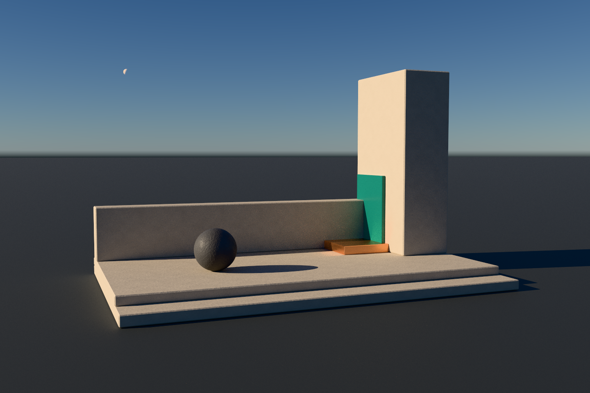
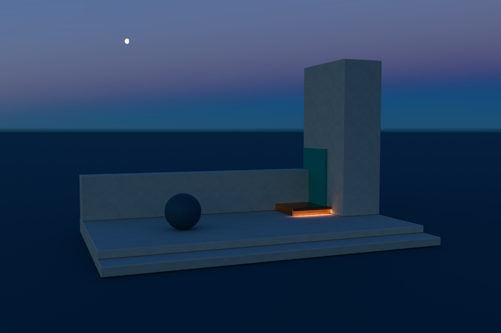

# Edit the lighting in Light Court

Open a small courtyard, rotate its Sun and watch the shadow move. Light Court
is a standalone authoring sample for the [desktop editor](../wiki/getting-started/install.md)
with [rendered World preview enabled](../development/editor-workspace.md#enable-the-rendered-authoring-surface).

The image is a 1440 × 960 [RT1 reference capture](../development/editor-workspace.md#reference-capture-of-the-viewport)
from the saved start view on macOS Metal. GPU compute traced 1,024 samples per
pixel to depth eight with seed 1. The PNG uses exposure 1 and Khronos PBR Neutral
with sRGB encoding. The editor build was `02313ecae`.

## Open the sample

1. Copy the [Light Court folder](../../examples/light-court/) to a writable
   location. Keep `art/`, `assets/`, and `authoring/` together. The project
   includes the imported meshes and material slots.
2. Open the copy's `ludus.project.json` from **File → Open Project**.
3. In **Project Explorer → Worlds**, open **light-court** for the default late-afternoon
   setup. The viewport opens at the saved perspective. If you navigated away,
   choose **View → Go to start view** in the viewport toolbar. Select **Lit** if
   the toolbar shows **Solid**.

The sample is an editor authoring project. Its CMake target lists the sample
data for tools that read the project.

## Read the lighting setup

The low three-quarter start view shows the two steps, the sphere's contact
shadow, and the copper plate below the enamel panel. The Sun sits
23 degrees above the horizon and lights the courtyard from the left. The linked
**Earth clear sky** Atmosphere supplies the cool sky light and warms the direct
sunlight. The linked **Moon** sits high in the left of the frame and contributes
very little direct light. Both lights use editable Transform rotations. See
[set up a clear-sky atmosphere](../development/editor-workspace.md#add-a-clear-sky-atmosphere)
for the Sun and Moon bindings.

## Inspect the materials

The [Light Court glTF](../../examples/light-court/art/light-court.gltf) contains
the original geometry and five metallic-roughness materials. In the World's
**Materials** tab, inspect the imported slots. Concrete, copper, enamel and
graphite ceramic use tangent-space normal and roughness maps.

- Warm concrete has fine mineral grain, small pores and slight variation in its
  base color. Its roughness stays near 0.86 so broad surfaces read as matte.
- Satin copper has fine brush marks running along the plate. Its metallic value
  is 1, and the roughness map varies around 0.34.
- Blue-green enamel has a slight orange-peel glaze with roughness around 0.22.
- The graphite ceramic sphere uses smooth vertex normals and fine grain to soften
  its highlight.

The mesh, materials and maps are original to Light Court and ship under the
[sample license](../../examples/light-court/art/LICENSE.txt). The catalog and
blobs under `assets/` are the Editor import of this source. See [inspect imported
materials](../development/editor-workspace.md#browse-a-worlds-material-resources) for how
to find the surfaces that use each slot.

## Rotate the Sun

The interactive viewport uses raster rendering so the shadow responds as you
edit. The [raster capture](images/light-court-raster.png) shows the same start
view at 1440 × 960 with the default editor graph on Metal and the grid hidden.
To capture bounce light and material reflections at the same camera, open
**Reference…** in the viewport toolbar and select **RT1 reference** as the **Source**.

1. Select **Sun** in the World hierarchy. In **Properties → Transform**, change
   **Rotation Y** from `-100` to `75` degrees. Watch the shadow swing and the
   warm light move to the other side of the courtyard as the viewport previews
   the draft.
2. Choose **Apply Changes**, then **Edit → Undo**. The Sun and shadow return to
   their starting positions.
3. Choose **Edit → Redo** and **File → Save**. Reopen the World and select **Sun**
   again. The saved **Rotation Y** is `75` degrees.

See the [World authoring guide](../development/editor-workspace.md#try-a-3d-authoring-workflow)
for camera controls, preview modes and save behavior.

## Compare late afternoon and blue hour

Open **light-court-blue-hour** in **Project Explorer → Worlds** to use the same
camera after sunset. The Sun sits 2.6 degrees below the horizon and the fuller
Moon sits higher in the frame. A warm strip concealed beneath the copper plate
lights the floor near the enamel. Switch the **Area light** in the World's
**Lights** list to see what it contributes. The source is the
[step light scene](../../examples/light-court/art/step-light.luscene.json).

| Late afternoon (default) | Blue hour |
| --- | --- |
|  |  |

Both RT1 frames use the same camera and sampling settings. The blue-hour PNG
uses a cooler sky tint and an exposure multiplier of 56 to keep the steps
readable in the dimmer light. In the viewport's **Exposure** menu, **Physical
camera** at EV100 −6.07 gives that multiplier with zero compensation. RT1
samples the light from the strip's surface. The default raster graph uses an
area-light approximation.
