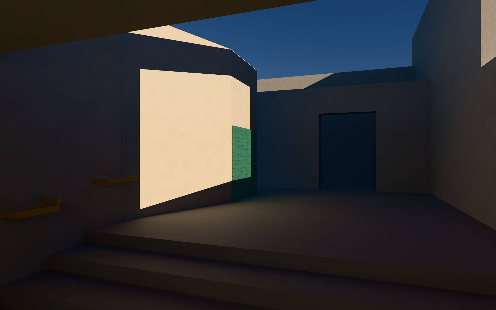
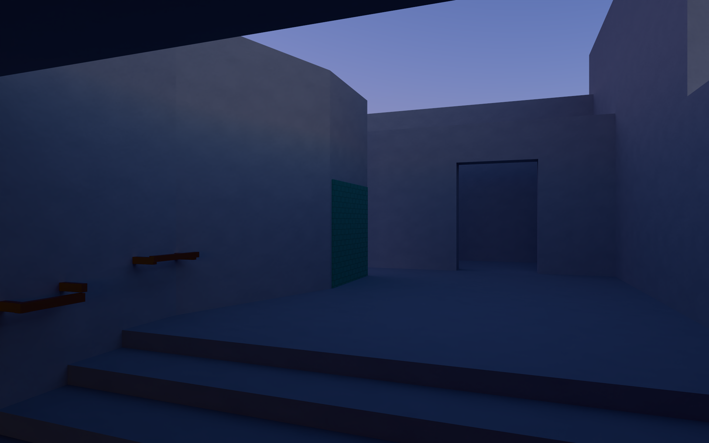
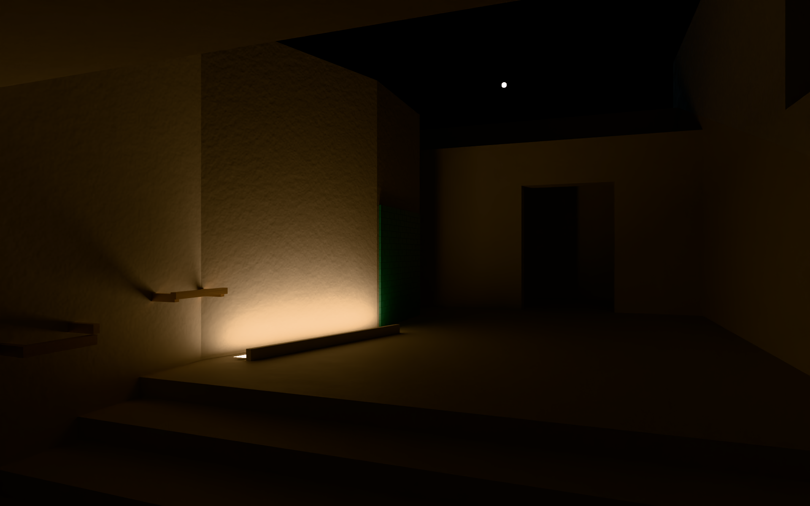

# Platform and rendering

<figure class="render-study-hero" markdown="1">
[{: width="1920" height="1200" }](../../assets/renderer/the-landing-daylight.webp)
<figcaption markdown="1">**The Landing · Daylight** — captured in Ludus with the RT1 reference renderer.</figcaption>
</figure>

## One view, three lighting setups

The camera and materials stay fixed across all three frames. Afternoon sun
catches the plaster and jade tile, blue-hour skylight defines the limestone
treads, and a concealed warm light picks out the bronze rail at night. Select a
frame to see it at full resolution.

<figure markdown="1">
[{: width="1920" height="1200" loading="lazy" }](../../assets/renderer/the-landing-daylight.webp)
<figcaption>Daylight</figcaption>
</figure>
<figure markdown="1">
[{: width="1920" height="1200" loading="lazy" }](../../assets/renderer/the-landing-blue-hour.webp)
<figcaption>Blue hour</figcaption>
</figure>
<figure markdown="1">
[{: width="1920" height="1200" loading="lazy" }](../../assets/renderer/the-landing-night.webp)
<figcaption>Night</figcaption>
</figure>

Ludus captured these 1920 × 1200 images with RT1 GPU compute on Metal. The
display images use Open Image Denoise and an exposure set for each lighting
setup. To capture your own scene, use
[Reference capture in the World viewport](../../development/editor-workspace.md#reference-capture-of-the-viewport).

## The Landing in motion

### Afternoon to blue hour

<figure class="render-study-hero" markdown="1">
<video controls playsinline preload="none" width="768" height="480" aria-label="The Landing from afternoon to blue hour" poster="../../engineering/assets/renderer/the-landing-time-lapse-poster.webp">
  <source src="../../engineering/assets/renderer/the-landing-time-lapse.mp4" type="video/mp4">
  <source src="../../engineering/assets/renderer/the-landing-time-lapse.webm" type="video/webm">
</video>
<figcaption markdown="1">**RT1 celestial time-lapse.** Sunlight climbs the folded wall and fades as the sky cools. [Download the silent time-lapse](../../assets/renderer/the-landing-time-lapse.mp4).</figcaption>
</figure>

### Aurora after dark

<figure class="render-study-hero" markdown="1">
<video controls playsinline preload="none" width="768" height="480" aria-label="Auroral curtains above The Landing" poster="../../engineering/assets/renderer/the-landing-aurora-poster.webp">
  <source src="../../engineering/assets/renderer/the-landing-aurora.mp4" type="video/mp4">
  <source src="../../engineering/assets/renderer/the-landing-aurora.webm" type="video/webm">
</video>
<figcaption markdown="1">**Clustered-deferred raster.** A green auroral curtain drifts above the amber-lit landing. [Download the silent aurora clip](../../assets/renderer/the-landing-aurora.mp4).</figcaption>
</figure>

## Rendering architecture

- [Main contract](../../architecture/rhi-gdi.md)
- [platform targets and compatibility](../guides/platform-targets.md)
- [RHI module guide](../../modules/graphics/rhi.md)
- [public rendering contract](../../development/fullscreen-rendering.md)
- [graphics debugging architecture and phased plan](../../architecture/graphics-debugging.md)
- [runtime UI design](../../architecture/ui.md)
- [renderer systems proposal](../../architecture/renderer-systems.md)
- [Render pipeline and pass resources](../../architecture/renderer-systems.md#render-pipeline-and-pass-resources)
- [Material system design](../../architecture/renderer-systems.md#material-system-design)
- [Large-world raster visibility](../../architecture/renderer-systems.md#large-world-raster-visibility)
- [Clear-sky atmosphere design](../../architecture/renderer-systems.md#clear-sky-atmosphere-design)
- [World environment and atmospheric transport](../../architecture/world-environment.md#atmospheric-transport-and-renderer-integration)
- [reference review](../../architecture/renderer-systems-gems-review.md)
- [L0 portable scene submission](../../architecture/renderer-systems.md#portable-scene-submission-l0)
- [terrain proposal](terrain.md)

For GPU previews, start with the [renderer texture/lease contract](../../architecture/renderer-systems.md#gpu-resident-progressive-preview) and the [installed-SDK acceptance](../../examples/reference-scene.md#gpu-preview-acceptance).
