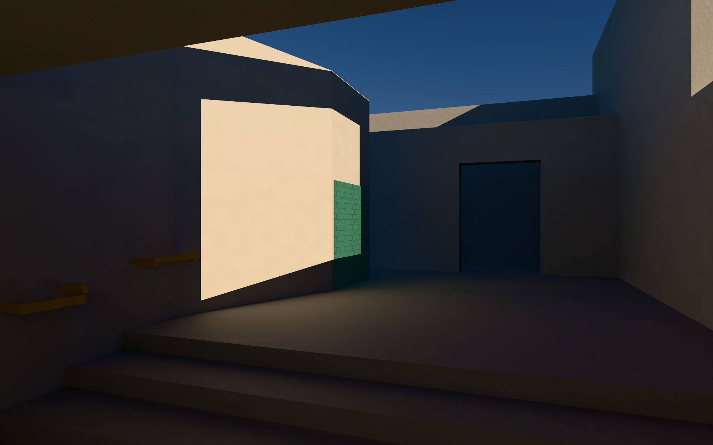
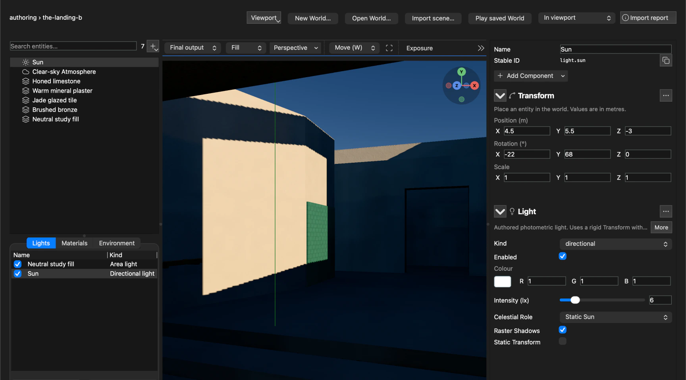

# Build your first world in Ludus

Ludus is a C++ game engine and editor. Open a World, move its light, and see
the change in the viewport.

[Install the editor](getting-started/install.md){ .md-button .md-button--primary }
[Try the browser preview](guides/browser-editor.md){ .md-button }

<figure class="render-study-hero" markdown="1">
[{: width="1920" height="1200" }](architecture/rendering.md)
<figcaption markdown="1">**The Landing · Daylight** — captured in Ludus with the RT1 reference renderer.</figcaption>
</figure>

## See Ludus in action

<figure class="render-study-hero" markdown="1">
[{: loading="lazy" }](../assets/renderer/the-landing-editor.webp)
<figcaption markdown="1">**The Landing in the World editor.** [Open the World editing guide](../development/editor-workspace.md#world-renderer-and-camera-preview).</figcaption>
</figure>

<figure class="render-study-hero" markdown="1">
<video controls playsinline preload="none" width="768" height="480" aria-label="The Landing from afternoon to blue hour" poster="engineering/assets/renderer/the-landing-time-lapse-poster.webp">
  <source src="engineering/assets/renderer/the-landing-time-lapse.mp4" type="video/mp4">
  <source src="engineering/assets/renderer/the-landing-time-lapse.webm" type="video/webm">
</video>
<figcaption markdown="1">**Afternoon to blue hour.** Sunlight climbs the folded wall and fades as the sky cools. [Download the silent RT1 time-lapse](../assets/renderer/the-landing-time-lapse.mp4).</figcaption>
</figure>

[See all three lighting setups and the aurora clip](architecture/rendering.md).

## Find your next step

- **Make your first project**

    Choose a name and location. Let Ludus prepare and verify the engine setup.

    [Create a project →](getting-started/first-project.md)

- **Render and change your first scene**

    Open the Cornell box, then change a material, move a block and adjust lighting.
    Follow screenshots and visible checkpoints at each step.

    [First rendered scene →](../examples/cornell-box.md)

- **Find a workflow**

    Build, run, debug, repair setup, or package a game with explicit steps.

    [Build and debug →](guides/build-and-debug.md)

- **Learn the reasoning**

    Explore engine boundaries, terminology and a focused reference reading path.

    [How Ludus fits together →](learn/architecture.md)

- **Explore engine architecture**

    Follow module ownership, startup, rendering, simulation and runtime boundaries.

    [Engine architecture map →](architecture/index.md)

- **Look up a C++ API**

    Browse public declarations, signatures and caller contracts generated from headers.

    [Public SDK API reference →](reference/index.md)

## What to expect

Ludus is an actively developed C++23 engine and toolset with native desktop
editor paths on Linux, macOS and Windows. The editor can build and run projects,
edit Worlds in a 3D viewport, and author audio and configuration. See
[platform targets](guides/platform-targets.md) for build and validation coverage
and [current capabilities](getting-started/status.md) for available workflows.

## Find an answer quickly

Use **Search** for a command, error or concept. Every guide has a local table of
contents and links to the underlying source or detailed engineering document.
Start with [troubleshooting](guides/troubleshooting.md) when setup or a build fails.

This wiki follows the repository's `main` branch. When working with an older
checkout or SDK, use the documentation at that revision and its command help.

[Improve a page](../development/wiki.md) · [Browse source](https://github.com/The-Ludus-Project/Ludus)
· [Report an issue](https://github.com/The-Ludus-Project/Ludus/issues)
